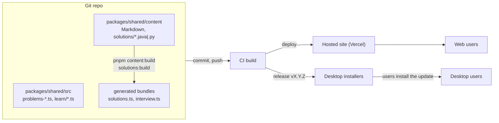
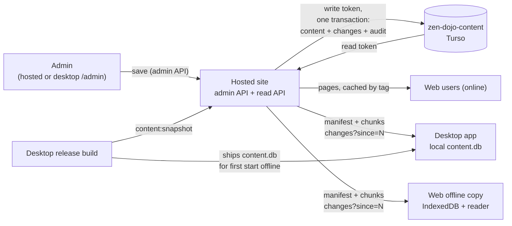
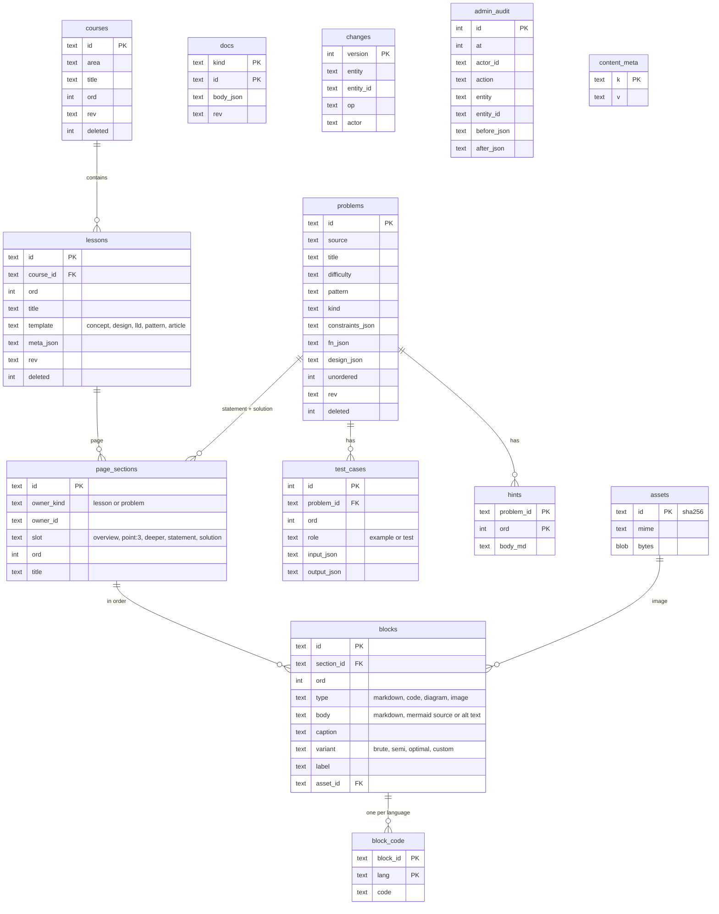
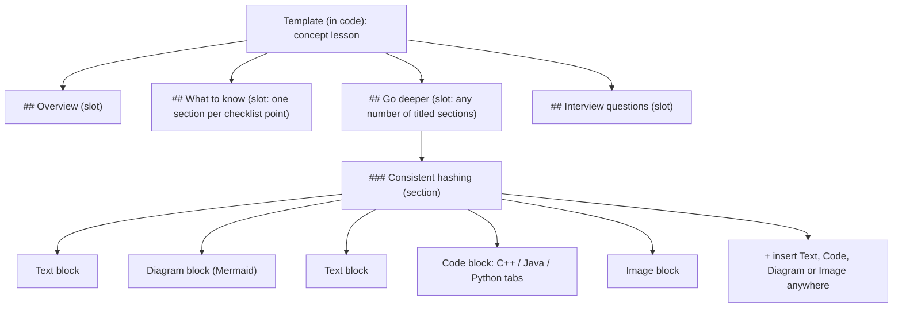
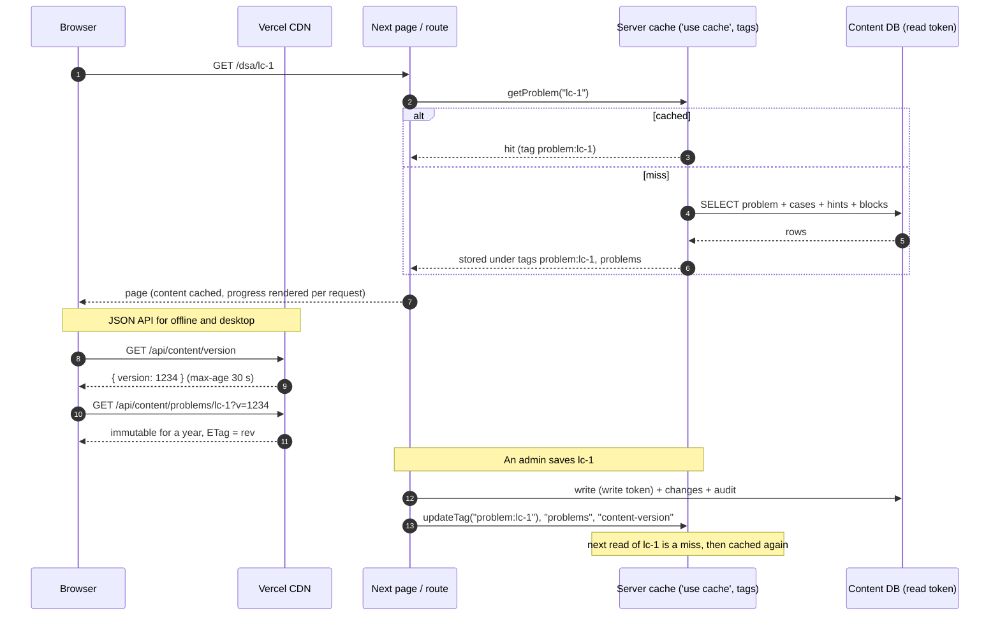
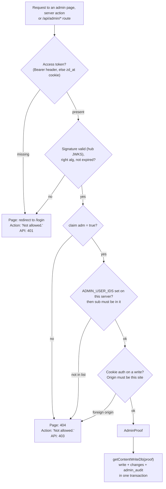
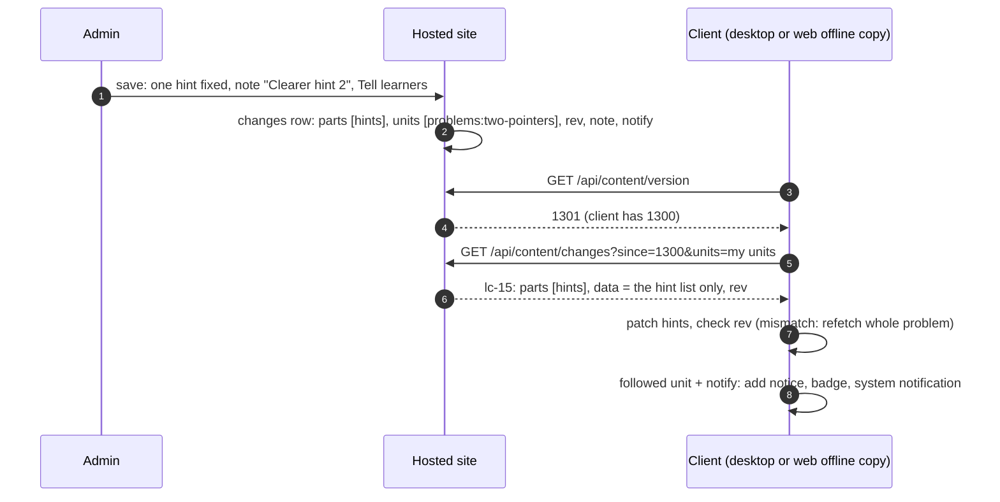
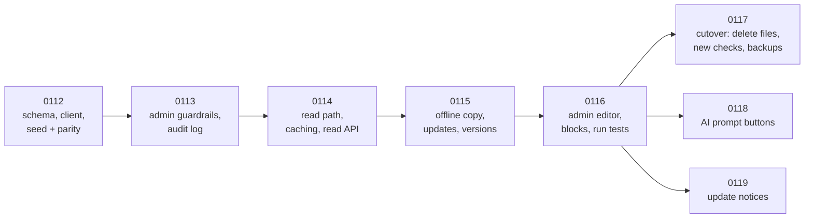

# Content in the database: architecture overview

Planned 2026-11-23. Plans: [0112](../plans/0112-content-db-schema-and-seed.md),
[0113](../plans/0113-admin-guardrails-and-audit-log.md), [0114](../plans/0114-content-read-path-and-caching.md),
[0115](../plans/0115-offline-content-download-and-updates.md), [0116](../plans/0116-admin-content-editor.md),
[0117](../plans/0117-content-cutover-delete-repo-files.md),
[0118](../plans/0118-admin-ai-prompt-buttons.md), [0119](../plans/0119-content-update-notifications.md).

## Why

Today every lesson, problem, test case, hint and solution is a file in `packages/shared/` (about 20 MB of TypeScript,
Markdown and generated bundles). Fixing one hint needs a commit, a push and a desktop release. After this work, content
lives in one shared database. An admin edits it in the app, the hosted site shows the change at once, and desktop and
offline web copies pull it in the background.

## Decisions

| Question | Decision |
|---|---|
| Where is the one true copy? | A new shared Turso database `zen-dojo-content`. The hosted site reads it directly. |
| Desktop and offline web | Keep a downloaded copy (desktop: local `content.db`; web: IndexedDB) and pull changes. |
| Where can admins edit? | On the hosted site and in the desktop app. Both save through the hosted admin API. Running tests before saving works on desktop only (the hosted site never runs code). |
| Who is an admin? | Only GitHub ids in `ADMIN_USER_IDS`, set by the owner in Vercel. No API, profile field or action can grant it. |
| The repo files | Deleted after cutover (0117). The repo keeps a small test fixture. Releases download the real snapshot. |
| Stress tests | Stay in code (they are generator functions), keyed by problem id. |
| User data | Unchanged: per-user databases, sync and backups do not change. Content is a separate database. |

## 1. Current and new data flow

Today:

New:

## 2. Database schema

The content database is separate from user data. It has its own migrations and is not part of backups of `habit.db`.

- A problem or lesson with its sections, blocks, code (and for problems, test cases and hints) is **one entity**: one
  `rev`, one `changes` row per save, one cache tag (`problem:<id>`, `lesson:<id>`).
- Every page a learner reads (concept lessons, design walkthroughs, LLD answers, pattern guides, articles) is a lesson.
  `docs` keeps only list data (reading list, revise deck, key numbers, thinking map).
- `content_version` (in `content_meta`) is the latest `changes.version`. Clients compare it to know if they are behind.

### Page format: templates, slots, sections, blocks

The format of a page (which heading comes where, and what sits under it) is kept by a **template** in code. The
template lists the page's **slots** in order with their headings, which are required, which repeat, and which block
types they allow. Inside a slot are **sections** (one per `###` heading), and inside a section are **blocks** in any
order: Markdown text, code (one or more languages as tabs, with a label such as Brute force or Optimal), Mermaid
diagrams with a caption, and images. The renderer walks the template, so headings are always in the right place, while
the admin can put any mix of text, code, diagrams and images inside each section.

The admin editor shows the same page two ways, switchable at any time: a **blocks view** (a + bar between any two
blocks to insert Text, Code, Diagram or Image; move, duplicate, remove; live diagram preview) and a **Markdown view**
(the whole page as one document, close to today's `docs/content-editing.md` format, with fences for code and diagrams,
`{block=… variant=… label=…}` to group languages into one code block, and `` for images).

## 3. Reading a page: caching and invalidation

| Layer | What | How it is invalidated |
|---|---|---|
| Server cache | `'use cache: remote'` functions in `lib/content-repo/` with `cacheLife('max')` | `updateTag` in admin actions, `revalidateTag(tag, { expire: 0 })` in routes and after desktop syncs |
| HTTP / CDN | `/api/content/*?v=<version>` responses, `immutable` | Never needed: a new version is a new URL. Only `/api/content/version` is short-lived (30 s) |
| Browser | `ETag` + `If-None-Match` → 304 | `rev` changes when the entity changes |
| Desktop | Same server cache in one long-lived process | Local sync route expires the tags of every applied change |

## 4. Admin check on every request

How someone becomes an admin: the owner adds their id (`gh:<github id>`) to `ADMIN_USER_IDS` in the Vercel project
and redeploys. The hub reads that list when it signs a token (`packages/sync-worker/src/auth/sessions.ts`). There is
no admin column in any table, profile updates keep only whitelisted fields, and token payloads are signed, so no
request can grant admin. A static test (`app/admin/guard.test.ts`) fails the build if any admin action, route or page
skips the check.

Tests that prove a non-admin is rejected (plan 0113 step 8): anonymous, bad signature, `alg: none`, payload with
`adm: true` swapped in, expired token, valid non-admin, admin not in the list, cross-origin cookie write; each action
and route returns "Not allowed." / 401 / 403 and writes no content and no audit row; a profile update with
`admin: true` does not change the next token.

## 5. Offline copy, part-level updates and notices

- **What a user downloads:** desktop keeps everything. On the web the user picks **units** in Settings: a course (its
  lessons and images) or the problems of one DSA pattern, or everything.
- **What an update downloads:** each save records which **parts** changed (`meta`, `cases`, `hints`,
  `section:<id>`, `section-order:<slot>`, `asset:<id>`, or `all` for create/delete). The changes endpoint sends only
  those parts, and only for the units the client follows. Fixing one hint downloads that hint list, nothing else.
- **Safety:** each change carries the entity's new `rev`; if the patched copy does not match, the client refetches
  that one entity. Applies are all-or-nothing. A client too far behind (410) downloads its units again.
- **Notices:** the admin writes a one-line note and ticks **Tell learners**. After a sync, a device turns those changes
  into notices only for units it follows (web: downloaded; desktop: started or followed, minus muted): a bell badge,
  a What's new page linking to the changed section, and one system notification (desktop always if enabled; browser
  only while it is running and the user allowed it). A device that was offline is told when it comes back online.

Versioning rules:

1. `content_version` goes up with every save. Versioned URLs make full downloads cacheable forever.
2. `CONTENT_SCHEMA_VERSION` goes up only when table shapes change. An older app never applies newer-shape data.
3. Changes are kept 90 days (at least 5,000 rows); further behind means downloading the followed units again.
4. Every apply is all-or-nothing, and the `rev` check catches a wrong patch.
5. **Full resync, rare:** the server also reports a `content_epoch`. The owner bumps it with `pnpm content:resync` after a
   restore or repair (imports bump it too). A device that sees a new epoch, or a server version lower than its own,
   throws its copy away and downloads everything again, and shows "Content was refreshed".
6. **One source:** every copy (installer, desktop, web offline, developer machine) is downloaded from the hosted
   content database. The repo files are read once, to fill that database the first time.

## Writing content with AI

Every admin edit field (statement, test cases, hints, solution page, one code, text or diagram block, a section, a whole
lesson, a course summary) has an **AI** button (plan 0118). It copies a prompt with the surrounding content, the house
rules for that kind of content and the exact answer format (numbered list for hints, JSON for test cases, one fence for
code with the judge's signature, page Markdown for sections). The admin pastes the answer back; it is parsed, validated
like a save and shown as a diff; **Use this** puts it in the draft, and nothing is saved until Save.

## 6. Plan order

Each plan ships something that works on its own: 0112 changes nothing visible, 0113 makes the admin portal safe on
the hosted site, 0114 switches reading, 0115 makes desktop and offline web self-updating, 0116 gives the editor, 0117
removes the old path.

## Long lists and caching, in short

- The DSA list still shows all ~500 problems on one page, no pagination (the app's rule: one scroll area with
  `content-visibility: auto`). The list query reads only summary columns (about 100 KB), never statements or code, and
  it is cached.
- Caching uses what Next 16 and Vercel already provide: `'use cache'` / `'use cache: remote'` with `cacheTag`, cleared by
  `updateTag` / `revalidateTag` when an admin saves; the Vercel CDN and the browser for versioned JSON URLs and images.
  No Redis or other cache service. On desktop the same cache lives in the app's own memory.

## What happens to today's tools

| Today | After |
|---|---|
| `pnpm content:build` / `content:check` (Markdown → TS) | Removed. Lessons are edited in `/admin`. |
| `pnpm content:add/list/remove/export/sync/seed`, `CONTENT_ADMIN_TOKEN` | Removed. Admin editor; owner-only `content:import`; `content:snapshot` / `content:pull` for copies. |
| `pnpm solutions:build`, `interview:*` | Removed (no bundles). |
| `pnpm solutions:verify` | `pnpm content:verify-solutions` (desktop; reads code from the DB). |
| `learn/learn.test.ts` and other coverage tests | Rules move to `content-model/verify.ts`; run on every admin save and by `pnpm content:verify` (also in the release workflow). Unit tests use a small fixture. |
| Content packs | User-installed packs unchanged. Admins can also import a pack into the shared content. |
| `pnpm test` (~4 min, compiles every solution) | Fixture-based and much faster; full solution runs move to `content:verify-solutions`. |

## Risks to watch

- **Build needs content:** cached content functions can run during `next build`. CI and fresh clones use the fixture;
  Vercel builds read the real DB (0114 step 6b).
- **Turso limits:** the content DB is one more database (about 97 user databases left on the free plan). Content reads
  are mostly served from cache; writes are rare.
- **`'use cache: remote'` on Vercel** must be checked on the first deploy (hit rate, cost). Plain `'use cache'` is the
  fallback.
- **Vercel response size:** snapshot chunks stay under 4 MB each.
- **One-way door:** files are deleted only after parity, a frozen snapshot and one desktop release that updates
  content on its own (0117).
