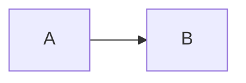

# Editing lessons and other content

For anyone (a person, Antigravity, a cheaper model) who has never seen this repo. Read this page, then fix the thing.
The prompt to give an agent: **"Read docs/content-editing.md, then fix <problem> in <file>."**

## Where content lives

| Kind | Where | Format |
|---|---|---|
| Concept lessons that are migrated (LLD now; the rest later) | `packages/shared/content/<area>/<concept-id>.md` | Markdown, described below. **Edit these.** |
| Concept lessons not yet migrated (system design, core CS) | `packages/shared/src/learn/` (`sd*.ts`, `core.ts`, `deep-*.ts`, `more-*.ts`) | TypeScript template literals |
| Checklists (the "What to know" points), concept ids, exercises | `packages/shared/src/study.ts` | TypeScript |
| Where each section of an unmigrated lesson sits | `packages/shared/src/learn/section-points.ts` | concept id, section title, point number |
| System design walkthroughs, LLD projects, DSA articles | `packages/shared/src/learn/designs-*.ts`, `lld-projects-*.ts`, `dsa-articles-*.ts` | TypeScript (see HANDOFF.md) |
| Added lessons and problems without code | `docs/content-packs.md` | JSON |

A concept id exists in `study.ts`. A Markdown lesson with the same id replaces the TypeScript lesson of that id.

## The Markdown format

One file per concept: `packages/shared/content/<area>/<concept-id>.md` (area is `sd`, `lld` or `core`; the file name is the id).

````markdown
---
id: lld-solid
title: SOLID
area: lld
section: Topics
---

## Overview

Two to four sentences: what this is and what an interviewer wants to hear.

## What to know

1. Single responsibility :: A class should have one reason to change. A second paragraph is fine, after a blank line.

2. Open/closed :: Add behaviour by adding code, not by editing working code.

## Recap

- One line worth remembering the night before.

## Go deeper

### Single responsibility in practice {point: 0}

Plain text. Blank line = new paragraph. No `##` or `###` at the start of a line in the text.


Diagram caption: optional one line right after the diagram

```java
class Invoice { }
```

### Closing remarks

A section without {point} goes after all the pointed ones.

## Interview questions

- A question to answer out loud.

## Common mistakes

- A gotcha.
````

Rules:

- The headings are fixed: `## Overview`, `## What to know`, `## Recap` (optional), `## Go deeper` (optional),
  `## Interview questions`, `## Common mistakes` (optional). Nothing else at `##` level.
- **What to know** is a numbered list, `N. checklist point :: explanation`. The point text must be exactly the text in
  `study.ts` and there must be one item per point (a test checks this).
- Each `###` section under Go deeper: prose first, then at most one ```` ```mermaid ```` block (a diagram), then at most one
  code block. No prose after a block. Titles are unique within a lesson, in sentence case.
- `{point: N}` after a `###` title says which checklist point (0-based) the section is about. Sections are shown in order of
  point, then file order. A fraction (`{point: 1.5}`) puts a section between two points. No `{point}` means "after all".
- Lists (`-`) hold one item each; a continuation line indented by spaces joins the item above.
- Write plainly: short sentences, no hype, no emoji. Do not copy text from books.

## How to change a lesson safely

1. Edit the `.md` file. For a typo, change the text and nothing else.
2. `pnpm.cmd content:build` (turns the `.md` files into `packages/shared/src/learn/generated/lessons.ts`).
   `pnpm.cmd content:check` only validates; both print the file, the line, what is wrong and how to fix it.
3. `pnpm.cmd exec vitest run packages/shared` while working, then `pnpm.cmd check` before saying you are done.
4. Commit the `.md` file **and** the regenerated `generated/lessons.ts` together.

### Reorder sections

Change the `{point: N}` numbers (or the numbers in a fraction) and run `pnpm.cmd content:build`. For a lesson that is still
TypeScript, change the number next to its section title in `learn/section-points.ts`. The audit test
(`learn/order-audit.test.ts`) fails if a section's title in `section-points.ts` no longer exists or the order is wrong.

### Add a lesson

1. Add the concept to `study.ts` (id, title, checklist points) if it does not exist.
2. Create `packages/shared/content/<area>/<id>.md` as above, one explanation per point.
3. `pnpm.cmd content:build`, then `pnpm.cmd check`.

### Rename a section title

In a `.md` file just edit the heading (links to it use the title, so they change with it). In an unmigrated lesson, change
the title in the TypeScript file **and** the same title in `section-points.ts`.

## What not to touch

- `packages/shared/src/learn/generated/lessons.ts`: generated. Never edit by hand; a test fails if it is out of date.
- Concept ids and checklist text in `study.ts`, unless you are adding a concept: ids are stored in people's progress data,
  and the Markdown must be changed to match any text you change.
- Never `data/habit.db` or the desktop app-data folder.

## Moving an old TypeScript lesson to Markdown

`MIGRATE=<area or concept id> pnpm.cmd exec vitest run packages/shared/src/learn/generated/migrate.test.ts` writes the
`.md` files from the current TypeScript lessons (overwriting existing files). Then `pnpm.cmd content:build`. The round-trip
test (`generated/lesson-md.test.ts`) proves every lesson survives TypeScript -> Markdown -> parse unchanged.
