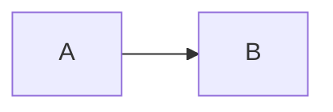

# Editing lessons and other content

For anyone (a person, Antigravity, a cheaper model) who has never seen this repo. Read this page, then fix the thing.
The prompt to give an agent: **"Read docs/content-editing.md, then fix <problem> in <file>."**

## Where content lives

| Kind | Where | Format |
|---|---|---|
| Concept lessons (system design, LLD, core CS) | `packages/shared/content/<area>/<concept-id>.md` | Markdown, described below. **Edit these.** |
| Checklists (the "What to know" points), concept ids, exercises | `packages/shared/src/study.ts` | TypeScript |
| System design walkthroughs, LLD projects, DSA articles | `packages/shared/src/learn/designs-*.ts`, `lld-projects-*.ts`, `dsa-articles-*.ts` | TypeScript (see HANDOFF.md) |
| Added lessons and problems without code | `docs/content-packs.md` | JSON |
| Java and Python reference solutions of the built-in problems | `packages/shared/content/solutions/<problem-id>.java` / `.py`; guide: `docs/solutions.md` | plain code files |

A concept id exists in `study.ts`; every concept has exactly one Markdown lesson.

## The Markdown format

One file per concept: `packages/shared/content/<area>/<concept-id>.md` (area is `sd`, `lld` or `core`; the file name is the id).

````markdown
---
id: lld-solid
title: SOLID
area: lld
section: Topics
---

## Overview

Two to four sentences: what this is and what an interviewer wants to hear.

## What to know

1. Single responsibility :: A class should have one reason to change. A second paragraph is fine, after a blank line.

2. Open/closed :: Add behaviour by adding code, not by editing working code.

## Recap

- One line worth remembering the night before.

## Go deeper

### Single responsibility in practice {point: 0}

Plain text. Blank line = new paragraph. No `##` or `###` at the start of a line in the text.


Diagram caption: optional one line right after the diagram

```java
class Invoice { }
```

### Closing remarks

A section without {point} goes after all the pointed ones.

## Interview questions

- A question to answer out loud.

## Common mistakes

- A gotcha.
````

Rules:

- The headings are fixed: `## Overview`, `## What to know`, `## Recap` (optional), `## Go deeper` (optional),
  `## Interview questions`, `## Common mistakes` (optional). Nothing else at `##` level.
- **What to know** is a numbered list, `N. checklist point :: explanation`. The point text must be exactly the text in
  `study.ts` and there must be one item per point (a test checks this).
- Each `###` section under Go deeper: prose first, then at most one ```` ```mermaid ```` block (a diagram), then at most one
  code block. No prose after a block. Titles are unique within a lesson, in sentence case.
- `{point: N}` after a `###` title says which checklist point (0-based) the section is about. Sections are shown in order of
  point, then file order. A fraction (`{point: 1.5}`) puts a section between two points. No `{point}` means "after all".
- Lists (`-`) hold one item each; a continuation line indented by spaces joins the item above.
- Write plainly: short sentences, no hype, no emoji. Do not copy text from books.

## How to change a lesson safely

1. Edit the `.md` file. For a typo, change the text and nothing else.
2. `pnpm.cmd content:build` (turns the `.md` files into `packages/shared/src/learn/generated/lessons.ts`).
   `pnpm.cmd content:check` only validates; both print the file, the line, what is wrong and how to fix it.
3. `pnpm.cmd exec vitest run packages/shared` while working, then `pnpm.cmd check` before saying you are done.
4. Commit the `.md` file **and** the regenerated `generated/lessons.ts` together.

### Reorder sections

Change the `{point: N}` numbers (or the numbers in a fraction) and run `pnpm.cmd content:build`. The audit test (`learn/order-audit.test.ts`) fails if a point is out of range or the order is wrong.

### Add a lesson

1. Add the concept to `study.ts` (id, title, checklist points) if it does not exist.
2. Create `packages/shared/content/<area>/<id>.md` as above, one explanation per point.
3. `pnpm.cmd content:build`, then `pnpm.cmd check`.

### Rename a section title

Edit the heading in the `.md` file (links to it use the title, so they change with it).

## What not to touch

- `packages/shared/src/learn/generated/lessons.ts`: generated. Never edit by hand; a test fails if it is out of date.
- Concept ids and checklist text in `study.ts`, unless you are adding a concept: ids are stored in people's progress data,
  and the Markdown must be changed to match any text you change.
- Never `data/habit.db` or the desktop app-data folder.

## Add one thing (no code, no release)

You can add one problem, extra test cases for a problem, a lesson, a lesson replacement or a reading link without touching the code.
Each is one small JSON file. A complete example of each is in `docs/examples/`.

**Prompt for any agent:** "Read docs/content-editing.md, then add <the thing> using pnpm content:add."

| What | Example file | `type` | Where it shows up |
|---|---|---|---|
| A new problem you can run | `docs/examples/one-problem.json` | `problem` | the /dsa list (tab "Other solves", under the heading in `group`, default "Added by you"), the pattern pages named in `patterns`, and Learn (course "Added items"). Opens in the same Run / Notes workspace; id `pack:items:<id>` |
| More test cases for any problem | `docs/examples/extra-tests.json` | `tests` | appended to that problem's tests when it runs |
| A lesson | `docs/examples/one-lesson.json` | `lesson` | Learn, course "Added items" |
| A replacement for a built-in lesson | (a `patch`, see `docs/content-packs.md`) | `patch` | the lesson of that concept, with a "Back to built-in" button |
| A reading link | `docs/examples/one-reading.json` | `reading` | stored and listed (`pnpm content:list`) |

`problem`, `lesson` and `patch` use exactly the item formats of `docs/content-packs.md` (the field `section` is not needed). A `problem` may also have `"group": "Warm-ups"` (the heading it is listed under in /dsa) and `"patterns": ["hash-map"]` (roadmap pattern ids, up to 5; the problem is then also listed on those pattern pages).
`tests` is new: `{ "type": "tests", "problem": "lc-1", "cases": [ { "input": [[3, 3], 6] } ] }`. `input` is a list with one value per
parameter. **`output` is optional**: when it is missing, `content:add` computes it by running the problem's own C++ reference solution
(needs g++). `reading` is `{ "type": "reading", "id": "...", "title": "...", "url": "https://..." }` with optional `area` and `note`.

### Commands

```
pnpm content:add docs/examples/one-problem.json      add one item, or a JSON list of items
pnpm content:sync my-content                          add or update every *.json in a folder (unchanged files are skipped)
pnpm content:sync my-content --prune                  also remove items that came from that folder and whose file is gone
pnpm content:list                                     what is stored
pnpm content:remove problem:count-vowels              remove one item (built-in content comes back by itself)
pnpm content:export all-items.json                    write every stored item to one file
pnpm content:seed                                     optional: copy every built-in problem into the database
```

Item ids are `<type>:<id>`, for example `problem:count-vowels`, `tests:lc-1`, `lesson:two-pointers-in-one-minute`.
Adding a file with the same id replaces the item. The change shows after a page reload: no restart, no build.

Where it writes: without options, straight into this computer's database (`DATABASE_URL`, default `data/habit.db`; for the real
`data/habit.db` the command asks for `--yes`, and the app should be closed). To use a running or hosted app instead, give its address
and its admin token: `pnpm content:add file.json --url https://my-site.example --token <CONTENT_ADMIN_TOKEN>`. The app only offers
this when the environment variable `CONTENT_ADMIN_TOKEN` is set (otherwise `/api/admin/content` answers 404).

### Rules the checker enforces (so you can write the file without running anything)

- Messages name the field that is wrong, for example `cases[0].input has 1 values but lc-1 takes 2`. Fix that field and run it again.
- A `problem` needs `title`, `statement`, `constraints`, `fn`, at least one example and tests whose values match the types in `fn`.
- Stored content is added on top of the built-in content. Built-in problems and lessons are never changed; removing an item restores them.
- Stored items are kept in the table `content_items`, apart from your progress, and are part of the backup.
