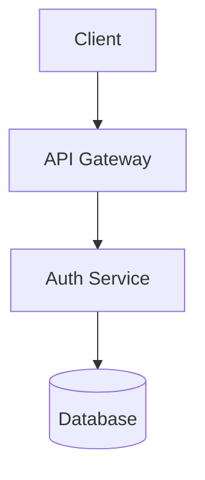

# Content packs: add lessons and problems without changing the code

> To add just one problem, one lesson or extra test cases without a whole pack, see `docs/content-editing.md`, section "Add one thing" (`pnpm content:add`).

A **content pack** is one JSON file. Import it in **Profile → Settings → Content** (paste it, choose the file, or give a
web address) and it becomes a course in **Learn**, or inserts its content into an existing study area. Its problems open
in the same editor with the Run button, and finishing items tracks progress. Installing a pack with the same `id` again
updates it and keeps your progress on items that still exist. Remove a pack from its course page or settings. Packs are
stored in your database, so they are part of backups.

Try the example first: `docs/examples/sample-pack.json`.

## Format (version 1 and 2)

Packs use format `zendojo-pack` (the older `prepwise-pack` is also accepted for backwards compatibility).
- **Version 1:** Creates a standalone course card under Learn.
- **Version 2:** Adds `revision`, `target` to put content into built-in study areas, built-in lesson `patch` overrides,
  `tags`/`source` on problems, and Mermaid diagram support in lessons.

```json
{
  "format": "zendojo-pack",
  "version": 2,
  "revision": "1.2.0",
  "id": "my-graph-course",
  "title": "Graph problems",
  "description": "One or two sentences shown on the course card.",
  "target": {
    "area": "lld",
    "section": "SOLID"
  },
  "sections": [
    {
      "title": "Basics",
      "items": [
        { "type": "lesson", "id": "bfs", "title": "Breadth-first search", "markdown": "..." },
        { "type": "problem", "id": "shortest-path", "title": "...", "...": "see below" },
        {
          "type": "patch",
          "concept": "lld-solid",
          "replace": {
            "overview": "...",
            "explain": ["..."],
            "questions": ["..."],
            "pitfalls": ["..."]
          }
        }
      ]
    }
  ]
}
```

- `id` (pack and every item): lowercase letters, digits and hyphens, up to 40 characters. Item ids must be different within a pack.
- `revision` (optional, v2): A version string such as `"1.2.0"`, used by content feeds to check for updates.
- `target` (optional, v2): Inserts items into a built-in study area (`"sd"`, `"lld"`, or `"core"`) under the specified `section` heading instead of creating a separate course card.
- Items appear in the order written. A section is a heading in the course page.

### Lesson

| field | meaning |
|---|---|
| `type` | `"lesson"` |
| `id`, `title` | Lowercase slug `id` and descriptive title |
| `markdown` | The text. Supported: paragraphs, `##` and `###` headings, `-` or `1.` lists, fenced code blocks (` ```cpp `), Mermaid diagrams (` ```mermaid `), `**bold**`, `` `code` ``. Raw HTML is shown as text. |

#### Mermaid diagrams in lessons

Lessons support embedded Mermaid diagrams using ` ```mermaid ` code fences:

````markdown
Here is the system architecture:


````

Supported diagram types include `flowchart`, `graph`, `sequenceDiagram`, `classDiagram`, `stateDiagram-v2`, and `erDiagram`. Diagrams are validated at install time and rendered using the lazy-loaded diagram viewer.

### Patch (overriding built-in lessons)

A pack can update or correct any built-in concept lesson without requiring a new app release:

```json
{
  "type": "patch",
  "concept": "lld-solid",
  "replace": {
    "overview": "Overview text summarizing the concept.",
    "explain": [
      "Explanation for checklist point 1...",
      "Explanation for checklist point 2..."
    ],
    "questions": [
      "Interview question 1 to practice out loud?",
      "Interview question 2?"
    ],
    "pitfalls": [
      "Common gotcha or anti-pattern to avoid."
    ]
  }
}
```

- `concept`: Must match a built-in concept ID (e.g. `lld-solid`, `sd-cap`, `core-processes`).
- Stored patch overrides automatically take precedence over the built-in lesson.
- In **Profile → Settings → Content**, any active patch can be reset back to the built-in lesson with one click ("Back to the built-in lesson"), and restored at any time. Removing the pack restores the built-in lesson.

### Problem

| field | meaning |
|---|---|
| `type` | `"problem"` |
| `title`, `difficulty` | `difficulty` is optional: `easy`, `medium`, `hard` |
| `statement` | List of paragraphs (plain text) |
| `constraints` | List of lines |
| `fn` | The function the learner writes: `{ "name": "lowerBound", "params": [{ "name": "nums", "type": "int[]" }, ...], "returns": "int" }` |
| `examples` | Shown with the statement and run first: `{ "input": [...], "output": ..., "explanation": "optional" }`. `input` has one value per parameter, in order. |
| `tests` | More cases of the same shape, run after the examples. Include edge cases: empty, one element, duplicates, extremes. |
| `hints` | Smallest nudge first |
| `solution` | Optional: `{ "idea": ["..."], "complexity": "O(n)", "cpp": "full reference code" }` |
| `tags` | Optional list of labels (e.g. `["binary-search", "arrays"]`) |
| `source`, `sourceUrl` | Optional human-readable attribution and web link |
| `unordered` | Optional `true` when any order of the returned list is correct |
| `url` | Optional link to the original problem (`http(s)` only) |

**Types** for parameters and the return value: `int`, `long`, `double`, `bool`, `string`, `int[]`, `long[]`, `bool[]`,
`string[]`, `int[][]`, `string[][]`, plus `list` (a linked list, written as `[1,2,3]`) and `tree` (a binary tree written level
by level like LeetCode, `[1,null,2,3]`). Values in `input` and `output` are plain JSON of that type. The app checks every
case against the declared types and tells you what is wrong.

## Content feed & over-the-air updates

A **content feed** is a JSON file listing available and updated packs:

```json
{
  "format": "zendojo-feed",
  "version": 1,
  "packs": [
    {
      "id": "lld-case-studies",
      "title": "Low-Level Design Case Studies",
      "version": "1.2.0",
      "url": "https://raw.githubusercontent.com/user/packs/main/lld.json",
      "sha256": "e3b0c44298fc1c149afbf4c8996fb92427ae41e4649b934ca495991b7852b855",
      "description": "10 real-world object-oriented design problems with solutions."
    }
  ]
}
```

In **Profile → Settings → Content**:
1. Enter your feed address in **Content feed address** and click **Save**.
2. Click **Check for updates**. The app fetches the feed, compares revisions with your installed packs, and categorises each pack as **Available**, **Update**, or **Installed**.
3. Click **Install** or **Update** on any pack. The app downloads the pack, verifies its SHA-256 hash (if provided), validates it, and updates your content while keeping all your existing progress.

## Check and build tools

- `pnpm pack:check <file>`: Validates any pack file with the same strict validator the app uses and prints clear diagnostics.
- `pnpm pack:build <draft.json> -o <pack.json>`: Builds problem test outputs automatically by compiling and executing a reference C++ solution (`solution.cpp`).
- `pnpm pack:build --verify <pack.json>`: Re-runs solution code against every test case in an existing pack to verify expected answers.

## Giving this to another AI (scraping and converting)

Copy the prompt below, add your source (a URL, pasted text, or a PDF's text) and the file `docs/examples/sample-pack.json` as the example,
and ask for one JSON file. Then use **Check only** in Settings, which lists every problem in plain words, and fix with the same AI.

```
You are converting learning material into a Zen Dojo content pack (JSON, format "zendojo-pack", version 2).
Follow the example file exactly. Rules:
- Write everything in your own words. Do not copy long passages from the source; summarise and credit the source in the pack description.
- Use sections for topics. Lessons are Markdown (headings, short paragraphs, lists, fenced code, mermaid diagrams).
- For each coding problem give: statement (list of paragraphs), constraints, fn (name, params with types, returns), 2-3 examples,
  at least 6 tests with edge cases, 3 hints from smallest to biggest, and a solution with idea, complexity and a correct C++ class
  named Solution. Allowed types: int, long, double, bool, string, int[], long[], bool[], string[], int[][], string[][], list, tree.
- Compute every "output" by running the reference solution mentally or in code. A wrong expected output makes the problem unfair.
- ids are lowercase letters, digits and hyphens and must be unique in the pack.
- Output only the JSON.
```

## Limits & safety

- A pack can be up to 2 MB with up to 500 items; one problem can have up to 200 tests.
- Web downloads are restricted to `http(s)`, follow at most 3 redirects, and are capped at 2 MB and 15 seconds.
- Markdown is rendered as semantic elements, never raw HTML (`<script>` and HTML tags are rendered as plain text).
- Sandboxed code runs only through the judge's time, memory, and output caps.

## For developers

- Format and validation: `packages/shared/src/packs.ts` (`validatePack`, `validateFeed`, `validateMermaid`, `packProblemSpec`, `parseMarkdown`).
- Storage and overrides: tables `content_packs`, `pack_progress`, and `settings`, code in `apps/web/lib/packs.ts` (`installPack`, `resolveLesson`, `resetLessonPatch`, `checkFeedUpdates`, `installFeedPack`).
- Pages: `/study/packs/[id]` (course) and `/study/packs/[id]/[item]` (lesson, problem, or patch).
- Settings UI: `apps/web/app/profile/settings/page.tsx` and `apps/web/app/profile/settings/feed-updater.tsx`.
