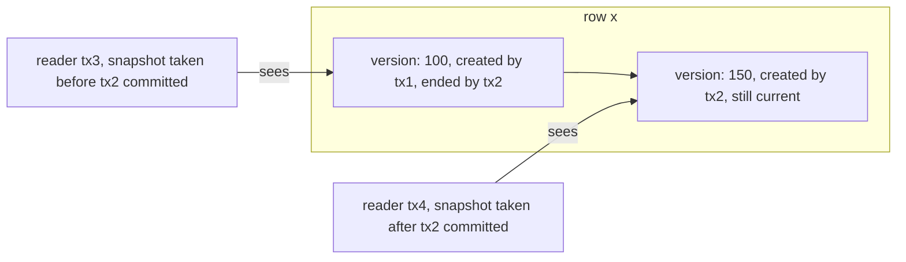

## Overview

Concurrency control lets many transactions run at once while keeping isolation. Two families: locking (pessimistic) and versioning or validation (optimistic, MVCC).

## What to know

1. Two-phase locking :: Two-phase locking: a transaction acquires locks as it goes (growing phase) and releases none until it commits (strict 2PL holds them all until commit). This guarantees serializability but readers and writers block each other and deadlocks are possible.

2. Shared vs exclusive locks, lock granularity :: Shared (read) locks are compatible with each other; exclusive (write) locks are compatible with nothing. Granularity: row locks give more concurrency with more overhead; table locks are cheap but block more. Intention locks let a table lock coexist safely with row locks.

3. MVCC :: Multi-version concurrency control: writes create new row versions tagged with transaction ids, and readers see the version matching their snapshot, so reads never block writes and writes never block reads. Old versions need garbage collection (vacuum).

4. Optimistic vs pessimistic locking :: Pessimistic: lock first (SELECT … FOR UPDATE), which is good when conflicts are frequent. Optimistic: proceed without locks and check a version or timestamp at commit, retrying on conflict, which is good when conflicts are rare (most web apps). Under heavy contention, optimistic retries waste work.

5. Deadlock detection in databases :: The database keeps a wait-for graph; when it finds a cycle, it aborts one transaction (the victim) with a deadlock error. Applications must retry. Lock rows in a consistent order to make deadlocks rarer.

## Recap

- 2PL: growing phase acquires locks, shrinking releases; strict 2PL holds until commit.
- Shared locks for reads, exclusive for writes; row vs page vs table granularity.
- MVCC: writers create new versions; readers see a snapshot without locking.
- Optimistic (version check at commit) for low contention; pessimistic (lock first) for high contention.

## Go deeper

### Two-phase locking in detail {point: 0}

2PL: a transaction acquires locks as it goes (growing phase) and, once it releases any lock, may not acquire new ones (shrinking phase). This guarantees serializable schedules. Strict 2PL holds all exclusive locks until commit or abort, preventing others from reading uncommitted data (avoids cascading aborts); rigorous 2PL holds all locks until the end. Most lock-based databases use strict 2PL.

Lock modes: shared (S) for reading, compatible with other S; exclusive (X) for writing, compatible with nothing. Intention locks (IS, IX) at the table level announce row-level locks below, so a request for a table lock can check compatibility without scanning every row lock. To prevent phantoms, databases lock ranges (predicate or next-key/gap locks in InnoDB), not just existing rows.

Granularity: row locks maximize concurrency but cost memory and management; table locks are cheap but serialize; some databases escalate many row locks to a table lock under pressure.

### How MVCC lets readers and writers coexist {point: 2}

In Postgres each row version has xmin (creating transaction) and xmax (deleting/updating transaction). An UPDATE writes a new version and sets xmax on the old one. A transaction's snapshot lists which transactions were committed when it started; it sees a version if xmin is committed-and-visible and xmax isn't. Readers never block writers and vice versa; writers still block other writers of the same row.

Old versions are garbage-collected by VACUUM once no snapshot can see them, so long-running transactions cause bloat.

### MVCC implementations compared {point: 2.5}

Postgres: new row versions are written into the table (heap); old versions remain until VACUUM removes them; each version has xmin/xmax transaction ids; indexes point to versions, and HOT updates avoid index changes when indexed columns don't change. Long transactions or stalled vacuum cause bloat; transaction id wraparound must be prevented by vacuum freezing.

MySQL InnoDB: the row in the clustered index holds the latest version; older versions are reconstructed from undo logs in the rollback segment; purge threads clean undo once no read view needs it. Long transactions make undo grow and slow reads that must walk long version chains.

Oracle: undo segments similarly reconstruct read-consistent versions; 'snapshot too old' errors occur when needed undo was overwritten.

In all of them, readers see a consistent snapshot without blocking writers, but writes to the same row still serialize, and snapshot age has a cost.

### Optimistic vs pessimistic, with numbers {point: 3}

Pessimistic locking (SELECT … FOR UPDATE, then update) blocks competitors while the lock is held. Throughput under contention is bounded by 1 / (lock hold time): if each transaction holds a hot row for 5 ms, that row supports ~200 updates per second, no matter how many servers you add. Keep hold times short and avoid network calls while holding locks.

Optimistic concurrency (version check at write) never blocks, but conflicting transactions fail and retry. With low contention (profile edits), nearly all succeed on the first try and throughput is high. With high contention on one row (a flash-sale counter), most attempts fail and retry, wasting work; pessimistic locking or a different design (queueing, splitting the counter, atomic decrements) is better.

Hot rows are a design smell at scale: split counters into shards summed on read, queue updates through a single writer, or use atomic increments in Redis with periodic persistence.

### Deadlocks inside the database {point: 4}

T1 updates row A then B; T2 updates B then A. The database's lock manager builds a wait-for graph, detects the cycle (Postgres checks after deadlock_timeout, ~1 s) and aborts one with a deadlock error. The app should retry it.

Prevent most of them by touching rows in a consistent order (sort ids before updating), keeping transactions short, and using the right indexes (missing indexes make UPDATEs lock more rows or ranges than needed).

### A small MVCC engine in Java: snapshots and version chains {point: 2}

MVCC is easiest to understand when you can see the data structure. Each row is a chain of versions. A version records the transaction that created it and, once it is replaced or deleted, the transaction that ended it. A reader takes a **snapshot** when it starts: the set of transactions that had committed at that moment. A version is visible to the reader if its creator is in the snapshot (or is the reader itself) and its end marker, if any, is not.


Diagram caption: Two versions of one row coexist. Each reader sees the version that matches its snapshot, so nobody blocks.

### The demo and what it prints {point: 2}

The demo implements exactly that in about forty lines. A setup transaction writes `x = 100` and commits. T1 starts. T2 then updates x to 150 but does not commit; T1 still reads 100, and T2 reads its own uncommitted 150. After T2 commits, T1 still reads 100, because its snapshot was taken earlier (this is repeatable read, the behaviour of snapshot isolation). T3, starting after the commit, reads 150. The row now has two versions.

```java
import java.util.*;

public class MvccDemo {
    /** One version of a row: written by createdBy, replaced by deletedBy (0 = still current). */
    record Version(String value, int createdBy, int deletedBy) {}

    static final Map<String, List<Version>> table = new HashMap<>();
    static final Set<Integer> committed = new HashSet<>();
    static int nextTx = 1;

    static class Tx {
        final int id = nextTx++;
        final Set<Integer> snapshot = new HashSet<>(committed); // who was committed when we started

        boolean sees(int txId) { return txId == id || snapshot.contains(txId); }

        String read(String key) {
            for (Version v : table.getOrDefault(key, List.of())) {
                boolean created = sees(v.createdBy());
                boolean deleted = v.deletedBy() != 0 && sees(v.deletedBy());
                if (created && !deleted) return v.value();
            }
            return null;
        }

        void write(String key, String value) {
            List<Version> versions = table.computeIfAbsent(key, k -> new ArrayList<>());
            for (int i = 0; i < versions.size(); i++) {
                Version v = versions.get(i);
                if (v.deletedBy() == 0 && sees(v.createdBy())) versions.set(i, new Version(v.value(), v.createdBy(), id));
            }
            versions.add(new Version(value, id, 0));
        }

        void commit() { committed.add(id); }
    }

    public static void main(String[] args) {
        Tx setup = new Tx();
        setup.write("x", "100");
        setup.commit();

        Tx t1 = new Tx();                       // starts before the update
        Tx t2 = new Tx();
        t2.write("x", "150");
        System.out.println("T1 reads x = " + t1.read("x") + " (T2 not committed)");
        System.out.println("T2 reads its own write x = " + t2.read("x"));
        t2.commit();
        System.out.println("T1 reads x = " + t1.read("x") + " (snapshot taken before T2 committed)");
        Tx t3 = new Tx();                       // starts after the commit
        System.out.println("T3 reads x = " + t3.read("x"));
        System.out.println("versions of x: " + table.get("x").size());
    }
}
```
### Reading the output {point: 2}

It prints `T1 reads x = 100`, `T2 reads its own write x = 150`, `T1 reads x = 100` again, `T3 reads x = 150` and `versions of x: 2`.

Read the output line by line against the snapshot rule. T1's first read: the version written by T2 has creator T2, which is not in T1's snapshot and is not T1 itself, so it is invisible, while the original version is visible because its end marker (T2) is also invisible to T1. T2's read: the creator is T2 itself, so the new version is visible and the old version's end marker is T2, which T2 sees, so the old one is hidden. T1's second read, after the commit: T2 is now in the global committed set, but T1 copied that set when it started, so nothing changed for T1. T3 copied the set after the commit, so for T3 the old version is ended by a visible transaction (hidden) and the new one is visible. The same row, three answers, no locks and no waiting; that is the whole point of MVCC.

### What this toy leaves out {point: 2.5}

Real engines add what the demo skips. Two transactions that both try to update `x` must not both succeed: Postgres makes the second wait for the first (and, at repeatable read, aborts it with "could not serialize access" if the first commits), while InnoDB takes a row lock on the write. Old versions must be removed once no snapshot can see them: Postgres does this with VACUUM, InnoDB with a purge thread reading undo logs, and a long-running transaction holds back that cleanup, which makes tables bloat. And real systems store transaction ids in the row header and consult a commit log to decide whether a creator committed, instead of copying a set of ids; Postgres records a snapshot as a range (`xmin`, `xmax`) plus the list of in-progress ids. The principle is the same as in the demo: readers choose a version by snapshot, writers add versions, and nobody waits for a read.

## Interview questions

- MVCC vs two-phase locking?
- Optimistic vs pessimistic locking for an inventory decrement during a flash sale?
