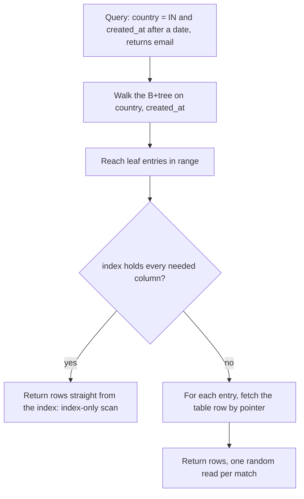

## Overview

An index is a separate sorted structure that lets the database find rows without scanning the table. Knowing how B+ trees work explains which queries an index helps and why indexes slow writes.

## What to know

1. B+ tree structure and why it fits disks :: A B+ tree keeps keys sorted in wide nodes (hundreds of keys per disk page), so the tree is only 3-4 levels deep even for millions of rows: a lookup is 3-4 page reads. Leaves are linked in order, so range scans walk the leaves sequentially. High fan-out matches disk and SSD page reads.

2. Clustered vs secondary indexes :: A clustered index stores the table rows themselves in index order (the InnoDB primary key); there can be only one, and range scans on it are very fast. A secondary index stores key → primary key or row pointer, so using it means a second lookup into the table, unless the index is covering.

3. Composite index column order :: For an index on (a, b, c), queries can use it for a; a,b; or a,b,c (leftmost prefix), and for a = ? AND b > ?. Put equality columns first and range columns last. An index on (b) alone doesn't help WHERE a = ?.

4. Hash indexes :: A hash index gives O(1) equality lookups but can't do ranges or ordering. Used in memory engines and for some key-value stores; B-trees are the general default.

5. When an index is not used :: Not used when: a function is applied to the column (WHERE LOWER(email) = … unless there's an expression index), a LIKE has a leading wildcard ('%abc'), the column is compared to the wrong type, the query selects most of the table (a scan is cheaper), or statistics are stale.

## Recap

- B+ tree: high fan-out, shallow (3-4 levels for billions of rows), leaves linked for range scans.
- Clustered index = table stored in key order (InnoDB primary key); secondary indexes point to it.
- Composite (a, b): useful for a or a+b, not b alone; equality columns before range columns.
- Index unused when: function on the column, leading wildcard LIKE, implicit casts, low selectivity.

## Go deeper

### Why B+ trees fit disks {point: 0}

A node is one page (e.g. 16 KB) holding hundreds of keys, so the tree is very wide and shallow: with fan-out 500, three levels index 125M rows and the top levels stay in memory, so a lookup is ~1 disk read. All values live in leaves, which are linked, so a range scan finds the start and then reads sequentially.

In InnoDB, the primary key is the clustered index: a secondary index lookup finds the primary key, then does a second lookup in the clustered index (unless the secondary index covers the query). That's why a random UUID primary key hurts: inserts land on random pages.

### Clustered vs secondary, and costs of indexes {point: 1}

A clustered index determines the physical order of rows: InnoDB stores rows inside the primary key B-tree, so primary-key range scans are sequential, and secondary indexes store the primary key as the pointer (a secondary lookup = secondary index search + primary index search). Postgres tables are heaps (unordered); every index, including the primary key, points to a heap tuple location, and CLUSTER can reorder once but isn't maintained.

Indexes aren't free: each insert, update of an indexed column, and delete must update every relevant index (write amplification), they consume memory and disk, and too many indexes slow writes and bloat backups. Unused indexes should be dropped (Postgres pg_stat_user_indexes shows usage).

Selectivity matters: an index helps when a query reads a small fraction of rows; for large fractions, a sequential scan is cheaper because random index-driven reads cost more per row than sequential reads.

### Composite index design rules {point: 2}

An index on (a, b, c) is sorted by a, then b within each a, then c. It supports WHERE a = ?, WHERE a = ? AND b = ?, WHERE a = ? AND b = ? AND c = ?, ORDER BY a, b, and WHERE a = ? ORDER BY b. It can't seek on b alone (no leading column), and a range on a (a > 5) stops b from being used for seeking (b is only filtered after).

Rules of thumb: equality columns first, then the column used for sorting or range, then extra columns to cover the query; put the most selective equality column first only when other queries also need it as a prefix. One well-designed composite index often replaces several single-column indexes.

Example: queries 'orders of customer X, newest first' and 'orders of customer X with status Y, newest first'. Index (customer_id, status, created_at DESC) serves the second fully but the first only for customer_id with a sort; (customer_id, created_at DESC) serves the first. Choose based on query frequency, or keep both if both are hot.

### Index types beyond the B-tree {point: 3}

Hash indexes: O(1) equality lookups, no range queries or ordering; Postgres hash indexes and in-memory engines use them, but B-trees are usually just as good for equality. Bitmap indexes (data warehouses, Oracle): a bitmap per distinct value, efficient for low-cardinality columns combined with AND/OR. GIN (generalized inverted index, Postgres): for values containing many elements: arrays, JSONB keys, full-text search terms. GiST and SP-GiST: geometric data, ranges, nearest-neighbour searches (PostGIS). BRIN (block range index): tiny summaries (min/max per block range) for huge tables physically ordered by the column, like append-only time-series. Trigram indexes (pg_trgm): speed up LIKE '%term%' and fuzzy matching.

Partial indexes index only rows matching a condition (WHERE status = 'open'), smaller and faster for skewed queries. Expression indexes index a computed value (LOWER(email)). Unique indexes enforce constraints. Covering indexes include extra columns to allow index-only scans.

### Index not used: common reasons {point: 4}

WHERE LOWER(email) = ? on an index of email (use a functional index or store normalized). WHERE name LIKE '%son' (leading wildcard; use trigram/full-text index). WHERE phone = 12345 when phone is VARCHAR (implicit cast). WHERE status = 'active' when 95% of rows are active (a scan is cheaper). Composite (country, city) with WHERE city = ? only. OR across different columns (may need separate indexes + bitmap OR).

Always check with EXPLAIN rather than guessing.

### Covering indexes and index-only scans {point: 2.5}

A normal secondary index lookup is two steps. The database walks the B+tree to the leaf entries for the key, which hold the indexed columns and a pointer to the row (the primary key in InnoDB, a tuple id in Postgres), then follows the pointer into the table to fetch the other columns. That second step is a random read for every matching row, and for a query returning thousands of rows it dominates the cost.

A **covering index** contains every column the query needs, so the second step is skipped. The plan shows it as an index-only scan (Postgres) or "Using index" (MySQL). The query `SELECT email FROM users WHERE country = 'IN' AND created_at > '2026-01-01'` is covered by an index on `(country, created_at, email)`: the first two columns are used to seek and filter, and the last one is carried in the leaf just to be returned. In SQL Server and recent Postgres versions you can add non-key columns with `INCLUDE (email)`, which stores them in the leaf without making them part of the sort order.

Diagram caption: A covering index removes the table fetch, which is often the biggest cost of a range query.

### What covering costs, and column order {point: 2.5}

Covering is not free. Every extra column makes the index bigger, which means more memory for the cache and more bytes to write on every insert and update. An index is updated on each write that touches an indexed column, so write-heavy tables should carry few indexes. In Postgres an index-only scan also depends on the visibility map: a page is only skipped when all its rows are known visible to every transaction, so a table that has not been vacuumed recently can still need table visits.

Column order decides whether the index helps at all. Equality columns go first, then the range column, then columns only needed for output; an index on `(created_at, country)` could not seek on country. Because of the "leftmost prefix" rule, an index on `(a, b, c)` also serves queries on `a` and on `(a, b)`, so you rarely need a separate index on `a` alone. When someone asks you to speed up a slow query, the interview-quality answer names the evidence (the plan shows a scan or many table fetches), the change (a composite or covering index with a specific column order) and the cost (write overhead, storage), then says you would check the new plan.

## Interview questions

- Why are B+ trees used instead of binary search trees on disk?
- Will an index on (last_name, first_name) help WHERE first_name = 'Ana'?
- Why do too many indexes hurt?
