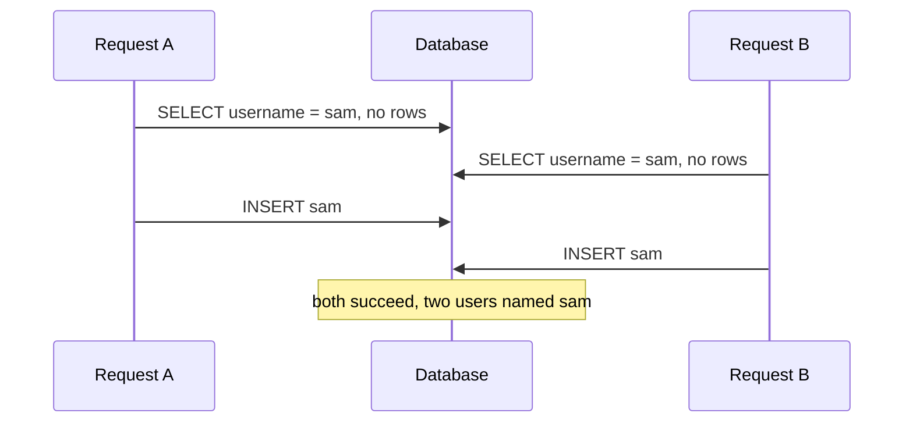

## Overview

Isolation levels define which concurrency anomalies a transaction may see. Weaker levels allow more concurrency; you need to know which anomalies each allows and when that breaks your invariants.

## What to know

1. Dirty read, non-repeatable read, phantom :: Dirty read: seeing another transaction's uncommitted write (which may roll back). Non-repeatable read: reading the same row twice and getting different values because another transaction committed in between. Phantom: re-running a range query returns new rows inserted by others.

2. Lost update and write skew :: Lost update: two transactions read-modify-write the same value and one overwrites the other (both read balance 100 and write 100 + their amount). Write skew: two transactions read the same data, then each write different rows based on it, breaking an invariant together (two doctors both go off-call because each saw the other on call).

3. Read committed, repeatable read, serializable :: Read committed prevents dirty reads (the Postgres default). Repeatable read also prevents non-repeatable reads, and in MySQL largely phantoms too. Serializable prevents all anomalies, including write skew, implemented with strict 2PL or serializable snapshot isolation, at the cost of aborts or blocking.

4. Snapshot isolation :: Each transaction reads a consistent snapshot as of its start (MVCC), and writers conflict only on the same rows. It prevents dirty and non-repeatable reads and lost updates (first committer wins), but allows write skew. Fix write skew with SELECT … FOR UPDATE on the rows the decision depends on, or with serializable isolation.

## Recap

- Read committed: no dirty reads; non-repeatable reads possible. Default in Postgres/Oracle.
- Repeatable read / snapshot: consistent snapshot per transaction; write skew still possible.
- Serializable: as if one at a time (2PL or SSI); may abort transactions to retry.
- Lost update: two read-modify-writes overwrite each other; use atomic updates, FOR UPDATE or versions.

## Go deeper

### Anomalies with two concrete transactions {point: 0}

Dirty read: T2 reads T1's uncommitted price; T1 rolls back. Non-repeatable read: T1 reads balance 100, T2 commits 50, T1 reads again and sees 50. Phantom: T1 counts rows WHERE status='open' (5), T2 inserts one, T1 recounts (6). Lost update: both read stock=10, both write 9 after selling one each (should be 8). Write skew: both check 'at least one doctor on call' and each removes themselves.

Know which level prevents which: read committed stops dirty reads; snapshot stops non-repeatable reads and phantoms for reads (and lost updates in Postgres's repeatable read); only serializable stops write skew.

### Lost update and write skew with fixes {point: 1}

Lost update: two transactions read stock = 10, each subtracts 1 in application code and writes 9; one decrement is lost. Fixes: atomic update (UPDATE stock SET qty = qty − 1 WHERE id = ? AND qty > 0), SELECT … FOR UPDATE before reading, optimistic version check, or an isolation level that detects it (Postgres repeatable read aborts the second writer).

Write skew: two transactions read overlapping data, make decisions, and write to different rows, together violating an invariant (both doctors go off call; two users book the same meeting room by inserting separate rows after checking the time is free). Snapshot isolation doesn't catch it because there's no write-write conflict. Fixes: SERIALIZABLE isolation, locking the rows the decision depends on (SELECT … FOR UPDATE on the doctors on call), materializing the conflict (a row per room per time slot, so both transactions update the same row), or a constraint (exclusion constraint on time ranges in Postgres).

```
-- Room booking without write skew: exclusion constraint (Postgres)
CREATE EXTENSION IF NOT EXISTS btree_gist;
CREATE TABLE bookings (
  room_id int,
  during  tstzrange,
  EXCLUDE USING gist (room_id WITH =, during WITH &&)   -- no overlapping ranges per room
);
```

### Each level and the anomalies it allows {point: 2}

Read uncommitted: dirty reads possible (see uncommitted changes); rarely used, and Postgres treats it as read committed. Read committed: each statement sees only committed data as of the statement's start; non-repeatable reads (a row changes between two reads in one transaction), phantoms (new rows appear in a repeated range query) and lost updates (in naive read-modify-write) are possible. Repeatable read: rows read once stay the same for the transaction; in the SQL standard phantoms are still possible, but snapshot-based implementations (Postgres) prevent them for reads. Snapshot isolation: the whole transaction reads one consistent snapshot; concurrent writes to the same row conflict (first committer wins); write skew is possible. Serializable: the result equals some serial order of the transactions; no anomalies.

The SQL standard defines levels by which of dirty read, non-repeatable read and phantom they prevent; real databases implement them differently, so name the database when you discuss behaviour.

### MySQL vs Postgres defaults {point: 2.5}

MySQL InnoDB defaults to REPEATABLE READ, using MVCC snapshots for plain reads and next-key (gap) locks for locking reads, which blocks many phantoms but can surprise you with lock waits. Postgres defaults to READ COMMITTED; its REPEATABLE READ is true snapshot isolation that aborts on concurrent update conflicts, and SERIALIZABLE uses SSI (detects dangerous patterns and aborts).

Whichever you use, the app must retry serialization failures.

### Choosing an isolation level

Default to the database default (read committed in Postgres, repeatable read in MySQL) and protect specific read-modify-write paths with atomic updates, row locks or version checks. Use serializable for transactions with complex invariants across rows (financial rules, scheduling), and retry serialization failures automatically (they're expected, not bugs).

Know the costs: higher levels mean more aborts and retries under contention (optimistic) or more blocking (lock-based). Read-only reporting queries benefit from repeatable read or snapshot so all their reads are consistent with each other.

In interviews, the strongest answer names the anomaly the business can't tolerate and the cheapest mechanism that prevents it.

### The check-then-insert race and how to close it {point: 1.7}

The most common isolation bug in application code is not an exotic anomaly. It is this pattern: read to check a condition, then write based on the answer. Take a sign-up form. The code runs `SELECT 1 FROM users WHERE username = 'sam'`; if no row comes back, it runs `INSERT INTO users ... 'sam'`. Run two requests for the same name at the same moment and both checks see nothing, because neither insert is visible yet, and both inserts then go through.


Diagram caption: Both requests pass the check before either writes. This is a phantom, and it happens at read committed and at repeatable read in MySQL.

### Closing the race {point: 1.7}

This is why "just wrap it in a transaction" is not an answer. At read committed, the second `SELECT` does not see the first insert until it commits, and at snapshot isolation neither sees the other's insert. The checks and the writes are separate steps and nothing ties them together. The fixes, from most to least preferred:

- **Let the database enforce the rule.** A `UNIQUE` constraint on `username` makes the second insert fail with a duplicate-key error, no matter how the requests interleave. Handle that error (show "name taken"). Use `INSERT ... ON CONFLICT DO NOTHING` (Postgres) or `INSERT IGNORE` / `ON DUPLICATE KEY UPDATE` (MySQL) when the conflict is a normal outcome. Constraints, including foreign keys and exclusion constraints (for example, no two overlapping bookings for one room), are the strongest tool because they hold for every client, not just yours.
- **Lock what you read.** `SELECT ... FOR UPDATE` on an existing row locks it, so the second request waits. It does not help when the row does not exist yet, because there is nothing to lock (MySQL's gap locks cover some of this at repeatable read, at the price of surprising deadlocks). For "no row yet", lock a parent row (the account or the room) that every request touches first, or use an advisory lock keyed on the value.
- **Run at SERIALIZABLE and retry.** Serializable isolation detects this interleaving and aborts one transaction with a serialization failure. It is correct without schema changes, but every transaction must be written to retry.
- **Make the write conditional.** `UPDATE accounts SET balance = balance - 50 WHERE id = 7 AND balance >= 50` checks and changes in one statement, so there is no gap. The same idea with a version column (`WHERE id = 7 AND version = 12`) is optimistic locking.

The general lesson for an interview: a read followed by a write on the strength of that read is a race unless something makes it atomic. Say which mechanism you pick, and why it fits: constraint for uniqueness, conditional update for counters and balances, row lock for read-modify-write on an existing row, serializable for complex invariants.

## Interview questions

- Give an example of write skew and two ways to prevent it.
- Which isolation level would you use for a bank transfer?
