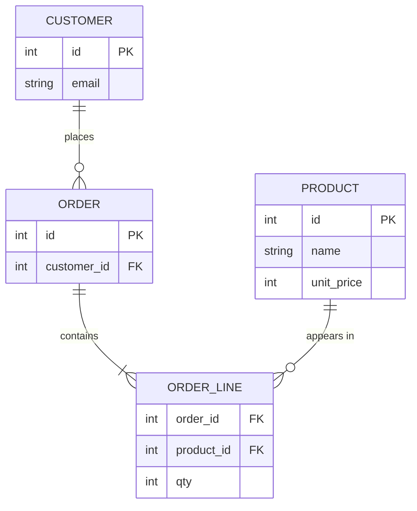

## Overview

Normalization removes redundancy so each fact lives in one place, which prevents update anomalies. Denormalization deliberately reintroduces redundancy to make reads faster.

## What to know

1. 1NF, 2NF, 3NF, BCNF :: 1NF: atomic values, no repeating groups. 2NF: no non-key column depends on only part of a composite key. 3NF: no non-key column depends on another non-key column (no transitive dependencies). BCNF: every determinant is a candidate key. In practice, aim for 3NF.

2. Functional dependencies :: X → Y means X's value determines Y's (zip_code → city). Normalization is splitting tables so every dependency goes from a key. If city is stored with every address row, renaming a city means updating many rows (an update anomaly).

3. Denormalization trade-offs for reads :: Copying data (storing author_name on posts, or precomputed counters) avoids joins and speeds reads, at the cost of extra writes and the risk of inconsistency. Typical for read-heavy paths, NoSQL models and analytics. Keep the source of truth normalized and maintain the copies with transactions or events.

## Recap

- 1NF: atomic values, no repeating groups. 2NF: no partial dependency on part of a composite key.
- 3NF: no transitive dependency (non-key → non-key). BCNF: every determinant is a candidate key.
- Normalize to avoid update anomalies; denormalize deliberately for read performance.

## Go deeper

### Functional dependencies and normal forms, precisely {point: 0}

A functional dependency X → Y means that rows agreeing on X always agree on Y (student_id → student_name). Normal forms restrict which dependencies may exist.

1NF: every column holds atomic values (no lists in a cell, no repeating column groups like phone1, phone2, phone3). 2NF: in 1NF, and no non-key column depends on only part of a composite key. 3NF: in 2NF, and no non-key column depends on another non-key column (no transitive dependency), or more precisely, for every X → A either X is a super key or A is part of a candidate key. BCNF: for every non-trivial X → Y, X is a super key. BCNF is stricter than 3NF; the difference appears with overlapping candidate keys, and a BCNF decomposition may lose the ability to enforce some dependencies within one table.

Decompositions must be lossless (joining the pieces gives back exactly the original rows), which holds when the common columns form a key of one of the pieces.

### Normalizing an order table {point: 0.5}

Orders(order_id, customer_id, customer_email, product_id, product_name, qty) with key (order_id, product_id). product_name depends only on product_id (partial dependency → violates 2NF): move to Products. customer_email depends on customer_id, which depends on order_id (transitive → violates 3NF): move to Customers. Result: Orders(order_id, customer_id), OrderItems(order_id, product_id, qty), Products, Customers.

Now changing a product name is one row, not every order line (no update anomaly), and you can add a product with no orders (no insertion anomaly).

### Worked example: course enrolments {point: 1}

Start: Enrolment(student_id, course_id, student_name, course_title, instructor, instructor_office, grade), key (student_id, course_id).

Dependencies: student_id → student_name; course_id → course_title, instructor; instructor → instructor_office; (student_id, course_id) → grade.

2NF violations: student_name depends only on student_id; course_title and instructor depend only on course_id. Split out Student(student_id, student_name) and Course(course_id, course_title, instructor). Enrolment(student_id, course_id, grade) remains.

3NF violation in Course: instructor → instructor_office is transitive. Split Instructor(instructor, instructor_office); Course keeps instructor as a foreign key.

Result: Student, Course, Instructor, Enrolment. Each fact is stored once: changing an instructor's office touches one row, and you can store a course with no students. Explaining this in four steps is a common DBMS interview question.

### When to denormalize {point: 2}

Read-heavy screens that join 5 tables per request: store a precomputed copy (order summary with customer name snapshot, comment count on posts). Pay with write complexity: keep the copy in sync (same transaction, trigger, or async from events) and accept staleness where safe.

Some 'denormalization' is actually correct modeling: the price on an order line should be a snapshot of the price at purchase time, not a reference to today's price.

### Denormalization techniques and their costs {point: 2}

Denormalize to speed up reads when joins or aggregations on hot paths are too slow, after measuring. Techniques: duplicate a column (order stores customer_name for display), store precomputed aggregates (post.comment_count, account.balance), materialized views (precomputed query results refreshed on a schedule or incrementally), summary tables for dashboards, and embedding child data in documents (NoSQL).

Costs: extra storage, write amplification (one change updates several places), and risk of inconsistency. Keep copies correct with triggers, updates in the same transaction, or asynchronous event-driven updates (accepting short staleness), and add reconciliation jobs that recompute and compare.

Analytics schemas (star schemas, wide tables) are deliberately denormalized because they're read-mostly and loaded in batches. OLTP schemas should start normalized and denormalize specific hot spots.

### Anomalies, and when a star schema breaks the rules on purpose {point: 2.5}

Normal forms are easier to remember as the problems they remove. Start with one wide table, `order_lines(order_id, customer_id, customer_email, product_id, product_name, unit_price, qty)`, and look at what goes wrong.

An **update anomaly**: the customer changes email, and it must be changed in every row of every order they placed. Miss one and the data disagrees with itself. An **insert anomaly**: you cannot record a new product until someone orders it, because the row needs an order. A **delete anomaly**: delete the only order that contained a product and you lose the product's name and price. All three come from the same cause, facts about different things stored together, and the cure is to give each fact one home.

Diagram caption: The decomposed schema. Customer email lives once, product name and price live once, and order_line keeps only what is true of that line.

### Third normal form versus BCNF {point: 0}

3NF says every non-key column depends on the key, the whole key and nothing but the key. Boyce-Codd normal form (BCNF) is slightly stricter: for every functional dependency, the left side must be a key. The classic gap is a table `(student, subject, teacher)` where each teacher teaches exactly one subject (`teacher -> subject`) and a student has one teacher per subject. The key is `(student, subject)`. The dependency `teacher -> subject` has a left side that is not a key, so the table is not in BCNF, yet it is in 3NF because `subject` is part of a candidate key. The cost of leaving it: you can record that a teacher teaches a subject only along with a student, and changing a teacher's subject touches many rows. Splitting into `(teacher, subject)` and `(student, teacher)` fixes it, at the price that the rule "a student has one teacher per subject" can no longer be enforced by a key alone.

### When denormalizing on purpose is right {point: 2}

Analytics databases break normalization deliberately. A **star schema** has one large fact table (one row per sale, with foreign keys and numbers) surrounded by small dimension tables (date, product, store) that are flattened: the product dimension carries category and brand in the same row even though category depends on product, not on the key. Reports then join one fact table to a few dimensions and group, without walking long chains of joins. Because data is loaded in batches and rarely updated, update anomalies are managed by the load process instead of by constraints. The rule of thumb for interviews: normalize the system of record, where writes and correctness matter; denormalize read paths, caches and warehouses, where you control how the copies are refreshed and can accept that they may be briefly stale.

A practical check before you decide: ask what the copy is for and who keeps it fresh. A denormalized column that a nightly job rebuilds from the source of truth is safe. A copy that application code must remember to update in five places is the update anomaly again, with the database no longer able to catch your mistake. If you must keep a copy in the same database, a trigger, a generated column or a materialized view moves the work from "every developer remembers" to "the database does it".

## Interview questions

- Normalize this table: orders(order_id, customer_name, customer_email, product, price).
- When would you denormalize?
