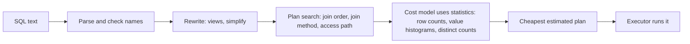

## Overview

SQL says what you want; the optimizer decides how to get it. Reading a plan and knowing the join algorithms is how you debug slow queries.

## What to know

1. Query plans and EXPLAIN :: EXPLAIN shows the chosen plan; EXPLAIN ANALYZE runs it and shows actual rows and times. Look for sequential scans on big tables, large gaps between estimated and actual rows, expensive sorts, and nested loops over many rows.

2. Nested loop vs hash vs merge join :: Nested loop: for each outer row, look up matches (fast with an index on the inner side and few outer rows). Hash join: build a hash table on the smaller input and probe it with the larger (good for big unsorted equi-joins). Merge join: both inputs sorted on the key, merged in one pass (good when already sorted or indexed).

3. Cost-based optimization and statistics :: The optimizer estimates the cost of alternative plans using table statistics (row counts, value distributions, histograms) and picks the cheapest. Stale statistics produce bad plans, so run ANALYZE after big data changes.

4. N+1 queries :: Code that loads a list (1 query) and then queries related data for each item (N queries) makes N+1 round trips, a classic ORM trap. Fix with a join, a batched IN (…) query, or eager loading.

## Recap

- EXPLAIN shows the plan; EXPLAIN ANALYZE runs it and shows actual rows/time.
- Nested loop: small outer side + indexed inner. Hash join: big unsorted inputs, equality. Merge join: both sorted.
- Bad estimates (stale statistics) cause bad plans; ANALYZE refreshes them.
- N+1: one query per item in a loop; batch with IN (...) or a join.

## Go deeper

### Reading a plan {point: 0}

Look for: Seq Scan on a large table where you expected an index; estimated rows far from actual rows (the optimizer guessed wrong, often stale stats or correlated columns); Sort or Hash operations spilling to disk; Nested Loop with a large outer side and no index on the inner. Fix by adding/adjusting indexes, rewriting the query (sargable conditions), or updating statistics.

```
EXPLAIN ANALYZE
SELECT o.id, c.name FROM orders o JOIN customers c ON c.id = o.customer_id
WHERE o.created_at > now() - interval '1 day';
-- Hash Join (actual rows=12034)
--   -> Index Scan using orders_created_at on orders o (actual rows=12034)
--   -> Hash -> Seq Scan on customers c (actual rows=500000)   ← fine if needed, else index-nested-loop
```

### Join algorithms in more depth {point: 1}

Nested loop join: for each row of the outer input, find matching inner rows. With an index on the inner join column it's O(outer × log inner) and returns the first rows quickly (great with LIMIT); without an index it's O(outer × inner), terrible for large inputs.

Hash join: build a hash table on the smaller input's join key (in memory, spilling to disk in batches if too large), then scan the larger input and probe. O(n + m), works only for equality conditions, and needs memory (work_mem in Postgres; spills show up as 'Batches: N' in EXPLAIN ANALYZE).

Merge join: sort both inputs on the join key (or read them in order from indexes), then walk them together. O(n log n + m log m) with sorts, O(n + m) if already sorted; handles range/inequality conditions in some databases and large inputs efficiently.

Reading EXPLAIN means recognizing which one was chosen and whether that's sensible for the row counts involved.

### Cost-based optimization {point: 2}

The optimizer estimates the cost (I/O and CPU) of alternative plans using statistics: number of rows and pages per table, per-column distinct counts, most common values, histograms of value distributions, null fractions and correlation with physical order. For a filter, selectivity estimates tell it how many rows will pass; for joins, it estimates output sizes and picks join order and algorithms; with many tables it uses dynamic programming or heuristics (genetic search beyond ~12 tables in Postgres).

When estimates are wrong, plans are wrong. Causes: stale statistics after bulk loads (run ANALYZE), correlated columns (create extended statistics), functions on columns (the optimizer can't use statistics or indexes; use expression indexes), and parameter values that differ wildly in selectivity. Some databases (Oracle, SQL Server) support plan hints or plan baselines to pin a good plan; Postgres relies on statistics and configuration, with extensions (pg_hint_plan) for hints.

### Spotting and fixing N+1 {point: 3}

Rendering 50 orders and, for each, querying its customer = 51 queries; at 1 ms each that's 50 ms of round trips. ORMs make it easy to do accidentally (lazy loading). Fix: one query with a join, or two queries (orders, then customers WHERE id IN (…)) and stitch in memory (DataLoader pattern batches per request).

Detect it with query counts per request in logs/APM.

### Practical query tuning checklist

1) Find the slow queries: slow query log, pg_stat_statements (total time, calls, mean), APM traces. Optimize what consumes the most total time, not only the slowest single query. 2) EXPLAIN ANALYZE (with BUFFERS) the query with realistic parameters. 3) Look for: sequential scans on big tables, estimate vs actual mismatches, nested loops over large row counts, sorts or hashes spilling to disk, and many repeated subplan executions. 4) Fix: add or reshape indexes, rewrite non-sargable conditions (WHERE DATE(created_at) = … → a range on created_at), remove SELECT *, paginate with keyset instead of OFFSET, push filters before joins, break apart OR conditions, avoid functions on indexed columns. 5) Check the application: N+1 queries, chatty round trips, missing batching, no connection pooling. 6) Re-measure.

At larger scale: caching, read replicas, materialized views or summary tables, and moving analytical queries off the OLTP database.

### Why the optimizer picks a bad plan, and what you can do about it {point: 2.5}

A query goes through a fixed pipeline, and the planner's choices depend on estimates. The parser checks the syntax and resolves table and column names. A rewrite step expands views and simplifies conditions (a constant-true filter disappears, a subquery may become a join). Then comes the part that matters for speed: plan search. For each table the planner considers the access paths (full scan, or one of several indexes), for each pair of tables a join method (nested loop, hash, merge) and, for several tables, many join orders. Each candidate gets a cost in abstract units for pages read and rows processed, and the cheapest candidate wins. The executor then runs exactly that plan, and nothing in it adapts if the numbers turn out wrong, except in a few engines that offer adaptive execution.


Diagram caption: The plan is the cheapest according to estimates, not according to reality. Bad estimates give bad plans.

### Where the estimates come from {point: 2.5}

The planner does not run the alternatives. It estimates how many rows each step produces from table statistics (row count, the most common values, a histogram of the rest, number of distinct values) and multiplies out costs. When the estimate is close, the plan is good. When it is off by orders of magnitude, a nested loop chosen for "10 rows" runs for "10 million", or a hash join spills to disk.

The usual causes of wrong estimates, and the fix for each:

- **Stale statistics.** After a bulk load or a big delete the counts are wrong. Run `ANALYZE` (Postgres) or `ANALYZE TABLE` (MySQL). Autovacuum handles it on a schedule, but not instantly.
- **Correlated columns.** The planner assumes conditions are independent: `city = 'Pune' AND state = 'MH'` is estimated as the product of the two selectivities, though they are almost the same set, so the estimate is far too low. Postgres has extended statistics (`CREATE STATISTICS ... (dependencies)`) for this case.
- **Skew.** One customer owns half the rows. A histogram helps, but a prepared statement planned for a rare value can be reused for the huge one (or the reverse). This is the well-known parameter-sniffing problem in SQL Server, and generic versus custom plans in Postgres prepared statements.
- **Expressions the planner cannot see through.** `WHERE lower(email) = 'a@b.c'` cannot use a plain index on `email` and gets a default guess. Create an expression index on `lower(email)`, or store a normalised column. The same goes for implicit casts that make a column comparison non-sargable.
- **Too many joins.** Beyond a handful of tables the planner stops searching exhaustively (Postgres switches to a genetic search past `geqo_threshold`), so a very large join can get a worse order than a hand-written one.

How to debug it in practice. Run `EXPLAIN ANALYZE` (this runs the query) and compare the estimated rows with the actual rows at each node; the first node where they differ widely is the culprit. Fix the cause (statistics, an index, a rewritten condition) before reaching for hints, because hints freeze a decision that may be wrong after the data changes. If you do need to force a choice, use the mildest tool: a better index, splitting the query with a temporary table or a materialised CTE, or a hint in databases that support them. And always compare the plan on production-sized data: a query that is fast on a developer machine with 1,000 rows tells you little about the plan with 100 million.

## Interview questions

- A query got slow after the table grew 10×. How do you investigate?
- What is the N+1 problem?
