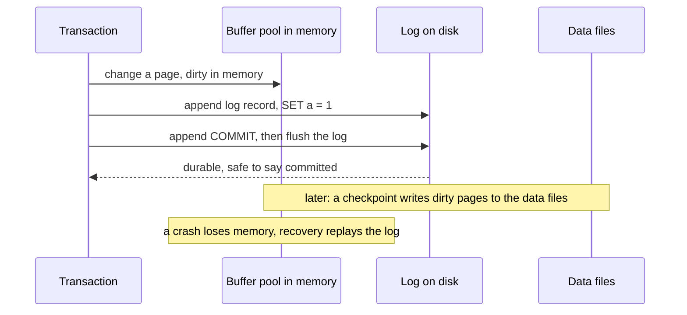

## Overview

Databases survive crashes by logging changes before applying them, and survive disasters with backups. Know WAL and the redo/undo idea.

## What to know

1. Write-ahead log (WAL) :: Every change is appended to a sequential log and flushed to disk before the transaction commits; the data pages are updated lazily later. Sequential log writes are fast, and the log is the source of truth after a crash. Replication often ships the WAL to replicas.

2. Checkpoints :: A checkpoint periodically flushes dirty pages to disk and records how far the log is applied, so recovery only replays the log after the last checkpoint and old log segments can be recycled.

3. Crash recovery (redo / undo) :: On restart: redo replays logged changes after the checkpoint so committed work is restored, and undo rolls back changes from transactions that never committed (ARIES: analysis, redo, undo).

4. Backups and point-in-time recovery :: Take full backups regularly and archive the WAL continuously; to restore to any moment (just before a bad DELETE), restore the base backup and replay WAL up to that point. Test restores. RPO (how much data you can lose) and RTO (how long recovery takes) drive the strategy.

## Recap

- WAL: log the change before applying it to data pages; commit = WAL flushed.
- Checkpoint: flush dirty pages so recovery only replays WAL after it.
- Recovery (ARIES): analysis → redo everything since checkpoint → undo uncommitted txns.
- PITR = base backup + archived WAL replayed to a timestamp.

## Go deeper

### Why the WAL makes commits fast and safe {point: 0}

Updating a row changes a page in memory; writing that 8 KB page to its random location on every commit would be slow. Instead, the database appends a small log record describing the change to the WAL (sequential write) and fsyncs it at commit. Data pages are written later in the background. After a crash, replaying the WAL from the last checkpoint reconstructs every committed change.

The same log feeds replication (followers replay it) and CDC.

### Write-ahead logging rules {point: 0.5}

Two rules make WAL work. Before a modified data page is written to disk, the log records describing the change must be on disk (write-ahead). Before a transaction is reported committed, all its log records (including the commit record) must be on disk. With these, the data files can lag behind arbitrarily; the log contains everything needed.

Buffer management policies: 'steal' allows writing pages modified by uncommitted transactions to disk (needs undo information to roll them back after a crash); 'no-force' allows committing without writing data pages (needs redo to reapply them). Most databases use steal/no-force for performance, which is why recovery needs both redo and undo.

The log is sequential, so committing is one sequential write (batched across transactions by group commit). Log sequence numbers (LSNs) on pages tell recovery whether a page already contains a logged change.

### Crash recovery with ARIES {point: 2}

ARIES, the classic algorithm (used in DB2 and SQL Server; Postgres and InnoDB use similar ideas), has three phases after a crash. Analysis: scan the log from the last checkpoint to reconstruct which transactions were active and which pages were dirty at the crash. Redo: repeat history, reapplying every logged change from the earliest needed point (for committed and uncommitted transactions alike) to pages whose LSN shows they lack it, restoring the exact pre-crash state. Undo: roll back transactions that hadn't committed, in reverse order, writing compensation log records (CLRs) so that a crash during recovery doesn't undo things twice.

Checkpoints limit how much log must be scanned: a fuzzy checkpoint records the active transactions and dirty pages without stopping the database, and the background writer flushes pages so the redo starting point advances. Checkpoint frequency trades recovery time against steady-state I/O.

### Backups that you can actually restore {point: 3}

Logical dumps (pg_dump) are portable but slow for big databases. Physical backups (base backup + continuous WAL archiving to S3) allow point-in-time recovery: restore the base backup, replay WAL until 10:42:59, just before someone ran DELETE without WHERE.

Define RPO (how much data you can lose) and RTO (how long recovery may take), and test restores regularly; an untested backup is a hope, not a backup.

### Backups, PITR and disaster recovery {point: 3}

Logical backups (pg_dump, mysqldump) export SQL or a portable format: good for small databases, migrations between versions, and restoring single tables; slow for large databases and not point-in-time.

Physical backups copy data files (pg_basebackup, Percona XtraBackup, storage snapshots) while the database runs; combined with continuous archiving of the WAL/binlog, they enable point-in-time recovery: restore the base backup, then replay the log up to a target time or transaction. Managed services (RDS, Cloud SQL) automate this with retention windows.

Disaster recovery planning: define RPO (data loss tolerated) and RTO (downtime tolerated); keep backups in another region and account (protects against region loss and ransomware or a compromised account); encrypt backups; test restores on a schedule and time them; and use replicas for fast failover, while remembering that replicas faithfully replicate mistakes like DROP TABLE, so they don't replace backups.

### A write-ahead log in Java: crash, then redo what committed {point: 2}

The core promise of a write-ahead log (WAL) is one rule: **the log record describing a change reaches stable storage before the change itself does**, and a transaction counts as committed only when its commit record is in the log. After a crash, the log is the truth.


Diagram caption: The data pages can be written lazily because the log already contains everything needed to redo them.

### The demo {point: 2}

The demo models that. It keeps a list of log records (the part that survives the crash) and a map for memory (the part that does not). Transaction 1 sets `a=1` and `b=2` and commits. Transaction 2 sets `a=99` but the crash comes before its commit. After the crash, memory is empty. **Recovery** scans the log, finds which transactions have a COMMIT record, and redoes only their changes, so `a` is back to 1 and the uncommitted 99 never appears.

```java
import java.util.*;

public class WalDemo {
    /** A log record: BEGIN, SET key value, COMMIT. */
    record Rec(int tx, String type, String key, String value) {}

    static final List<Rec> log = new ArrayList<>();   // survives the crash (it is on disk)
    static Map<String, String> memory = new HashMap<>(); // lost in the crash

    static void begin(int tx) { log.add(new Rec(tx, "BEGIN", null, null)); }
    static void set(int tx, String k, String v) { log.add(new Rec(tx, "SET", k, v)); memory.put(k, v); }
    static void commit(int tx) { log.add(new Rec(tx, "COMMIT", null, null)); } // the commit is the log flush

    /** Redo only what committed; changes of unfinished transactions are ignored. */
    static Map<String, String> recover() {
        Set<Integer> done = new HashSet<>();
        for (Rec r : log) if (r.type().equals("COMMIT")) done.add(r.tx());
        Map<String, String> state = new TreeMap<>();
        for (Rec r : log) if (r.type().equals("SET") && done.contains(r.tx())) state.put(r.key(), r.value());
        return state;
    }

    public static void main(String[] args) {
        begin(1); set(1, "a", "1"); set(1, "b", "2"); commit(1);
        begin(2); set(2, "a", "99"); // never commits: the crash comes first
        System.out.println("before crash, memory = " + new TreeMap<>(memory));
        memory = new HashMap<>(); // crash: memory is gone, the log is not
        System.out.println("after crash, memory = " + memory);
        System.out.println("after recovery = " + recover());
        System.out.println("log records = " + log.size());
    }
}
```
### Reading the output {point: 2}

It prints `before crash, memory = {a=99, b=2}`, `after crash, memory = {}`, `after recovery = {a=1, b=2}` and `log records = 6`. The six records are the BEGIN, two SETs and COMMIT of transaction 1, plus the BEGIN and SET of transaction 2, which has no COMMIT.

That missing COMMIT is the whole story. Recovery never asks "did this change reach the data file?", only "is there a commit record for its transaction?". The memory map held `a=99` before the crash, a value no committed transaction ever wrote, and recovery correctly drops it. This also shows why the order matters: if the engine wrote the commit to the log after changing the data pages and crashed in between, a change could exist without its log record, which is exactly what write-ahead logging forbids. The log record goes first, always. A real engine also has to make sure the log write is truly on disk (the fsync from the previous section) before it acknowledges the commit to the client; otherwise a client could be told "committed" for a transaction the log has never heard of.

### What a real engine adds {point: 2}

The toy replays the whole log. A real engine writes **checkpoints**: it records which log position everything before has been applied to the data files, so recovery starts there instead of at the beginning. It also has to cope with the case the demo avoids: the buffer pool may write a dirty page of an uncommitted transaction to disk before commit (a "steal" policy, which frees memory), so recovery needs **undo** information too, not only redo. ARIES, the classic algorithm, does three passes: analysis (find what was in flight at the crash), redo (repeat history, including the work of transactions that later turn out uncommitted), then undo (roll back the transactions without a commit record, logging compensation records so a crash during recovery is also safe). Each log record carries a log sequence number (LSN), and each page remembers the LSN of its last change, so redo can skip a change the page already contains. That is why replaying a log twice does no harm: redo is idempotent.

Log records are also the basis for other features: replicas apply the same stream (physical replication), change-data-capture tools read it to feed other systems, and point-in-time recovery restores a base backup and replays the archived log up to a chosen moment.

## Interview questions

- How does a database recover after a power failure?
- Someone ran DELETE without WHERE at 14:03. How do you recover?
