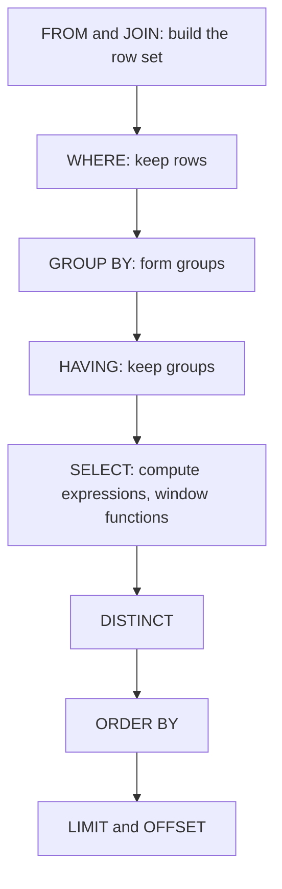

## Overview

The relational model stores data in tables of rows linked by keys, queried declaratively with SQL. Interviewers expect fluent joins and aggregations and an understanding of what they cost.

## What to know

1. Keys (primary, foreign, candidate) :: A primary key uniquely identifies a row (often a surrogate id). A candidate key is any minimal set of columns that could be the primary key (e.g. email). A foreign key references another table's key and enforces referential integrity (no orders for missing users).

2. Joins (inner, outer, self) and their cost :: Inner join returns matching rows only; left outer join returns all left rows with nulls where there's no match (find users with no orders: LEFT JOIN … WHERE o.id IS NULL); full outer join returns both sides. A self join joins a table to itself (employee → manager). Cost depends on indexes on the join keys and the join algorithm.

3. GROUP BY, HAVING, window functions :: GROUP BY aggregates rows into groups; WHERE filters rows before grouping, HAVING filters groups after. Window functions (ROW_NUMBER, RANK, LAG, SUM OVER (PARTITION BY … ORDER BY …)) compute over related rows without collapsing them: top-N per group, running totals, period-over-period changes.

4. Subqueries vs joins :: Many subqueries can be written as joins; modern optimizers often rewrite them the same way. Correlated subqueries (which reference the outer row) may run once per row and be slow. EXISTS is efficient for 'has at least one'. Choose for readability, then check the plan.

## Recap

- Primary key identifies a row; foreign key references one; candidate keys are any minimal unique sets.
- INNER join keeps matches; LEFT keeps all left rows; self join compares rows of one table.
- WHERE filters rows before grouping; HAVING filters groups after.
- Window functions (ROW_NUMBER, RANK, SUM OVER) compute per-row results across a partition without collapsing rows.

## Go deeper

### Keys and constraints {point: 0}

A super key is any set of columns that uniquely identifies a row; a candidate key is a minimal super key (remove any column and it's no longer unique); the primary key is the candidate key you choose as the main identifier; the rest are alternate keys (enforce them with UNIQUE constraints). Surrogate keys (auto-increment or UUID) are stable and compact; natural keys (email, ISBN) carry meaning but can change, so many designs use a surrogate primary key plus a unique constraint on the natural key.

Foreign keys enforce referential integrity: a child row must reference an existing parent. ON DELETE behaviour: RESTRICT (refuse), CASCADE (delete children), SET NULL. CHECK constraints enforce rules (quantity > 0, end_date > start_date), NOT NULL avoids three-valued logic surprises. Constraints are the cheapest correctness guarantee you can get, because the database enforces them under concurrency, unlike application checks.

### Joins and how they're executed {point: 1}

INNER JOIN returns matching pairs. LEFT (OUTER) JOIN keeps every left row, filling NULLs when there's no match; RIGHT is the mirror; FULL OUTER keeps both sides. CROSS JOIN is the Cartesian product. A self join joins a table to itself (employees with their managers). Semi-join (EXISTS / IN) returns left rows that have a match without duplicating them; anti-join (NOT EXISTS) returns rows without a match.

A common trap: putting a condition on the right table in WHERE after a LEFT JOIN (WHERE o.status = 'paid') silently turns it into an inner join; put it in the ON clause to keep unmatched rows.

Execution: nested loop (for each outer row, look up matches; fast when the outer side is small and the inner side has an index), hash join (build a hash table on the smaller input, probe with the larger; best for large unsorted equality joins), merge join (both inputs sorted on the key; stream through both). The optimizer picks based on row estimates and available indexes.

```
-- Employees and their managers (self join), keeping employees without a manager
SELECT e.name AS employee, m.name AS manager
FROM employees e
LEFT JOIN employees m ON m.id = e.manager_id;

-- Trap: this LEFT JOIN behaves like an INNER JOIN
SELECT c.name, o.id FROM customers c
LEFT JOIN orders o ON o.customer_id = c.id
WHERE o.status = 'paid';                       -- customers without orders disappear
-- Fix: move the filter into ON
SELECT c.name, o.id FROM customers c
LEFT JOIN orders o ON o.customer_id = c.id AND o.status = 'paid';
```

### Aggregation, GROUP BY and window functions {point: 2}

GROUP BY collapses rows into groups; every selected column must be grouped or aggregated (COUNT, SUM, AVG, MIN, MAX). WHERE filters rows before grouping, HAVING filters groups after. COUNT(*) counts rows, COUNT(col) skips NULLs, COUNT(DISTINCT col) counts unique values.

Window functions compute values across related rows without collapsing them: aggregate OVER (PARTITION BY … ORDER BY … frame). Ranking: ROW_NUMBER (unique 1,2,3), RANK (ties share, gaps after: 1,1,3), DENSE_RANK (ties share, no gaps: 1,1,2). Offsets: LAG/LEAD for previous/next row (day-over-day change). Running totals: SUM(x) OVER (ORDER BY day ROWS BETWEEN UNBOUNDED PRECEDING AND CURRENT ROW). Moving averages: ROWS BETWEEN 6 PRECEDING AND CURRENT ROW.

Common interview queries: top N per group (rank in a subquery, filter rank ≤ N), consecutive streaks (gaps and islands: date − ROW_NUMBER() days is constant within a streak), and percent of total (x / SUM(x) OVER ()).

```
-- Longest login streak per user (gaps and islands)
WITH d AS (
  SELECT DISTINCT user_id, login_date FROM logins
), g AS (
  SELECT user_id, login_date,
         login_date - (ROW_NUMBER() OVER (PARTITION BY user_id ORDER BY login_date))::int AS grp
  FROM d
)
SELECT user_id, MAX(cnt) AS longest_streak FROM (
  SELECT user_id, grp, COUNT(*) AS cnt FROM g GROUP BY user_id, grp
) s GROUP BY user_id;
```

### Subqueries vs joins {point: 3}

Modern optimizers usually rewrite IN/EXISTS subqueries into semi-joins, so performance is often the same; write whichever is clearer. Watch for NOT IN with a subquery that can return NULL: x NOT IN (1, NULL) is never true, so it returns nothing; use NOT EXISTS. Correlated subqueries in the SELECT list can run once per row; check the plan.

### Classic queries to have ready

Second-highest salary per department, top-N per group, running totals and gaps are standard. Window functions make them short; know DENSE_RANK vs RANK (ties) vs ROW_NUMBER (unique).

```
-- Top 3 earners per department
SELECT dept_id, name, salary FROM (
  SELECT dept_id, name, salary,
         DENSE_RANK() OVER (PARTITION BY dept_id ORDER BY salary DESC) AS r
  FROM employees) t
WHERE r <= 3;

-- Running total of daily revenue
SELECT day, revenue, SUM(revenue) OVER (ORDER BY day) AS running
FROM daily_revenue;

-- Customers with no orders (anti-join)
SELECT c.id FROM customers c
LEFT JOIN orders o ON o.customer_id = c.id
WHERE o.id IS NULL;
```

### The logical order of a SELECT: why WHERE cannot see your alias {point: 2}

You write a query in the order SELECT, FROM, WHERE, GROUP BY, HAVING, ORDER BY. The database thinks about it in a different order, and that order explains most "why does this error?" and "why is this slow?" questions.


Diagram caption: The logical order of evaluation. The optimizer may physically do things in another order, but the result must be the same as this.

### Rules that follow from the order {point: 2}

Several rules follow from the order. `WHERE` runs before `SELECT`, so it cannot use a column alias defined in the select list (`SELECT price * qty AS total ... WHERE total > 100` fails in standard SQL; repeat the expression or use a subquery). `WHERE` also runs before grouping, so it cannot contain aggregates: `WHERE COUNT(*) > 1` is an error, and the filter on a group's aggregate belongs in `HAVING`. The reverse is a performance habit: filter rows in `WHERE` whenever you can (`WHERE country = 'IN'`) rather than in `HAVING`, so fewer rows are grouped. `ORDER BY` runs after `SELECT`, so it can use aliases. Window functions run at the `SELECT` step, after grouping, which is why you can write `SUM(total) OVER (...)` next to a `GROUP BY` result but cannot filter on a window function in the same query's `WHERE`; wrap it in a subquery or CTE and filter outside.

Two details cause real bugs. First, **NULL** is not equal to anything, including itself. `x = NULL` is never true; use `x IS NULL`. `COUNT(*)` counts rows, `COUNT(col)` skips NULLs, and `AVG(col)` ignores them too, so an average over a column with NULLs is the average of the non-null values. `NOT IN (subquery)` returns no rows at all if the subquery produces even one NULL, because the comparison with that NULL is unknown; `NOT EXISTS` does not have this trap and is the safer choice.

Second, the outer join trap: `LEFT JOIN orders o ON ... WHERE o.status = 'PAID'` throws away the customers with no orders, because their `o.status` is NULL and the filter in `WHERE` removes them, turning the left join into an inner join. Put the condition in the `ON` clause (`ON o.customer_id = c.id AND o.status = 'PAID'`) to keep the unmatched left rows.

A good interview answer ties these together: "I think of the query as FROM, WHERE, GROUP BY, HAVING, SELECT, ORDER BY, LIMIT, so conditions on rows go in WHERE, conditions on aggregates in HAVING, and conditions on the right side of an outer join go in ON."

## Interview questions

- Write SQL for the second-highest salary per department.
- Find customers who placed no orders last month.
- WHERE vs HAVING?
