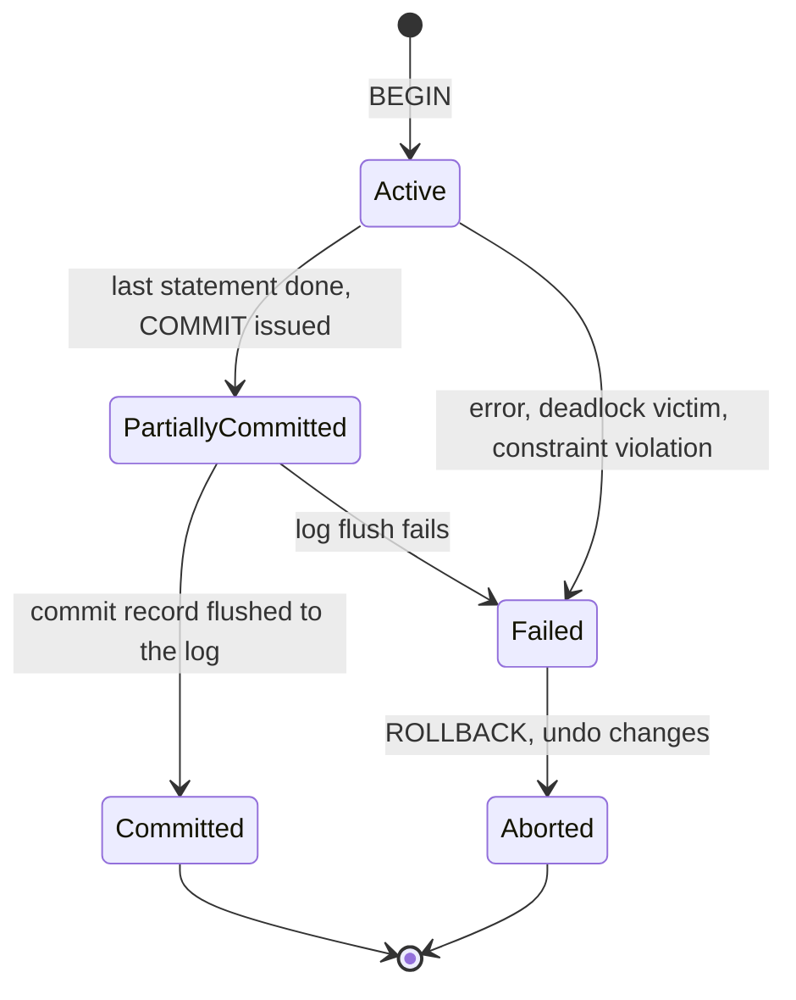

## Overview

A transaction groups operations so they succeed or fail together and run as if isolated from others. ACID is the contract; each letter has a specific mechanism behind it.

## What to know

1. Atomicity, consistency, isolation, durability :: Atomicity: all or nothing; a failure rolls back every change (undo log). Consistency: constraints and invariants hold before and after (the application defines most invariants). Isolation: concurrent transactions don't see each other's partial work (locking or MVCC). Durability: once committed, the data survives crashes (WAL plus fsync).

2. Commit and rollback :: COMMIT makes the changes permanent and visible; ROLLBACK discards them. Keep transactions short: they hold locks or old versions, and long transactions hurt concurrency and storage.

3. Savepoints :: A savepoint marks a point inside a transaction you can roll back to without abandoning the whole transaction. Useful for partial retries inside a batch.

4. Autocommit pitfalls :: With autocommit on, each statement is its own transaction. Running related statements (debit then credit) without an explicit transaction means a crash between them leaves inconsistent data. ORMs sometimes open transactions implicitly or not at all, so know which yours does.

## Recap

- Atomicity: all or nothing (undo/WAL). Consistency: constraints hold. Isolation: concurrent txns don't interfere. Durability: committed survives crashes.
- Keep transactions short; never wait on user input or remote calls inside one.
- Savepoints roll back part of a transaction.
- Autocommit: each statement commits alone, so multi-step changes need explicit BEGIN/COMMIT.

## Go deeper

### How each ACID property is implemented {point: 0}

Atomicity: the database logs changes (WAL / redo log, plus undo information or old row versions) so it can roll back an aborted transaction and, after a crash, undo transactions that didn't commit. Consistency: constraints, triggers and cascades checked at statement or commit time keep data valid according to defined rules; the application is responsible for business invariants the schema doesn't express. Isolation: locking and/or MVCC control what concurrent transactions see and prevent conflicting writes. Durability: commit returns only after the WAL record is flushed to stable storage (fsync); replication can add durability across machines.

Relaxing durability for speed is possible: Postgres synchronous_commit = off returns before the flush (a crash can lose the last fraction of a second of commits, but never corrupts data); MySQL innodb_flush_log_at_trx_commit = 2 is similar. Mentioning these trade-offs shows practical understanding.

### A transfer done right {point: 1}

Both updates and the ledger entry happen in one transaction with a constraint that balances can't go negative; if anything fails, nothing is applied. The conditional update makes the balance check and the decrement atomic.

```
BEGIN;
UPDATE accounts SET balance = balance - 500
 WHERE id = 1 AND balance >= 500;          -- 0 rows → insufficient funds → ROLLBACK
UPDATE accounts SET balance = balance + 500 WHERE id = 2;
INSERT INTO ledger(from_id, to_id, amount) VALUES (1, 2, 500);
COMMIT;
```

### Savepoints, nested work and error handling {point: 2}

A savepoint marks a point inside a transaction to which you can roll back without aborting the whole transaction: SAVEPOINT s1; … ROLLBACK TO SAVEPOINT s1; RELEASE SAVEPOINT s1. ORMs use savepoints to implement nested transactions (a nested 'transaction' is a savepoint inside the outer one).

In Postgres, once a statement in a transaction fails, the transaction is aborted and every further statement fails until ROLLBACK, unless you rolled back to a savepoint. Use savepoints when you want to try an insert and handle a unique violation without losing the transaction.

Transaction scoping in apps: one transaction per unit of work (one request handler or one message), opened as late and committed as early as possible. Frameworks' declarative transactions (@Transactional) should not wrap remote calls; if a payment API call happens inside a DB transaction and the DB commit then fails, you've charged without recording it. Order: write intent, commit, call external system with an idempotency key, record result.

```
BEGIN;
INSERT INTO orders(id, user_id) VALUES (991, 7);
SAVEPOINT coupon;
INSERT INTO coupon_uses(code, order_id) VALUES ('WELCOME', 991);   -- may violate UNIQUE
-- on error:
ROLLBACK TO SAVEPOINT coupon;    -- order insert survives, continue without coupon
COMMIT;
```

### Autocommit and long transactions {point: 3}

With autocommit on (the default in most drivers), running two UPDATEs as separate statements means a crash between them leaves half a transfer. Conversely, a transaction left open (a debugger, a slow HTTP call inside it) holds locks and, in MVCC databases, prevents cleanup of old row versions (Postgres table bloat).

Rule: do remote calls before or after the transaction; inside it, only database work.

### Long transactions, locks and timeouts {point: 3}

Transactions hold resources until they end: row locks (blocking other writers), snapshot visibility (preventing MVCC cleanup), and connections. A transaction left idle by a bug (an exception path that doesn't roll back, a developer's open console session) can block migrations and cause table bloat.

Defenses: statement_timeout and lock_timeout (fail fast instead of waiting forever), idle_in_transaction_session_timeout (Postgres) to kill abandoned transactions, monitoring for long-running transactions and lock waits (pg_stat_activity, pg_locks), and running migrations that take strong locks with a short lock_timeout and retries.

Batch updates should be chunked (update 10,000 rows per transaction in a loop) rather than one transaction updating millions of rows, which holds locks for a long time, bloats the WAL and replicas lag.

### What COMMIT actually waits for {point: 1}

A transaction moves through a few states, and knowing them makes failure handling easy to explain. It starts **active** while statements run. When the last statement finishes and COMMIT is issued it is **partially committed**: the work is done, but the database has not yet promised that it will survive a crash. It becomes **committed** once the commit record is safely in the log, and from then on the changes cannot be lost. If anything fails before that point (a constraint violation, a deadlock, a timeout, a lost connection, even a failed log write), the transaction is **failed** and then **aborted**: the database undoes its changes and the application sees an error. This split matters because "the statements ran without error" and "the transaction is committed" are two different moments, and an application must treat only a successful COMMIT as the promise. Aborted is also a normal ending, not a bug: databases abort transactions on purpose, as deadlock victims or on serialization conflicts, and expect the caller to retry.


Diagram caption: A transaction is durable only once its commit record is on stable storage. Until then it can still be aborted.

### The commit path and the durability dial {point: 1}

When your code calls COMMIT, the database does roughly this. It appends a commit record to the write-ahead log and asks the operating system to flush the log file to disk (an fsync). Only when the flush returns does it tell the client "committed". The changed data pages themselves can stay in memory and be written later, because if the server crashes the log is enough to redo them. That is why commits are fast enough: one sequential log write, not a random write per changed page. Because an fsync costs milliseconds on a disk, databases use **group commit**: while one flush is in progress, commits from other connections queue up and share the next flush.

Durability has a dial. Postgres has `synchronous_commit` and MySQL InnoDB has `innodb_flush_log_at_trx_commit`. Set to the strict value, every commit waits for the flush, and a crash loses nothing that was acknowledged. Relaxed values acknowledge before the flush, which raises throughput but means that a crash can lose the last fraction of a second of acknowledged commits (the database stays consistent, it just forgets the newest transactions). With replication there is a second dial: whether commit also waits for a replica to confirm (synchronous replication), which protects against losing the primary's disk but adds network latency to every commit.

### Rollback, savepoints and error handling in practice {point: 2}

An error inside a transaction has different effects in different databases. In Postgres, after any statement error the whole transaction is aborted: further statements fail with "current transaction is aborted" until you roll back or roll back to a savepoint. MySQL keeps the transaction open after most statement errors, so the application must decide what to do. A **savepoint** marks a point inside the transaction you can return to (`ROLLBACK TO SAVEPOINT s1`) without losing the earlier work, which is how frameworks implement nested transactions and "try this insert, recover if it conflicts".

Three application habits matter more than the theory. Keep transactions short: a transaction holds locks and keeps old row versions alive for as long as it runs, so never wait for a user or a remote call inside one. Retry on serialization failures and deadlocks: those errors are the database asking you to run the transaction again, so wrap the whole unit of work in a retry loop with a limit and some backoff. And remember that **autocommit** is on by default in most drivers, so two statements you meant to be one unit are two separate transactions unless you issue BEGIN yourself or turn autocommit off.

One more point that interviewers like: a transaction is a boundary for the database, not for the outside world. If your code sends an email or calls a payment API inside a transaction and the transaction then rolls back, the email is still sent. Either do the external call after the commit succeeds, or record the intent in a table inside the same transaction (the outbox pattern) and let a separate worker perform it, retrying until it works.

## Interview questions

- Explain each ACID property and what implements it.
- How does a database guarantee durability?
