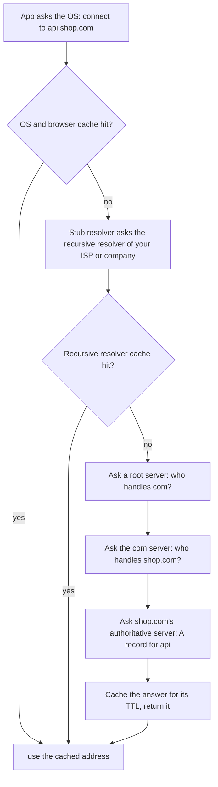

## Overview

DNS maps names to addresses through a distributed, cached hierarchy. It's also a cheap tool for load balancing, failover and geo-routing, limited by caching.

## What to know

1. Recursive vs iterative resolution :: Your stub resolver asks a recursive resolver (the ISP's, 8.8.8.8, 1.1.1.1), which does the work: it asks a root server (which points to .com), the .com TLD server (which points to example.com's nameservers), and the authoritative server (which gives the answer). Each step is iterative from the resolver's view, and answers are cached.

2. Record types (A, AAAA, CNAME, MX, TXT) :: A: name → IPv4. AAAA: name → IPv6. CNAME: alias to another name (not allowed at the zone apex). MX: mail servers. TXT: arbitrary text (domain verification, SPF). NS: delegates to nameservers. SRV: service host and port.

3. TTLs and caching :: Each record has a TTL; resolvers and clients cache it that long. Short TTLs (30-60 s) allow fast changes and failover but cost more queries; long TTLs are efficient but slow to change. Some clients ignore TTLs, so plan migrations with that in mind.

4. DNS-based load balancing and failover :: Return several A records (round-robin), different answers per region (GeoDNS, latency-based routing), or remove unhealthy endpoints (health-checked DNS failover, e.g. Route 53). DNS can't see real-time load and is limited by caching, so it's usually combined with load balancers.

## Recap

- Stub → recursive resolver → root → TLD → authoritative; answers cached for their TTL.
- A/AAAA: IPv4/IPv6. CNAME: alias (not at the zone apex). MX: mail. TXT: verification, SPF.
- Short TTLs (30-60 s) for failover; long TTLs for stable records.
- DNS load balancing returns multiple/geo-specific IPs; clients cache, so failover isn't instant.

## Go deeper

### DNS hierarchy and records {point: 0}

The DNS namespace is a tree: root (.), top-level domains (.com, .org, .in), second-level domains (example.com), and subdomains. Responsibility is delegated by NS records: the root zone points to TLD name servers, which point to each domain's authoritative servers. Authoritative servers answer for their zones; recursive resolvers (ISP, 8.8.8.8, 1.1.1.1, corporate) do the lookup work for clients and cache.

Records: A (IPv4), AAAA (IPv6), CNAME (alias to another name; can't coexist with other records at the same name, so not at the zone apex, which is why providers offer ALIAS/ANAME records), MX (mail servers with priorities), TXT (free text: SPF, DKIM, domain verification), NS (delegation), SOA (zone metadata), SRV (service location with port), CAA (which certificate authorities may issue for the domain), PTR (reverse DNS).

DNS uses UDP port 53 for most queries, TCP for large responses and zone transfers, and increasingly DNS over HTTPS/TLS for privacy.

### Resolving api.shop.com from a cold cache {point: 0.5}

The OS asks the configured recursive resolver (ISP or 8.8.8.8). The resolver asks a root server → referral to the .com TLD servers → asks them → referral to shop.com's authoritative servers → asks them → gets api.shop.com A 203.0.113.10 TTL 60. It caches every step (TLD referrals for days), so the next lookup for another shop.com name skips straight to the authoritative server.

The resolver works recursively for the client; it queries the servers iteratively.

### Caching, TTLs and propagation {point: 2}

Every answer carries a TTL in seconds; resolvers cache it for that long (also caching negative answers, NXDOMAIN, per the SOA's negative TTL). Browsers and operating systems have their own caches too. 'DNS propagation' is really caches expiring.

Planning a change: days before a migration, lower the TTL (e.g. from 3600 to 60) so caches turn over quickly; make the change; after it's stable, raise the TTL again. Low TTLs increase query volume and make you more dependent on your DNS provider's availability; very high TTLs make failover slow.

Some clients ignore TTLs (older JVMs cached forever by default; long-lived connections never re-resolve), so failover strategies shouldn't rely on DNS alone. DNS is also a dependency to make redundant: use providers with anycast networks, and consider two providers for critical domains (a major DNS provider outage has taken down large parts of the web before).

### DNS for load balancing, failover and service discovery {point: 3}

Round-robin DNS returns several A records in rotating order, spreading clients across servers, but with no health awareness or load awareness, and caching skews distribution. Managed DNS adds health checks (stop returning unhealthy endpoints), weighted records (send 10% to a new region), latency- or geo-based routing (answer with the nearest region based on the resolver's location or the EDNS Client Subnet), and failover records (primary/secondary).

Inside clusters, DNS is the default service discovery: Kubernetes CoreDNS resolves service names to cluster IPs or directly to pod IPs (headless services); Consul serves DNS for registered services. Short TTLs and client-side resolution behaviour matter, since connection pools may keep using old IPs after changes.

Security: DNSSEC signs records so resolvers can verify authenticity (prevents cache poisoning), though adoption is partial; DNS is also a common exfiltration and command-and-control channel, so enterprises monitor it.

### DNS-based failover and its limits {point: 3.5}

Health-checked DNS (Route 53) stops returning a failed region's IP; geo/latency routing returns the closest region. Limits: resolvers and clients cache answers for the TTL (some ignore it and cache longer), and long-lived connections don't re-resolve, so failover takes TTL + connection lifetime.

For faster failover, combine DNS with anycast or a global load balancer that has a stable IP.

### Reading a dig answer and the DNS pitfalls that cause outages {point: 0}

`dig` shows what DNS does in the form people ask about. Run `dig api.shop.com` and the answer section lists records: a name, a TTL in seconds, the class `IN`, the type and the value. For example `api.shop.com. 300 IN A 203.0.113.10` says the name has an IPv4 address and that resolvers may cache it for 300 seconds. If the answer begins with a `CNAME` line (`api.shop.com. 60 IN CNAME lb-123.cloud.example.`), the name is an alias, and the resolver follows it to the final A or AAAA records. `dig +trace api.shop.com` makes your machine do the walk itself from the root servers, which is the clearest way to see delegation: root points to the `.com` servers, which point to the domain's own authoritative servers, which answer.

Diagram caption: Most lookups end at a cache. Only a cold name needs the full walk, and each layer keeps its own copy for the TTL.

### Pitfalls that cause real incidents {point: 2}

**TTL and caching.** Lowering a record's TTL before a migration only helps once the old, longer TTL has expired everywhere, so lower it a day ahead, not at the moment of change. Caches exist at several layers (browser, operating system, your recursive resolver, and the application: the JVM caches successful lookups for 30 seconds by default when no security manager is installed, and the `networkaddress.cache.ttl` setting changes that). A long-lived connection pool never looks up the name again, so a failover by DNS does nothing for connections that already exist.

**Negative caching.** A lookup that returns "does not exist" (NXDOMAIN) is cached too, for the time set in the zone's SOA record. If a service starts querying a name before it is created, the miss can stick for minutes after you add it.

**CNAME at the zone apex.** A CNAME cannot coexist with other records for the same name, and the apex (`shop.com`) must carry SOA and NS records, so you cannot make the bare domain a CNAME. Providers offer ALIAS or ANAME flattening for this, which resolves the target on the server side and returns plain A records.

**DNS failover limits.** Health-checked DNS can steer traffic away from a dead region, but clients and resolvers that ignore TTLs keep sending users to the old address, so recovery takes minutes, not seconds. For faster failover, use anycast or a load balancer in front, and keep DNS for coarse steering. Finally, DNS uses UDP on port 53 for small answers and falls back to TCP for large ones or zone transfers, which is why a firewall that blocks TCP 53 causes rare, confusing failures for big responses such as DNSSEC-signed answers.

## Interview questions

- Walk through resolving www.example.com from a cold cache.
- How would you fail over between regions using DNS, and what limits how fast it works?
