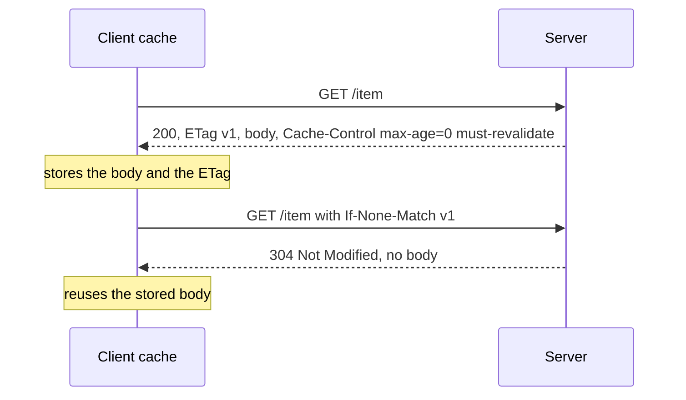

## Overview

HTTP is the application protocol of most APIs. Know method semantics, status codes, caching headers and how connections are reused across HTTP versions.

## What to know

1. Methods, idempotency and status codes :: GET reads (safe, idempotent, cacheable); PUT replaces (idempotent); DELETE (idempotent); POST creates or acts (not idempotent); PATCH partially updates. Status codes: 2xx success (200, 201 Created, 204), 3xx redirect (301, 302, 304 Not Modified), 4xx client error (400, 401 unauthenticated, 403 forbidden, 404, 409 conflict, 429), 5xx server error (500, 502, 503, 504).

2. Headers, caching (Cache-Control, ETag) :: Cache-Control (max-age, no-store, private/public, s-maxage for CDNs) controls caching. ETag or Last-Modified enable conditional requests: the client sends If-None-Match, and the server answers 304 with no body if nothing changed. Vary says which request headers change the response.

3. Cookies and CORS :: Cookies carry state such as session ids; secure them with HttpOnly (no JavaScript access), Secure (HTTPS only) and SameSite (CSRF protection). CORS: browsers block cross-origin requests unless the server allows the origin with Access-Control-Allow-Origin; non-simple requests send a preflight OPTIONS first. CORS protects users' browsers, not your API.

4. Keep-alive, HTTP/2 multiplexing, HTTP/3 :: HTTP/1.1 keep-alive reuses a TCP connection for sequential requests. HTTP/2 multiplexes many concurrent requests over one connection with compressed headers. HTTP/3 does the same over QUIC without TCP head-of-line blocking.

## Recap

- Safe: GET/HEAD. Idempotent: GET, PUT, DELETE. Not idempotent: POST, PATCH (usually).
- 2xx ok, 3xx redirect, 4xx client error (400, 401, 403, 404, 409, 429), 5xx server (500, 502, 503, 504).
- Cache-Control: max-age, no-store, private/public; ETag + If-None-Match → 304.
- CORS: the browser enforces it; the server opts in with Access-Control-Allow-* headers.

## Go deeper

### Methods, semantics and status codes {point: 0}

GET retrieves a representation; it must be safe (no side effects the client is responsible for) and is cacheable. HEAD is GET without the body. POST submits data for processing: create a resource, trigger an action; not idempotent by default. PUT replaces the target resource with the request body; idempotent (sending it twice has the same effect). PATCH applies partial modifications; idempotency depends on the patch format. DELETE removes; idempotent (a second delete may return 404, but the state is the same). OPTIONS describes communication options (used by CORS preflight).

Status classes: 1xx informational (100 Continue, 101 Switching Protocols for WebSocket upgrade), 2xx success (200 OK, 201 Created, 202 Accepted, 204 No Content), 3xx redirection (301 permanent, 302/303 temporary, 304 Not Modified, 307/308 preserve method), 4xx client errors (400, 401, 403, 404, 405 Method Not Allowed, 409 Conflict, 410 Gone, 412 Precondition Failed, 413 Payload Too Large, 415, 422, 429), 5xx server errors (500, 502 Bad Gateway from a proxy, 503 Service Unavailable, 504 Gateway Timeout).

Retries: clients and proxies may automatically retry idempotent requests on network errors, which is why non-idempotent operations need idempotency keys.

### Caching headers that work {point: 1}

Fingerprinted static assets (app.3f9a1c.js): Cache-Control: public, max-age=31536000, immutable, because the URL changes when the content does. HTML: Cache-Control: no-cache (store but revalidate each time) with an ETag, so unchanged pages cost a 304 with no body. Personalized API responses: Cache-Control: private, no-store. Shared caches (CDN) can use s-maxage and stale-while-revalidate to serve slightly stale content while refreshing in the background.

### CORS preflight {point: 2}

A page on app.shop.com calls api.shop.com with JSON and an Authorization header: the browser first sends OPTIONS with Origin, Access-Control-Request-Method and -Headers. The API must answer with Access-Control-Allow-Origin: https://app.shop.com (not * when credentials are involved), allowed methods and headers, and optionally Access-Control-Max-Age to cache the preflight.

CORS protects users' browsers from other sites reading responses; it isn't server-side security; curl ignores it entirely.

### Cookies, sessions and CORS in more depth {point: 2.5}

Set-Cookie attributes: Domain and Path scope where it's sent; Expires/Max-Age make it persistent (otherwise a session cookie); Secure sends only over HTTPS; HttpOnly hides it from JavaScript (mitigates token theft via XSS); SameSite controls cross-site sending: Strict (never cross-site), Lax (top-level navigations only, the browser default), None (always, requires Secure). Third-party cookies are being phased out by browsers.

Same-origin policy: scripts can read responses only from the same origin (scheme + host + port). CORS lets a server relax that for specific origins. Simple requests (GET/POST with simple headers and content types) are sent directly, and the browser blocks reading the response unless Access-Control-Allow-Origin matches. Others trigger a preflight OPTIONS request first. With credentials (cookies), the server must echo the specific origin and set Access-Control-Allow-Credentials: true; wildcards aren't allowed.

CSRF exploits the browser sending cookies on cross-site requests; defenses are SameSite cookies, CSRF tokens, and checking Origin/Referer headers on state-changing requests.

### Connection management and performance {point: 3}

HTTP/1.1 keep-alive reuses a TCP (and TLS) connection for many sequential requests, avoiding repeated handshakes. Browsers open up to 6 connections per origin to get parallelism. HTTP/2 multiplexes requests over one connection: no need for domain sharding or bundling everything into one file, header compression (HPACK) shrinks repetitive headers, and server push (now deprecated in browsers) tried to send resources proactively. HTTP/3 removes TCP head-of-line blocking.

Other performance tools: compression (gzip, Brotli; don't compress already-compressed images), caching headers and ETags, CDNs, preconnect/preload hints, 103 Early Hints, and range requests for large files and resumable downloads.

On the server side, proxies and services should reuse upstream connections (pooling), set sensible timeouts (connect, read, idle), and limit request sizes. Slowloris-style attacks hold many connections open sending headers very slowly; reverse proxies buffer and time out such clients before they reach application servers.

### Conditional requests: ETag and 304 Not Modified {point: 1}

Caching in HTTP has two halves. The first is **freshness**: `Cache-Control: max-age=3600` tells a cache it may reuse the response for an hour without asking anyone. The second is **validation**: once a cached copy is stale, the cache does not have to download it again. It asks the server "has this changed?", and the server answers with a tiny 304 if not.

The server marks each version of a resource with a validator, most often an `ETag`, an opaque string such as a hash of the content or a version number. The client stores it with the response. On the next request it sends `If-None-Match: "v1"`. If the current ETag still matches, the server replies `304 Not Modified` with no body, and the client reuses its stored copy; if the content changed, the server sends `200` with the new body and a new ETag. `Last-Modified` and `If-Modified-Since` do the same with a timestamp, with a one-second resolution that ETags do not have. A 304 saves bandwidth, not a round trip, so it is the right tool for large responses that change rarely (an image, a big JSON file). The same ETags can protect writes: `If-Match` on a PUT lets the server refuse an update (412 Precondition Failed) when someone else changed the resource first, which is optimistic locking over HTTP. Two details come up in questions. A **weak** ETag (written `W/"v1"`) says the content is equivalent but not byte-identical, which is enough for caching but not for range requests. And when a URL can return different bodies depending on a request header (`Accept-Encoding`, `Accept-Language`), the response must carry a `Vary` header naming it, or a shared cache may serve a gzipped body to a client that cannot read it.


Diagram caption: The first response carries the body. The second carries only headers, so a large body is sent once.

### A runnable demo with the JDK's own server and client {point: 1}

The demo starts the JDK's built-in `HttpServer` on a free port, then uses `java.net.http.HttpClient` to fetch `/item` twice. The server sets an ETag, and answers 304 with no body when `If-None-Match` equals it. It prints `first request: 200 ETag="v1" body={"price": 42}` and then `revalidation: 304 body length=0`, which is the exchange from the diagram, on a real socket.

```java
import com.sun.net.httpserver.HttpServer;
import java.net.InetSocketAddress;
import java.net.URI;
import java.net.http.HttpClient;
import java.net.http.HttpRequest;
import java.net.http.HttpResponse;
import java.nio.charset.StandardCharsets;

public class EtagDemo {
    public static void main(String[] args) throws Exception {
        String body = "{\"price\": 42}";
        String etag = "\"v1\"";
        HttpServer server = HttpServer.create(new InetSocketAddress("127.0.0.1", 0), 0);
        server.createContext("/item", ex -> {
            String inm = ex.getRequestHeaders().getFirst("If-None-Match");
            ex.getResponseHeaders().add("ETag", etag);
            ex.getResponseHeaders().add("Cache-Control", "max-age=0, must-revalidate");
            if (etag.equals(inm)) {
                ex.sendResponseHeaders(304, -1);          // no body: the client's copy is still good
            } else {
                byte[] b = body.getBytes(StandardCharsets.UTF_8);
                ex.sendResponseHeaders(200, b.length);
                ex.getResponseBody().write(b);
            }
            ex.close();
        });
        server.start();
        try {
            HttpClient client = HttpClient.newHttpClient();
            URI uri = URI.create("http://127.0.0.1:" + server.getAddress().getPort() + "/item");
            HttpResponse<String> first = client.send(HttpRequest.newBuilder(uri).build(), HttpResponse.BodyHandlers.ofString());
            System.out.println("first request: " + first.statusCode() + " ETag=" + first.headers().firstValue("ETag").orElse("none") + " body=" + first.body());
            HttpResponse<String> second = client.send(
                    HttpRequest.newBuilder(uri).header("If-None-Match", first.headers().firstValue("ETag").orElseThrow()).build(),
                    HttpResponse.BodyHandlers.ofString());
            System.out.println("revalidation: " + second.statusCode() + " body length=" + second.body().length());
        } finally {
            server.stop(0);
        }
    }
}
```

## Interview questions

- PUT vs POST vs PATCH?
- 401 vs 403?
- How does an ETag save bandwidth?
- What problem does CORS solve?
