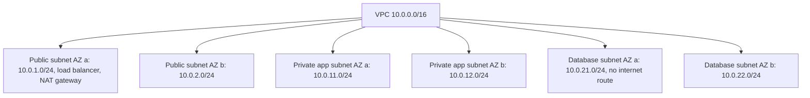

## Overview

IP delivers packets between hosts across networks on a best-effort basis. Addressing, NAT and routing explain how a request finds your server and why private networks work the way they do.

## What to know

1. IPv4 vs IPv6, subnets and CIDR :: IPv4 addresses are 32 bits (about 4.3 billion, exhausted); IPv6 addresses are 128 bits. CIDR notation 10.0.0.0/16 means the first 16 bits are the network, giving 65,536 addresses. Subnets split address space (e.g. public and private subnets in a VPC).

2. NAT :: Network address translation lets many private addresses (10.x, 192.168.x) share one public IP: the router rewrites source addresses and ports and tracks connections. This is why servers inside a VPC need a NAT gateway to reach the internet, and why inbound connections to home devices don't work by default.

3. ARP :: ARP maps an IP address to a MAC address on the local network: 'who has 10.0.0.5?' broadcast, then a reply. Only used within one L2 segment; beyond it, frames go to the gateway's MAC.

4. Routing basics (BGP idea, anycast) :: Routers forward packets hop by hop using routing tables (longest prefix match). BGP is how independent networks (ISPs, clouds) announce which prefixes they can reach. Anycast announces the same IP from many locations, so users reach the nearest one; used by DNS root servers and CDNs.

## Recap

- CIDR /24 = 256 addresses; private ranges 10/8, 172.16/12, 192.168/16.
- NAT maps many private addresses to one public IP using ports.
- ARP: IP → MAC on the local network.
- BGP routes between networks (ASes); anycast announces one IP from many places, nearest wins.

## Go deeper

### Addressing and CIDR arithmetic {point: 0}

An IPv4 address is 32 bits, written as four octets. CIDR notation a.b.c.d/n means the first n bits are the network prefix; the rest identify hosts. A /24 has 2⁸ = 256 addresses (254 usable hosts traditionally, after the network and broadcast addresses; clouds reserve a few more). A /16 has 65,536; a /20 has 4,096; a /32 is one address. Subnet mask /24 = 255.255.255.0.

To check whether an address is in a subnet, AND it with the mask and compare to the network address: 10.0.17.5 in 10.0.16.0/20? Mask /20 = 255.255.240.0; 17 AND 240 = 16, so yes. Splitting: a /16 VPC splits into 16 /20 subnets or 256 /24 subnets.

Private ranges (RFC 1918): 10.0.0.0/8, 172.16.0.0/12, 192.168.0.0/16, not routed on the public internet. Others to know: 127.0.0.0/8 loopback, 169.254.0.0/16 link-local (also cloud metadata at 169.254.169.254, a common SSRF target), 100.64.0.0/10 carrier-grade NAT.

IPv6 uses 128-bit addresses (2001:db8::/32 style), typically /64 per subnet, with no NAT needed, simpler headers, and built-in autoconfiguration (SLAAC). Dual-stack systems run both.

### Subnetting a VPC {point: 0.5}

VPC 10.0.0.0/16 = 65,536 addresses. Split into /20 subnets (4,096 each): 10.0.0.0/20 public AZ-a, 10.0.16.0/20 public AZ-b, 10.0.32.0/20 private AZ-a, and so on. Public subnets route 0.0.0.0/0 to an internet gateway; private subnets route it to a NAT gateway, so instances can reach out but can't be reached.

A host checks whether a destination is in its own subnet (mask compare); if yes it ARPs for its MAC, otherwise it sends to the default gateway.

### ARP, DHCP and the local network {point: 2}

DHCP assigns addresses: a new host broadcasts DHCPDISCOVER; a server offers an address (OFFER), the host requests it (REQUEST), the server acknowledges (ACK) with the lease time, subnet mask, default gateway and DNS servers. Leases expire and renew.

ARP maps IP addresses to MAC addresses on a local network: 'who has 192.168.1.1? tell 192.168.1.20' is broadcast; the owner replies with its MAC; results are cached. ARP has no authentication, so ARP spoofing can redirect local traffic (a reason to encrypt even on LANs). IPv6 replaces ARP with Neighbor Discovery.

Switches learn which MAC is on which port and forward frames only there; VLANs split one physical switch into separate broadcast domains. In clouds, the virtual network (VPC) implements all of this in software: there's no real broadcast, and ARP is answered by the hypervisor.

### Routing and BGP basics {point: 3}

Inside an organization, interior gateway protocols (OSPF, IS-IS) compute shortest paths using link costs. Between organizations, the internet is a set of autonomous systems (ASes: ISPs, clouds, large companies), each with an AS number, exchanging reachability with BGP. A BGP router announces 'I can reach prefix 203.0.113.0/24 via AS path 64500 64501'; neighbours choose paths by policy (business relationships, path length, preferences) rather than pure shortest distance.

Consequences: routing changes propagate in seconds to minutes; misconfigurations or hijacks (announcing someone else's prefix, or a more specific prefix) can redirect traffic globally (famous outages); RPKI adds origin validation. Anycast relies on BGP: the same prefix announced from many sites, so each user's traffic goes to the topologically nearest one, which is how DNS resolvers, CDNs and DDoS scrubbing networks absorb load and fail over.

Cloud regions connect to the internet through many peering points; private interconnects (Direct Connect, Interconnect) give dedicated paths from offices or data centers.

### Anycast and why DNS/CDNs use it {point: 3.5}

The same IP prefix is announced via BGP from many data centers; routers send packets to the nearest (by routing policy) announcement. Users automatically hit a close PoP, and if one PoP fails its announcement is withdrawn and traffic shifts elsewhere.

Works best for short, stateless exchanges (DNS over UDP) or with stable routing for TCP (route changes mid-connection could land on another PoP). 8.8.8.8 and 1.1.1.1 are anycast.

### CIDR arithmetic in Java {point: 0}

CIDR notation `a.b.c.d/n` means "the first n bits are the network, the rest identify a host". The prefix `/24` leaves 8 host bits, so the block holds 2^8 = 256 addresses; `/16` leaves 16 bits for 65,536; `/26` leaves 6 bits for 64. Of those, a classic IPv4 subnet reserves the first address (the network address, all host bits zero) and the last (the broadcast address, all host bits one), so the usable hosts are 2^(32-n) minus 2. Cloud providers reserve a few more in each subnet; AWS keeps five, so a `/28` (16 addresses) leaves 11 usable.

The arithmetic is bit manipulation. Convert the dotted address to a 32-bit number, build the mask with n leading ones (`0xFFFFFFFF << (32 - n)`), and AND the address with the mask to get the network address. OR the network with the inverted mask to get the broadcast address. To test whether an address belongs to a block, mask both with the block's mask and compare. Routers do exactly this comparison, in hardware, against every entry of the routing table, and the entry with the longest matching prefix wins.

```java
public class CidrDemo {
    static long toLong(String ip) {
        String[] p = ip.split("[.]");
        long v = 0;
        for (String s : p) v = (v << 8) | Integer.parseInt(s);
        return v;
    }

    static String toIp(long v) {
        return ((v >> 24) & 255) + "." + ((v >> 16) & 255) + "." + ((v >> 8) & 255) + "." + (v & 255);
    }

    static void describe(String cidr) {
        String[] parts = cidr.split("/");
        int prefix = Integer.parseInt(parts[1]);
        long mask = prefix == 0 ? 0 : (0xFFFFFFFFL << (32 - prefix)) & 0xFFFFFFFFL;
        long network = toLong(parts[0]) & mask;
        long broadcast = network | (~mask & 0xFFFFFFFFL);
        long total = 1L << (32 - prefix);
        System.out.println(cidr + " -> network " + toIp(network) + ", broadcast " + toIp(broadcast)
                + ", addresses " + total + ", usable hosts " + Math.max(0, total - 2));
    }

    static boolean contains(String cidr, String ip) {
        String[] parts = cidr.split("/");
        int prefix = Integer.parseInt(parts[1]);
        long mask = prefix == 0 ? 0 : (0xFFFFFFFFL << (32 - prefix)) & 0xFFFFFFFFL;
        return (toLong(ip) & mask) == (toLong(parts[0]) & mask);
    }

    public static void main(String[] args) {
        describe("10.0.1.0/24");
        describe("10.0.0.0/16");
        describe("192.168.1.130/26");
        System.out.println("10.0.1.77 in 10.0.1.0/24: " + contains("10.0.1.0/24", "10.0.1.77"));
        System.out.println("10.0.2.5 in 10.0.1.0/24: " + contains("10.0.1.0/24", "10.0.2.5"));
    }
}
```

### Planning the address space of a VPC {point: 0.5}

The program prints `10.0.1.0/24 -> network 10.0.1.0, broadcast 10.0.1.255, addresses 256, usable hosts 254`, then the same for `10.0.0.0/16` (65,536 addresses) and for `192.168.1.130/26`. The last one is the instructive case: the address is not the start of its block, and the program shows that the block really begins at `192.168.1.128` and ends at `192.168.1.191`, 64 addresses in all. It then prints `true` for `10.0.1.77` in `10.0.1.0/24` and `false` for `10.0.2.5`.

Use this when you design a network in an interview. Pick a private range (RFC 1918: `10.0.0.0/8`, `172.16.0.0/12`, `192.168.0.0/16`), give each VPC a block that does not overlap with any VPC or office network you may ever connect to it (peering and VPN need distinct ranges, and renumbering later is painful), and carve it into subnets per availability zone and tier. A common layout uses a /16 for the VPC and /24 subnets: public ones for load balancers and NAT gateways, private ones for application servers, and isolated ones for databases with no route to the internet.


Diagram caption: One VPC, two availability zones, three tiers. Routing tables, not the address ranges themselves, decide which subnets can reach the internet.

## Interview questions

- How many hosts fit in a /24?
- How does a server in a private subnet download updates?
- What is anycast and why do CDNs use it?
