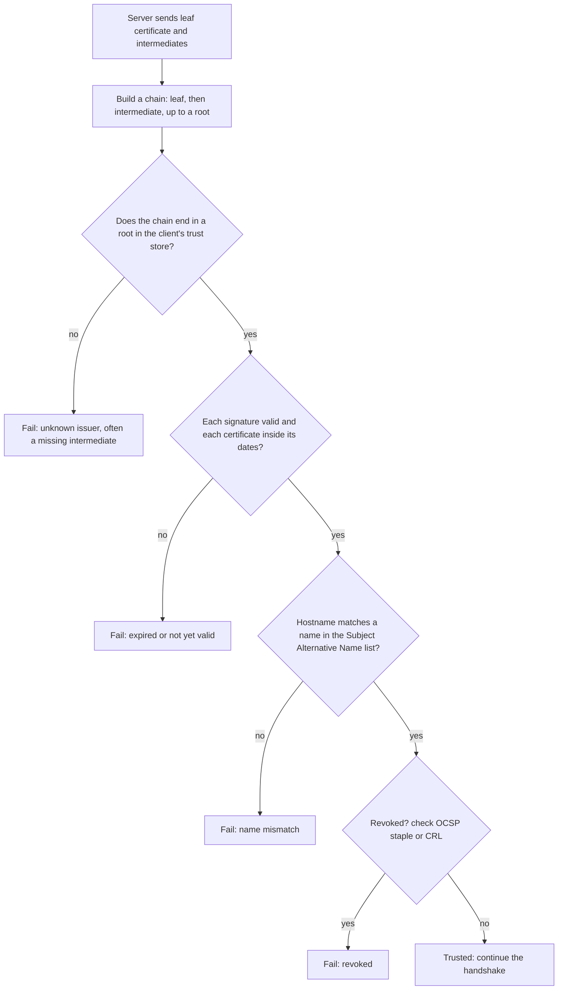

## Overview

TLS provides encryption, integrity and server authentication for connections. Know how the handshake establishes keys, how certificates prove identity, and when to use mutual TLS.

## What to know

1. Handshake (TLS 1.3) :: The ClientHello carries supported cipher suites and an ephemeral key share; the ServerHello carries its key share, certificate and a signature proving it owns the certificate's private key. Both derive the same session keys (ECDHE), so it takes 1 round trip, or 0-RTT on resumption. Ephemeral keys give forward secrecy: stealing the server key later doesn't decrypt old traffic.

2. Certificates and chains of trust :: The server presents a certificate binding its domain to a public key, signed by an intermediate CA, which is signed by a root CA the client already trusts. The client verifies the chain, the domain name, expiry and revocation. Let's Encrypt automates issuing short-lived certificates.

3. Symmetric vs asymmetric crypto :: Asymmetric crypto (public/private key pairs: RSA, ECDSA, ECDH) is used for key agreement and signatures; it's slow. Symmetric crypto (one shared key: AES-GCM, ChaCha20) encrypts the actual data quickly. TLS uses asymmetric crypto to agree on symmetric keys.

4. mTLS :: Mutual TLS: the client also presents a certificate, so both sides authenticate. Common for service-to-service traffic inside a mesh and for B2B APIs; it needs certificate issuance and rotation infrastructure.

## Recap

- TLS 1.3: 1-RTT handshake; ECDHE key exchange gives forward secrecy.
- Certificate chain: server cert ← intermediate ← root in the client's trust store.
- Asymmetric crypto for authentication/key agreement, symmetric (AES-GCM, ChaCha20) for data.
- mTLS: both sides present certificates; standard for service-to-service identity.

## Go deeper

### TLS 1.3 handshake {point: 0}

ClientHello: supported cipher suites, a key share (ephemeral ECDHE public key), SNI (hostname). ServerHello: chosen suite and its key share; both sides now compute the shared secret. The server sends (encrypted) its certificate, a signature over the handshake with its private key (proves it owns the cert), and Finished. The client verifies the chain to a trusted root, the hostname, the signature, then sends Finished. Application data flows after one round trip.

Forward secrecy: the session keys came from ephemeral keys, so stealing the server's private key later doesn't decrypt recorded traffic.

### Certificates and chains of trust {point: 1}

A certificate binds a public key to an identity (domain names in the Subject Alternative Name field), with a validity period, signed by a certificate authority (CA). Browsers and operating systems ship a set of trusted root CAs. Servers present their leaf certificate plus intermediate certificates; the client builds a chain from the leaf to a trusted root, verifying each signature, the validity dates, the hostname match, key usage, and revocation status where possible (OCSP stapling, CRLs; browsers increasingly rely on short-lived certificates instead).

Certificate Transparency: CAs log every certificate they issue in public append-only logs; browsers require proof of logging, so misissued certificates for your domain can be detected (monitor CT logs). Let's Encrypt and ACME automated issuance and renewal with 90-day certificates.

Operational failures to mention: expired certificates (automate renewal and alert on expiry), missing intermediates (works in some browsers, fails in others), hostname mismatches, and private keys leaked through misconfigured storage (use KMS/HSMs and restrict access).

### Certificates in practice {point: 1.5}

Certificates expire (90 days for Let's Encrypt), so automate renewal (ACME, cert-manager). Revocation checking is weak in browsers; short lifetimes are the real mitigation. Terminate TLS at the load balancer for simplicity, and re-encrypt to backends (or use mTLS via a service mesh) if the internal network isn't trusted.

Pinning certificates in mobile apps blocks interception but makes rotation risky; pin the public key of an intermediate or a backup key, never only the leaf.

### Cryptographic building blocks {point: 2}

Symmetric encryption (AES-GCM, ChaCha20-Poly1305): one shared key encrypts and decrypts; fast (hardware AES does gigabytes per second); 'authenticated encryption' also detects tampering. The problem is agreeing on the key over an insecure network.

Asymmetric cryptography: a key pair. Key exchange (ECDHE, ephemeral elliptic-curve Diffie-Hellman) lets two parties derive a shared secret by exchanging public values; an eavesdropper can't compute it. Digital signatures (RSA, ECDSA, Ed25519) prove that the holder of a private key signed some data; anyone with the public key verifies. Asymmetric operations are much slower, so TLS uses them only during the handshake.

Hash functions (SHA-256) produce fixed-size digests; HMAC combines a hash with a key to authenticate messages. Key derivation (HKDF) turns the shared secret into separate keys for each direction. Forward secrecy comes from ephemeral key exchange: session keys aren't derivable from the server's long-term key.

### mTLS and TLS in system design {point: 3}

In mutual TLS, the server also requests a certificate from the client and verifies it, so both sides authenticate. Within a company, a private CA issues short-lived certificates to services (SPIFFE IDs like spiffe://prod/ns/payments/sa/api); a service mesh (Istio, Linkerd) or platform (Kubernetes with cert-manager) rotates them automatically and enforces policies such as 'only the checkout service may call payments'. This is the foundation of zero-trust networking: don't trust the network, authenticate every call.

Where to terminate TLS: at the CDN/edge for clients (lowest latency); re-encrypt from the edge to the origin; between internal services either mTLS everywhere (mesh) or at least TLS on untrusted networks. TLS termination at a load balancer lets it route by HTTP content but means traffic behind it is plaintext unless re-encrypted.

Performance: TLS 1.3 handshakes are fast, session resumption avoids full handshakes, and connection reuse means the handshake cost is paid rarely; CPU cost of encryption is small on modern hardware.

### How a client decides to trust a certificate {point: 1.5}

After the key exchange, the server sends its certificate chain, and the client must decide whether the key in it really belongs to the site it wanted. That decision is a short, fixed checklist, and each item maps to a common production failure.

Take the steps in turn. A **chain** is the leaf certificate (issued to your domain), signed by an intermediate certificate authority (CA), signed by a root. Roots are not sent; they ship inside the operating system or browser **trust store**. If the server forgets to send the intermediate, some clients can fetch it themselves and others fail, which is why "works in my browser, fails in curl or in my Java service" is a classic report. The fix is to configure the server with the full chain, leaf plus intermediates. **Validity dates** are checked against the client's clock, so an expired certificate, or a device with a wrong clock, fails. The **hostname** must match a name in the certificate's Subject Alternative Name field (the old Common Name is ignored by modern clients), and wildcard names such as `*.shop.com` match exactly one label, so `a.b.shop.com` is not covered.

Diagram caption: Four ways validation fails. Each one has a typical operational cause.

### Revocation, pinning and rotation {point: 1}

**Revocation** answers "was this certificate withdrawn before its expiry?" The old way is a certificate revocation list (CRL), a large file the client downloads. The newer way is OCSP, an online query per certificate, which slows the connection and tells the CA which sites you visit. **OCSP stapling** has the server fetch a signed, time-stamped OCSP answer regularly and attach it to the handshake, which fixes both problems. In practice the industry has moved toward short-lived certificates (90 days or less) because a certificate that expires soon matters less if revocation is unreliable.

**Pinning** means a client accepts only a specific certificate or public key, not just anything signed by a trusted CA. It protects against a rogue CA, but a pinned certificate that you rotate without updating the client breaks the app, so mobile apps use it carefully, often pinning to a backup key as well.

Most real outages here are plain **expiry**: someone forgot a renewal. Automation removes it: the ACME protocol (used by Let's Encrypt) proves control of a domain and issues certificates automatically, tools like cert-manager renew them in Kubernetes, and monitoring should alert when any certificate is within, say, 14 days of expiry. For service-to-service traffic with mutual TLS, the same checklist applies in both directions, and a service mesh typically issues and rotates the short-lived certificates for you.

## Interview questions

- Walk through a TLS 1.3 handshake.
- Why does TLS use both asymmetric and symmetric encryption?
- What is forward secrecy?
