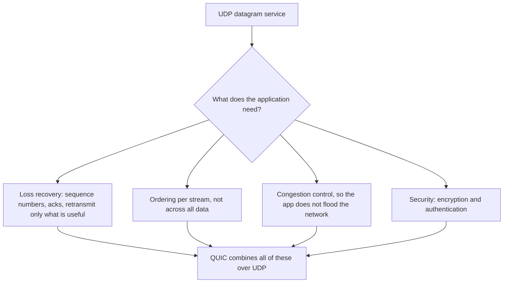

## Overview

UDP is a thin layer over IP: ports and a checksum, with no connection, ordering or retransmission. You choose it when late data is worthless or when you implement reliability yourself, as QUIC does.

## What to know

1. When UDP fits (DNS, video, games) :: DNS (one small request and reply; just retry), live video and voice (a late frame is useless; skip it), games (send the latest state frequently), metrics (StatsD; losing a few samples is fine), and broadcast or multicast discovery.

2. QUIC: streams without head-of-line blocking :: QUIC runs over UDP and builds reliability, congestion control and encryption (TLS 1.3 built in) on top, with multiple independent streams so a lost packet only stalls its own stream. Connections are identified by an id rather than IP and port, so they survive network changes (Wi-Fi to cellular). HTTP/3 runs on QUIC.

3. 0-RTT :: A client that has talked to a server before can send encrypted application data in its very first packet, saving a round trip. The risk is replay attacks, so 0-RTT is limited to idempotent requests.

## Recap

- UDP: no handshake, no ordering, no retransmission; 8-byte header.
- Fits DNS, live media, games, telemetry: late data is worthless or the app handles loss.
- QUIC: TLS 1.3 built in, independent streams (no HOL blocking), connection migration, 0-RTT resumption.

## Go deeper

### UDP characteristics and uses {point: 0}

UDP adds only ports, length and a checksum to IP. No connection setup, no state on the server per client, no retransmission, no ordering, no congestion control. Packets can be lost, duplicated or reordered, and a datagram larger than the path MTU gets fragmented (losing one fragment loses the whole datagram), so applications keep datagrams under ~1200-1400 bytes.

Uses: DNS queries (fall back to TCP for large responses), DHCP, NTP, SNMP, syslog, real-time voice and video (RTP over UDP, with jitter buffers and forward error correction), online games, video streaming protocols in some systems, VPNs (WireGuard), and QUIC. Multicast and broadcast only work with UDP.

Applications on UDP must handle: loss (retransmit, or tolerate), ordering (sequence numbers), duplicates, congestion (rate control, or the app can flood the network), and security (UDP is easy to spoof, which enables amplification DDoS attacks via open DNS/NTP servers).

### Why games and calls use UDP {point: 0.3}

In a game, a position update that arrives late is useless because a newer one is already on the way; TCP would hold all later updates until the lost one is retransmitted (head-of-line blocking), causing visible stalls. Over UDP, the game sends sequence-numbered snapshots, ignores old ones, and adds reliability only for the few messages that need it (chat, purchases).

Voice/video codecs tolerate small losses (concealment) far better than delays.

### Designing on top of UDP: a game or voice example {point: 0.6}

A multiplayer game server runs a tick loop (say 30 Hz). Clients send input commands with sequence numbers; the server simulates and sends each client a snapshot of relevant world state with the latest acknowledged input number. Lost snapshots don't matter, since the next one supersedes them; clients interpolate between snapshots and predict their own movement locally, reconciling when the authoritative state arrives. Reliable events (chat, purchases, match results) go over a reliable channel: a small acknowledgement and retransmission layer for just those messages, or a separate TCP/WebSocket connection.

Voice: packets every 20 ms carry audio frames; a jitter buffer delays playback slightly to smooth arrival variation; lost packets are concealed (interpolated) or recovered with forward error correction; the codec adapts bitrate to measured loss and bandwidth (WebRTC does all of this, plus NAT traversal with ICE/STUN/TURN).

### What QUIC fixes for the web {point: 1}

HTTP/2 multiplexes streams over one TCP connection, so a single lost packet stalls all streams. QUIC implements reliability per stream over UDP, so loss on one stream doesn't block others. It combines the transport and TLS handshakes (1 RTT, 0-RTT on resumption), and identifies connections by an ID instead of the IP/port tuple, so a phone switching from Wi-Fi to cellular keeps the connection.

0-RTT data can be replayed by an attacker, so only idempotent requests should use it.

### QUIC in more depth {point: 1.5}

QUIC is a transport protocol over UDP, standardized in 2021, carrying HTTP/3. It implements reliability, congestion control and flow control in user space, with streams as a first-class concept: each stream is independently ordered, so a lost packet only delays the streams whose data it carried.

Security is built in: TLS 1.3 is integrated into the handshake, and almost all of QUIC's headers are encrypted, which prevents middleboxes from ossifying the protocol (they can't depend on fields they can't read). A new connection takes 1 RTT; resumption allows 0-RTT data (replayable, so only for idempotent requests).

Connection IDs let a connection survive changes in the client's IP address or port (mobile network switches, NAT rebinding). Because it runs in user space, QUIC evolves quickly with application releases, at the cost of more CPU than kernel TCP (improving with offloads like UDP GSO). Operationally, load balancers must route by connection ID to keep a connection on one server, and some networks block UDP 443, so clients fall back to TCP.

### What you must rebuild when you leave TCP {point: 0.6}

Choosing UDP does not remove the need for reliability, ordering and congestion control. It only moves the decision into your application, where you can pick what to keep. UDP gives you a port, a length and a checksum, and nothing else: no connection, no retransmission, no ordering, no flow control. Datagrams can be lost, duplicated and reordered, and each one is delivered whole or not at all.

For each TCP feature, ask whether your application needs it. A voice call does not want a retransmitted packet that arrives 300 ms late, since the moment to play it has passed, so it keeps UDP's behaviour and hides the gaps with codec-level concealment. A multiplayer game sends the player's position 30 times a second, and an old position is worthless once a newer one arrives, so it also drops late data. A game's chat messages or "item purchased" events do need to arrive, so many games run two channels: unreliable for state, reliable for events. DNS needs one request and one response, so it does its own simple timeout and retry, with no connection at all.

Diagram caption: QUIC is what you get when you rebuild the useful parts of TCP and TLS in user space on top of UDP.

### Why QUIC chose UDP, and the 0-RTT trade-off {point: 2}

QUIC could not be a new IP protocol: routers, NATs and firewalls drop unknown protocol numbers, and operating system kernels take years to change. UDP passes through almost everywhere, and QUIC runs in a user-space library, so browsers and servers can update it quickly. It adds what the web needs: multiple independent streams on one connection (so one lost packet does not block the others), connection setup that includes the encryption handshake in a single round trip, and **connection migration**: a connection is identified by a connection id, not by the IP and port pair, so it survives a phone moving from Wi-Fi to cellular.

**0-RTT** lets a client that has talked to the server before send application data in its very first flight, using a key remembered from the previous session. That saves a round trip for repeat visits. The trade-off is **replay**: 0-RTT data is not protected against an attacker who records the packet and sends it again, so servers should accept it only for safe, idempotent requests (a GET of a public page), never for something like a payment. The same reasoning appears in TLS 1.3 early data. Running over UDP has operational costs too: some networks rate-limit or block UDP, so clients fall back to TCP, and QUIC's per-packet encryption uses more CPU than kernel TCP, which is a real cost at scale.

## Interview questions

- Why does video calling use UDP?
- How does QUIC avoid TCP's head-of-line blocking?
