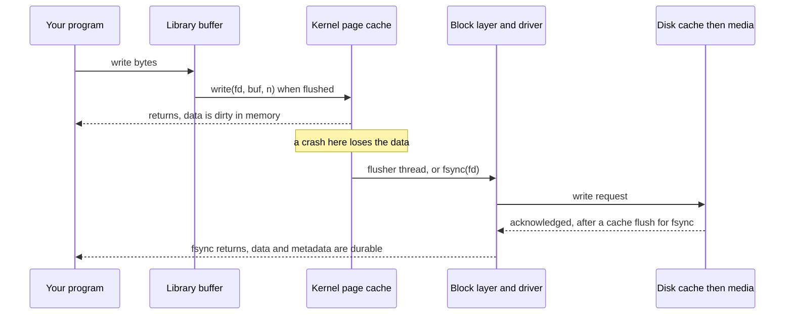

## Overview

File systems and I/O models determine how fast and how safely data reaches disk, and how a server handles thousands of connections. Event loops and the page cache are the ideas that matter most for backend interviews.

## What to know

1. Inodes, directories, links :: An inode stores a file's metadata (size, permissions, block pointers), not its name. A directory maps names to inode numbers. A hard link is another name for the same inode (the file is deleted when the link count reaches 0); a symbolic link is a small file containing a path.

2. Buffered I/O, page cache, fsync :: write() usually only copies data into the kernel page cache and returns; the OS writes it to disk later. A crash can lose it unless you call fsync, which forces it to stable storage (slow: milliseconds). Databases fsync their write-ahead log on commit; group commit batches several transactions into one fsync.

3. Blocking vs non-blocking vs async I/O :: Blocking I/O: the thread waits until data is ready (simple; needs one thread per connection). Non-blocking: the call returns immediately with 'try again'. Asynchronous I/O (io_uring, IOCP): submit operations and get completions later.

4. select / poll / epoll and event loops :: select and poll scan every watched descriptor on each call (O(n)). epoll (Linux) and kqueue (BSD) register interest once and return only the ready descriptors, so one thread can serve tens of thousands of connections. This is the event-loop model of Nginx, Node.js and Redis.

5. Zero-copy (sendfile) :: sendfile() moves file data from the page cache to a socket inside the kernel, with no copies to user space, which lets static file servers and Kafka send data at line rate.

## Recap

- Inode holds metadata + block pointers; a directory maps names → inode numbers.
- Hard link = another name for the same inode; symlink = a file containing a path.
- write() lands in the page cache; only fsync() makes it durable.
- epoll: O(1) readiness notification for many sockets; the basis of event loops.

## Go deeper

### File system structure {point: 0}

In Unix-style file systems, an inode stores a file's metadata (size, owner, permissions, timestamps, link count) and pointers to its data blocks (direct pointers, plus indirect blocks or, in modern systems like ext4 and XFS, extents: contiguous ranges). The file name isn't in the inode: a directory is a special file mapping names to inode numbers.

Hard links are additional directory entries pointing to the same inode; the file's data is freed only when the link count reaches zero and no process has it open (which is why deleting a log file that a process still writes to doesn't free disk space). Symbolic links are small files containing a path; they can cross file systems and dangle if the target is removed.

Journaling (ext4, XFS, NTFS) writes metadata changes (and optionally data) to a journal before applying them, so after a crash the file system replays or discards incomplete operations instead of running a long fsck. Copy-on-write file systems (ZFS, Btrfs, APFS) never overwrite in place, enabling cheap snapshots and checksums.

### Buffering, the page cache and direct I/O {point: 1}

Several layers buffer data. User-space buffers (stdio, BufferedOutputStream) batch small writes into fewer syscalls; they must be flushed. The kernel's page cache holds file pages in RAM: reads hit it when data is cached (that's why the second read of a file is fast), and writes dirty pages that background writeback flushes after a delay (seconds). The disk itself has a volatile write cache; fsync also issues a flush/FUA command so data reaches stable storage.

O_DIRECT bypasses the page cache, so the application manages its own cache (databases like MySQL InnoDB and ScyllaDB do this to avoid double caching and to control I/O scheduling). Readahead detects sequential reads and prefetches.

Zero-copy: sendfile() and splice() move data from the page cache to a socket without copying it through user space; with NIC support (scatter-gather DMA), data isn't copied by the CPU at all. Kafka uses this to serve consumers at high throughput.

### Durability: write vs fsync {point: 1.5}

write() copies data into the kernel's page cache and returns; a crash or power loss before writeback loses it. fsync(fd) forces the file's data and metadata to stable storage (and waits). For a new file, you must also fsync the directory so the name entry survives.

Databases fsync the WAL on commit (group commit batches many transactions per fsync). The safe 'replace a file' recipe: write temp file → fsync it → rename over the original (atomic) → fsync the directory.

### I/O models: blocking, non-blocking, multiplexed, async {point: 2}

Blocking I/O: read() waits until data is available; simple code, one thread per concurrent operation. Non-blocking I/O: read() returns immediately with EAGAIN if no data; the program must poll. I/O multiplexing: select/poll/epoll/kqueue wait on many descriptors at once and report which are ready; a single thread then performs the ready reads and writes. This is the reactor pattern behind Nginx, Redis, Node.js and Netty. Asynchronous I/O: submit operations and get completion notifications later (Windows IOCP, Linux io_uring, which uses shared submission/completion rings to avoid syscalls per operation); the proactor pattern.

Event loops are efficient for many mostly idle connections, but any blocking call or CPU-heavy work inside the loop stalls every connection; offload such work to a thread pool. Thread-per-request with virtual threads or goroutines achieves similar scalability with blocking-style code, because the runtime multiplexes them onto few OS threads using non-blocking I/O underneath.

### select, poll, epoll and zero-copy {point: 3}

select/poll pass the whole set of descriptors on every call and scan it: O(n) per call, fine for a few hundred. epoll registers interest once (epoll_ctl) and epoll_wait returns only ready descriptors: O(ready), so one thread can manage 100k connections. Edge-triggered mode reports changes once (read until EAGAIN); level-triggered keeps reporting while data remains.

sendfile() sends file bytes to a socket inside the kernel, skipping copies to user space and back; Kafka and static file servers rely on it.

### Following one write() from your program to the disk {point: 1}

Saying "write saves the data" hides several layers, and the gaps between them are where data is lost. Follow a `write(fd, buf, n)` call on Linux with a normal file.

First, if you used a language-level stream (C `fwrite`, Java `BufferedOutputStream`), the bytes may sit in a buffer inside your own process until it fills or you flush. `write()` itself is a system call: the kernel copies the bytes into the **page cache**, marks those pages **dirty**, and returns. At that moment the data is in kernel memory only. A power cut now loses it, but another process that reads the file sees the new data, because reads go through the same cache. Later, a background flusher thread writes dirty pages to the block device (after about 30 seconds by default, or sooner under memory pressure). The block layer queues and merges requests and hands them to the driver, and the disk itself may hold them in a volatile write cache. Only after that is the data durable.

Diagram caption: Four places data can wait. Only a successful fsync means it reached stable storage.

### fsync, journaling and O_DIRECT {point: 1}

`fsync(fd)` asks the kernel to push the file's dirty data (and the metadata needed to find it) to the device and wait, including a cache-flush command so the disk does not just hold the data in volatile memory. `fdatasync` skips metadata that is not needed to read the data back, such as modification time. Creating a file also changes its directory, so a careful program (a database, an editor that saves safely) fsyncs the new file and then the directory that contains it. The usual "safe save" pattern is: write a temporary file, fsync it, rename it over the original (rename is atomic), fsync the directory.

Filesystem journaling protects the filesystem's own structure, not your data. With ext4's default `data=ordered` mode, data blocks are written before the metadata that points to them, so you do not see another file's old contents after a crash, but your latest write may still be missing. `O_DIRECT` bypasses the page cache (databases use it when they manage their own buffer pool), and `O_SYNC` makes every write wait for the device, which is safe and slow. Costs are what a design answer needs: an fsync can take milliseconds on a disk, so databases batch many commits into one fsync (group commit).

## Interview questions

- Why might data you wrote be lost after a crash even though write() returned?
- How can Nginx handle 10k connections with a few threads?
