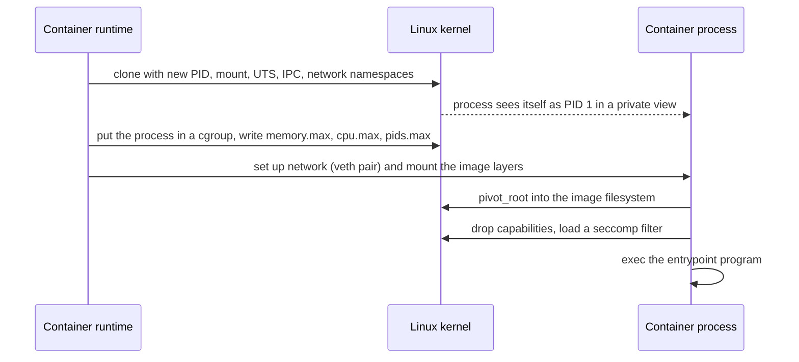

## Overview

The kernel runs with full hardware privileges and mediates all access to devices and memory; programs request services through system calls. Containers are an application of kernel features, not virtual machines.

## What to know

1. User vs kernel mode :: The CPU enforces privilege levels: user-mode code can't touch hardware or other processes' memory directly. The kernel runs in kernel mode. A bug in user mode crashes one process; a kernel bug crashes the machine.

2. System calls and their cost :: A system call (read, write, open, mmap) switches into kernel mode through a trap, runs kernel code, and returns. It costs far more than a function call (hundreds of nanoseconds or more), which is why buffered I/O batches small reads and writes.

3. Interrupts and signals :: Hardware interrupts (a packet arrived, disk I/O done, a timer tick) make the CPU run a kernel handler; the timer interrupt enables preemptive scheduling. Signals are the user-space equivalent sent to processes (SIGINT on Ctrl-C, SIGTERM for graceful shutdown, SIGKILL which can't be caught).

4. Containers: namespaces and cgroups :: A container is a process isolated by namespaces (its own view of PIDs, network, mounts, users, hostname) and limited by cgroups (CPU, memory and I/O quotas), sharing the host kernel. That makes it lighter than a VM, which runs a whole guest kernel on a hypervisor, but the isolation is weaker.

## Recap

- User mode can't touch hardware; system calls trap into kernel mode.
- Syscall cost: mode switch + checks (~100 ns-1 µs); batch I/O to amortize.
- Interrupts: hardware events; signals: kernel → process notifications (SIGTERM, SIGKILL, SIGSEGV).
- Containers = processes with namespaces (isolation of view) + cgroups (resource limits).

## Go deeper

### System calls step by step {point: 1}

A system call is the controlled entry from user mode into the kernel. The program (usually through libc) puts the syscall number and arguments in registers and executes a special instruction (syscall on x86-64). The CPU switches to kernel mode, jumps to the kernel's entry point, which saves user registers, validates arguments (pointers must point into the caller's memory), performs the operation (possibly blocking the thread), and returns to user mode with a result or error code (errno).

Cost: a few hundred nanoseconds for a trivial call, more with security mitigations (Spectre/Meltdown fixes added overhead to mode switches), plus whatever the operation does. Programs reduce syscall counts by buffering (one write of 64 KB instead of 64 writes of 1 KB), using vectored I/O (readv/writev), batching (io_uring, sendmmsg), and vDSO for frequent cheap calls like gettimeofday, which run in user space.

strace shows the syscalls a process makes, which is a quick way to see what a program is really doing (files opened, network calls, sleeps).

### Interrupts, exceptions and signals {point: 2}

Hardware interrupts come from devices (network card received packets, disk finished, timer tick). The CPU stops the current work, jumps to the kernel's interrupt handler, which does minimal work (acknowledge, queue data) and defers the rest to softirqs/tasklets or kernel threads to keep interrupts short. High packet rates use interrupt coalescing and polling (NAPI) to avoid interrupt storms.

Exceptions (traps and faults) come from the CPU executing an instruction: page faults, division by zero, invalid opcode, breakpoints; the kernel handles them (load a page) or turns them into signals for the process (SIGSEGV, SIGFPE).

Signals are the kernel's asynchronous notifications to processes: SIGINT (Ctrl+C), SIGTERM (polite stop), SIGKILL and SIGSTOP (can't be caught), SIGCHLD (child exited), SIGPIPE (wrote to a closed pipe/socket), SIGHUP (often 'reload config'). Signal handlers run asynchronously, interrupting the program at any point, so they should only set flags or write to a self-pipe; most work belongs in the main loop.

### Signals and graceful shutdown {point: 2.5}

Orchestrators send SIGTERM, wait a grace period (Kubernetes: 30 s), then SIGKILL (can't be caught). A service should catch SIGTERM, stop accepting new work (fail readiness), finish in-flight requests, flush buffers, close connections, then exit.

In a container, your process is PID 1, which doesn't get default signal handling; use an init (tini) or handle signals explicitly, or shutdowns become 30-second hangs followed by a kill.

### What a container really is {point: 3}

No separate kernel: a container is a normal process tree. Namespaces give it its own view of PIDs (it sees itself as PID 1), mounts (its own root filesystem from the image layers), network (its own interfaces and ports), hostname, users and IPC. cgroups cap and account its CPU, memory, I/O and process count; exceeding the memory limit gets the process OOM-killed.

So containers start in milliseconds and share the host kernel (weaker isolation than VMs, which run their own kernel on a hypervisor).

### Namespaces, cgroups and container isolation {point: 3}

Linux namespaces give a process its own view of a global resource: PID (process ids start at 1 inside), mount (its own file system tree, usually an image's root via overlayfs), network (own interfaces, routing tables, ports; connected via veth pairs and bridges), UTS (hostname), IPC, user (map container root to an unprivileged host user), cgroup and time.

cgroups (control groups) limit and account resources for a group of processes: CPU (quota per period, or weights), memory (hard limit triggers OOM kill inside the group), block I/O bandwidth, PIDs (stop fork bombs). Kubernetes resource requests and limits translate directly into cgroup settings.

Additional hardening: seccomp filters restrict which syscalls a container can make, capabilities drop root privileges (no CAP_SYS_ADMIN), read-only root file systems, and LSMs (AppArmor, SELinux). For stronger isolation between untrusted tenants, use sandboxed runtimes (gVisor) or lightweight VMs (Firecracker, Kata Containers), since all containers share one kernel and a kernel bug can break isolation.

### How a container starts: clone flags, mounts and cgroup limits {point: 3}

A container is an ordinary Linux process that the kernel has been told to isolate and limit. The runtime (runc, for example) does about five things, and naming them is the clearest answer to "what is a container".

Diagram caption: Isolation comes from namespaces, limits from cgroups, and safety from capabilities and seccomp.

### Namespaces, cgroups and capabilities {point: 3}

**Namespaces** change what a process can see. The runtime calls `clone` (or `unshare`) with flags such as `CLONE_NEWPID` (the process gets its own process ids, starting at 1), `CLONE_NEWNS` (a private mount table), `CLONE_NEWNET` (its own network interfaces and routing), `CLONE_NEWUTS` (its own hostname), `CLONE_NEWIPC` and `CLONE_NEWUSER` (map user ids, so root inside is not root outside). Then it uses `pivot_root` to make the unpacked image the process's root filesystem. The image layers are stacked with an overlay filesystem: read-only layers shared between containers, plus a thin writable layer per container.

**cgroups** (control groups) change what a process can use. In cgroup v2 these are files under `/sys/fs/cgroup/<group>/`: `memory.max` is a hard memory limit, `cpu.max` holds a quota and a period (for example `50000 100000` means 50 ms of CPU time in every 100 ms, which is half a core), and `pids.max` limits the number of processes. Two behaviours are worth knowing. If a container goes over `memory.max` and the kernel cannot reclaim memory, the OOM killer kills a process inside that group, and the orchestrator sees "OOMKilled". And the CPU quota is enforced by **throttling**: once a container has used its quota in a period, all its threads are paused until the next period. A multi-threaded service can burn its quota in the first part of the period and then freeze, which shows up as latency spikes at low average CPU, a common production puzzle.

Finally the runtime drops Linux **capabilities** (so even root inside cannot, say, load kernel modules) and installs a **seccomp** filter that blocks dangerous system calls. Containers share the host kernel, so a kernel bug can cross the boundary, which is the key difference from a virtual machine and the reason sandboxes such as gVisor or Firecracker exist for untrusted code.

## Interview questions

- Container vs VM?
- Why are system calls expensive and how do you reduce them?
- SIGTERM vs SIGKILL in a graceful shutdown?
