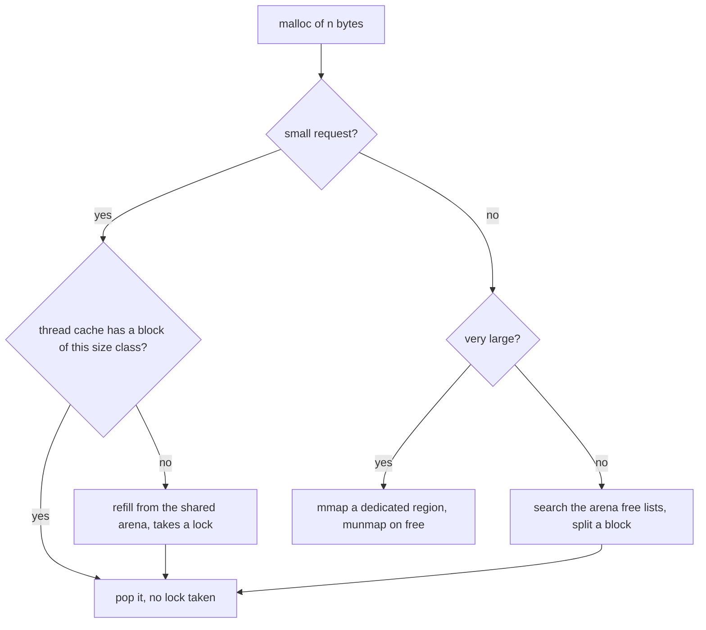

## Overview

The OS gives each process its own virtual address space and maps it onto physical memory. Knowing stack vs heap and how paging works explains memory leaks, stack overflows and why memory access patterns affect performance.

## What to know

1. Stack vs heap :: The stack holds function frames (locals, return addresses); allocation just moves a pointer, it's freed automatically on return, and it's small (often 1-8 MB per thread). Deep recursion overflows it. The heap holds dynamically allocated objects that live beyond one call; it's larger and managed by malloc/free or a garbage collector, and it can fragment and leak.

2. Fragmentation (internal vs external) :: Internal fragmentation is wasted space inside allocated blocks (asking for 33 bytes and getting a 64-byte block). External fragmentation is free memory split into pieces too small to use. Paging removes external fragmentation for physical memory; allocators use size classes to limit both.

3. Paging and page tables :: Virtual memory is divided into fixed-size pages (usually 4 KB) mapped to physical frames by a page table per process; multi-level page tables keep the table small. Pages can be anywhere in physical memory or not resident at all.

4. TLB :: The translation lookaside buffer caches recent virtual-to-physical translations so most accesses skip the page-table walk. A TLB miss costs extra memory accesses; huge pages (2 MB) increase TLB coverage for big-memory apps like databases.

5. Segmentation (idea) :: Segmentation divides memory into variable-size logical segments (code, data, stack) with a base and a limit. It's mostly historical on x86-64, where paging does the real work.

## Recap

- Stack: per thread, automatic, fast, limited (~1-8 MB). Heap: shared, manual/GC, fragmentation.
- Internal fragmentation: waste inside allocated blocks. External: free memory split into small holes.
- Paging: fixed-size pages map virtual → physical frames via page tables.
- TLB caches translations; a miss walks the multi-level page table.

## Go deeper

### Process address space layout {point: 0}

From low to high addresses on a typical Linux process: the text segment (machine code, read-only and shareable between processes running the same program), initialized data, BSS (zero-initialized globals), the heap (grows up via brk/sbrk or mmap for large allocations), memory-mapped regions (shared libraries, mmap'd files, thread stacks), and the main thread's stack near the top (grows down). The kernel occupies the upper part of the address space, inaccessible from user mode. ASLR randomizes these positions to make exploits harder.

Stack: function frames with local variables, return addresses and saved registers; allocation is just moving the stack pointer, so it's very fast and freed automatically on return; size is limited (8 MB default main thread on Linux, often less for other threads), so deep recursion overflows it. Heap: dynamic allocation with malloc/new; lives until freed (or garbage collected); slower, fragments, and is shared by all threads (allocators use per-thread caches to avoid lock contention).

### Fragmentation in practice {point: 1}

Internal: allocating 33 bytes from a 64-byte size class wastes 31; paging wastes on average half a page per allocation region. External: after many malloc/free of varied sizes, there's 100 MB free but no 10 MB contiguous block. Allocators (jemalloc, tcmalloc) use size classes and per-thread caches to limit both; compacting garbage collectors move objects to eliminate external fragmentation.

Paging removes external fragmentation for physical memory because any free frame can back any page.

### Allocators and garbage collection {point: 1.5}

malloc implementations (glibc ptmalloc, jemalloc, tcmalloc) keep free lists by size class, split and coalesce blocks, and use per-thread caches. Small objects come from size-class slabs (fast, some internal fragmentation); large ones get their own mmap regions. Memory freed to the allocator isn't always returned to the OS, so a process's RSS can stay high after a spike.

Garbage-collected runtimes (JVM, Go, .NET) find unreachable objects automatically. Generational collectors exploit the observation that most objects die young: allocate in a young generation (bump-pointer allocation, very fast), copy survivors to older generations, and collect the old generation rarely. Collectors trade throughput, pause times and memory overhead: Java's G1 targets pause goals, ZGC and Shenandoah keep pauses under a few milliseconds even for huge heaps. Memory leaks still happen in GC languages when references are unintentionally kept (static maps, caches without eviction, listeners never removed).

### Address translation with 4 KB pages {point: 2}

A 48-bit virtual address on x86-64 is split into four 9-bit indexes (one per page-table level) and a 12-bit offset (4 KB = 2¹²). The MMU checks the TLB; on a hit, physical address = frame number + offset in ~1 cycle. On a miss, it walks four levels of tables in memory (each a potential cache miss), then caches the result.

Huge pages (2 MB) cover more memory per TLB entry, which is why databases and JVMs enable them. A context switch to another process changes the page-table root, so TLB entries are tagged (PCID) or flushed.

### Paging, page tables and the TLB in more depth {point: 2.5}

Virtual memory is divided into fixed-size pages (4 KB typical; 2 MB and 1 GB huge pages), physical memory into frames of the same size. The page table maps virtual page numbers to frame numbers plus permission bits (present, read/write, user/kernel, executable, dirty, accessed). A flat table for a 48-bit address space would be huge, so x86-64 uses a 4-level tree (5-level on newer systems): only the parts covering used memory exist.

Every memory access needs a translation. The TLB is a small, fast cache of recent translations (dozens to a few thousand entries, split by level). A TLB hit costs about nothing; a miss triggers a page walk (up to 4 memory accesses, often cached). Programs with scattered access over large memory suffer TLB misses, which is why huge pages help databases and JVM heaps.

Segmentation, the older approach, divided memory into variable-size segments (code, data, stack) with base and limit; it causes external fragmentation and survives in x86 mostly vestigially. Paging won because fixed-size frames make allocation trivial.

### How malloc finds a block: free lists, buddy and slab allocators {point: 1}

`malloc(n)` looks like one call, but it is a small allocator program that sits between your code and the kernel. The kernel only hands out whole pages, through `brk` (grow the heap) or `mmap` (map a fresh region). The allocator cuts those pages into the variable-sized blocks your program asks for, and the way it does that decides speed and fragmentation.

The simplest design is a **free list**: blocks carry a small header with their size, and free blocks are linked together. To allocate, the allocator searches the list. **First fit** takes the first block big enough (fast, but it leaves small leftovers at the front). **Best fit** takes the smallest block that fits (less waste per request, but it scans more and tends to leave many tiny unusable slivers). **Worst fit** takes the largest block, which sounds clever but performs badly. On `free`, the allocator merges the block with free neighbours (**coalescing**) so that external fragmentation does not grow forever.

Real allocators use **size classes**. Requests are rounded up to a class (16, 32, 48, 64 bytes, and so on) and each class has its own free list, so allocation is popping a list head and free is pushing one: constant time. Rounding wastes a few bytes per object, which is internal fragmentation, but it makes fragmentation predictable. Modern allocators (glibc ptmalloc, jemalloc, tcmalloc, mimalloc) also keep a **per-thread cache** of free blocks, so most allocations take no lock at all.

Diagram caption: The common path is a lock-free pop from a per-thread cache. Huge blocks go straight to the kernel.

### Buddy and slab allocators {point: 1}

Two other designs come up. The **buddy system** keeps blocks in power-of-two sizes: to allocate 20 KB it takes a 32 KB block, splitting a larger one in halves if needed; when a block is freed and its "buddy" (the other half it was split from) is also free, they merge. Merging is quick because the buddy's address is computed with an XOR, but rounding up to powers of two wastes up to half a block. The Linux kernel uses buddy allocation for physical pages. A **slab allocator** keeps pools of identical objects (for example, inode structures) that are already initialised, so allocating one is cheap and there is no fragmentation inside the pool. The kernel's slab and slub allocators sit on top of the buddy allocator.

What to say in an interview: a long-running service can show growing memory even though live data is stable, because of fragmentation or because the allocator keeps freed pages for reuse instead of returning them to the OS. Switching to jemalloc or tuning arenas is a real fix teams make, and so is allocating fewer short-lived objects.

## Interview questions

- Where do local variables live vs objects created with new?
- What is the TLB and why do huge pages help databases?
