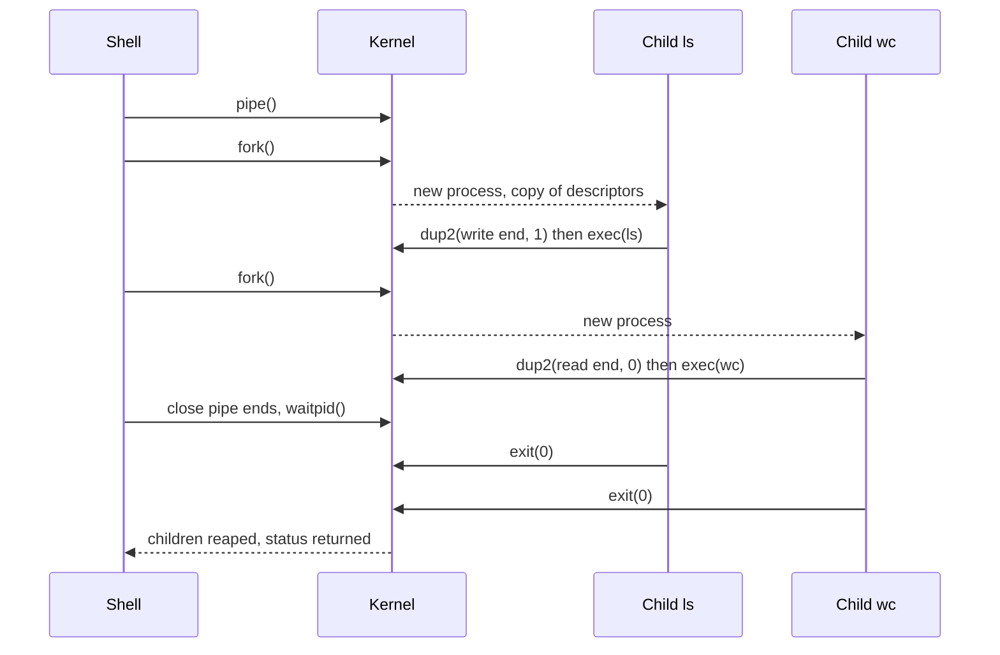

## Overview

A process is a running program with its own address space; threads are execution paths inside a process that share its memory. The trade-off between isolation (processes) and cheap sharing (threads) shows up in every server design.

## What to know

1. Process vs thread (memory, cost, isolation) :: A process has its own virtual memory, file descriptors and security context; a crash is contained. Threads share the heap, globals and descriptors, each with its own stack and registers, so they're cheaper to create and switch between and communicate through memory. But one thread's bug can corrupt or crash the whole process.

2. Process states and context switching :: States: new → ready → running → blocked (waiting on I/O) → ready … → terminated. A context switch saves the current thread's registers and program counter and loads another's; switching between processes also changes the address space (flushing the TLB), so it costs more. Each switch costs microseconds, and thousands per second add up.

3. fork/exec and inter-process communication (pipes, shared memory, sockets) :: fork() duplicates the process (copy-on-write, so it's cheap); exec() replaces the program in the current process; this is how shells launch commands. Processes communicate through pipes (byte streams), shared memory (fastest, needs synchronization), message queues, Unix sockets, or network sockets.

4. User vs kernel threads, green threads / coroutines :: Kernel threads are scheduled by the OS and can run on multiple cores in parallel. Green threads, coroutines and virtual threads (Go goroutines, Java virtual threads, async/await) are scheduled in user space on a few OS threads; they're cheap enough to have millions, which suits I/O-heavy servers.

## Recap

- Process: own address space, isolated, expensive to create/switch. Thread: shares memory, cheap.
- Context switch saves registers/PC; process switch also changes page tables (TLB flush cost).
- fork copies (copy-on-write), exec replaces the image; IPC: pipes, shared memory, sockets.
- Coroutines/green threads: user-space scheduling, thousands per OS thread, for I/O-heavy work.

## Go deeper

### What a process consists of {point: 0}

A process is a running program plus everything the OS tracks for it: a virtual address space (code/text, data, heap, memory-mapped regions, one stack per thread), open file descriptors, current working directory, credentials (user/group ids), signal handlers, resource limits, and one or more threads. The kernel keeps this in a process control block (task_struct in Linux).

Each thread has its own registers, program counter and stack, but shares the address space and file descriptors with other threads of the process. That's why threads communicate cheaply (shared memory) but a bug in one thread (a wild pointer, an uncaught fatal error) can bring down the whole process, while processes are isolated from each other.

On Linux, both are 'tasks' created by clone() with different sharing flags: fork() shares nothing (copy-on-write), pthread_create() shares memory, files and signal handlers.

### Threads vs processes vs async in a server {point: 0.5}

Process per request (old CGI): strong isolation, very expensive. Thread per request: shared memory, simple blocking code, but each thread needs ~1 MB stack and context switches add up beyond thousands of connections. Event loop / async (Node, Netty, asyncio): one or a few threads multiplex many connections with non-blocking I/O, so 100k idle connections are cheap; CPU-heavy work blocks the loop and must go to a worker pool.

Java virtual threads and Go goroutines give thread-style code with async-style cost: the runtime parks them on blocking I/O.

### Process states and context switching {point: 1}

Lifecycle: new → ready (waiting for a CPU) → running → either back to ready (time slice expired, preempted), to blocked/waiting (waiting for I/O, a lock, a timer), or to terminated. When a terminated child hasn't been waited for by its parent it's a zombie (just an exit status entry); if the parent dies first, the child is re-parented to init/systemd (an orphan), which reaps it.

A context switch saves the running task's CPU state (registers, program counter, stack pointer) and restores another's. Between threads of the same process, the address space stays, so it's cheaper; between processes, the kernel switches page tables, which invalidates or tags TLB entries, and caches go cold. Direct cost is a few microseconds; the indirect cost of cold caches can be larger.

That's why servers avoid one thread per connection at high concurrency, and why CPU-bound work uses about one thread per core.

### fork + exec, step by step {point: 2}

A shell runs ls: fork() creates a child that is a copy of the shell (same code, copied-on-write memory, same open file descriptors). In the child, fork returns 0; it may redirect stdout (dup2) and then calls exec('ls'), which replaces its memory image with the ls program. The parent gets the child's pid and calls wait() to collect its exit status (otherwise the child stays a zombie).

Copy-on-write makes fork cheap: pages are shared read-only until either side writes, then only that page is copied.

```
pid_t pid = fork();
if (pid == 0) {                       // child
    execlp("ls", "ls", "-l", NULL);   // only returns on error
    _exit(127);
} else {                              // parent
    int status; waitpid(pid, &status, 0);
}
```

### Inter-process communication options {point: 2}

Pipes: a one-way byte stream between related processes (shell pipelines); named pipes (FIFOs) work between unrelated processes. Message queues (POSIX/System V): discrete messages with priorities. Shared memory (shm_open + mmap): the fastest, since processes map the same physical pages, but they must synchronize with semaphores or futexes. Unix domain sockets: like network sockets but local, bidirectional, can pass file descriptors; used by Docker, databases and many daemons. Network sockets (TCP/UDP): work across machines too. Signals: tiny asynchronous notifications (SIGTERM, SIGUSR1), not for data. Memory-mapped files: share data via the page cache.

Choosing: shared memory for high-throughput local data (with careful synchronization), Unix sockets for local client-server, TCP or gRPC for anything that may become remote. In system design, microservices are processes communicating over network IPC, which is why serialization and network latency matter.

### A shell runs a command: fork, exec, wait and zombies {point: 2.5}

When you type `ls | wc -l` in a shell, the shell does not run `ls` itself. It creates processes, wires them together and waits. Walking through it shows fork, exec, pipes and process cleanup in one story, and it is the most common way interviewers probe this topic.

First the shell calls `pipe()`, which gives it two file descriptors: one to write into the pipe, one to read from it. Then it calls `fork()` once per command. After a fork there are two nearly identical processes. The child has copies of the parent's file descriptors, but its memory is shared copy-on-write, so the fork itself is cheap even for a large process. In the child for `ls`, the shell uses `dup2()` to make the pipe's write end its standard output (descriptor 1), closes the extra descriptors, then calls `exec("ls")`. Exec throws away the child's memory image and loads the new program; the process id and the open descriptors (with the redirections) stay. The child for `wc` does the same with the read end as standard input. The parent closes its copies of both pipe ends, because a reader only sees end-of-file when every write end is closed, then calls `waitpid()` for each child.


Diagram caption: Two forks, two execs and one pipe. The shell waits and collects both exit codes.

### Zombies, orphans and process creation on Windows {point: 2.5}

Two states trip people up. A **zombie** is a child that has exited but whose parent has not yet called `wait`. Its memory is gone, but the kernel keeps a small entry (exit status, resource usage) so the parent can still read it. Zombies use no CPU, but each holds a process table slot, so a parent that never waits can eventually exhaust process ids. The fix is in the parent: call `wait`, or handle `SIGCHLD`, or ignore it explicitly. An **orphan** is a child whose parent died first. It is adopted by process 1 (init or systemd, or the container's init), which waits for it. This is why a container whose main process is your app, not a proper init, can accumulate zombies: nobody reaps them.

Windows has no fork. `CreateProcess` builds a fresh process from a program in one call, which is simpler but slower to set up for the "copy and tweak" pattern. On Linux, `posix_spawn` or `vfork` plus exec exists to avoid the cost of duplicating a big address space when you only want to run another program.

## Interview questions

- Process vs thread: when would you use multiple processes?
- What happens during a context switch and why is it expensive?
- Why can Go run a million goroutines but not a million OS threads?
