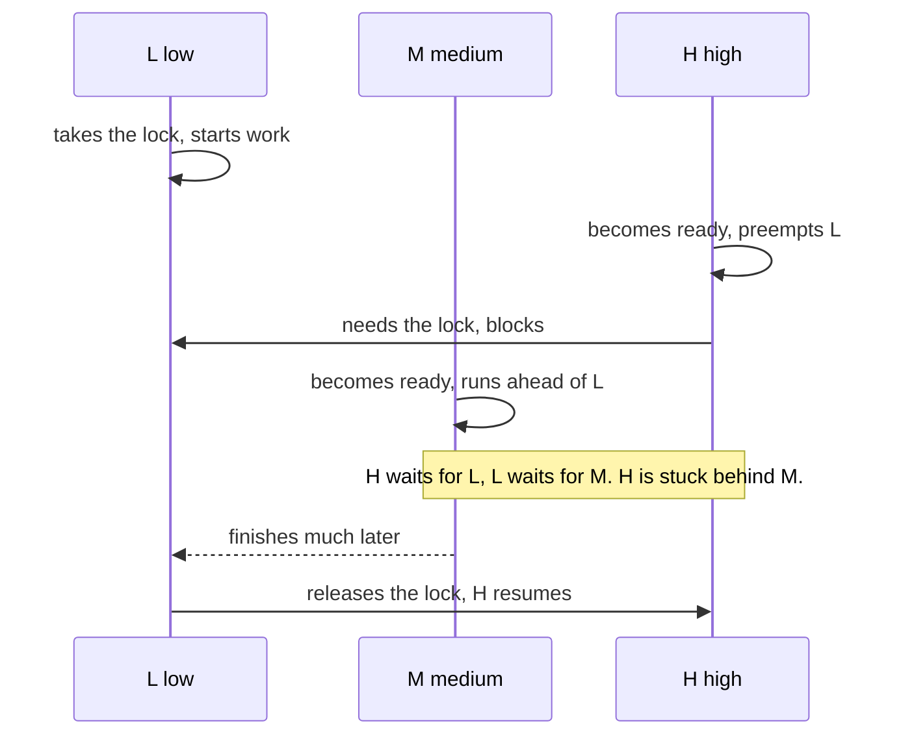

## Overview

The scheduler decides which ready thread runs on each core and for how long. Every policy trades throughput, latency (response time) and fairness against each other.

## What to know

1. FCFS, SJF, round robin, priority :: FCFS runs jobs in arrival order: simple, but short jobs wait behind long ones (convoy effect). SJF/SRTF run the shortest job first: optimal average wait, but needs job lengths and can starve long jobs. Round robin gives each job a time slice (quantum) in turn: fair and responsive, with a quantum-size trade-off. Priority scheduling runs the highest priority first.

2. Multilevel feedback queues :: A multilevel feedback queue has several queues of different priority: new jobs start high, jobs that use their full slice drop down (CPU-bound), and jobs that block early stay high (interactive). Periodically everything is boosted to prevent starvation. Classic Unix schedulers work this way; Linux CFS instead gives each task a fair share of CPU time.

3. Preemption and starvation :: Preemptive schedulers can interrupt a running thread (timer interrupt) to run another, which keeps the system responsive. Starvation: a low-priority job never runs; fixed by aging (raising priority as it waits). Priority inversion: a low-priority thread holds a lock that a high-priority one needs; fixed by priority inheritance.

4. Throughput vs latency vs fairness :: Throughput is jobs completed per unit time (favoured by long slices and few switches); latency is how quickly an interactive task responds (favoured by short slices); fairness is equal shares. Servers usually prioritize tail latency.

## Recap

- FCFS: simple, convoy effect. SJF/SRTF: optimal average wait, needs burst estimates, starves long jobs.
- Round robin: time slices for fairness/latency; too small a quantum = switch overhead.
- MLFQ: new jobs start high priority, CPU hogs sink, periodic boost prevents starvation.
- Linux CFS: picks the task with the smallest virtual runtime (red-black tree).

## Go deeper

### Worked example: average waiting time {point: 0}

Jobs arrive at t=0 with bursts A=8, B=4, C=1. FCFS (A, B, C): waits 0, 8, 12 → average 6.67. SJF (C, B, A): waits 0, 1, 5 → average 2. Round robin with quantum 2: C finishes early, B and A interleave; average wait sits between, but response time (time to first run) is best.

That's the core trade-off: SJF minimizes average waiting, RR minimizes response time and is fair, FCFS is simplest. Interactive systems favour response time.

### Worked example with round robin {point: 0}

Jobs arrive at time 0: A needs 5 ms, B needs 3 ms, C needs 1 ms. Quantum 2 ms. Timeline: A 0-2, B 2-4, C 4-5 (done at 5), A 5-7, B 7-8 (done at 8), A 8-9 (done at 9). Completion times: A 9, B 8, C 5. Waiting times (completion − burst): A 4, B 5, C 4 → average 4.33. Response times: A 0, B 2, C 4.

Compare SJF (C, B, A): C 0-1, B 1-4, A 4-9; waiting 0, 1, 4 → average 1.67, but A's response time is 4. FCFS (A, B, C): waiting 0, 5, 8 → average 4.33, and C waits 8 ms despite needing 1. Practise this kind of calculation; interviewers sometimes ask for a quick Gantt chart.

### How MLFQ approximates SJF without knowing bursts {point: 1}

Several queues with decreasing priority and increasing quantum. A new job starts at the top. If it uses its whole quantum it's probably CPU-bound and drops a level; if it blocks for I/O early it stays high, so interactive jobs stay responsive. Every so often all jobs are boosted to the top so long jobs don't starve and jobs that became interactive recover.

Gaming the scheduler (yielding just before the quantum ends) is prevented by charging total CPU used at a level, not per slice.

### Linux CFS and real-time classes {point: 2}

Linux's Completely Fair Scheduler (and its successor EEVDF since 6.6) aims to give each runnable task a fair share of CPU weighted by its nice value. Each task accumulates virtual runtime (actual runtime scaled by weight); the scheduler always runs the task with the smallest virtual runtime, keeping tasks in a red-black tree ordered by it (O(log n) to pick and insert). A task that slept a long time has a small virtual runtime and gets the CPU soon after waking, which keeps interactive programs responsive.

Real-time classes (SCHED_FIFO, SCHED_RR) always preempt normal tasks; within them, higher static priority wins. Multicore: each CPU has its own run queue, with load balancing that migrates tasks between cores (weighing cache affinity and NUMA locality). cgroups' CPU controller caps or weights CPU per group, which is how containers get CPU limits (and why a container with a low quota can be throttled even when the machine is idle).

### Scheduling goals and metrics {point: 3}

Metrics: turnaround time (completion − arrival), waiting time (time in the ready queue), response time (arrival → first time on CPU), throughput (jobs per unit time), CPU utilization, and fairness. Batch systems care about throughput and turnaround; interactive systems care about response time; real-time systems care about meeting deadlines.

The schedulers trade these off. FCFS is non-preemptive and simple but suffers the convoy effect (short jobs stuck behind a long one). Shortest Job First minimizes average waiting time (provably optimal when all jobs are known), and its preemptive form Shortest Remaining Time First adapts to arrivals, but both need burst predictions (exponential averaging of past bursts) and can starve long jobs. Round robin gives each ready job a quantum in turn: response time is bounded by (n − 1) × quantum, but a quantum too small wastes time in context switches and one too large degrades into FCFS. Priority scheduling picks the highest priority; starvation is fixed by aging (raising priority of waiting jobs).

### Priority inversion, aging and priority inheritance {point: 2.5}

Priority scheduling has two classic failure modes. The first is starvation: a steady flow of high-priority work means a low-priority process never runs. The usual fix is **aging**: the longer a process waits, the more its effective priority rises, until it gets a turn. The second is subtler and has crashed real systems.

**Priority inversion** happens when a high-priority task needs a resource that a low-priority task holds, and a medium-priority task keeps the low one off the CPU. Take three tasks, H (high), M (medium) and L (low). L takes a lock and starts working. H becomes ready, preempts L, and then blocks on the same lock. Now H waits for L. But M becomes ready, and because M outranks L, the scheduler runs M. L cannot run to release the lock, so H, the most important task, is effectively waiting for M, a task it should outrank. The delay is unbounded: M can run as long as it likes.

Diagram caption: Priority inversion. With priority inheritance, L would run at H's priority while it holds the lock, and M could not delay it.

### Mars Pathfinder and priority inheritance {point: 2.5}

The 1997 Mars Pathfinder lander hit exactly this: a low-priority meteorological task held a shared bus lock, a medium-priority task starved it, and a high-priority bus management task missed its deadline, which triggered watchdog resets. The fix, uploaded from Earth, was enabling **priority inheritance** on the mutex: while a low-priority task holds a lock that a higher-priority task waits for, it temporarily runs at the higher priority. Once it releases the lock it drops back. A related protocol, **priority ceiling**, gives each lock a ceiling equal to the highest priority of any task that uses it, and any holder runs at that ceiling.

Where it matters today: real-time operating systems and drivers use these protocols. Linux has priority-inheriting mutexes for real-time tasks (`PTHREAD_PRIO_INHERIT`). For ordinary server code, inversion shows up in a milder form: a low-priority background job holding a database lock that blocks latency-sensitive requests. The interview-ready answer is the same idea in application terms: keep critical sections short, do not hold locks across slow calls, and give background work its own resources.

## Interview questions

- Why does round robin's quantum size matter?
- Explain priority inversion and how it's fixed.
