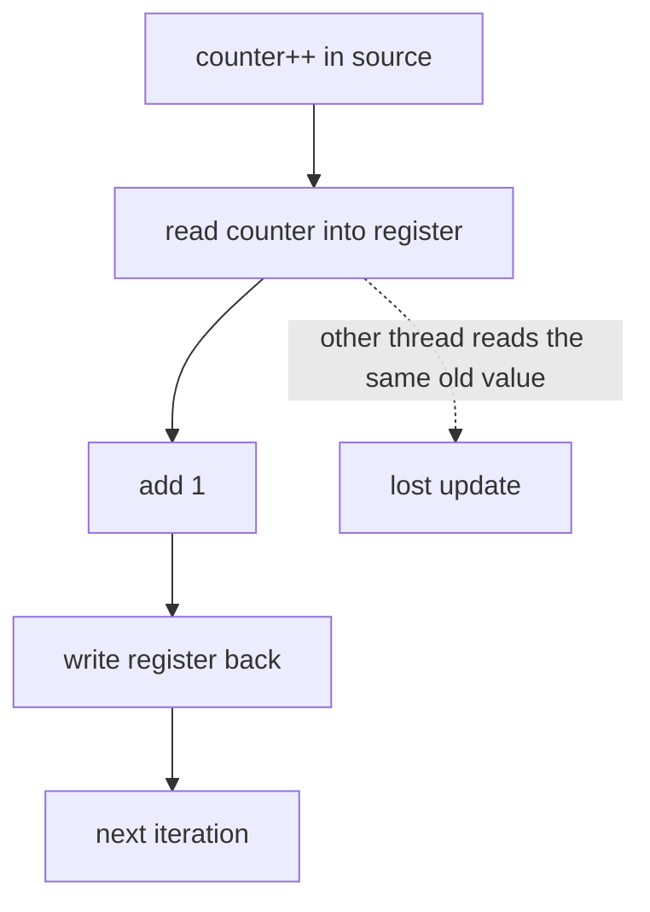

## Overview

When threads share data, unsynchronized access gives wrong results that appear only sometimes. Synchronization primitives enforce mutual exclusion and ordering; memory-model rules decide when one thread sees another's writes.

## What to know

1. Race conditions and critical sections :: A race condition is when the result depends on thread timing, as in count++ (read, add, write) from two threads losing an update. The critical section is the code that touches shared state and must run by one thread at a time.

2. Mutexes, spinlocks, semaphores :: A mutex lets one thread hold it at a time; others sleep (the context-switch cost is fine for long waits). A spinlock busy-waits instead of sleeping: good for very short critical sections on multicore, wasteful otherwise. A semaphore is a counter allowing up to N holders (e.g. N database connections); a binary semaphore behaves like a lock without ownership.

3. Condition variables and monitors :: A condition variable lets a thread sleep until a condition holds (queue not empty), always used with a mutex in a while loop: lock; while (!cond) wait(cv); … ; unlock. The while loop handles spurious wakeups. A monitor is an object whose methods are mutually exclusive and come with condition variables (Java synchronized + wait/notify).

4. Reader-writer locks :: A reader-writer lock allows many readers or one writer, which helps read-heavy shared data. Watch for writer starvation if readers keep arriving; fair implementations queue writers.

5. Memory visibility and atomics (volatile, CAS) :: Without synchronization, a thread may never see another thread's write (caches, compiler and CPU reordering). volatile (Java) guarantees visibility and ordering for one variable, but not atomic compound operations. Atomics use compare-and-swap (CAS): set the value to new only if it is still old, retrying on failure. This is the basis of lock-free counters and structures.

## Recap

- Race condition: result depends on interleaving; protect the critical section.
- Mutex: one owner, sleeps when contended. Spinlock: busy-waits, only for very short sections.
- Semaphore: counter of permits (bounded pools). Condition variable: wait for a predicate under a mutex, in a while loop.
- Visibility: without volatile/atomics/locks another thread may never see your write.

## Go deeper

### Why count++ isn't atomic {point: 0}

count++ is load, add, store. Thread 1 loads 5, thread 2 loads 5, both store 6: one increment is lost. Fixes: a mutex around the increment, an atomic fetch-and-add (AtomicInteger.incrementAndGet, std::atomic<int>), or avoid sharing (per-thread counters summed at the end, like LongAdder).

Compare-and-swap loops implement lock-free updates: read old, compute new, CAS(old → new), retry if another thread changed it in between.

```
std::atomic<long> count{0};
count.fetch_add(1, std::memory_order_relaxed);   // atomic increment

// CAS loop for "max so far"
long cur = best.load();
while (x > cur && !best.compare_exchange_weak(cur, x)) { /* cur reloaded */ }
```

### Mutex, spinlock and semaphore in detail {point: 1}

A mutex provides mutual exclusion with ownership: the thread that locks must unlock. Contended locks put waiting threads to sleep (via the kernel, e.g. futex on Linux: uncontended lock/unlock stays in user space with an atomic instruction, and only contention enters the kernel). Good for critical sections of any length.

A spinlock busy-waits in a loop testing an atomic flag. No sleep/wake overhead, so it's best when the lock is held for a very short time and the waiting thread is on another core; terrible if the holder is preempted (waiters burn CPU). Kernels use spinlocks in interrupt context where sleeping isn't allowed; adaptive mutexes spin briefly, then sleep.

A counting semaphore holds N permits: wait/P decrements (blocks at 0), signal/V increments. Use it to limit concurrent access to a pool of N resources (database connections, parallel downloads) or for signalling between threads. A binary semaphore looks like a mutex but has no ownership, so any thread can signal it, which makes it suitable for signalling but error-prone as a lock.

### Condition variables done right {point: 2}

Waiting for 'queue not empty': lock the mutex, while (queue.empty()) cv.wait(lock); then pop. The while loop is required: wake-ups can be spurious, and another consumer may have taken the item between the notify and your wake-up. The producer pushes under the same mutex and then notifies.

Reader-writer locks let many readers in at once but only one writer; they help only when reads dominate and critical sections are long enough to outweigh their overhead, and naive versions can starve writers.

```
std::mutex m; std::condition_variable cv; std::queue<int> q;
void produce(int x) { { std::lock_guard<std::mutex> g(m); q.push(x); } cv.notify_one(); }
int consume() {
    std::unique_lock<std::mutex> lk(m);
    cv.wait(lk, [] { return !q.empty(); });      // loops on spurious wake-ups
    int x = q.front(); q.pop(); return x;
}
```

### Monitors and the classic problems {point: 2.5}

A monitor combines a mutex with condition variables: methods run with the lock held, and threads wait on conditions inside them (Java synchronized + wait/notify, or ReentrantLock + Condition). Always wait in a loop re-checking the condition.

Classic problems interviewers like: producer-consumer with a bounded buffer (two conditions: notFull, notEmpty); readers-writers (allow concurrent readers, exclusive writers; decide whether readers or writers get priority to avoid starvation); dining philosophers (five philosophers, five forks; naive 'pick up left then right' deadlocks; fixes: a global order on forks, allow at most four to try at once, or pick up both atomically); sleeping barber.

Knowing these by name and their fix shows you can reason about deadlock and starvation, which is what the question is really testing.

```
class BoundedBuffer<T> {
    private final Object[] items; private int head, tail, count;
    private final ReentrantLock lock = new ReentrantLock();
    private final Condition notFull = lock.newCondition(), notEmpty = lock.newCondition();
    BoundedBuffer(int capacity) { items = new Object[capacity]; }
    void put(T x) throws InterruptedException {
        lock.lock();
        try {
            while (count == items.length) notFull.await();
            items[tail] = x; tail = (tail + 1) % items.length; count++;
            notEmpty.signal();
        } finally { lock.unlock(); }
    }
    @SuppressWarnings("unchecked") T take() throws InterruptedException {
        lock.lock();
        try {
            while (count == 0) notEmpty.await();
            T x = (T) items[head]; items[head] = null; head = (head + 1) % items.length; count--;
            notFull.signal();
            return x;
        } finally { lock.unlock(); }
    }
}
```

### Memory models and visibility {point: 4}

CPUs and compilers reorder instructions and keep values in registers and per-core caches for speed. Without synchronization, one thread may never see another's writes, or see them in a different order. A memory model defines which orderings are guaranteed.

In Java, happens-before edges create visibility: unlocking a monitor happens-before later locking it; a write to a volatile field happens-before later reads of it; Thread.start and Thread.join create edges; final fields are safely published after construction. In C++, std::atomic operations with memory orders (seq_cst by default; acquire/release for producer-consumer handoff; relaxed for counters where ordering doesn't matter).

The classic bug: double-checked locking for a lazy singleton without volatile can expose a partially constructed object, because the reference assignment can be reordered before the constructor's writes. Rule: share mutable data only through locks, atomics, volatile, or concurrent collections, or don't share it at all.

### Fixing a race in Java: synchronized, atomics and what they cost {point: 1.5}

Take the race from "Why count++ isn't atomic" and fix it three ways in a runnable Java program. Two threads each add one million times to a shared counter. The first counter is a plain `int`, the second is guarded by `synchronized`, the third is an `AtomicInteger`.


Diagram caption: Three machine-level steps. Two threads can both read the old value, and one write is lost.

### The three counters compared {point: 1.5}

The three versions behave like this. The plain counter ends below 2,000,000 on most runs because increments overlap and get lost (the demo run printed 1,871,945, but the exact number changes every run, and on a lucky run it can even be exactly 2,000,000). The `synchronized` counter always ends at 2,000,000: the lock makes read, add and write one indivisible step for everyone who takes the same lock, and it also gives a visibility guarantee, since releasing a lock happens-before the next acquire of it. The `AtomicInteger` also ends at exactly 2,000,000, using a hardware compare-and-swap (or fetch-and-add) in a retry loop with no lock.

```java
import java.util.concurrent.atomic.AtomicInteger;

public class RaceDemo {
    static int racy = 0;
    static int locked = 0;
    static final Object LOCK = new Object();
    static final AtomicInteger atomic = new AtomicInteger();

    public static void main(String[] args) throws Exception {
        int perThread = 1_000_000;
        Thread[] ts = new Thread[2];
        for (int i = 0; i < ts.length; i++) {
            ts[i] = new Thread(() -> {
                for (int k = 0; k < perThread; k++) {
                    racy++;
                    synchronized (LOCK) { locked++; }
                    atomic.incrementAndGet();
                }
            });
            ts[i].start();
        }
        for (Thread t : ts) t.join();
        System.out.println("expected=" + 2 * perThread);
        System.out.println("racy=" + racy + (racy < 2 * perThread ? " (lost updates)" : " (got lucky this run)"));
        System.out.println("synchronized=" + locked);
        System.out.println("atomic=" + atomic.get());
    }
}
```
### Which tool to choose {point: 1.5}

Example output: `expected=2000000`, then `racy=` a number below that (typically), then `synchronized=2000000` and `atomic=2000000`.

Which to choose? An atomic variable suits one independent counter or flag, and it never blocks. A lock suits invariants that span several variables ("balance and transaction count change together"), which no single atomic can protect. Under heavy contention, a CAS loop keeps retrying and burns CPU, so for a hot counter updated by many threads, `LongAdder` spreads updates over several cells and sums them on read, trading exactness at a single instant for throughput. And `volatile` alone fixes visibility, not atomicity: `volatile int x; x++` is still a race.

A quick way to explain the guarantee behind all three in an interview is the **happens-before** relation. Releasing a lock happens-before the next acquire of that lock, a write to a volatile variable happens-before later reads of it, and an atomic operation is both an update and a visibility point. If two accesses to the same variable are not ordered by any such edge and one is a write, the program has a data race, and the compiler and CPU are free to reorder or cache in ways that look impossible when you read the source. Tools such as ThreadSanitizer (C and C++, Go) and Java's jcstress harness exist to find these.

## Interview questions

- Why isn't count++ thread-safe and how do you fix it?
- Mutex vs semaphore?
- Why must wait() be called in a while loop?
