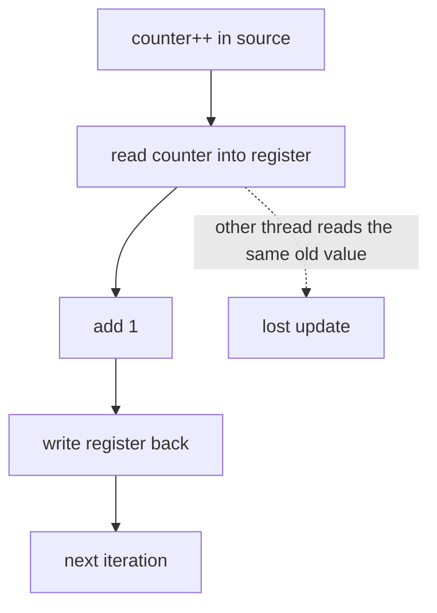
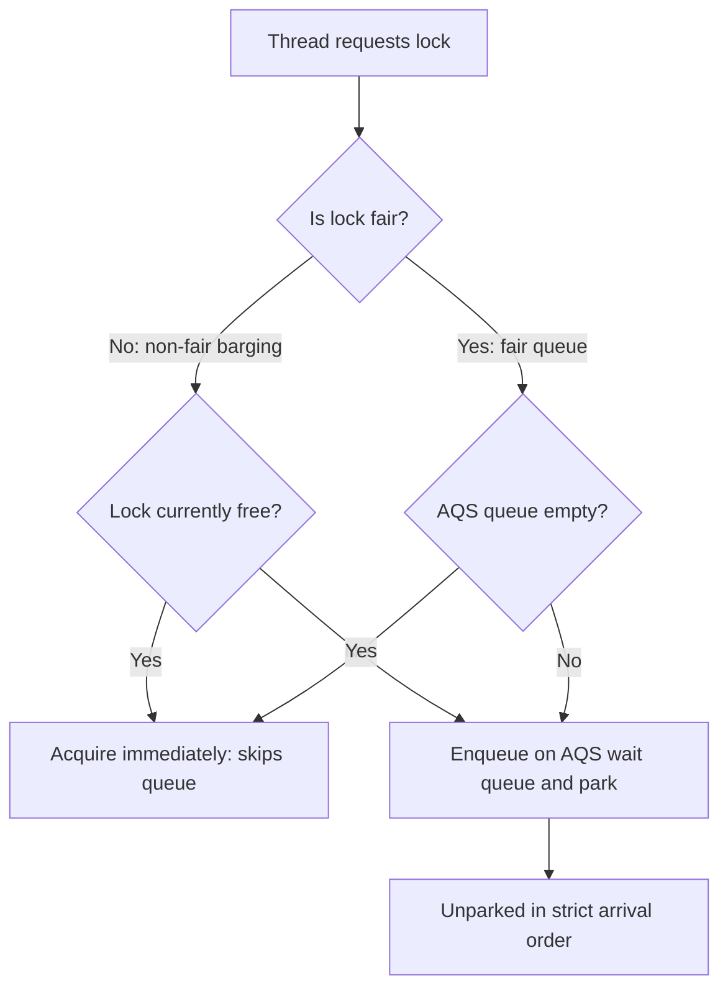
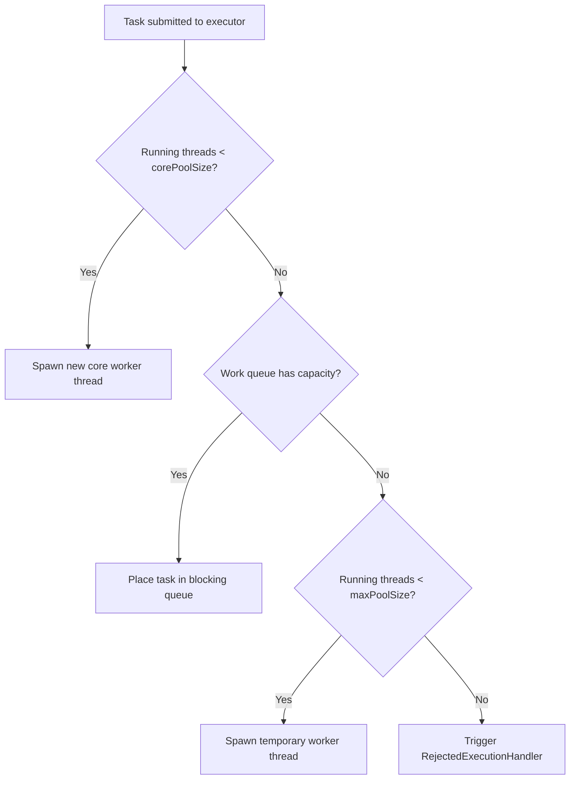
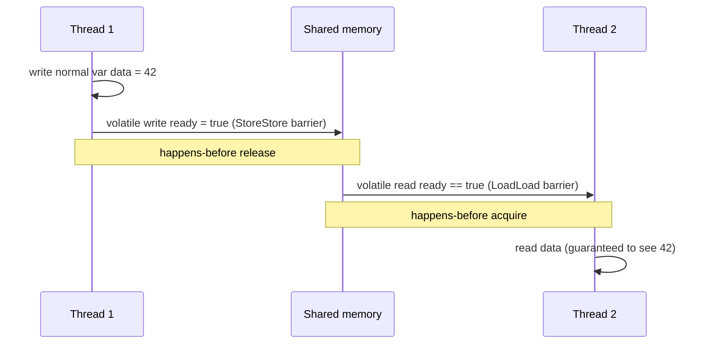
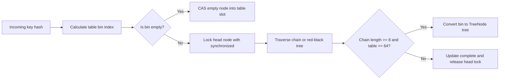
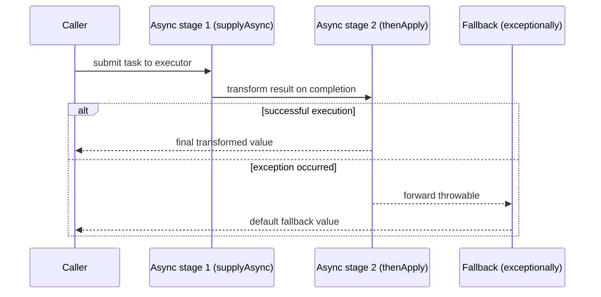

## Overview

When threads share data, unsynchronized access gives wrong results that appear only sometimes. Synchronization primitives enforce mutual exclusion and ordering; memory-model rules decide when one thread sees another's writes.

## What to know

1. Race conditions and critical sections :: A race condition is when the result depends on thread timing, as in count++ (read, add, write) from two threads losing an update. The critical section is the code that touches shared state and must run by one thread at a time.

2. Mutexes, spinlocks, semaphores :: A mutex lets one thread hold it at a time; others sleep (the context-switch cost is fine for long waits). A spinlock busy-waits instead of sleeping: good for very short critical sections on multicore, wasteful otherwise. A semaphore is a counter allowing up to N holders (e.g. N database connections); a binary semaphore behaves like a lock without ownership.

3. Condition variables and monitors :: A condition variable lets a thread sleep until a condition holds (queue not empty), always used with a mutex in a while loop: lock; while (!cond) wait(cv); … ; unlock. The while loop handles spurious wakeups. A monitor is an object whose methods are mutually exclusive and come with condition variables (Java synchronized + wait/notify).

4. Reader-writer locks :: A reader-writer lock allows many readers or one writer, which helps read-heavy shared data. Watch for writer starvation if readers keep arriving; fair implementations queue writers.

5. Memory visibility and atomics (volatile, CAS) :: Without synchronization, a thread may never see another thread's write (caches, compiler and CPU reordering). volatile (Java) guarantees visibility and ordering for one variable, but not atomic compound operations. Atomics use compare-and-swap (CAS): set the value to new only if it is still old, retrying on failure. This is the basis of lock-free counters and structures.

## Recap

- Race condition: result depends on interleaving; protect the critical section.
- Mutex: one owner, sleeps when contended. Spinlock: busy-waits, only for very short sections.
- Semaphore: counter of permits (bounded pools). Condition variable: wait for a predicate under a mutex, in a while loop.
- Visibility: without volatile/atomics/locks another thread may never see your write.

## Go deeper

### Why count++ isn't atomic {point: 0}

count++ is load, add, store. Thread 1 loads 5, thread 2 loads 5, both store 6: one increment is lost. Fixes: a mutex around the increment, an atomic fetch-and-add (AtomicInteger.incrementAndGet, std::atomic<int>), or avoid sharing (per-thread counters summed at the end, like LongAdder).

Compare-and-swap loops implement lock-free updates: read old, compute new, CAS(old → new), retry if another thread changed it in between.

```
std::atomic<long> count{0};
count.fetch_add(1, std::memory_order_relaxed);   // atomic increment

// CAS loop for "max so far"
long cur = best.load();
while (x > cur && !best.compare_exchange_weak(cur, x)) { /* cur reloaded */ }
```

### Mutex, spinlock and semaphore in detail {point: 1}

A mutex provides mutual exclusion with ownership: the thread that locks must unlock. Contended locks put waiting threads to sleep (via the kernel, e.g. futex on Linux: uncontended lock/unlock stays in user space with an atomic instruction, and only contention enters the kernel). Good for critical sections of any length.

A spinlock busy-waits in a loop testing an atomic flag. No sleep/wake overhead, so it's best when the lock is held for a very short time and the waiting thread is on another core; terrible if the holder is preempted (waiters burn CPU). Kernels use spinlocks in interrupt context where sleeping isn't allowed; adaptive mutexes spin briefly, then sleep.

A counting semaphore holds N permits: wait/P decrements (blocks at 0), signal/V increments. Use it to limit concurrent access to a pool of N resources (database connections, parallel downloads) or for signalling between threads. A binary semaphore looks like a mutex but has no ownership, so any thread can signal it, which makes it suitable for signalling but error-prone as a lock.

### Fixing a race in Java: synchronized, atomics and what they cost {point: 1.5}

Take the race from "Why count++ isn't atomic" and fix it three ways in a runnable Java program. Two threads each add one million times to a shared counter. The first counter is a plain `int`, the second is guarded by `synchronized`, the third is an `AtomicInteger`.


Diagram caption: Three machine-level steps. Two threads can both read the old value, and one write is lost.

### The three counters compared {point: 1.5}

The three versions behave like this. The plain counter ends below 2,000,000 on most runs because increments overlap and get lost (the demo run printed 1,871,945, but the exact number changes every run, and on a lucky run it can even be exactly 2,000,000). The `synchronized` counter always ends at 2,000,000: the lock makes read, add and write one indivisible step for everyone who takes the same lock, and it also gives a visibility guarantee, since releasing a lock happens-before the next acquire of it. The `AtomicInteger` also ends at exactly 2,000,000, using a hardware compare-and-swap (or fetch-and-add) in a retry loop with no lock.

```java
import java.util.concurrent.atomic.AtomicInteger;

public class RaceDemo {
    static int racy = 0;
    static int locked = 0;
    static final Object LOCK = new Object();
    static final AtomicInteger atomic = new AtomicInteger();

    public static void main(String[] args) throws Exception {
        int perThread = 1_000_000;
        Thread[] ts = new Thread[2];
        for (int i = 0; i < ts.length; i++) {
            ts[i] = new Thread(() -> {
                for (int k = 0; k < perThread; k++) {
                    racy++;
                    synchronized (LOCK) { locked++; }
                    atomic.incrementAndGet();
                }
            });
            ts[i].start();
        }
        for (Thread t : ts) t.join();
        System.out.println("expected=" + 2 * perThread);
        System.out.println("racy=" + racy + (racy < 2 * perThread ? " (lost updates)" : " (got lucky this run)"));
        System.out.println("synchronized=" + locked);
        System.out.println("atomic=" + atomic.get());
    }
}
```

### Which tool to choose {point: 1.5}

Example output: `expected=2000000`, then `racy=` a number below that (typically), then `synchronized=2000000` and `atomic=2000000`.

Which to choose? An atomic variable suits one independent counter or flag, and it never blocks. A lock suits invariants that span several variables ("balance and transaction count change together"), which no single atomic can protect. Under heavy contention, a CAS loop keeps retrying and burns CPU, so for a hot counter updated by many threads, `LongAdder` spreads updates over several cells and sums them on read, trading exactness at a single instant for throughput. And `volatile` alone fixes visibility, not atomicity: `volatile int x; x++` is still a race.

A quick way to explain the guarantee behind all three in an interview is the **happens-before** relation. Releasing a lock happens-before the next acquire of that lock, a write to a volatile variable happens-before later reads of it, and an atomic operation is both an update and a visibility point. If two accesses to the same variable are not ordered by any such edge and one is a write, the program has a data race, and the compiler and CPU are free to reorder or cache in ways that look impossible when you read the source. Tools such as ThreadSanitizer (C and C++, Go) and Java's jcstress harness exist to find these.

### Condition variables done right {point: 2}

Waiting for 'queue not empty': lock the mutex, while (queue.empty()) cv.wait(lock); then pop. The while loop is required: wake-ups can be spurious, and another consumer may have taken the item between the notify and your wake-up. The producer pushes under the same mutex and then notifies.

Reader-writer locks let many readers in at once but only one writer; they help only when reads dominate and critical sections are long enough to outweigh their overhead, and naive versions can starve writers.

```
std::mutex m; std::condition_variable cv; std::queue<int> q;
void produce(int x) { { std::lock_guard<std::mutex> g(m); q.push(x); } cv.notify_one(); }
int consume() {
    std::unique_lock<std::mutex> lk(m);
    cv.wait(lk, [] { return !q.empty(); });      // loops on spurious wake-ups
    int x = q.front(); q.pop(); return x;
}
```

### ReentrantLock fairness and condition variables {point: 2.2}

Java provides explicit locks through `java.util.concurrent.locks.ReentrantLock`. Unlike the intrinsic `synchronized` monitor lock, `ReentrantLock` supports non-block structured locking, polling with timeout (`tryLock`), interruptible acquisition (`lockInterruptibly`), and configurable fairness.

A fair lock (`new ReentrantLock(true)`) guarantees FIFO acquisition order using an internal AbstractQueuedSynchronizer (AQS) queue. Arriving threads cannot jump ahead of threads already waiting in line. Non-fair locking (`new ReentrantLock(false)`, the default) permits barging: an arriving thread can acquire the lock immediately if it happens to be free when it checks, even if other threads are queued. Barging dramatically reduces thread context-switching overhead and improves overall throughput under contention, though it introduces the risk of temporary starvation for queued threads.

Furthermore, `ReentrantLock` allows creating multiple distinct `Condition` instances on the same lock (`lock.newCondition()`), such as `notFull` and `notEmpty` in a bounded buffer. With intrinsic monitors (`wait`/`notify`), all waiting threads share a single wait set, forcing developers to call `notifyAll()` to avoid missed signals, which causes the classic "thundering herd" problem where dozens of threads awaken only to go back to sleep. With separate conditions, producers signal only consumers (`notEmpty.signal()`), and consumers signal only producers (`notFull.signal()`).


Diagram caption: Fair versus non-fair lock acquisition: non-fair permits barging for higher throughput.

```java
import java.util.LinkedList;
import java.util.Queue;
import java.util.concurrent.locks.Condition;
import java.util.concurrent.locks.ReentrantLock;

public class LockConditionDemo {
    static class BoundedBuffer<T> {
        private final Queue<T> queue = new LinkedList<>();
        private final int capacity;
        private final ReentrantLock lock;
        private final Condition notFull;
        private final Condition notEmpty;

        BoundedBuffer(int capacity, boolean fair) {
            this.capacity = capacity;
            this.lock = new ReentrantLock(fair);
            this.notFull = lock.newCondition();
            this.notEmpty = lock.newCondition();
        }

        void put(T item) throws InterruptedException {
            lock.lock();
            try {
                while (queue.size() == capacity) {
                    notFull.await();
                }
                queue.add(item);
                notEmpty.signal();
            } finally {
                lock.unlock();
            }
        }

        T take() throws InterruptedException {
            lock.lock();
            try {
                while (queue.isEmpty()) {
                    notEmpty.await();
                }
                T item = queue.poll();
                notFull.signal();
                return item;
            } finally {
                lock.unlock();
            }
        }

        int size() {
            lock.lock();
            try {
                return queue.size();
            } finally {
                lock.unlock();
            }
        }
    }

    public static void main(String[] args) throws Exception {
        BoundedBuffer<Integer> buffer = new BoundedBuffer<>(3, true);
        Thread producer = new Thread(() -> {
            try {
                for (int i = 1; i <= 5; i++) {
                    buffer.put(i);
                    System.out.println("produced=" + i);
                }
            } catch (InterruptedException e) {
                Thread.currentThread().interrupt();
            }
        });

        Thread consumer = new Thread(() -> {
            try {
                for (int i = 1; i <= 5; i++) {
                    int val = buffer.take();
                    System.out.println("consumed=" + val);
                }
            } catch (InterruptedException e) {
                Thread.currentThread().interrupt();
            }
        });

        producer.start();
        consumer.start();
        producer.join();
        consumer.join();
        System.out.println("buffer final size=" + buffer.size());
    }
}
```

### Monitors and the classic problems {point: 2.5}

A monitor combines a mutex with condition variables: methods run with the lock held, and threads wait on conditions inside them (Java synchronized + wait/notify, or ReentrantLock + Condition). Always wait in a loop re-checking the condition.

Classic problems interviewers like: producer-consumer with a bounded buffer (two conditions: notFull, notEmpty); readers-writers (allow concurrent readers, exclusive writers; decide whether readers or writers get priority to avoid starvation); dining philosophers (five philosophers, five forks; naive 'pick up left then right' deadlocks; fixes: a global order on forks, allow at most four to try at once, or pick up both atomically); sleeping barber.

Knowing these by name and their fix shows you can reason about deadlock and starvation, which is what the question is really testing.

```
class BoundedBuffer<T> {
    private final Object[] items; private int head, tail, count;
    private final ReentrantLock lock = new ReentrantLock();
    private final Condition notFull = lock.newCondition(), notEmpty = lock.newCondition();
    BoundedBuffer(int capacity) { items = new Object[capacity]; }
    void put(T x) throws InterruptedException {
        lock.lock();
        try {
            while (count == items.length) notFull.await();
            items[tail] = x; tail = (tail + 1) % items.length; count++;
            notEmpty.signal();
        } finally { lock.unlock(); }
    }
    @SuppressWarnings("unchecked") T take() throws InterruptedException {
        lock.lock();
        try {
            while (count == 0) notEmpty.await();
            T x = (T) items[head]; items[head] = null; head = (head + 1) % items.length; count--;
            notFull.signal();
            return x;
        } finally { lock.unlock(); }
    }
}
```

### Thread pool sizing and rejection policies {point: 2.8}

Creating and destroying native operating system threads incurs significant overhead: stack allocation (typically 1 MB per thread), kernel context switches, and scheduling latency. `ThreadPoolExecutor` solves this by maintaining a pool of reusable worker threads backed by a work queue.

Sizing a thread pool depends on the workload. For CPU-bound tasks (encryption, compression, image rendering), context-switching between excess threads degrades performance; size the pool to $N_{threads} = N_{cpu} + 1$. For I/O-bound tasks (network calls, database queries, disk operations), worker threads spend most of their lifetime blocked waiting for responses. The classic sizing formula from Goetz is $N_{threads} = N_{cpu} \times U_{cpu} \times (1 + W/C)$, where $U_{cpu}$ is desired CPU utilization and $W/C$ is the ratio of wait time to compute time. If a database query spends 90 ms waiting and 10 ms processing on CPU ($W/C = 9$), a 4-core machine can efficiently support $4 \times 1 \times (1 + 9) = 40$ worker threads.

A `ThreadPoolExecutor` accepts a work queue (e.g. `ArrayBlockingQueue` with bounded capacity) and a `RejectedExecutionHandler`. When the queue fills and active threads reach `maximumPoolSize`, the rejection policy dictates the backpressure strategy. Java provides four built-in policies: `AbortPolicy` (throws `RejectedExecutionException`), `CallerRunsPolicy` (executes the task in the submitting thread, naturally throttling submission rate), `DiscardPolicy` (silently drops the task), and `DiscardOldestPolicy` (evicts the head of the work queue to make room). For graceful shutdown, call `shutdown()` to stop accepting new work, wait with `awaitTermination()`, and follow up with `shutdownNow()` if tasks fail to drain within the deadline.


Diagram caption: ThreadPoolExecutor decision flow: core pool first, then queue, then max pool, then rejection.

```java
import java.util.concurrent.ArrayBlockingQueue;
import java.util.concurrent.RejectedExecutionHandler;
import java.util.concurrent.ThreadPoolExecutor;
import java.util.concurrent.TimeUnit;
import java.util.concurrent.atomic.AtomicInteger;

public class ThreadPoolDemo {
    public static void main(String[] args) throws Exception {
        int corePoolSize = 2;
        int maxPoolSize = 4;
        int queueCapacity = 3;
        AtomicInteger rejectedCount = new AtomicInteger(0);

        RejectedExecutionHandler customHandler = (task, executor) -> {
            rejectedCount.incrementAndGet();
            System.out.println("rejected task: queue full and max threads reached");
        };

        ThreadPoolExecutor executor = new ThreadPoolExecutor(
                corePoolSize,
                maxPoolSize,
                10L,
                TimeUnit.SECONDS,
                new ArrayBlockingQueue<>(queueCapacity),
                customHandler
        );

        int totalTasks = 10;
        for (int i = 1; i <= totalTasks; i++) {
            executor.execute(() -> {
                try {
                    Thread.sleep(50);
                } catch (InterruptedException e) {
                    Thread.currentThread().interrupt();
                }
            });
        }

        executor.shutdown();
        boolean terminated = executor.awaitTermination(5, TimeUnit.SECONDS);
        System.out.println("tasks submitted=" + totalTasks);
        System.out.println("rejections=" + rejectedCount.get());
        System.out.println("completed=" + executor.getCompletedTaskCount());
        System.out.println("terminated gracefully=" + terminated);
    }
}
```

### Memory models and visibility {point: 4}

CPUs and compilers reorder instructions and keep values in registers and per-core caches for speed. Without synchronization, one thread may never see another's writes, or see them in a different order. A memory model defines which orderings are guaranteed.

The Java Memory Model (JMM, formalised in JSR-133) defines behavior through **happens-before** ordering. If action A happens-before action B, the memory effects of A are guaranteed to be visible to B, and A is ordered before B. Core happens-before rules include:
1. **Program order rule**: each action in a thread happens-before any subsequent action in that same thread.
2. **Monitor lock rule**: an unlock on a monitor lock happens-before every subsequent lock on the same monitor.
3. **Volatile variable rule**: a write to a volatile field happens-before every subsequent read of that same field.
4. **Thread start rule**: a call to `Thread.start()` happens-before any action in the started thread.
5. **Thread join rule**: all actions in a thread happen-before any other thread successfully returns from `join()` on that thread.
6. **Transitivity**: if A happens-before B and B happens-before C, then A happens-before C.

Under the hood, reading or writing a `volatile` field emits hardware memory barriers (or memory fences) that restrict CPU store buffers and invalidate queues. Writing a volatile variable emits a `StoreStore` barrier (preventing prior writes from moving past the volatile write) and a `StoreLoad` barrier (preventing the volatile write from reordering with subsequent reads). Reading a volatile variable emits `LoadLoad` and `LoadStore` barriers. This explains why double-checked locking for a singleton failed in early Java: without `volatile`, `instance = new Singleton()` involves memory allocation, constructor invocation, and reference assignment, which the compiler/CPU could reorder such that the reference is published before fields are initialized. Declaring `private static volatile Singleton instance;` establishes the requisite happens-before relationship.


Diagram caption: Happens-before edge established by volatile write and subsequent volatile read across threads.

### Concurrent collections and lock striping

Standard collections in `java.util` (such as `HashMap`, `ArrayList`, `LinkedList`) are not thread-safe. Wrapping them with `Collections.synchronizedMap` locks the entire collection on every read and write, producing a severe throughput bottleneck under multi-threaded contention. The `java.util.concurrent` package provides high-performance concurrent collections engineered around fine-grained lock striping and non-blocking algorithms.

`ConcurrentHashMap` represents the pinnacle of concurrent data structure design in the JDK. In Java 7, it utilized lock striping across 16 independent `Segment` locks (each managing a slice of hash buckets), permitting up to 16 concurrent writers. In Java 8 and beyond, the design was rewritten: it eliminates segments entirely and organizes entries into a flat array of hash bins. Reads are completely lock-free via volatile field reads. For writes, inserting the first node into an empty bin uses lock-free Compare-And-Swap (`compareAndSetObject`). When collision occurs and the bin is already populated, the thread synchronizes only on the bucket's head node (`synchronized (f)`). If bin collision exceeds 8 nodes and total table capacity reaches at least 64, the bin treeifies into a Red-Black tree (`TreeNode`), guaranteeing $O(\log N)$ worst-case lookup.

Furthermore, `ConcurrentHashMap` provides atomic compound operations: `computeIfAbsent`, `computeIfPresent`, `merge`, and `putIfAbsent`. Performing `if (!map.containsKey(k)) map.put(k, v)` on a synchronized map is a classic check-then-act race bug because another thread can insert between the check and the put. Atomic methods ensure the computation and insertion run as an indivisible step per bucket. For inter-thread handoffs, `BlockingQueue` implementations such as `ArrayBlockingQueue` (single lock) and `LinkedBlockingQueue` (dual locks: `putLock` and `takeLock` allowing simultaneous produce and consume) provide thread-safe bounded buffers with built-in backpressure.


Diagram caption: ConcurrentHashMap concurrency model: CAS on empty bucket, synchronized lock only on bucket head node.

```java
import java.util.concurrent.ArrayBlockingQueue;
import java.util.concurrent.BlockingQueue;
import java.util.concurrent.ConcurrentHashMap;
import java.util.concurrent.CountDownLatch;

public class ConcurrentMapDemo {
    public static void main(String[] args) throws Exception {
        ConcurrentHashMap<String, Integer> map = new ConcurrentHashMap<>();
        int threads = 4;
        int incrementsPerThread = 10_000;
        CountDownLatch latch = new CountDownLatch(threads);

        for (int i = 0; i < threads; i++) {
            new Thread(() -> {
                for (int j = 0; j < incrementsPerThread; j++) {
                    map.merge("hits", 1, Integer::sum);
                    map.computeIfAbsent("initialized", k -> 42);
                }
                latch.countDown();
            }).start();
        }
        latch.await();

        System.out.println("map hits=" + map.get("hits"));
        System.out.println("initialized val=" + map.get("initialized"));

        BlockingQueue<String> queue = new ArrayBlockingQueue<>(2);
        queue.put("item-1");
        queue.put("item-2");
        System.out.println("queue full=" + (queue.remainingCapacity() == 0));
        System.out.println("queue take=" + queue.take());
        System.out.println("queue remaining=" + queue.remainingCapacity());
    }
}
```

### Asynchronous composition with CompletableFuture

Modern high-concurrency systems avoid blocking operating system threads on remote service calls or database lookups. `CompletableFuture` (introduced in Java 8) implements the Promise/Future pattern, providing a fluent functional API for asynchronous programming and task composition.

Unlike legacy `Future`, which blocks calling threads on `get()`, `CompletableFuture` executes callbacks asynchronously when completion events fire. The API supports three primary composition patterns:
1. **Transformation**: `thenApply(fn)` maps the result of a stage to a new value within the same pipeline, analogous to `map` in functional streams.
2. **Chaining (FlatMapping)**: `thenCompose(fn)` chains dependent asynchronous operations, where the second future depends on the completion of the first.
3. **Combining**: `thenCombine(otherFuture, biFn)` joins two independent concurrent futures, executing the combining bifunction only when both complete. For fan-out/fan-in patterns, `CompletableFuture.allOf(f1, f2, f3)` coordinates multiple parallel operations.

Thread management is critical when using `CompletableFuture`. Methods without the `Async` suffix (e.g. `thenApply`) execute either in the caller thread or in the thread that completed the previous stage. The `Async` variants (e.g. `thenApplyAsync`) dispatch tasks to an executor. By default, tasks run on `ForkJoinPool.commonPool()`. If an application executes blocking network I/O inside the common pool, it starves other tasks in the JVM; production code should always supply a dedicated bounded custom thread pool (`supplyAsync(task, myIoExecutor)`). For error handling, `exceptionally(fn)` intercepts upstream exceptions and returns fallback recovery values, while `handle(biFn)` receives both the result and throwable, allowing unified inspection and telemetry.


Diagram caption: Asynchronous pipeline execution showing transformation chaining and fallback error recovery.

```java
import java.util.concurrent.CompletableFuture;
import java.util.concurrent.ForkJoinPool;

public class CompletableDemo {
    public static void main(String[] args) {
        CompletableFuture<String> pipeline = CompletableFuture.supplyAsync(() -> "hello")
                .thenApply(s -> s + " world")
                .thenCompose(s -> CompletableFuture.supplyAsync(() -> s.toUpperCase()));

        CompletableFuture<String> failingStep = CompletableFuture.<String>supplyAsync(() -> {
            throw new RuntimeException("simulated network failure");
        }).exceptionally(ex -> "fallback-response");

        CompletableFuture<String> combined = pipeline.thenCombine(failingStep, (res1, res2) -> res1 + " | " + res2);

        String result = combined.join();
        System.out.println("async pipeline result: " + result);
        System.out.println("common pool active: " + (ForkJoinPool.commonPool().getPoolSize() >= 0));
    }
}
```

## Interview questions

- Why isn't count++ thread-safe and how do you fix it?
- Mutex vs semaphore?
- Why must wait() be called in a while loop?
- How does the Java Memory Model guarantee visibility between threads?
- What are the tradeoffs between fair and non-fair ReentrantLock?
- How do you choose the right queue and rejection policy for a ThreadPoolExecutor?
- How does ConcurrentHashMap achieve thread safety without locking the entire table?
- How does CompletableFuture handle exceptions across an async processing chain?
