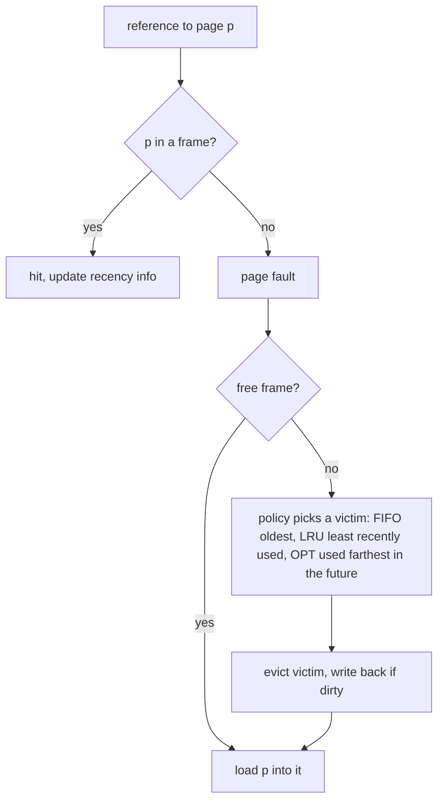

## Overview

Virtual memory lets processes use more memory than is physically present by loading pages on demand and evicting cold ones to disk. It's also what makes fork, memory-mapped files and shared libraries cheap.

## What to know

1. Demand paging and page faults :: Pages are loaded only when first touched. An access to a non-resident page triggers a page fault; the OS loads the page from disk (major fault: milliseconds) or maps a zeroed or cached page (minor fault: fast), then resumes the instruction.

2. Page replacement (LRU, clock, FIFO) :: When memory is full, the OS evicts a page. Ideal: the page used furthest in the future (OPT, a theoretical benchmark). LRU approximates it well but is expensive to track exactly. Clock (second chance) cheaply approximates LRU with reference bits. FIFO is simple but can evict hot pages (Belady's anomaly).

3. Thrashing and working set :: Thrashing: the working sets of running processes don't fit in RAM, so the system spends its time paging instead of computing. Fixes: reduce multiprogramming, add memory, or improve locality. The working set is the pages a process uses in a recent window.

4. Memory-mapped files :: mmap maps a file into the address space, so file reads become memory accesses served through the page cache, without read() copies. Used by databases and for loading large files; writes are flushed by the OS (or msync).

5. Copy-on-write :: After fork(), parent and child share pages marked read-only; a page is copied only when one of them writes to it. This makes fork cheap, and is how Redis takes snapshots (BGSAVE) while still serving writes.

## Recap

- Demand paging: load a page on first access (page fault); the disk is the backing store.
- Replacement: LRU ideal but costly; clock (second chance) approximates it.
- Thrashing: working sets exceed RAM, CPU waits on faults; reduce load or add memory.
- mmap maps files into memory; copy-on-write makes fork and shared libraries cheap.

## Go deeper

### Why virtual memory exists {point: 0}

Virtual memory gives each process its own private address space that looks large and contiguous. Benefits: isolation (a process can't read or corrupt another's memory, since its page tables don't map those frames), simpler programming and linking (every program can assume the same layout), efficient sharing (shared libraries and fork use the same physical frames mapped into several processes), lazy allocation (memory isn't backed by RAM until touched), and overcommit (the sum of address spaces can exceed RAM, backed by swap or simply not used).

Linux overcommits by default: malloc of 10 GB succeeds on an 8 GB machine; trouble starts only when pages are actually touched. If memory runs out, the OOM killer picks a process to kill (by a badness score). Containers hit the same mechanism per cgroup when exceeding their memory limit.

### What happens on a page fault {point: 0.5}

The CPU traps to the kernel with the faulting address. The kernel checks it's a valid mapping (else SIGSEGV). Minor fault: the page is already in memory (page cache or shared) and just needs a table entry: microseconds. Major fault: pick a victim frame (write it back if dirty), read the page from disk/swap, update the page table, resume: milliseconds on SSD, much worse on HDD.

So a process with a working set larger than RAM spends its time faulting: thrashing.

### Page replacement algorithms compared {point: 1}

When a page must be brought in and no frame is free, the OS evicts a victim. Optimal (Belady's MIN): evict the page used furthest in the future; impossible in practice but the benchmark. FIFO: evict the oldest loaded page; simple but can evict hot pages and suffers Belady's anomaly (more frames can cause more faults). LRU: evict the least recently used page; good approximation of optimal for typical locality, but exact LRU needs updating on every access. Clock / second chance: approximates LRU with one reference bit per frame. Enhanced clock also uses the dirty bit (prefer evicting clean pages, which don't need a write-back). LFU-like and working-set based policies exist too; Linux uses active/inactive lists (a two-list approximation) and more recently multi-generational LRU.

Example with 3 frames and references 1 2 3 4 1 2 5 1 2 3 4 5: FIFO gives 9 faults; with 4 frames FIFO gives 10 (Belady's anomaly); LRU with 3 frames gives 10, optimal gives 7. Being able to trace one such sequence is a common interview exercise.

### Clock algorithm {point: 1.5}

Frames form a circle with a hand. Each frame has a reference bit, set by hardware on access. To evict, look at the frame under the hand: if its bit is 1, clear it and advance (second chance); if 0, evict it. Frequently used pages keep getting their bit set and survive; cold pages are found quickly.

LRU exactly would need updating a list on every memory access, which hardware can't afford; clock gets close with one bit.

### Copy-on-write and memory-mapped files {point: 3}

Copy-on-write (COW): after fork(), parent and child share all pages marked read-only. When either writes a page, the CPU faults, and the kernel copies just that page for the writer. fork() is therefore cheap even for large processes; followed by exec, almost nothing is copied. Redis uses this for snapshots: it forks, the child writes the dataset to disk while the parent keeps serving, and only pages modified during the snapshot get copied (so memory use can spike under heavy writes).

mmap maps a file into the address space: reading the memory triggers page faults that load file pages through the page cache; writes dirty pages that the kernel writes back later (or on msync). Advantages: no explicit read/write copies, the OS handles caching, and many processes can share the mapping. Used by databases (LMDB, older MongoDB engine), Kafka's index files, and loading large models or datasets. Downsides: I/O errors arrive as signals, and you give up control over when data is flushed, so many databases prefer their own buffer pool with direct I/O.

### Counting page faults: FIFO, LRU and optimal on one reference string {point: 1.7}

The best way to see replacement algorithms is to run them on the same input. Take the reference string `7 0 1 2 0 3 0 4 2 3 0 3 2 1 2 0 1 7 0 1` (the pages a program touches, in order) and a machine with 3 frames. Each algorithm decides which resident page to evict when a new page faults and memory is full.


Diagram caption: The only difference between the algorithms is how node G picks the victim.

### The three policies {point: 1.7}

- **FIFO** evicts the page that has been resident longest. It is simple but ignores use: a page loaded early and used constantly is still thrown out.
- **LRU** evicts the page unused for the longest time. It exploits locality: pages touched recently tend to be touched again.
- **OPT** (Belady's optimal) evicts the page whose next use is farthest away. It needs the future, so it cannot be built, but it gives the lower bound to compare against.

On the string above with 3 frames the counts are FIFO 15 faults, LRU 12 and OPT 9. LRU lands between the other two, which is typical. The program also shows **Belady's anomaly**: on the string `1 2 3 4 1 2 5 1 2 3 4 5`, FIFO with 3 frames faults 9 times, but with 4 frames it faults 10 times. More memory made it worse. LRU and OPT never do that (they are "stack algorithms"), which is one reason FIFO is rarely used alone.

```java
import java.util.*;

public class PageFaults {
    static int fifo(int[] refs, int frames) {
        Deque<Integer> q = new ArrayDeque<>();
        Set<Integer> in = new HashSet<>();
        int faults = 0;
        for (int p : refs) {
            if (in.contains(p)) continue;
            faults++;
            if (q.size() == frames) in.remove(q.pollFirst());
            q.addLast(p);
            in.add(p);
        }
        return faults;
    }

    static int lru(int[] refs, int frames) {
        LinkedHashSet<Integer> set = new LinkedHashSet<>(); // oldest use first
        int faults = 0;
        for (int p : refs) {
            if (set.remove(p)) { set.add(p); continue; }
            faults++;
            if (set.size() == frames) set.remove(set.iterator().next());
            set.add(p);
        }
        return faults;
    }

    static int optimal(int[] refs, int frames) {
        List<Integer> mem = new ArrayList<>();
        int faults = 0;
        for (int i = 0; i < refs.length; i++) {
            int p = refs[i];
            if (mem.contains(p)) continue;
            faults++;
            if (mem.size() < frames) { mem.add(p); continue; }
            int victim = -1, farthest = -1;
            for (int q : mem) {
                int next = Integer.MAX_VALUE;
                for (int j = i + 1; j < refs.length; j++) if (refs[j] == q) { next = j; break; }
                if (next > farthest) { farthest = next; victim = q; }
            }
            mem.remove(Integer.valueOf(victim));
            mem.add(p);
        }
        return faults;
    }

    public static void main(String[] args) {
        int[] refs = {7, 0, 1, 2, 0, 3, 0, 4, 2, 3, 0, 3, 2, 1, 2, 0, 1, 7, 0, 1};
        System.out.println("FIFO faults=" + fifo(refs, 3));
        System.out.println("LRU faults=" + lru(refs, 3));
        System.out.println("OPT faults=" + optimal(refs, 3));
        int[] belady = {1, 2, 3, 4, 1, 2, 5, 1, 2, 3, 4, 5};
        System.out.println("Belady FIFO 3 frames=" + fifo(belady, 3) + ", 4 frames=" + fifo(belady, 4));
    }
}
```
### What the program prints {point: 1.7}

It prints `FIFO faults=15`, `LRU faults=12`, `OPT faults=9` and `Belady FIFO 3 frames=9, 4 frames=10`. Real kernels cannot afford exact LRU on every memory access, so they approximate it with reference bits, the clock algorithm and active/inactive lists.

## Interview questions

- What happens on a page fault?
- Why is fork() cheap even for a 10 GB process?
- What is thrashing?
