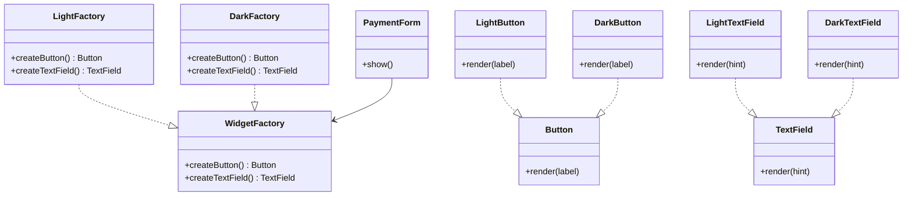

## Overview

Abstract factory gives one interface for creating a family of related objects, without naming their concrete classes. The client receives one factory and gets products that match, such as a light button with a light text field. An interviewer wants to hear why the family must stay consistent, and how a new theme avoids changes in client code.

## What to know

1. Intent and the problem it solves :: Abstract factory provides one interface for building a set of products that belong together. It makes sure a client never mixes a dark button with a light field. The problem it solves is families that drift apart, because each call site picks a class for each part on its own.

2. Structure and participants :: The abstract factory declares one creation method for each product in the family. Concrete factories implement it, and each returns its own set of products. The abstract products are the interfaces that clients use, and each theme has a concrete class for each product. The client receives a factory once and depends only on factory and product interfaces.

3. A worked example in Java :: The example builds a payment form in a light or dark theme. The form asks the factory for its widgets and never names a theme class. One function picks the factory from a setting. Adding a theme means one new factory and its products. The form does not change.

4. When to use it and when not to :: Use it when several products vary together, such as themes, platforms or payment providers, and the parts must match. Do not use it when only one product varies. A factory method or a plain parameter is simpler. Adding a product to the family forces a change in every factory, so keep families small and stable.

5. Related patterns and how it shows up in interviews :: Factory method creates one product through inheritance. Abstract factory groups several creation methods into one object, and often uses factory methods inside. Builder assembles one complex object step by step. In interviews it shows up in theme or widget questions, notification families (SMS and email with matching templates), and payment gateway families (charge, refund and webhook parsing for one provider). Mention the mismatch risk first, then name the pattern.

## Recap

- Abstract factory: one factory per family, one method per product.
- The client gets matching products and never mixes families.
- A new family is a new factory. Client code stays the same.

## Go deeper

### The problem it solves {point: 0}

A checkout page needs a button and a text field. Without the pattern, each screen calls `new DarkButton()` or `new LightButton()` and chooses the matching text field by hand. A screen that mixes a dark button with a light field looks broken, and nothing in the compiler catches it. Changing the theme means editing every screen.

With the pattern, the screen asks one factory for both widgets. The factory guarantees they match. The theme choice lives in one function. The before version repeats the choice for each widget. The after version makes one factory decide the whole family.

### Structure {point: 1}

`WidgetFactory` is the abstract factory. It declares `createButton()` and `createTextField()`. `LightFactory` and `DarkFactory` are concrete factories. Each returns its own products. `Button` and `TextField` are the abstract products. `LightButton` and `DarkButton` implement `Button`, and the text field classes implement `TextField` in the same way. `PaymentForm` is the client. It receives a factory and depends only on interfaces.



### Example: payment form in a light or dark theme {point: 2}

`PaymentForm` takes a `WidgetFactory` in its constructor. It creates both widgets from that factory and renders them. `factoryFor` is the only place that chooses a theme. `main` shows the form in both themes, and the output shows that each form uses one family.

```java
public class Main {
    interface Button {
        void render(String label);
    }

    interface TextField {
        void render(String hint);
    }

    // Abstract factory: one creation method per product in the family.
    interface WidgetFactory {
        Button createButton();
        TextField createTextField();
    }

    static class LightButton implements Button {
        @Override
        public void render(String label) {
            System.out.println("[light button] " + label);
        }
    }

    static class LightTextField implements TextField {
        @Override
        public void render(String hint) {
            System.out.println("[light field] " + hint);
        }
    }

    static class DarkButton implements Button {
        @Override
        public void render(String label) {
            System.out.println("[dark button] " + label);
        }
    }

    static class DarkTextField implements TextField {
        @Override
        public void render(String hint) {
            System.out.println("[dark field] " + hint);
        }
    }

    static class LightFactory implements WidgetFactory {
        @Override
        public Button createButton() {
            return new LightButton();
        }

        @Override
        public TextField createTextField() {
            return new LightTextField();
        }
    }

    static class DarkFactory implements WidgetFactory {
        @Override
        public Button createButton() {
            return new DarkButton();
        }

        @Override
        public TextField createTextField() {
            return new DarkTextField();
        }
    }

    // Client: knows only the factory and the product interfaces.
    static class PaymentForm {
        private final TextField cardNumber;
        private final Button payButton;

        PaymentForm(WidgetFactory factory) {
            this.cardNumber = factory.createTextField();
            this.payButton = factory.createButton();
        }

        void show() {
            cardNumber.render("Card number");
            payButton.render("Pay now");
        }
    }

    static WidgetFactory factoryFor(String theme) {
        return switch (theme) {
            case "light" -> new LightFactory();
            case "dark" -> new DarkFactory();
            default -> throw new IllegalArgumentException("Unknown theme: " + theme);
        };
    }

    public static void main(String[] args) {
        new PaymentForm(factoryFor("light")).show();
        new PaymentForm(factoryFor("dark")).show();
    }
}
```

### When to use it and when not to {point: 3}

Use it when a product family must stay consistent and the family can change as a whole. Typical signs are a theme, a platform (Windows or macOS widgets), or a provider with several related calls. Do not use it for a single product, because the extra interfaces add work with no gain. Do not use it when the family changes often, because every new product needs a method in every factory. A smaller alternative is one factory method that takes a theme and returns one product.

### In interviews {point: 4}

Good candidates in this app's LLD problems are the vending machine (a family of coin and item handling per machine model) and the text editor (a family of renderers per platform). In a payment design, name the family: "charge, refund and webhook parsing must come from the same provider, so I would use an abstract factory per provider."

The most common confusion is with factory method. Factory method creates one product, usually by subclassing the creator. Abstract factory is an object with several creation methods that are used together. Also compare with builder. A builder assembles one object over many calls. An abstract factory returns several separate products that work as a set.

## Interview questions

- Why would you use one factory object instead of several factory methods?
- What happens to client code when you add a new theme, and what happens when you add a new product to every theme?
- How do you make sure a client cannot mix families?

## Common mistakes

- Using abstract factory for one product type, which is a factory method with extra steps.
- Letting the client choose each product class, which brings back the mismatch problem.
- Forgetting that adding a product to the family changes every concrete factory.
- Hiding the theme choice in several places instead of one factory selector.
