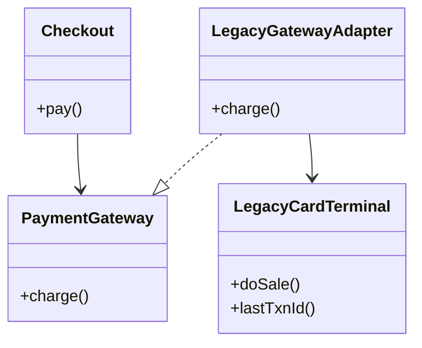

## Overview

Adapter converts the interface of one class into the interface that a client expects. It lets your code use a library or legacy API that does not match your design. An interviewer wants you to name the target interface, wrap the foreign class, and keep the translation in one place.

## What to know

1. Intent and the problem it solves :: Adapter makes two incompatible interfaces work together without changing either one. Use it when a third-party SDK or an old module has different names, units or return values than the code you are writing. The client keeps calling its own interface, and the translation lives in one class.

2. Structure and participants :: The Target is the interface the client uses. The Adaptee is the existing class with the incompatible API. The Adapter implements the Target, holds an Adaptee, and translates each call. The client only sees the Target.

3. A worked example in Java :: A checkout calls a PaymentGateway with a dollar amount and reads a boolean result. A legacy card terminal takes cents as text and returns numeric codes. The adapter does the conversion, so the checkout code does not change.

4. When to use it and when not to :: Use it at the boundary with code you do not own, such as an SDK, an old module or an external API. Do not use it when you own both sides, because changing one interface is simpler. Many adapters for one API suggest that your target interface is wrong.

5. Related patterns and how it shows up in interviews :: Facade also gives a simpler interface, but it wraps a whole subsystem with a new API. Adapter keeps the shape a client already expects. Decorator keeps the same interface and adds behaviour. In interviews, adapters appear in payment, notification and logging designs where a provider must be swapped later.

## Recap

- Adapter translates a foreign interface into the one your code expects.
- The client never needs to know that the adaptee exists.
- Keep the translation in one class at the boundary.

## Go deeper

### The problem it solves {point: 0}

Without an adapter, the checkout code calls the terminal directly. It converts dollars to cents, builds strings, reads numeric codes and maps them to booleans. This logic spreads into every caller. Switching to another vendor means editing every place that touches the terminal. An adapter moves all of the translation into one class, so the checkout depends only on PaymentGateway.

### Structure {point: 1}

The Target is PaymentGateway, the interface that checkout uses. The Adaptee is LegacyCardTerminal, which we cannot change. LegacyGatewayAdapter implements PaymentGateway and holds a terminal. Its charge method converts the units, calls doSale, and maps the result code to a PaymentResult. Checkout holds only a PaymentGateway.



### Example: Card payments at checkout {point: 2}

The checkout accepts any PaymentGateway. The adapter wraps the legacy terminal. The fake terminal approves amounts that have up to six digits in cents, and it declines larger amounts. The demo runs both paths.

```java
public class Main {

    // Target interface: what the checkout code wants.
    interface PaymentGateway {
        PaymentResult charge(String paymentToken, double amountInDollars);
    }

    record PaymentResult(boolean approved, String reference) {}

    // Legacy SDK we cannot change. Its names, units and return values differ from ours.
    static class LegacyCardTerminal {
        private int counter = 1000;

        int doSale(String merchantAccount, String amountCents, String cardToken) {
            System.out.println("Legacy doSale " + merchantAccount + " " + amountCents + " cents");
            return amountCents.length() > 6 ? 51 : 0; // 0 = approved, 51 = declined (fake rule)
        }

        String lastTxnId() {
            return "TXN-" + (++counter);
        }
    }

    // Adapter: implements our interface and translates each call to the legacy API.
    static class LegacyGatewayAdapter implements PaymentGateway {
        private final LegacyCardTerminal terminal;
        private final String merchantAccount;

        LegacyGatewayAdapter(LegacyCardTerminal terminal, String merchantAccount) {
            this.terminal = terminal;
            this.merchantAccount = merchantAccount;
        }

        @Override
        public PaymentResult charge(String paymentToken, double amountInDollars) {
            long cents = Math.round(amountInDollars * 100);
            int code = terminal.doSale(merchantAccount, String.valueOf(cents), paymentToken);
            boolean approved = code == 0;
            return new PaymentResult(approved, approved ? terminal.lastTxnId() : "DECLINED-" + code);
        }
    }

    // Client: knows only the PaymentGateway interface.
    static class Checkout {
        private final PaymentGateway gateway;

        Checkout(PaymentGateway gateway) {
            this.gateway = gateway;
        }

        String pay(String token, double total) {
            PaymentResult result = gateway.charge(token, total);
            return result.approved()
                    ? "Paid, ref " + result.reference()
                    : "Declined: " + result.reference();
        }
    }

    public static void main(String[] args) {
        PaymentGateway gateway = new LegacyGatewayAdapter(new LegacyCardTerminal(), "MERCH-42");
        Checkout checkout = new Checkout(gateway);
        System.out.println(checkout.pay("tok_visa_4242", 19.99));
        System.out.println(checkout.pay("tok_big_limit", 1234567.00));
    }
}
```

### When to use it and when not to {point: 3}

Use an adapter when a dependency's API does not match your design and you want to keep your design unchanged. Typical signals are a vendor SDK, a library upgrade that renamed methods, or two modules written by different teams. Do not add one only to rename methods inside your own code. An adapter adds a class and one more call, so keep it thin. If the adapter starts to hold business rules such as retries or fraud checks, move those rules into the domain.

### In interviews {point: 4}

In a payment or notification design, say that the SDK is outside your control, so you put an adapter behind your own interface. Then say that this makes it easy to add a second provider later. Adapter is often confused with Facade. A facade simplifies a whole subsystem and defines a new API. An adapter makes one existing class match an interface that already exists. Adapter also differs from Decorator, which keeps the interface the same and adds behaviour.

## Interview questions

- Where would you put the translation code between a vendor SDK and your domain?
- How is an adapter different from a facade?
- How would you test checkout without calling the real gateway?

## Common mistakes

- Putting business rules, such as retries or fraud checks, inside the adapter.
- Leaking vendor types or error codes into the client code.
- Writing an adapter for code you own, when changing the interface would be simpler.
- Forgetting units and rounding in the conversion, which causes wrong amounts.
