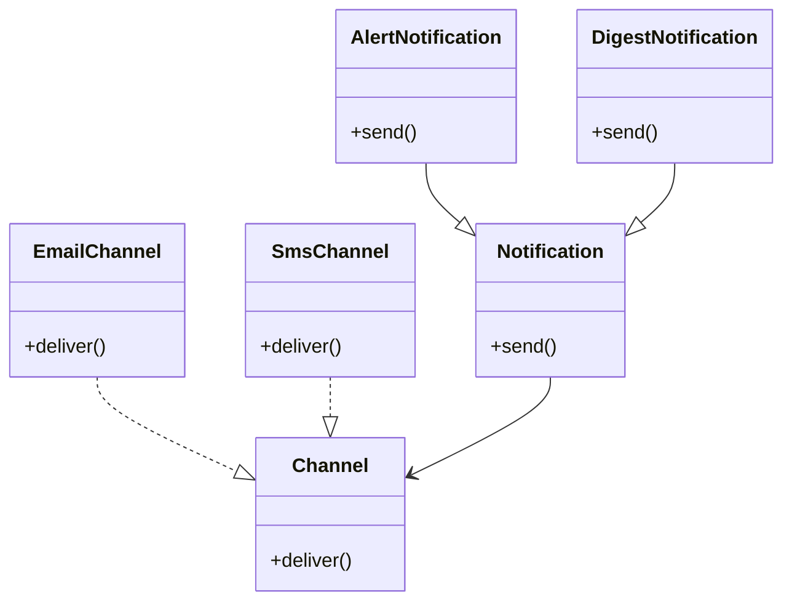

## Overview

Bridge splits a class that varies along two independent dimensions into two hierarchies. The abstraction says what the object does, and the implementor says how the work is done. The two sides are joined by a reference. An interviewer wants to hear that a new type or a new channel adds one class, not one class per combination.

## What to know

1. Intent and the problem it solves :: Bridge lets two kinds of variation change independently. Without it, every combination of message type and delivery channel becomes its own subclass. With it, you need N plus M classes instead of N times M. The abstraction keeps a reference to the implementor and delegates the delivery step.

2. Structure and participants :: The Abstraction holds an Implementor reference and defines high-level operations. Refined abstractions, such as Alert and Digest, add their own behaviour. The Implementor interface defines the low-level operation, and concrete implementors, such as Email and SMS, perform it. The abstraction never needs to know which implementor it has.

3. A worked example in Java :: A notification system sends alerts and digests over email and SMS. The notification builds the message, and the channel delivers it. Adding push notifications means one new channel class, and every message type can use it at once.

4. When to use it and when not to :: Use it when a class has two or more independent reasons to change, such as message type and channel, or shape and renderer. Skip it when only one dimension varies, because a single interface or a strategy is simpler. Bridge adds an indirection, so do not add it to code that has one axis.

5. Related patterns and how it shows up in interviews :: Bridge looks like Strategy, since both hold a delegate object. Strategy swaps one algorithm inside one object. Bridge separates two whole hierarchies that are designed together. Adapter fits existing code, while Bridge is a design choice made up front. In interviews, Bridge appears in device or remote control designs, drawing APIs, and notification or logging designs with sinks and formats.

## Recap

- Bridge separates what an object does from how it is done.
- N plus M classes instead of N times M.
- The abstraction holds the implementor and never creates it.

## Go deeper

### The problem it solves {point: 0}

Suppose the system needs alerts and digests, sent by email and by SMS. Without Bridge you write AlertEmail, AlertSms, DigestEmail and DigestSms. Adding push notifications adds two more classes (AlertPush and DigestPush), and each one repeats the delivery code. Every new axis multiplies the count. The fix is to separate the message from the channel that sends it.

### Structure {point: 1}

Notification is the abstraction. It holds a Channel field. AlertNotification and DigestNotification extend it and add their own content rules. Channel is the implementor interface. EmailChannel and SmsChannel implement it. The two hierarchies grow separately, and the only link between them is the Channel reference.



### Example: Alerts and digests over email and SMS {point: 2}

The demo sends an alert over SMS, an alert over email, and a digest over email. The message classes never mention email or SMS. The SMS channel also trims long text to its limit.

```java
import java.util.ArrayList;
import java.util.List;

public class Main {

    // Implementor: how a message is delivered.
    interface Channel {
        void deliver(String recipient, String body);
    }

    static class EmailChannel implements Channel {
        @Override
        public void deliver(String recipient, String body) {
            System.out.println("EMAIL to " + recipient + ": " + body);
        }
    }

    static class SmsChannel implements Channel {
        private static final int MAX_LENGTH = 160;

        @Override
        public void deliver(String recipient, String body) {
            String text = body.length() > MAX_LENGTH ? body.substring(0, MAX_LENGTH) : body;
            System.out.println("SMS to " + recipient + ": " + text);
        }
    }

    // Abstraction: what kind of message this is. It holds a Channel but does not know which one.
    static abstract class Notification {
        protected final Channel channel;

        protected Notification(Channel channel) {
            this.channel = channel;
        }

        abstract void send(String recipient);
    }

    static class AlertNotification extends Notification {
        private final String text;

        AlertNotification(Channel channel, String text) {
            super(channel);
            this.text = text;
        }

        @Override
        void send(String recipient) {
            channel.deliver(recipient, "[ALERT] " + text);
        }
    }

    static class DigestNotification extends Notification {
        private final List<String> items = new ArrayList<>();

        DigestNotification(Channel channel) {
            super(channel);
        }

        DigestNotification add(String item) {
            items.add(item);
            return this;
        }

        @Override
        void send(String recipient) {
            channel.deliver(recipient, "Daily digest: " + String.join("; ", items));
        }
    }

    public static void main(String[] args) {
        Channel email = new EmailChannel();
        Channel sms = new SmsChannel();

        new AlertNotification(sms, "Parking lot B is full").send("+1-555-0100");
        new AlertNotification(email, "Payment failed for order 881").send("ana@example.com");
        new DigestNotification(email)
                .add("3 spots freed")
                .add("2 new reviews")
                .send("ana@example.com");
    }
}
```

### When to use it and when not to {point: 3}

Use Bridge when you can name two axes that change for different reasons, and you expect new members on both. Signs include a class name that combines two nouns, such as AlertEmail, or a growing list of subclasses. Skip it when there is one axis. The costs are an extra interface, an extra object to wire up, and more code to read. For one axis, a single interface with a few implementations is enough.

### In interviews {point: 4}

Bridge appears in designs such as a remote control for many devices, a drawing API that renders shapes on several back ends, or a logger that writes messages to several sinks in several formats. In a vending machine or a parking lot it rarely appears, because those designs have one main axis. Name the two axes first, then draw the two hierarchies. Bridge is often confused with Strategy. Both delegate, but a Strategy is one algorithm chosen per object, while a Bridge connects two designed hierarchies. Adapter also joins two interfaces, but Adapter is for code that already exists.

## Interview questions

- How would the design change if you added a third axis, such as priority?
- How is Bridge different from Strategy?
- What belongs in the abstraction, and what belongs in the implementor?

## Common mistakes

- Using Bridge when only one dimension varies.
- Letting the abstraction know channel details, such as the SMS length limit.
- Creating a subclass for each combination anyway, which defeats the split.
- Having the abstraction create its own channel, instead of receiving it.
