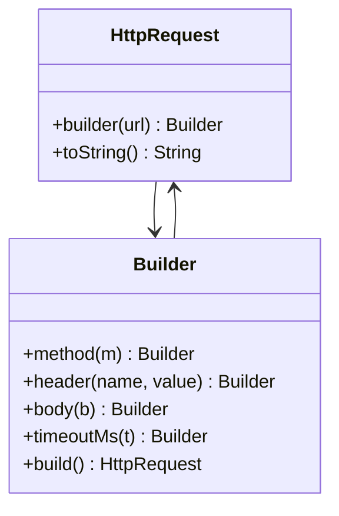

## Overview

Builder constructs a complex object step by step and returns it only when it is complete and valid. Callers set the optional parts by name, and `build()` checks the whole object before it exists. An interviewer wants to hear why this beats a constructor with many parameters, and where the validation happens.

## What to know

1. Intent and the problem it solves :: Builder separates the steps of constructing an object from the object's final form. Callers set only the fields they need, and each one is named. The problem it solves is the telescoping constructor, with many overloads and parameters that are easy to pass in the wrong order.

2. Structure and participants :: The product is the object being built, usually immutable. The builder is a nested class with one method per optional field, and each method returns the builder. `build()` validates the fields and creates the product through a private constructor. A director, which runs the steps in a fixed order, is optional and rarely needed in interviews.

3. A worked example in Java :: The example builds an HTTP request. The URL is required and goes in the first call. Method, headers, body and timeout have defaults. `build()` rejects a URL without https, a GET with a body, and a timeout that is not positive. The request is immutable after `build()`.

4. When to use it and when not to :: Use it when an object has many optional fields, needs validation across fields, or should be immutable. Do not use it for two or three plain fields. A constructor or a record is simpler. A builder adds a second class to maintain. A forgotten `build()` call is a silent bug that the compiler does not catch.

5. Related patterns and how it shows up in interviews :: A factory chooses which object to create in one call. A builder assembles one object over several calls. A fluent setter on a mutable class looks like a builder but lacks validation and immutability. In interviews it fits search queries, order or cart creation, parking-lot ticket options, and configuration of a form or a document. Mention where the validation lives, in `build()`.

## Recap

- Builder: named optional fields, validation in `build()`, immutable result.
- Use it for many optional parameters. Use a constructor or a record for a few fields.
- The product's constructor is private, so only the builder creates it.

## Go deeper

### The problem it solves {point: 0}

A request class with a constructor for each combination looks like this in prose: one constructor with URL, one with URL and method, one with URL, method and body, and so on. Each extra option adds another overload. Two `String` parameters next to each other are easy to swap, and the compiler accepts the swap. A null for an unused option is also easy to pass by mistake.

After the change, each option has a name at the call site. Defaults live in the builder. The validation runs once, in `build()`, so an invalid request cannot exist. The before version relies on the order of parameters. The after version relies on names.

### Structure {point: 1}

`HttpRequest` is the product. Its constructor is private and reads from a `Builder`. `HttpRequest.builder(url)` starts the build. `Builder` has one method for each optional field, and each method returns `this`. `build()` checks the fields and returns the product.



### Example: HTTP request for an order API {point: 2}

The builder keeps the URL required and makes everything else optional. `build()` enforces three rules: https only, no body on a GET, and a positive timeout. The product copies the header map, so callers cannot change a request after it is built.

```java
import java.util.LinkedHashMap;
import java.util.Map;

public class Main {
    static final class HttpRequest {
        private final String method;
        private final String url;
        private final Map<String, String> headers;
        private final String body;
        private final int timeoutMs;

        private HttpRequest(Builder b) {
            this.method = b.method;
            this.url = b.url;
            this.headers = Map.copyOf(b.headers);
            this.body = b.body;
            this.timeoutMs = b.timeoutMs;
        }

        static Builder builder(String url) {
            return new Builder(url);
        }

        @Override
        public String toString() {
            return method + " " + url + " timeout=" + timeoutMs + "ms headers=" + headers
                + " body=" + body;
        }

        static final class Builder {
            private final String url;
            private String method = "GET";
            private final Map<String, String> headers = new LinkedHashMap<>();
            private String body;
            private int timeoutMs = 5_000;

            private Builder(String url) {
                this.url = url;
            }

            Builder method(String method) {
                this.method = method;
                return this;
            }

            Builder header(String name, String value) {
                headers.put(name, value);
                return this;
            }

            Builder body(String body) {
                this.body = body;
                return this;
            }

            Builder timeoutMs(int timeoutMs) {
                this.timeoutMs = timeoutMs;
                return this;
            }

            HttpRequest build() {
                if (url == null || !url.startsWith("https://")) {
                    throw new IllegalStateException("url must start with https://");
                }
                if (method.equals("GET") && body != null) {
                    throw new IllegalStateException("GET cannot have a body");
                }
                if (timeoutMs <= 0) {
                    throw new IllegalStateException("timeout must be positive");
                }
                return new HttpRequest(this);
            }
        }
    }

    public static void main(String[] args) {
        HttpRequest post = HttpRequest.builder("https://api.example.com/orders")
            .method("POST")
            .header("Content-Type", "application/json")
            .body("{\"item\":\"tea\"}")
            .timeoutMs(2_000)
            .build();
        System.out.println(post);

        HttpRequest get = HttpRequest.builder("https://api.example.com/orders/7").build();
        System.out.println(get);

        try {
            HttpRequest.builder("https://api.example.com/orders").body("oops").build();
        } catch (IllegalStateException e) {
            System.out.println("rejected: " + e.getMessage());
        }
    }
}
```

### When to use it and when not to {point: 3}

Use it when the object has more than four or five optional fields, when some combinations are invalid, or when the object must not change after creation. Do not use it when the object has two or three required fields and no rules, because a constructor or a Java record does the same job with less code. Builders also make the object harder to find at the call site, since the type is hidden behind a chain. Keep the chain short and the names clear.

### In interviews {point: 4}

Name the object that has many options. In a parking lot, a ticket or a reservation with optional vehicle type, duration and payment plan fits. In a text editor, a document or export with optional fonts, margins and page size fits. Say the force first: "Many optional fields with rules between them, so a builder that validates in build()."

Builder is often confused with factory. A factory returns a product in one call based on a choice. A builder collects the choices over several calls and then creates the product. Builder is also confused with a fluent setter on a mutable class. The setter lets the object be half built and changed later. The builder hides the partial state and validates once.

## Interview questions

- When would you pick a builder over a constructor, and what is the cost?
- Where do you validate the fields, and why there?
- How do you make the built object immutable?

## Common mistakes

- Returning the product from each setter, so the object exists while it is still incomplete.
- Validating in each setter instead of once in `build()`, which misses rules between fields.
- Sharing a mutable map or list between the builder and the product.
- Using a builder for a class with two fields, where a constructor is clearer.
