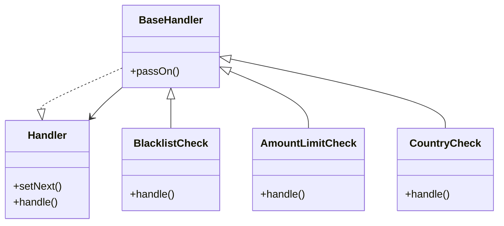

## Overview

Chain of responsibility passes a request along a line of handlers. Each handler either deals with the request or passes it to the next one. The intent is to decouple the sender from the handlers and to let you add, remove or reorder checks without touching the others. An interviewer wants to hear that you can name the handlers, say where the chain stops, and explain what happens when no handler takes the request.

## What to know

1. Intent and the problem it solves :: Put a series of checks or steps behind one entry point, where each step decides whether to act or to pass the request on. Without it, one large method grows an if-else for every rule, and every new rule edits that method. The chain keeps each rule in its own class.

2. Structure and participants :: A Handler interface declares the next link and the handle method. A base class stores the next handler and provides a helper to pass the request on. Concrete handlers implement one rule each. The client builds the chain once and sends requests to the first handler.

3. A worked example in Java :: A payment service runs checks in order: blacklist, amount limit, supported country, and a per-user velocity limit. The demo shows approved and declined payments, with the reason for each decline.

4. When to use it and when not to :: Use it when several independent checks or steps apply to the same request, and when their order matters or may change. Do not use it when there is only one rule or the order is fixed and never grows, because a plain method is clearer. A long chain also makes it harder to see the full path, and a request can fall off the end with no handler taking it, so decide what the default outcome is.

5. Related patterns and how it shows up in interviews :: Middleware in web frameworks is the usual real-world form. Compare it with Decorator, which wraps one object to add behaviour, while a chain passes the request between separate handlers that may stop it. Compare it with Command, which turns a request into an object, and with Mediator, which routes messages through a central hub. In LLD rounds it fits parking lot pricing rules, vending machine validation, and approval workflows.

## Recap

- Chain of responsibility: each handler either handles the request or passes it on.
- Keep one rule per handler, and build the chain in one place.
- Decide what happens when the end of the chain is reached.

## Go deeper

### The problem it solves {point: 0}

Imagine a payment method that checks a blacklist, then an amount limit, then a country rule, then a velocity rule. Written as one method, it looks like a stack of if statements. Each new rule changes the same method, the rules cannot be tested alone, and the order is buried in the code. A test for the velocity rule has to set up the blacklist and the country data as well.

With a chain, each rule is a small class with one job. The method that processes a payment only sends it to the first handler. The order is visible where the chain is built, and a rule can be added, removed or moved by changing that one place.

### Structure {point: 1}

The Handler interface has two methods: setNext, which links the next handler and returns it so the chain can be built in one line, and handle, which returns the decision for the request. BaseHandler holds the next link and offers passOn, which calls the next handler or returns the final result when there is none. Each concrete handler, such as BlacklistCheck or AmountLimitCheck, extends BaseHandler, checks its own rule, and either returns a decline or calls passOn.



### Example: payment checks before approval {point: 2}

The example builds a chain of four checks for a payment service. The chain is built once in main. Each payment goes to the first handler, and the handler returns either APPROVED or the reason for the decline. The VelocityCheck keeps a count per user, so the fourth payment from the same user is declined.

```java
import java.util.*;

public class Main {
    record Payment(String userId, long amountCents, String country) {}

    interface Handler {
        Handler setNext(Handler next);
        String handle(Payment p);
    }

    static abstract class BaseHandler implements Handler {
        private Handler next;

        public Handler setNext(Handler next) {
            this.next = next;
            return next;
        }

        protected String passOn(Payment p) {
            return next == null ? "APPROVED" : next.handle(p);
        }
    }

    static class BlacklistCheck extends BaseHandler {
        private final Set<String> blocked;

        BlacklistCheck(Set<String> blocked) { this.blocked = blocked; }

        public String handle(Payment p) {
            return blocked.contains(p.userId()) ? "DECLINED: user is blocked" : passOn(p);
        }
    }

    static class AmountLimitCheck extends BaseHandler {
        private final long maxCents;

        AmountLimitCheck(long maxCents) { this.maxCents = maxCents; }

        public String handle(Payment p) {
            return p.amountCents() > maxCents ? "DECLINED: above limit" : passOn(p);
        }
    }

    static class CountryCheck extends BaseHandler {
        private final Set<String> allowed;

        CountryCheck(Set<String> allowed) { this.allowed = allowed; }

        public String handle(Payment p) {
            return allowed.contains(p.country()) ? passOn(p) : "DECLINED: country not supported";
        }
    }

    static class VelocityCheck extends BaseHandler {
        private final int maxPerUser;
        private final Map<String, Integer> counts = new HashMap<>();

        VelocityCheck(int maxPerUser) { this.maxPerUser = maxPerUser; }

        public String handle(Payment p) {
            int n = counts.merge(p.userId(), 1, Integer::sum);
            return n > maxPerUser ? "DECLINED: too many payments" : passOn(p);
        }
    }

    public static void main(String[] args) {
        Handler chain = new BlacklistCheck(Set.of("u9"));
        chain.setNext(new AmountLimitCheck(100_000))
             .setNext(new CountryCheck(Set.of("IN", "US")))
             .setNext(new VelocityCheck(2));

        List<Payment> payments = List.of(
            new Payment("u1", 2_500, "IN"),
            new Payment("u9", 2_500, "IN"),
            new Payment("u2", 500_000, "US"),
            new Payment("u3", 1_000, "FR"),
            new Payment("u1", 1_000, "IN"),
            new Payment("u1", 1_000, "IN"));

        for (Payment p : payments) {
            System.out.println(p.userId() + " " + p.amountCents() + " -> " + chain.handle(p));
        }
    }
}
```

### When to use it and when not to {point: 3}

Use the pattern when a request must pass several independent checks, the checks may change, and the order matters. It also fits cases where any handler can stop the request early, such as authentication before rate limiting. The cost is indirection: the path a request takes is spread across classes, and a missing link can let a request through or drop it silently. Check the chain in tests that send a request through the whole path.

When there is one rule, or when the steps always run in the same fixed order, a plain method with a few named helper calls is simpler. Do not build a chain just to look like a design pattern. If every handler always runs and none stops the request, a list of validators with a loop is often clearer than a linked chain.

### In interviews {point: 4}

In an LLD round, say the force first: "the checks will grow and the order may change, so each check becomes a handler". This shows up in parking lot entry checks, vending machine validation (coin, stock, change), and approval workflows in expense systems, where a request goes from manager to director to finance by amount. Name the default outcome when no handler takes the request. Be ready to explain how it differs from Decorator: a decorator always calls the wrapped object and adds behaviour around it, while a chain may stop the request at any link. Compare it with Mediator, where a central object decides who receives a message, and with Command, where the request itself is an object that can be queued or undone.

### Modern Java

A handler can be a lambda when it has one method, for example a functional interface Handler with a single handle method, and each link can be a method reference. Java's servlet filter chain and the Netty pipeline are real examples of this idea. Use a record for the request, as in the example, so the handlers cannot change it.

## Interview questions

- What happens if no handler in the chain takes the request?
- How would you add a new rule without changing the existing handlers?
- How is a chain of responsibility different from a decorator?
- How would you test one link in the chain on its own?

## Common mistakes

- Letting a handler both decide and modify shared state, so the result depends on the order in an unclear way.
- Forgetting to call passOn, which silently ends the chain early.
- Building the chain in several places, so the order is hard to see.
- Leaving the end of the chain undefined, so a request can be dropped without a clear answer.
- Using the pattern for one rule, where a plain method is clearer.
