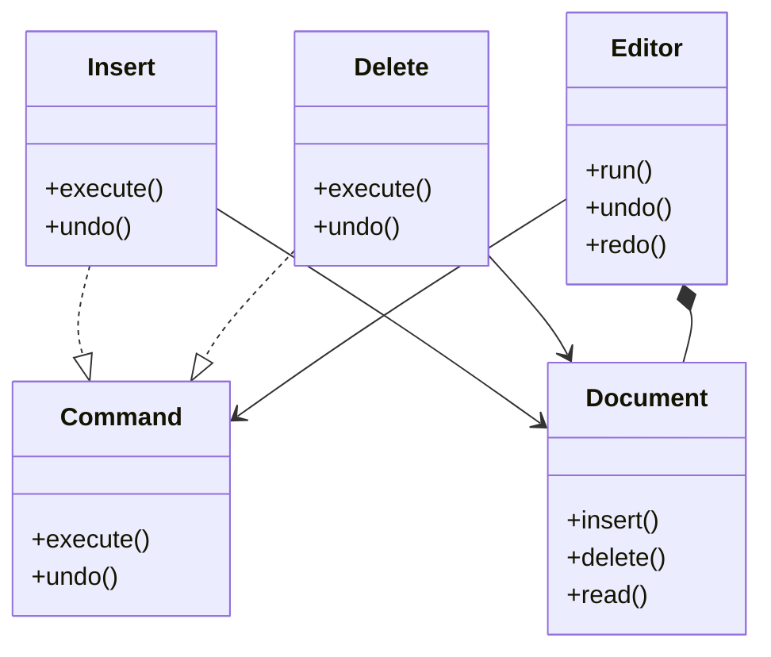

## Overview

Command turns a request into an object. The object holds everything needed to carry out the action, so it can be stored, queued, logged, retried or undone. The intent is to separate the code that asks for an action from the code that performs it. An interviewer wants to hear the execute and undo pair, a history stack for undo and redo, and why each action must remember what it changed.

## What to know

1. Intent and the problem it solves :: Wrap an action in an object with an execute method, so the caller can treat actions as data. Without it, undo means remembering every change in a separate place, and queues or logs must know the details of each action. A command object carries those details with the action.

2. Structure and participants :: A Command interface declares execute and undo. Concrete commands hold the receiver (the object that does the work) and the arguments. An invoker, such as an editor, runs commands and keeps the history stacks. The client creates the commands and gives them to the invoker.

3. A worked example in Java :: A text editor runs insert and delete commands. Each command records what it needs to reverse itself. The demo shows edits, undo, redo, and how a new edit clears the redo history.

4. When to use it and when not to :: Use it for undo and redo, queued or scheduled work, transaction logs, retries, and macros built from several actions. Do not use it when actions are simple calls that never need undo, queuing or logging, because a method call is enough. Each command is a class, so a large number of small actions makes the code heavier.

5. Related patterns and how it shows up in interviews :: Runnable and Callable in Java are commands with one method. Compare it with Strategy, where the object chooses how to do one job, while a command packages one request to be run later. Compare it with Memento, which saves state, and with Chain of responsibility, which passes a request along handlers. In LLD rounds it fits text editors, elevator requests, smart home actions, and job queues.

## Recap

- Command: a request as an object with execute and undo.
- The invoker keeps an undo stack and a redo stack.
- A new action clears the redo stack.

## Go deeper

### The problem it solves {point: 0}

A text editor that supports undo could keep a copy of the whole document after every edit. That uses a lot of memory and copies too much. Another option is a method per action with an if chain for undo, for example an undoType method that knows the last typed text and an undoDelete method that knows the removed text. The editor then has to know the details of every action, and adding an action means editing the undo code.

With commands, each action stores its own undo information when it runs. The editor only keeps a stack of commands and calls execute or undo on the top one. Adding a new action means adding a new command class, and the editor does not change.

### Structure {point: 1}

The Command interface has execute and undo. Insert and Delete are concrete commands. Each one holds the Document, which is the receiver, and its arguments. Delete saves the removed text in execute so undo can put it back. Editor is the invoker: it runs a command, pushes it on the undo stack and clears the redo stack. Undo and redo move commands between the two stacks.



### Example: text editor with undo and redo {point: 2}

The example keeps a StringBuilder as the document. Insert adds text, and its undo removes the same number of characters. Delete reads the text it is about to remove, so undo can insert it back at the same position. The editor runs each command, pushes it on the undo stack, and clears the redo stack when a new edit happens.

```java
import java.util.*;

public class Main {
    static class Document {
        private final StringBuilder text = new StringBuilder();

        void insert(int pos, String s) { text.insert(pos, s); }
        void delete(int pos, int len) { text.delete(pos, pos + len); }
        String read(int pos, int len) { return text.substring(pos, pos + len); }

        @Override public String toString() { return text.toString(); }
    }

    interface Command {
        void execute();
        void undo();
    }

    static class Insert implements Command {
        private final Document doc;
        private final int pos;
        private final String s;

        Insert(Document doc, int pos, String s) { this.doc = doc; this.pos = pos; this.s = s; }

        public void execute() { doc.insert(pos, s); }
        public void undo() { doc.delete(pos, s.length()); }
    }

    static class Delete implements Command {
        private final Document doc;
        private final int pos;
        private final int len;
        private String removed = "";

        Delete(Document doc, int pos, int len) { this.doc = doc; this.pos = pos; this.len = len; }

        public void execute() {
            removed = doc.read(pos, len);
            doc.delete(pos, len);
        }

        public void undo() { doc.insert(pos, removed); }
    }

    static class Editor {
        private final Document doc = new Document();
        private final Deque<Command> undoStack = new ArrayDeque<>();
        private final Deque<Command> redoStack = new ArrayDeque<>();

        void run(Command c) {
            c.execute();
            undoStack.push(c);
            redoStack.clear();
        }

        void undo() {
            if (undoStack.isEmpty()) return;
            Command c = undoStack.pop();
            c.undo();
            redoStack.push(c);
        }

        void redo() {
            if (redoStack.isEmpty()) return;
            Command c = redoStack.pop();
            c.execute();
            undoStack.push(c);
        }

        Document doc() { return doc; }
    }

    public static void main(String[] args) {
        Editor editor = new Editor();
        Document doc = editor.doc();

        editor.run(new Insert(doc, 0, "Hello"));
        editor.run(new Insert(doc, 5, " world"));
        editor.run(new Delete(doc, 5, 6));
        System.out.println("after edits: " + doc);

        editor.undo();
        System.out.println("after undo:  " + doc);
        editor.undo();
        System.out.println("after undo:  " + doc);
        editor.redo();
        System.out.println("after redo:  " + doc);

        editor.run(new Insert(doc, 0, ">> "));
        editor.redo();
        System.out.println("final:       " + doc);
    }
}
```

### When to use it and when not to {point: 3}

Use commands when an action needs undo, when actions must be queued or retried, or when a log of actions is needed for audit or replay. A command also makes it easy to group several actions into one macro. The cost is one class per action and the need to keep each undo correct. Undo is hard when an action depends on outside state that changes later, such as a network call or a payment, so some systems use a compensating action instead of a true undo.

When actions are fixed, never queued, and never undone, call the method directly. A command object that only wraps a single call adds files without adding value. In Java, a lambda or Runnable is enough for a queue of simple tasks that need no undo.

### In interviews {point: 4}

In LLD rounds, the text editor is the usual case: say "undo and redo mean each edit is a command with an undo, and the editor keeps two stacks". The same design fits elevator requests stored as commands, smart home rules that can be logged, and a job queue where each job is run later. Name what makes undo correct: each command must store what it removed or changed when it ran. Compare it with Memento, which stores a snapshot of the state, while a command stores the change. A snapshot is simpler but costs more memory; a command is smaller but must reverse itself. Compare it with Strategy: a strategy is chosen to do a job in a particular way, while a command is a request that is stored and run later.

### Modern Java

Because execute is a single method, a command can be a lambda when no undo is needed, for example a Runnable put in an ExecutorService. For commands with undo, keep the interface and use a record or class for each action. Java's Runnable and Callable are commands with one method.

## Interview questions

- How does undo work for a delete command?
- Why does a new edit clear the redo stack?
- What would you change to support undo for an action that calls an external payment API?
- How is a command different from a strategy?

## Common mistakes

- Storing the undo information outside the command, so the command cannot undo itself.
- Forgetting to clear the redo stack after a new edit.
- Making commands that depend on the editor's internal state instead of the receiver.
- Using a command for an action that never needs undo or queuing.
- Assuming every real-world action can be undone exactly, when some need a compensating action.
