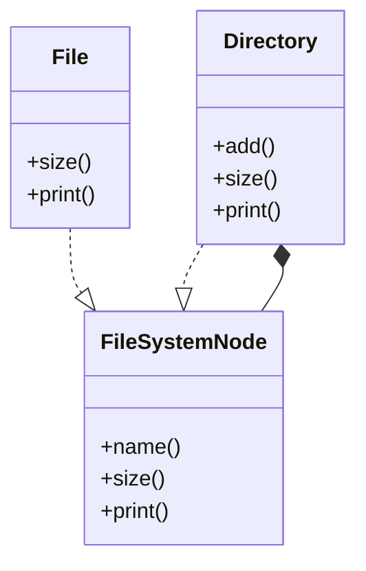

## Overview

Composite treats single objects and groups of objects through one interface. A file and a folder both report a size, so the caller does not need to know which one it holds. An interviewer wants to hear the leaf and composite roles, and to see a recursive call over the children.

## What to know

1. Intent and the problem it solves :: Composite lets clients use individual objects and compositions in the same way. A tree of nodes can be processed by one recursive call. Without it, callers check types with instanceof and handle each case in a different place.

2. Structure and participants :: The Component is the shared interface, with operations such as size and print. A Leaf implements the operation directly. A Composite holds a list of Components and implements the operation by combining its children. The client uses both kinds the same way.

3. A worked example in Java :: A file system has files and directories. Each node reports its size, and a directory adds the sizes of its children, including nested directories. Printing the tree uses the same recursive pattern.

4. When to use it and when not to :: Use it when the data forms a tree, such as files, menus, UI widgets or an organisation chart, and the same operations apply to leaves and groups. Skip it when the structure is flat, or when leaves and groups need very different operations. Keep the child management out of the leaves if you can, so they do not have to throw errors for add().

5. Related patterns and how it shows up in interviews :: Decorator also wraps objects recursively, but it wraps exactly one object and adds behaviour. Composite holds many children and combines their results. Iterator is often used to walk a composite. Visitor adds new operations to a tree without changing the node classes. In interviews, Composite appears in file system, UI widget, menu and building-level designs.

## Recap

- Leaves and composites share one interface, so clients need no type checks.
- Operations on a group are written as a loop over children that calls the same method.
- Guard against cycles when a node can point back to a parent.

## Go deeper

### The problem it solves {point: 0}

Without Composite, a size calculation must first check whether each item is a file or a folder. A folder's size code loops over its items and handles each kind itself. Printing the tree repeats the same checks. Adding a new kind of node means editing every method that checks types. The fix is one shared interface that both kinds implement.

### Structure {point: 1}

FileSystemNode is the Component. It declares name, size and print. File is the Leaf. Its size is its own byte count. Directory is the Composite. It holds its children as FileSystemNode values, so a child can be a file or another directory. Its size loops over the children and adds their sizes, and each child does its own work in turn.



### Example: Folder sizes and a tree view in a file system {point: 2}

The demo builds a small home folder with nested directories. It prints the tree with sizes at every level, then prints the total. The same size and print methods work for files and folders.

```java
import java.util.ArrayList;
import java.util.List;

public class Main {

    // Component: files and directories share this type.
    interface FileSystemNode {
        String name();
        long size();
        void print(String indent);
    }

    // Leaf: has no children.
    static class File implements FileSystemNode {
        private final String name;
        private final long bytes;

        File(String name, long bytes) {
            this.name = name;
            this.bytes = bytes;
        }

        @Override
        public String name() {
            return name;
        }

        @Override
        public long size() {
            return bytes;
        }

        @Override
        public void print(String indent) {
            System.out.println(indent + name + " (" + bytes + " B)");
        }
    }

    // Composite: holds children, which can be files or other directories.
    static class Directory implements FileSystemNode {
        private final String name;
        private final List<FileSystemNode> children = new ArrayList<>();

        Directory(String name) {
            this.name = name;
        }

        Directory add(FileSystemNode node) {
            children.add(node);
            return this;
        }

        @Override
        public String name() {
            return name;
        }

        @Override
        public long size() {
            long total = 0;
            for (FileSystemNode child : children) {
                total += child.size();
            }
            return total;
        }

        @Override
        public void print(String indent) {
            System.out.println(indent + name + "/ (" + size() + " B)");
            for (FileSystemNode child : children) {
                child.print(indent + "  ");
            }
        }
    }

    public static void main(String[] args) {
        Directory root = new Directory("home")
                .add(new File("notes.txt", 1_200))
                .add(new Directory("photos")
                        .add(new File("beach.jpg", 4_500_000))
                        .add(new File("cat.png", 900_000)));

        Directory projects = new Directory("projects");
        projects.add(new File("main.java", 3_400));
        root.add(projects);

        root.print("");
        System.out.println("Total: " + root.size() + " B");
    }
}
```

### When to use it and when not to {point: 3}

Use Composite when the data is a tree and each operation can be written once for both leaves and groups. Signals include the words "contains" and "part of" in the requirements, and operations that must run over the whole subtree. Costs are a wider interface, since leaves may need methods that do not make sense for them, and recursion that must be guarded. If the data is flat, a plain list is simpler and clearer.

### In interviews {point: 4}

The file system is the classic case. A UI widget tree, where a panel holds buttons and other panels, is another. Menus and nested categories in a shopping catalogue use the same shape. The parking lot design can use it for a building that holds levels, and each level holds spots. Composite is often confused with Decorator, since both use recursion. A Decorator wraps one object and adds behaviour, while a Composite groups many objects and combines their results. Name the Leaf and the Composite before you write any code.

## Interview questions

- How does size() work for a directory that holds nested directories?
- Should add() be on the Component interface or only on the composite? Why?
- How would you stop a cycle in a tree where a node can point to its parent?

## Common mistakes

- Using instanceof checks in the client code, which defeats the pattern.
- Letting a directory contain itself or one of its ancestors, which causes endless recursion.
- Forgetting the empty-directory case in size or print logic.
- Forcing add() onto leaves, so they must throw an error when called.
