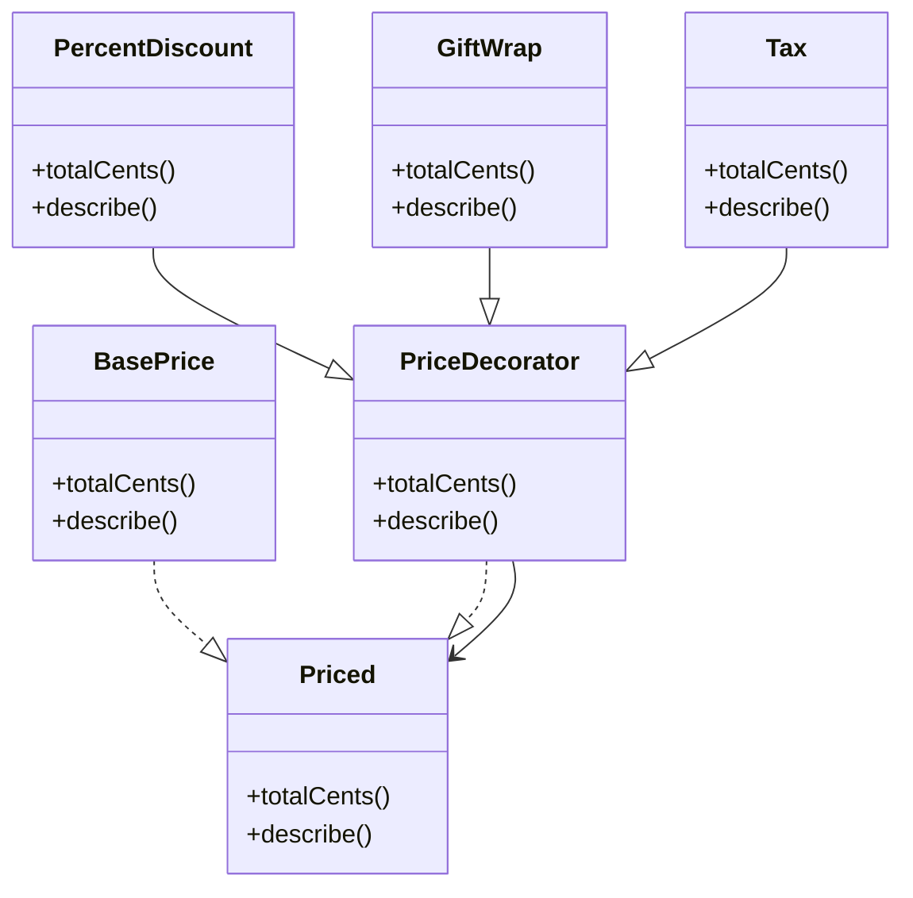

## Overview

Decorator adds behaviour to an object by wrapping it. The wrapper implements the same interface as the object it wraps, so wrappers can be stacked in any order at run time. An interviewer wants to hear the shared interface, the wrapper that holds the next object, and a reason to prefer wrapping over subclassing.

## What to know

1. Intent and the problem it solves :: Decorator attaches extra responsibilities to an object without changing its class. Each optional feature becomes one wrapper class. Stacking wrappers replaces a subclass for every combination of features.

2. Structure and participants :: The Component is the interface. The ConcreteComponent is the base object. The Decorator implements the Component and holds another Component. Concrete decorators add behaviour before or after they delegate to the wrapped object.

3. A worked example in Java :: A checkout price starts from a base item price. A percent discount, gift wrap and sales tax each wrap the previous price. The total and the description come out of the whole stack.

4. When to use it and when not to :: Use it when features are optional, can be combined, and do not depend on each other much, such as logging, caching or retries around a service. Skip it when there are only two or three fixed variants, because a plain field or method is clearer. Too many thin wrappers make debugging hard, since a call passes through many layers.

5. Related patterns and how it shows up in interviews :: Proxy has the same shape but a different purpose. A decorator adds behaviour, while a proxy controls access or creation. Adapter changes the interface. Composite also holds children, but it holds many of them. In interviews, Decorator appears in pricing rules, notification senders with retries and logging, and text styling in a text editor.

## Recap

- Decorator wraps an object with the same interface and adds behaviour.
- Wrappers stack in any order, so features combine without new subclasses.
- Every wrapper must delegate to the object it holds.

## Go deeper

### The problem it solves {point: 0}

Without Decorator, a price with a discount, gift wrap and tax needs a class for each combination, such as DiscountedGiftWrapped or TaxedDiscounted. Adding one feature doubles the number of classes. The other common approach is one class with flags and many if statements, so every new option edits the same method. Decorator keeps each feature in its own small class.

### Structure {point: 1}

Priced is the Component. It declares totalCents and describe. BasePrice is the ConcreteComponent. PriceDecorator implements Priced and holds another Priced in a field named inner. PercentDiscount, GiftWrap and Tax extend PriceDecorator. Each one changes the result of the wrapped call and passes the rest through.



### Example: Checkout total with stacked price adjustments {point: 2}

The demo wraps a headphone price with a 10 percent discount, then gift wrap, then 8.25 percent tax. The order of the wrappers matters: the discount applies before the fee and the tax. The describe output shows the stack in the same order.

```java
public class Main {

    interface Priced {
        long totalCents();
        String describe();
    }

    // Concrete component: the base price of an item.
    static class BasePrice implements Priced {
        private final String name;
        private final long cents;

        BasePrice(String name, long cents) {
            this.name = name;
            this.cents = cents;
        }

        @Override
        public long totalCents() {
            return cents;
        }

        @Override
        public String describe() {
            return name;
        }
    }

    // Base decorator: same interface, holds the price it wraps.
    static abstract class PriceDecorator implements Priced {
        protected final Priced inner;

        PriceDecorator(Priced inner) {
            this.inner = inner;
        }
    }

    static class PercentDiscount extends PriceDecorator {
        private final int percent;

        PercentDiscount(Priced inner, int percent) {
            super(inner);
            this.percent = percent;
        }

        @Override
        public long totalCents() {
            long base = inner.totalCents();
            return base - base * percent / 100;
        }

        @Override
        public String describe() {
            return inner.describe() + " - " + percent + "% off";
        }
    }

    static class GiftWrap extends PriceDecorator {
        private static final long FEE_CENTS = 399;

        GiftWrap(Priced inner) {
            super(inner);
        }

        @Override
        public long totalCents() {
            return inner.totalCents() + FEE_CENTS;
        }

        @Override
        public String describe() {
            return inner.describe() + " + gift wrap";
        }
    }

    static class Tax extends PriceDecorator {
        private final int basisPoints; // 825 means 8.25 percent

        Tax(Priced inner, int basisPoints) {
            super(inner);
            this.basisPoints = basisPoints;
        }

        @Override
        public long totalCents() {
            return inner.totalCents() * (10_000 + basisPoints) / 10_000;
        }

        @Override
        public String describe() {
            return inner.describe() + " + tax";
        }
    }

    static String money(long cents) {
        return String.format("$%d.%02d", cents / 100, cents % 100);
    }

    public static void main(String[] args) {
        Priced item = new BasePrice("Headphones", 12_000);
        item = new PercentDiscount(item, 10);
        item = new GiftWrap(item);
        item = new Tax(item, 825);

        System.out.println(item.describe());
        System.out.println("Total: " + money(item.totalCents()));
    }
}
```

### When to use it and when not to {point: 3}

Use Decorator when the same kinds of behaviour must combine in different ways, and each one can be written without knowing the others. Signals include a growing list of subclasses and flags that change the same method. Costs are many small classes, results that depend on the order of wrapping, and an object whose type no longer matches the class you expected, so instanceof checks fail. For two or three fixed options, a parameter object or plain fields are simpler.

### In interviews {point: 4}

Pricing with coupons and taxes is a common LLD question, and Decorator is the usual answer. Notification senders often gain retries and logging as wrappers around a base sender. The Java I/O streams are the standard example: a buffered stream wraps a file stream. In a text editor, bold and italic styling can wrap a text run. Decorator is often confused with Proxy, which has the same structure but controls access instead of adding behaviour. It is also confused with Composite, which holds many children rather than one wrapped object. Say that the wrapper keeps the interface, so callers do not change.

## Interview questions

- How is a decorator different from a subclass?
- What changes if the discount and the tax are swapped in the stack?
- How would you add logging around every price calculation without editing each decorator?

## Common mistakes

- Making a decorator depend on the concrete type of the object it wraps.
- Forgetting to delegate, so the wrapped object's behaviour is lost.
- Writing order-dependent decorators without saying so in the code or the API.
- Using decorators for two options that never change, where a field is clearer.
