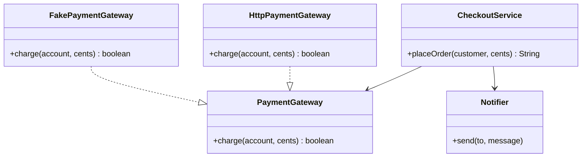

## Overview

Dependency injection gives a class the collaborators it needs from outside, instead of creating them inside. The class asks for interfaces in its constructor, and one place in the program chooses the concrete classes. An interviewer wants to hear why this makes code testable, and where the wiring happens.

## What to know

1. Intent and the problem it solves :: Dependency injection supplies a class with the objects it uses from outside, instead of letting it create them. The problem it solves is hidden coupling. A class that calls `new` on a payment provider cannot be tested without the provider, and cannot switch providers without editing its own code.

2. Structure and participants :: The client declares what it needs as interfaces, such as a payment gateway and a notifier. A composition root, usually `main` or a framework, creates the concrete classes and passes them in. Constructor injection is the default. The fields are final, and the object is complete once the constructor returns.

3. A worked example in Java :: The example builds a checkout service. In `main`, one wiring uses a real gateway, and another uses a fake gateway that records its calls. The service does not know which one it got. Only `main` names concrete classes.

4. When to use it and when not to :: Use it for any class that talks to something outside itself, such as a database, a payment provider, a clock or a queue. It costs a few interfaces and one wiring step. Do not add an interface for every class with one implementation and no reason to swap it. Frameworks such as Spring do the wiring, but the idea works with plain constructors, and interviewers expect the manual version.

5. Related patterns and how it shows up in interviews :: Strategy also passes a behaviour in, but it chooses a rule for each call, while injection supplies collaborators once for each object. Singleton and a service locator hide the same dependency, which makes testing harder. Abstract factory creates a family, and injection decides which family the client receives. In interviews, name the collaborators you inject, such as payment, notifier, clock and storage, and show a fake in a test.

## Recap

- Dependency injection: receive collaborators through the constructor, as interfaces.
- One composition root creates the concrete classes. Nothing else calls `new` on them.
- Tests pass fakes. Production passes real adapters. The client does not change.

## Go deeper

### The problem it solves {point: 0}

A checkout service creates its own payment client inside the constructor, and calls the provider directly. A test of the checkout logic now needs the provider, its keys and the network. A developer who wants to try a different provider must edit the checkout class. The class is hard to reuse, because it carries its own dependencies.

After the change, the service receives a payment interface and a notifier interface. Tests pass a fake. Production passes the real provider. The checkout logic is the same in both cases. The before version hides the dependency. The after version shows it in the constructor.

### Structure {point: 1}

`CheckoutService` is the client. It depends on `PaymentGateway` and `Notifier`, which are interfaces. `HttpPaymentGateway` implements the real gateway, and `FakePaymentGateway` implements a test double. Both implement the same interface. `main` is the composition root, and it chooses which one to pass in.



### Example: checkout service with a fake and a real gateway {point: 2}

`main` first builds the service with a fake gateway that declines, and prints the calls the fake recorded. Then it builds the service with the real gateway. The `CheckoutService` class is the same in both runs. Only the wiring differs.

```java
import java.util.ArrayList;
import java.util.List;

public class Main {
    interface PaymentGateway {
        boolean charge(String account, int cents);
    }

    interface Notifier {
        void send(String to, String message);
    }

    // Real adapter: in production this would call a payment provider's API.
    static class HttpPaymentGateway implements PaymentGateway {
        @Override
        public boolean charge(String account, int cents) {
            System.out.println("charging " + cents + " to " + account);
            return true;
        }
    }

    // Test double: records calls and returns a fixed answer.
    static class FakePaymentGateway implements PaymentGateway {
        final List<String> calls = new ArrayList<>();
        private final boolean succeed;

        FakePaymentGateway(boolean succeed) {
            this.succeed = succeed;
        }

        @Override
        public boolean charge(String account, int cents) {
            calls.add(account + ":" + cents);
            return succeed;
        }
    }

    static class ConsoleNotifier implements Notifier {
        @Override
        public void send(String to, String message) {
            System.out.println("to " + to + ": " + message);
        }
    }

    // Depends only on interfaces, received through the constructor.
    static class CheckoutService {
        private final PaymentGateway payments;
        private final Notifier notifier;

        CheckoutService(PaymentGateway payments, Notifier notifier) {
            this.payments = payments;
            this.notifier = notifier;
        }

        String placeOrder(String customer, int cents) {
            if (cents <= 0) {
                throw new IllegalArgumentException("amount must be positive");
            }
            if (!payments.charge(customer, cents)) {
                notifier.send(customer, "Payment declined");
                return "FAILED";
            }
            notifier.send(customer, "Order placed for " + cents + " cents");
            return "PLACED";
        }
    }

    public static void main(String[] args) {
        // Test wiring: a fake gateway that declines.
        FakePaymentGateway fake = new FakePaymentGateway(false);
        CheckoutService testService = new CheckoutService(fake, new ConsoleNotifier());
        System.out.println(testService.placeOrder("asha", 1_200));
        System.out.println("gateway calls: " + fake.calls);

        // Production wiring: the real gateway. Only main names concrete classes.
        CheckoutService service = new CheckoutService(new HttpPaymentGateway(), new ConsoleNotifier());
        System.out.println(service.placeOrder("ravi", 4_500));
    }
}
```

### When to use it and when not to {point: 3}

Use it when a class depends on something outside the program or something that may change, such as a provider, a database, a clock or a queue. The extra cost is one interface per seam and one wiring step. Do not add an interface around every class. A class with one implementation and no outside dependency gains nothing from it. Do not use a global lookup, such as a static registry, to get dependencies. That hides them again. Constructor injection keeps each dependency visible in the signature.

### In interviews {point: 4}

Name the outside collaborators in the design. In a parking lot, a clock for ticket times and a repository for spot state. In an elevator or vending machine problem, a timer or a payment provider. Say it in order: "The service talks to payments and notifications, so I would inject both as interfaces. The test passes fakes."

Dependency injection is confused with a service locator. Both move the choice out of the class. A locator is a global lookup that the class calls, so the dependency stays hidden. Injection passes the object in through the constructor. It is also confused with strategy. Strategy changes a rule for each call, while injection fixes the collaborator for the life of the object.

## Interview questions

- What is the difference between constructor injection and a service locator?
- Which dependencies would you inject into your design, and why?
- How does injection make the code easier to test?

## Common mistakes

- Creating the concrete class inside the constructor, which defeats the injection.
- Injecting an interface for every class, even when nothing will ever replace it.
- Hiding the dependency behind a static lookup, which brings back the coupling.
- Passing a whole container of objects into the class instead of the specific ones it needs.
