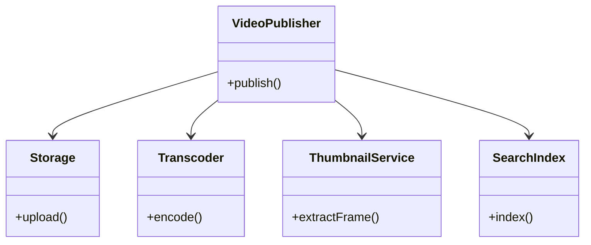

## Overview

Facade gives a complex subsystem one simple entry point. The client calls one method, and the facade calls the right parts in the right order. An interviewer wants a small public API, a clear list of the steps that stay hidden, and a note on how the parts remain reachable when needed.

## What to know

1. Intent and the problem it solves :: Facade hides the details of several classes that work together. Without it, every client must know the order of steps, the error handling and the setup of each part. A facade keeps that knowledge in one place. Clients depend on one class, and the subsystem can change behind it.

2. Structure and participants :: The Facade holds references to the subsystem classes and exposes a few high-level methods. The subsystem classes do their own work and do not need to know the facade exists. Clients talk only to the facade. The subsystem classes stay public for advanced use.

3. A worked example in Java :: Publishing a video means uploading the file, transcoding it, extracting a thumbnail and adding it to a search index. A VideoPublisher exposes one publish method that validates the input and runs these steps in order.

4. When to use it and when not to :: Use it when a flow touches several components and most clients need the same sequence. Skip it when the facade would only forward each call one to one, because that adds a layer with no value. Avoid turning it into a large class that owns the business rules of everything.

5. Related patterns and how it shows up in interviews :: Adapter changes one interface to match another. Facade creates a new, simpler interface over many classes. Mediator also coordinates classes, but the parts know the mediator and talk through it. In interviews, a facade often appears as the top-level class of the design, such as ParkingLot, VendingMachine or an elevator controller.

## Recap

- Facade gives a complex subsystem one simple method for each common task.
- The facade owns the order of steps and the error handling.
- Subsystem classes stay usable on their own.

## Go deeper

### The problem it solves {point: 0}

A common smell is a controller that calls five services in sequence, handles each error, and repeats the same sequence in several endpoints. If one step changes, every caller changes. Callers also have to learn which steps are needed and in what order. A facade puts the sequence in one method, so the callers stay the same when the steps change.

### Structure {point: 1}

VideoPublisher is the facade. It holds a Storage, a Transcoder, a ThumbnailService and a SearchIndex. Its publish method calls them in order and returns a short summary. Each subsystem class has its own job and does not know about the publisher. The client depends only on VideoPublisher.



### Example: Publishing an uploaded video {point: 2}

The demo publishes one video with a title. The subsystem classes print what they do, so the order of the steps is visible. The client makes one call and gets one summary back.

```java
import java.util.List;

public class Main {

    // Subsystem classes. Each one has its own API and rules.
    static class Storage {
        String upload(String localPath) {
            System.out.println("Storage: uploaded " + localPath);
            return "s3://videos/" + localPath;
        }
    }

    static class Transcoder {
        List<String> encode(String url) {
            System.out.println("Transcoder: encoding " + url);
            return List.of(url + "/360p", url + "/720p");
        }
    }

    static class ThumbnailService {
        String extractFrame(String url) {
            System.out.println("Thumbnails: frame taken from " + url);
            return url + "/thumb.jpg";
        }
    }

    static class SearchIndex {
        void index(String title, String url) {
            System.out.println("Index: added '" + title + "' at " + url);
        }
    }

    // Facade: one method hides the order of steps and the input checks.
    static class VideoPublisher {
        private final Storage storage = new Storage();
        private final Transcoder transcoder = new Transcoder();
        private final ThumbnailService thumbnails = new ThumbnailService();
        private final SearchIndex index = new SearchIndex();

        String publish(String localPath, String title) {
            if (title == null || title.isBlank()) {
                throw new IllegalArgumentException("Title is required");
            }
            String url = storage.upload(localPath);
            List<String> renditions = transcoder.encode(url);
            String thumb = thumbnails.extractFrame(url);
            index.index(title, url);
            return "Published '" + title + "' with " + renditions.size()
                    + " renditions, thumbnail " + thumb;
        }
    }

    public static void main(String[] args) {
        VideoPublisher publisher = new VideoPublisher();
        System.out.println(publisher.publish("holiday.mp4", "Holiday 2026"));
    }
}
```

### When to use it and when not to {point: 3}

Use a facade when a task needs several classes, in a fixed order, and many callers need the same task. Signals include the same five calls copied in several places, or a client that must know internal rules to do one thing. Costs are one more class and the risk that the facade grows without limit. If only one class is involved, call that class directly. Keep domain rules in the subsystem classes, and let the facade only coordinate them.

### In interviews {point: 4}

A parking lot design is a good place to use a facade. ParkingLot can expose park and unpark, and hide the spot search, the ticket creation and the payment. A vending machine or an elevator controller works the same way. Say which methods the facade exposes, and what it hides. Facade is often confused with Adapter. Adapter makes one existing class match an interface, while a facade defines a new interface over many classes. It is also confused with Proxy, which stands in for one object with the same interface, while a facade covers several objects with a new one.

## Interview questions

- What should the facade hide, and what should stay public?
- What happens if the transcode step fails after the upload succeeded?
- How is a facade different from a service class?

## Common mistakes

- Writing a facade that forwards every method, which adds a layer with no benefit.
- Putting domain rules in the facade instead of in the subsystem classes.
- Letting clients skip the facade and call the subsystem for the same task.
- Hiding error details, so callers cannot tell which step failed.
