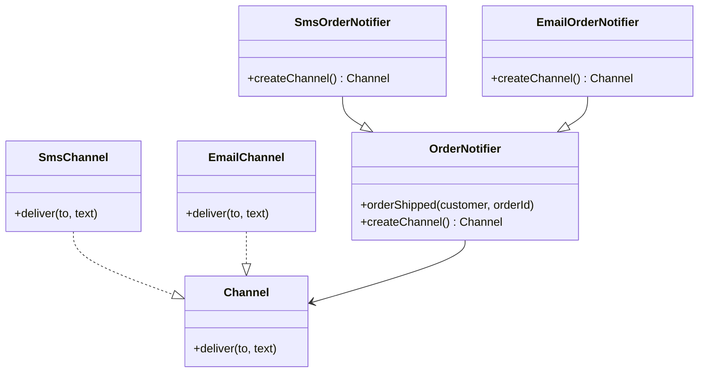

## Overview

Factory method lets a base class define a workflow and defer the choice of the object it creates to one overridable method. The workflow works with the product interface and never calls `new` on a concrete product. An interviewer wants to hear why callers should not know the concrete class, and where that choice lives.

## What to know

1. Intent and the problem it solves :: Factory method lets a class defer the choice of the object it creates to a single method that subclasses override. The code that uses the object depends only on an interface. Use it when the steps of a workflow stay the same but the product type varies. The problem it solves is type checks and `new` calls spread across many methods.

2. Structure and participants :: The product is the interface the workflow uses. A concrete product implements it. The creator declares the factory method and holds the workflow that calls it. A concrete creator overrides the factory method to return one concrete product. The creator never names a concrete product class.

3. A worked example in Java :: The example sends order shipped alerts. Each customer gets SMS or email. An abstract notifier runs one fixed workflow, and each subclass returns the channel it owns. Adding a push channel means one new channel class and one new notifier subclass. The workflow does not change.

4. When to use it and when not to :: Use it when a base workflow needs an object whose type varies by subclass or configuration, or when type switches that create objects appear in several methods. Do not use it for one product type that never changes. A plain constructor is simpler. A static method that returns a product covers many cases without subclassing.

5. Related patterns and how it shows up in interviews :: Abstract factory creates a family of related products, and often uses factory methods inside. Factory method is one creation method in one hierarchy. Builder assembles one complex object over several calls, while a factory chooses which object to create in one call. In interviews it fits vehicle creation in a parking lot, item creation in a vending machine, and strategy selection in an elevator. Say what varies, then name the pattern.

## Recap

- Factory method: the workflow stays in the base class, and subclasses choose the product.
- Callers depend on the product interface, never on `new ConcreteProduct`.
- Adding a product adds a class. The workflow does not change.

## Go deeper

### The problem it solves {point: 0}

Imagine an order service that sends shipped alerts. The first version checks the customer's channel with `if (channel.equals("sms"))` and creates an SMS sender, else an email sender. The same check then appears in the cancel flow and the refund flow. Each new channel edits three methods, and each method repeats the same steps: find the customer, build the message, send, and log.

After the change, the steps live in one workflow method. Each channel is created in one place, the creator's factory method. The rest of the code receives a channel interface and never checks a type. The before version spreads the choice across every method. The after version makes one method own the choice.

### Structure {point: 1}

There are four participants. `Channel` is the product interface. `SmsChannel` and `EmailChannel` are concrete products that implement it. `OrderNotifier` is the creator. It holds `orderShipped`, which calls the abstract factory method `createChannel()` and then uses the result. `SmsOrderNotifier` and `EmailOrderNotifier` are concrete creators. Each overrides `createChannel()` to return its own product.



### Example: order shipped alerts per channel {point: 2}

The workflow in `OrderNotifier.orderShipped` is final, so subclasses cannot change the steps. They only choose the channel. `Main` creates one notifier per channel and runs the same call on each. The channels print instead of calling a real provider.

```java
import java.util.List;

public class Main {
    interface Channel {
        void deliver(String to, String text);
    }

    static class SmsChannel implements Channel {
        @Override
        public void deliver(String to, String text) {
            System.out.println("SMS to " + to + ": " + text);
        }
    }

    static class EmailChannel implements Channel {
        @Override
        public void deliver(String to, String text) {
            System.out.println("Email to " + to + ": " + text);
        }
    }

    // Creator: owns the workflow and defers the choice of channel.
    static abstract class OrderNotifier {
        protected abstract Channel createChannel(); // the factory method

        public final void orderShipped(String customer, String orderId) {
            Channel channel = createChannel();
            channel.deliver(customer, "Order " + orderId + " has shipped");
        }
    }

    static class SmsOrderNotifier extends OrderNotifier {
        @Override
        protected Channel createChannel() {
            return new SmsChannel();
        }
    }

    static class EmailOrderNotifier extends OrderNotifier {
        @Override
        protected Channel createChannel() {
            return new EmailChannel();
        }
    }

    public static void main(String[] args) {
        List<OrderNotifier> notifiers = List.of(new SmsOrderNotifier(), new EmailOrderNotifier());
        for (OrderNotifier notifier : notifiers) {
            notifier.orderShipped("Asha", "A-1042");
        }
    }
}
```

### When to use it and when not to {point: 3}

Use it when you see the same steps repeated around a type check, when a framework calls your code and needs to create objects you own, or when the product type is the only thing that varies. The cost is one class per product and one subclass per creator. The hierarchy grows with every option. If the workflow is trivial, a static factory method such as `Channel.of("sms")` gives the same benefit with less code. Do not create a subclass for each value of an enum that never grows.

### In interviews {point: 4}

Name the problem where the pattern fits. In a parking lot, a factory method can create the right vehicle or spot type while the entry workflow stays the same. In a vending machine, it can create item types. Say the force first: "The steps are identical and only the product changes, so I would use a factory method."

The pattern is often confused with two others. Abstract factory creates a family of products through an object, while factory method creates one product through inheritance. Strategy is passed in to change an algorithm. Factory method decides which object is created. Builder constructs one complex object with many optional parts. Factory method chooses a type.

## Interview questions

- Where does object creation live in your design, and who decides the concrete class?
- How is a factory method different from a static factory method?
- What do you change when you add a new product type?

## Common mistakes

- Creating a creator subclass for every class, even when no shared workflow needs it.
- Returning a concrete type from the factory method, which defeats the purpose.
- Calling the factory method from a constructor, where the subclass fields are not set yet.
- Putting a type switch inside the creator, which moves the problem instead of solving it.
