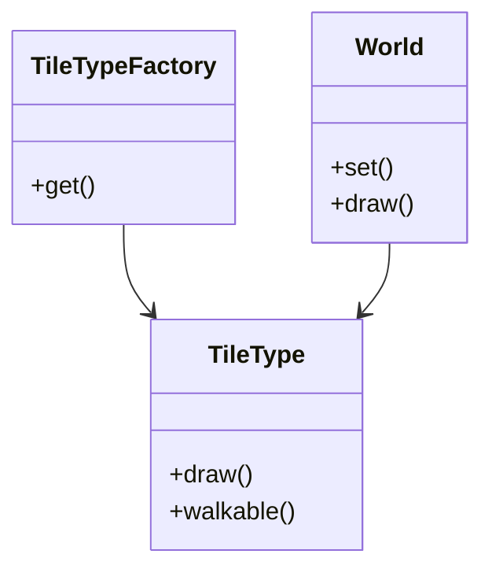

## Overview

Flyweight shares objects that many places need, so a very large number of similar items uses little memory. It splits state into intrinsic parts, which are stored once and shared, and extrinsic parts, which the caller passes in. An interviewer wants to hear what is shared, what is not, and a factory that keeps the shared pool.

## What to know

1. Intent and the problem it solves :: Flyweight reduces memory when a program needs a very large number of objects that differ only in a few values. Storing the same data in every object wastes space. The pattern keeps one shared object per kind, and passes the position or count from outside.

2. Structure and participants :: The Flyweight holds intrinsic state, which is the same for every use. A factory returns an existing flyweight for a key and creates a new one only when none exists. The context holds the extrinsic state, such as coordinates, and a reference to a shared flyweight.

3. A worked example in Java :: A tile map where each cell is grass or water. A TileType flyweight stores the sprite and the walkable flag once for each kind. The map keeps only references to the shared tiles, and the position is passed when a tile is drawn.

4. When to use it and when not to :: Use it when profiling shows many duplicate objects, such as characters in a text editor, tiles in a game, or chess pieces. Skip it when there are few objects, because the factory and the split state add complexity for little gain. A flyweight must be immutable, or a change would show up in every place that uses it.

5. Related patterns and how it shows up in interviews :: Singleton has one instance for the whole program, while a flyweight has one instance per kind. Object Pool reuses objects that are costly to create, and hands them out and takes them back. Prototype copies an object, while a flyweight shares it. In interviews, Flyweight appears in text editors, game maps, chess boards and parking spot types.

## Recap

- Shared state is intrinsic and immutable. Per-use state is extrinsic and passed in.
- A factory returns one shared instance per key.
- Measure first. Use the pattern when the number of objects is really large.

## Go deeper

### The problem it solves {point: 0}

A map of 1000 by 1000 cells, where each cell stores its own name, sprite and walkable flag, holds a million copies of the same strings and booleans. Memory grows with the number of cells, not with the number of kinds of tile. Comparing tile types is also harder, because every cell has its own copy. Sharing one object per kind fixes both problems.

### Structure {point: 1}

TileType is the flyweight. It holds the name, sprite and walkable flag, and it has no position. TileTypeFactory returns one TileType per name, creating it the first time it is needed. World is the context. It stores a grid of references to shared TileType objects, and it passes the x and y coordinates when it draws a tile.



### Example: Game map tiles with shared tile kinds {point: 2}

The demo fills a 4 by 3 map with water and grass in a pattern. It draws every tile and prints how many distinct TileType objects exist. Twelve cells use only two objects.

```java
import java.util.HashMap;
import java.util.Map;

public class Main {

    // Flyweight: intrinsic state only. One instance is shared by every tile of this kind.
    static final class TileType {
        private final String name;
        private final String sprite;
        private final boolean walkable;

        private TileType(String name, String sprite, boolean walkable) {
            this.name = name;
            this.sprite = sprite;
            this.walkable = walkable;
        }

        void draw(int x, int y) {
            System.out.println("draw " + sprite + " " + name + " at (" + x + "," + y + ")");
        }

        boolean walkable() {
            return walkable;
        }
    }

    // Factory: hands out one shared TileType per kind.
    static class TileTypeFactory {
        private static final Map<String, TileType> CACHE = new HashMap<>();
        static int created = 0;

        static TileType get(String name, String sprite, boolean walkable) {
            return CACHE.computeIfAbsent(name, key -> {
                created++;
                return new TileType(name, sprite, walkable);
            });
        }
    }

    // Context: stores a reference per cell. Positions are passed in, not stored in the flyweight.
    static class World {
        private final TileType[][] grid;

        World(int width, int height) {
            grid = new TileType[height][width];
        }

        void set(int x, int y, TileType tile) {
            grid[y][x] = tile;
        }

        void draw() {
            for (int y = 0; y < grid.length; y++) {
                for (int x = 0; x < grid[y].length; x++) {
                    grid[y][x].draw(x, y);
                }
            }
        }
    }

    public static void main(String[] args) {
        World world = new World(4, 3);
        for (int y = 0; y < 3; y++) {
            for (int x = 0; x < 4; x++) {
                TileType tile = (x + y) % 3 == 0
                        ? TileTypeFactory.get("water", "~", false)
                        : TileTypeFactory.get("grass", ".", true);
                world.set(x, y, tile);
            }
        }
        world.draw();
        System.out.println("Cells: 12, distinct TileType objects: " + TileTypeFactory.created);
    }
}
```

### When to use it and when not to {point: 3}

Use Flyweight when the number of objects is high and most of their data is the same across many of them. Signals include memory profiles dominated by duplicate small objects, or a design where each character, cell or piece repeats the same data. Costs are the factory, the split between shared and per-use state, and the need for immutability. For a small fixed set of kinds, a Java enum with the shared data is simpler and gives the same effect.

### In interviews {point: 4}

Text editors are the usual example. Each character refers to a shared glyph and font, and the position is kept by the document. Chess boards share piece types, such as a white knight, across all squares. Parking lots can share spot type objects, such as compact or large, across thousands of spots. In each case, name the intrinsic state and the extrinsic state before you draw the classes. Flyweight is often confused with Singleton. A singleton is one object for the whole program, while a flyweight is one object per kind. It is also confused with Prototype, which copies objects, while a flyweight shares them.

## Interview questions

- In a text editor, which state is intrinsic and which is extrinsic?
- Why must a flyweight be immutable?
- Would a Java enum be enough for the tile example? When would it not be?

## Common mistakes

- Storing the position or other per-cell data inside the flyweight.
- Making the flyweight mutable, so a change affects every cell that uses it.
- Creating new flyweight objects outside the factory, which defeats the sharing.
- Using a plain HashMap cache when several threads create tiles, instead of a thread-safe map.
