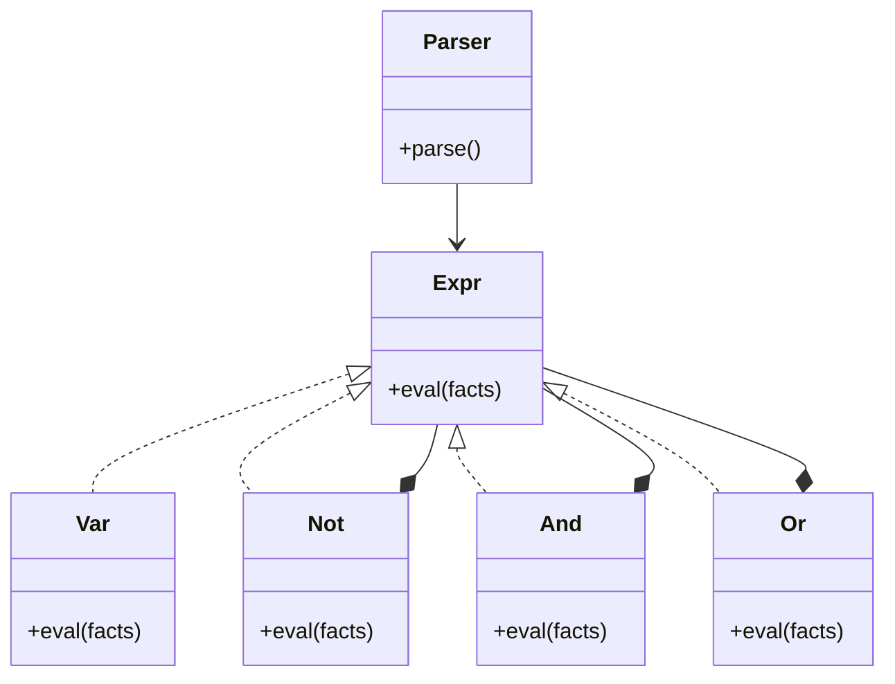

## Overview

Interpreter defines a small grammar for a language and represents each rule as a class. A parser builds a tree of these classes from text, and each node knows how to evaluate itself. It is useful for small rule or query languages. An interviewer wants to hear the grammar, the node types, and why a full parser framework is not needed for a small case.

## What to know

1. Intent and the problem it solves :: Users or config files need rules such as "new customer AND (cart over 50 OR VIP)" that change without a code release. Hard-coding each rule as an if statement does not scale to combinations. Interpreter turns the rule text into a tree of objects that can be evaluated for any input.
2. Structure and participants :: An expression interface declares eval with a context. Terminal expressions hold a variable and look it up in the context. Non-terminal expressions, such as And, Or and Not, hold child expressions. A parser turns the text into the tree following the grammar.
3. A worked example in Java :: A discount rule language with AND, OR, NOT and parentheses over named facts. The example parses one rule text into a tree and evaluates it for two customers. It also shows the parser rejecting a broken rule.
4. When to use it and when not to :: Use it when the grammar is small, stable and written by people who need readable rules, such as filters or eligibility rules. Do not use it for a large language, where a parser generator or an existing library is better. A simple lookup table or a list of predicates is enough for fixed rules.
5. Related patterns and how it shows up in interviews :: The expression tree is often walked by a Visitor, for example to print it or to optimise it. Composite gives the tree shape, since And and Or contain other expressions. It shows up in search filters, rule engines, feature flags and calculator problems.

## Recap

- Interpreter: a grammar, one class per rule, and a parser that builds the tree.
- Each node evaluates itself against the context.
- Good for small rule languages. Not a reason to write a full compiler.

## Go deeper

### The problem it solves {point: 0}

A promotion team wants to write rules such as "new customer and cart over 50 or VIP, and not blocked". With code, each rule becomes a new method with nested if statements. Each change needs a developer and a release. Storing the rule as text and evaluating it at run time solves the release problem, but then the program needs a way to read the text and turn it into checks.

### Structure {point: 1}

Expr is the expression interface with eval(facts). Var looks up a fact by name. Not, And and Or hold other Expr objects and combine their results. Parser reads the tokens of a rule and builds the tree with recursive descent: one method per grammar rule, with OR at the lowest precedence, then AND, then NOT and parentheses.



### Example: Discount eligibility rules {point: 2}

The example parses a rule text with AND, OR, NOT and parentheses. Facts are a map from a name to true or false. The first customer meets the rule. The second customer is blocked, so the same rule returns false. A broken rule throws an error from the parser. The tree is built once and can be reused for many customers.

```java
import java.util.List;
import java.util.Map;

public class Main {

    interface Expr {
        boolean eval(Map<String, Boolean> facts);
    }

    record Var(String name) implements Expr {
        public boolean eval(Map<String, Boolean> facts) {
            return facts.getOrDefault(name, false);
        }
    }

    record Not(Expr inner) implements Expr {
        public boolean eval(Map<String, Boolean> facts) {
            return !inner.eval(facts);
        }
    }

    record And(Expr left, Expr right) implements Expr {
        public boolean eval(Map<String, Boolean> facts) {
            return left.eval(facts) && right.eval(facts);
        }
    }

    record Or(Expr left, Expr right) implements Expr {
        public boolean eval(Map<String, Boolean> facts) {
            return left.eval(facts) || right.eval(facts);
        }
    }

    // Grammar:
    //   expr   := term ( "OR" term )*
    //   term   := factor ( "AND" factor )*
    //   factor := "NOT" factor | "(" expr ")" | NAME
    static class Parser {
        private final List<String> tokens;
        private int pos = 0;

        Parser(String text) {
            String spaced = text.replace("(", " ( ").replace(")", " ) ").trim();
            this.tokens = List.of(spaced.split("\\s+"));
        }

        Expr parse() {
            Expr expr = parseOr();
            if (pos != tokens.size()) {
                throw new IllegalArgumentException("Unexpected token: " + tokens.get(pos));
            }
            return expr;
        }

        private String peek() {
            return pos < tokens.size() ? tokens.get(pos) : "";
        }

        private String next() {
            return tokens.get(pos++);
        }

        private Expr parseOr() {
            Expr left = parseAnd();
            while (peek().equals("OR")) {
                next();
                left = new Or(left, parseAnd());
            }
            return left;
        }

        private Expr parseAnd() {
            Expr left = parseFactor();
            while (peek().equals("AND")) {
                next();
                left = new And(left, parseFactor());
            }
            return left;
        }

        private Expr parseFactor() {
            if (peek().equals("NOT")) {
                next();
                return new Not(parseFactor());
            }
            if (peek().equals("(")) {
                next();
                Expr inner = parseOr();
                if (!peek().equals(")")) {
                    throw new IllegalArgumentException("Expected )");
                }
                next();
                return inner;
            }
            if (peek().isEmpty() || peek().equals(")")) {
                throw new IllegalArgumentException("Expected a name");
            }
            return new Var(next());
        }
    }

    public static void main(String[] args) {
        String rule = "new_customer AND (cart_over_50 OR vip) AND NOT blocked";
        Expr eligible = new Parser(rule).parse();
        System.out.println("Rule: " + rule);

        Map<String, Boolean> asha = Map.of(
            "new_customer", true, "cart_over_50", false, "vip", true, "blocked", false);
        Map<String, Boolean> ben = Map.of(
            "new_customer", true, "cart_over_50", false, "vip", true, "blocked", true);

        System.out.println("Asha eligible: " + eligible.eval(asha));
        System.out.println("Ben eligible: " + eligible.eval(ben));

        try {
            new Parser("new_customer AND )").parse();
        } catch (IllegalArgumentException e) {
            System.out.println("Bad rule: " + e.getMessage());
        }
    }
}
```

### When to use it and when not to {point: 3}

Use Interpreter when the rules are short, the grammar is small, and the rules are written or changed by people who are not programmers. The tree is easy to test one node at a time. The costs are the parser, error messages and the risk of growing the grammar over time. For a few fixed rules, a list of predicates is clearer. For a real language with many keywords, use a parser generator or an existing library, not a hand-written parser.

### In interviews {point: 4}

Name Interpreter when the problem says "users define their own rules" or "filters can be combined": search filters, feature flags, coupon rules, or alert conditions. Show the grammar first, then the node types, then the parser. Expect the interviewer to ask how you add a new operator. The answer is one new node class and one new branch in the parser. Mention that the tree can be walked by a Visitor when you need to print it or to optimise it. Interpreter is often confused with Command: Command stores an action to run later, while Interpreter stores the meaning of a rule to evaluate now.

### Modern Java

Records give each node a small immutable class with its children as fields. A sealed interface can list the node types, and a switch over it can replace the eval method in one place. Use that form when the node set is fixed and you want all the logic in one method.

## Interview questions

- What are the terminal and non-terminal expressions in this example?
- Why does OR sit at a lower precedence than AND in the grammar?
- How would you add an XOR operator?
- When would you choose a parser generator over a hand-written parser?

## Common mistakes

- Using Interpreter for a rule that is one if statement long.
- Building the tree again for every evaluation instead of once per rule.
- Leaving the parser without an end check, so trailing tokens are ignored silently.
- Making the grammar large before anyone needs the extra operators.
