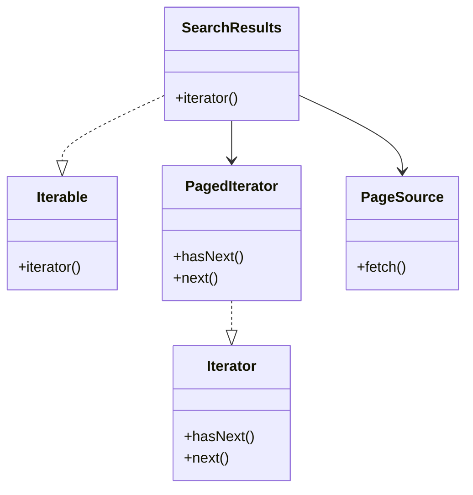

## Overview

Iterator gives a way to walk through the items of a collection without exposing how the collection stores them. The intent is to separate traversal from the collection itself, so the same loop works on a list, a tree, or data that arrives in pages. An interviewer wants to hear the hasNext and next pair, lazy loading when the data is large, and what happens when the underlying data changes during a walk.

## What to know

1. Intent and the problem it solves :: Provide one way to visit each item, whatever the storage. Without it, callers reach into the internal structure, so a change of storage breaks every loop. An iterator also lets the caller stop early, so work is done only for the items actually needed.

2. Structure and participants :: An Iterable collection returns an Iterator. The Iterator has hasNext and next, and it keeps the position of the walk. A data source supplies the raw items, such as pages from a remote call. The client uses a for-each loop, which calls the iterator for it.

3. A worked example in Java :: A search API returns results in pages. A custom iterator fetches the next page only when the current one is used up, and it stops when a page comes back empty. The demo shows that a loop which stops early fetches only the first page.

4. When to use it and when not to :: Use it when the data is a sequence that callers walk through, when data should load lazily, or when the storage may change later. Do not use it when a caller needs random access by index or a whole list at once, because a list or a stream may be simpler. Iterators are one-way and single-pass, so a second loop needs a new iterator. Modifying the collection during a walk can throw ConcurrentModificationException.

5. Related patterns and how it shows up in interviews :: Java's Iterable and Iterator are the standard form, and the for-each loop uses them. Compare it with Composite, where a tree is walked with an iterator to visit each node. Compare it with Visitor, which adds new operations over a structure, while an iterator only walks it. In LLD rounds it fits playlists, file system walks, paginated search results, and a parking lot that lists free spots by floor.

## Recap

- Iterator: visit items one at a time without knowing how they are stored.
- Load pages lazily, and stop as soon as the caller stops.
- Iterators are single-pass; create a new one for each walk.

## Go deeper

### The problem it solves {point: 0}

A search client might fetch every page at once and return a full list. If the caller only needs the first three results, the other pages were fetched for nothing. If the caller changes the code that stores results, from a list to a page cache, every loop over the results must change too.

With an iterator, the client asks for the next result. The iterator fetches a page only when its buffer is empty and no result is left in it. The caller's loop does not know about pages, and a change in storage does not touch the loops.

### Structure {point: 1}

SearchResults is the iterable collection. Its iterator method returns a PagedIterator. PagedIterator holds a buffer of items, the number of the next page to fetch, and a flag that is set when the source is empty. Its hasNext method fetches pages while the buffer is empty and the source is not exhausted. PageSource is the data source, a function that returns one page for a page number.



### Example: paginated search results {point: 2}

The example uses a fake search API with two pages of results and an empty third page that marks the end. The first loop stops after three results, so only page zero is fetched. The second loop walks everything and fetches all three pages. Each fetch prints a line, so the lazy behaviour is visible.

```java
import java.util.*;

public class Main {
    interface PageSource {
        List<String> fetch(int page);
    }

    static class SearchResults implements Iterable<String> {
        private final PageSource source;

        SearchResults(PageSource source) { this.source = source; }

        public Iterator<String> iterator() { return new PagedIterator(source); }
    }

    static class PagedIterator implements Iterator<String> {
        private final PageSource source;
        private final Deque<String> buffer = new ArrayDeque<>();
        private int nextPage = 0;
        private boolean exhausted = false;

        PagedIterator(PageSource source) { this.source = source; }

        public boolean hasNext() {
            while (buffer.isEmpty() && !exhausted) {
                List<String> page = source.fetch(nextPage);
                System.out.println("  (fetched page " + nextPage + ")");
                nextPage++;
                if (page.isEmpty()) exhausted = true;
                else buffer.addAll(page);
            }
            return !buffer.isEmpty();
        }

        public String next() {
            if (!hasNext()) throw new NoSuchElementException();
            return buffer.poll();
        }
    }

    public static void main(String[] args) {
        List<List<String>> data = List.of(
            List.of("shoes-1", "shoes-2", "shoes-3"),
            List.of("shoes-4", "shoes-5"),
            List.of());
        PageSource fakeApi = page -> page < data.size() ? data.get(page) : List.of();
        SearchResults results = new SearchResults(fakeApi);

        System.out.println("First three only:");
        int seen = 0;
        for (String r : results) {
            System.out.println("  " + r);
            if (++seen == 3) break;
        }

        System.out.println("Everything:");
        for (String r : results) {
            System.out.println("  " + r);
        }
    }
}
```

### When to use it and when not to {point: 3}

Use an iterator when callers walk a sequence once, when the data is large or slow to load, or when the storage may change. Lazy iteration saves work when the caller stops early, and it keeps callers independent of paging or storage details. The cost is that the walk has one direction and one pass, and that the data can change under the iterator. A list that is changed during a for-each loop throws ConcurrentModificationException, so either copy the data first or use an iterator that supports removal through its own remove method.

When callers need to jump to an index, count the items, or sort, a List or an array is a better fit. When the work is a transformation of each item, a stream may read more clearly than an explicit iterator.

### In interviews {point: 4}

In LLD rounds, say that the collection should not expose its structure, so an iterator gives the walk. This comes up in playlists with next and previous, a file system walk that visits folders, a parking lot that lists free spots floor by floor, and paginated results from an API. If the walk must go in more than one order, offer one iterator per order, or a method that returns a different iterator. Compare it with Composite: a Composite is a tree of nodes, and an iterator is the tool used to visit every node without the caller writing recursion. Compare it with Visitor: a visitor adds a new operation to each node type, while an iterator only moves through them. Mention that the for-each loop in Java calls iterator for you, so the collection only needs to implement Iterable.

### Modern Java

Iterable has a default forEach method that takes a lambda, so a collection that implements iterator gets forEach for free. Iterator also has a default remove method that throws by default; override it only when removal is safe. For paged data, a Stream built with Stream.iterate or a custom Spliterator can also work well, and Stream.iterate is a good choice when the next item depends on the previous one.

## Interview questions

- Why does the iterator fetch pages lazily?
- What happens if the list changes during a for-each loop?
- How would you add a reverse iterator without changing the collection?
- When would you pick a List over an Iterator?

## Common mistakes

- Returning the internal list, so callers can change it while they walk.
- Forgetting to mark the end of the data, so the iterator asks for pages forever.
- Assuming an iterator can be reused for a second walk.
- Calling next without checking hasNext, which throws when the data runs out.
- Fetching every page up front, which loses the benefit of lazy loading.
