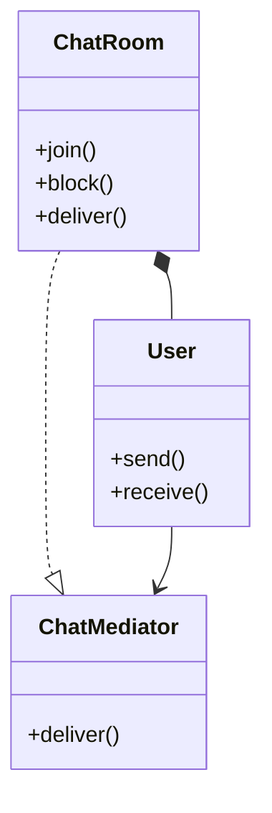

## Overview

Mediator puts the rules for how objects talk to each other in one central object. Each participant knows only the mediator, not the others. The intent is to stop a web of direct references, where every object must know about many others. An interviewer wants to hear that the mediator owns the routing and the rules, that participants stay simple, and that the mediator can grow into a bottleneck if it does too much.

## What to know

1. Intent and the problem it solves :: Route communication through one object, so participants do not refer to each other directly. Without it, each user in a chat holds references to every other user, and each new rule, such as blocking, must be added in many places. With a mediator, the rules live in one class.

2. Structure and participants :: A Mediator interface declares how a message is delivered. Colleagues, such as users, hold a reference to the mediator and send their messages through it. The concrete mediator, such as a chat room, keeps the list of colleagues and applies the rules. Colleagues receive messages through a method the mediator calls.

3. A worked example in Java :: A chat room delivers messages between users. It supports broadcast and direct messages, and it can block a sender from reaching a recipient. The demo shows a broadcast that skips a blocked user, a direct message that is refused, and an unknown recipient.

4. When to use it and when not to :: Use it when many objects interact in complex ways and the rules for those interactions change. It also helps when the interaction rules should be tested in one place. Do not use it when two objects talk in a simple, fixed way, because a direct call is clearer. A mediator can grow into a large class that knows everything, so split it when it starts to hold unrelated logic.

5. Related patterns and how it shows up in interviews :: Observer also decouples senders and receivers, but the subject does not choose the rules of delivery, and the observers do not talk to each other through it. Compare it with Facade, which gives a simple front to a subsystem, while a mediator coordinates peers that talk to each other. Compare it with Chain of responsibility, where a request moves along handlers. In LLD rounds it fits chat rooms, air traffic control, a dialog where widgets react to each other, and a smart home hub.

## Recap

- Mediator: participants talk through one object that owns the rules.
- Participants hold the mediator, not each other.
- Watch for a mediator that grows too large.

## Go deeper

### The problem it solves {point: 0}

In a chat app written without a mediator, each user object holds a list of every other user. Sending a broadcast means looping over that list. Adding a block rule means checking the block list in every user object, and each user must know how the others are named and stored. A change to one user's behaviour can break the others.

With a mediator, each user knows only the room. A user sends a message to the room with a recipient name or with no name for a broadcast. The room checks the rules, such as blocks and unknown names, and then delivers the message. The users stay simple, and the rules sit in one class that is easy to test.

### Structure {point: 1}

The ChatMediator interface has one method, deliver. User is the colleague: it holds its name and the mediator, and it sends through the mediator. ChatRoom is the concrete mediator: it keeps the users by name, stores the blocks, and delivers messages. A user receives a message through its receive method, which the room calls.



### Example: chat room with blocking {point: 2}

The example creates three users in one room. The first message is a broadcast. Then ana blocks cy, so a later broadcast from ana skips cy, and a direct message from ana to cy is refused. A message to an unknown user is reported by the room. Users never call each other.

```java
import java.util.*;

public class Main {
    interface ChatMediator {
        void deliver(User from, String to, String text);
    }

    static class User {
        private final String name;
        private final ChatMediator room;

        User(String name, ChatMediator room) {
            this.name = name;
            this.room = room;
        }

        String name() { return name; }

        void send(String to, String text) { room.deliver(this, to, text); }

        void receive(String from, String text) {
            System.out.println(name + " <- " + from + ": " + text);
        }
    }

    static class ChatRoom implements ChatMediator {
        private final Map<String, User> users = new LinkedHashMap<>();
        private final Set<String> blocks = new HashSet<>();

        User join(String name) {
            User u = new User(name, this);
            users.put(name, u);
            return u;
        }

        void block(String sender, String recipient) {
            blocks.add(sender + ">" + recipient);
        }

        public void deliver(User from, String to, String text) {
            if (to == null) {
                for (User u : users.values()) {
                    if (u != from && !blocked(from, u)) u.receive(from.name(), text);
                }
                return;
            }
            User target = users.get(to);
            if (target == null) {
                System.out.println("no such user: " + to);
            } else if (blocked(from, target)) {
                System.out.println("not delivered to " + to);
            } else {
                target.receive(from.name(), text);
            }
        }

        private boolean blocked(User from, User to) {
            return blocks.contains(from.name() + ">" + to.name());
        }
    }

    public static void main(String[] args) {
        ChatRoom room = new ChatRoom();
        User ana = room.join("ana");
        User bob = room.join("bob");
        User cy = room.join("cy");

        ana.send(null, "hi everyone");
        bob.send("ana", "hey ana");
        room.block("ana", "cy");
        ana.send(null, "cy will not see this");
        ana.send("cy", "direct, blocked too");
        cy.send("nobody", "hello?");
    }
}
```

### When to use it and when not to {point: 3}

Use a mediator when many objects must coordinate, when the rules change often, and when you want to test the rules without the participants. It makes each participant reusable, since it only knows the mediator interface. The cost is that the mediator can become a large class that knows about every participant, which is the problem it was meant to solve in a new place. When that happens, split the mediator by topic or move rules into strategy objects.

When two objects talk in one fixed way, a direct reference is simpler and easier to read. A mediator for a single pair of objects adds a class without adding clarity. Also avoid it when participants need to talk to each other in many ways that cannot be described in one interface.

### In interviews {point: 4}

In an LLD round, say the rule first: "the users must not know each other, and the room decides who gets a message, so the room is a mediator". This fits chat rooms, an air traffic control tower that routes planes, a dialog where a checkbox enables a text box, and a smart home hub that connects devices. Mention the bottleneck risk and say how you would keep the mediator focused. Compare it with Observer: in Observer the subject notifies observers that are registered for events, and the observers do not coordinate through the subject. In Mediator, the mediator decides the routing and the rules for each message. Compare it with Facade: a facade hides a subsystem from its client, while a mediator sits between peers that are equals.

### Modern Java

The mediator interface can be a functional interface when it has one method, so a lambda can serve as a simple mediator in a test. A record can hold a message with its sender, recipient and text, which keeps the message data separate from the routing logic. Java's java.util.concurrent.Executor is not a mediator in this sense, but its design separates the code that submits work from the code that runs it.

## Interview questions

- What would change in the code if you removed the mediator and let users call each other?
- How would you add a rule that limits broadcasts to one per minute?
- How does Mediator differ from Observer?
- When does a mediator become a problem?

## Common mistakes

- Letting participants keep direct references to each other, which defeats the purpose.
- Putting business logic in the participants instead of the mediator.
- Building one huge mediator that holds every rule for the whole system.
- Using a mediator where two objects only need a simple call.
- Forgetting to handle unknown recipients or blocked pairs in one place.
