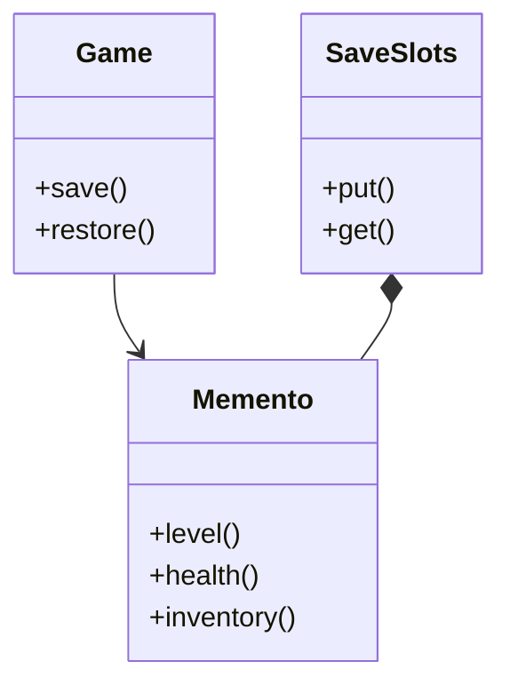

## Overview

Memento captures the state of an object so it can be restored later, without exposing the object's internal fields to the code that stores the snapshot. The intent is to allow save and restore while keeping the state private to its owner. An interviewer wants to hear who creates the snapshot, who keeps it, why the keeper must not read it, and what a snapshot costs in memory.

## What to know

1. Intent and the problem it solves :: Save a state so it can be brought back later, such as a game save point or an undo point. Without it, the caller must copy every field of the object, which breaks when a field is added, or the object's fields must be public so others can read and write them. A memento lets the owner create and restore its own state.

2. Structure and participants :: The originator is the object whose state is saved. It creates a memento that holds a copy of its state, and it restores from one. The memento is an opaque snapshot. The caretaker stores mementos by name or in a history, and it never reads what is inside them.

3. A worked example in Java :: A game saves a checkpoint with its level, health and inventory. The caretaker keeps named save slots. The demo saves at the start of a level, plays on, dies, and restores the checkpoint.

4. When to use it and when not to :: Use it for undo points, save and load, rollback after a failed step, and checkpoints. Do not use it when the state is large and changes often, because each snapshot copies it, and the memory cost grows with each save. A command that stores only the change can be smaller. Keep snapshots as immutable copies, so later changes to the originator do not leak into them.

5. Related patterns and how it shows up in interviews :: Command can also support undo, but it stores the change instead of a full state. Compare the two in an interview: Memento is simpler to get right, while Command saves memory. Prototype copies an object to create a new one, while a memento keeps a copy to restore an old one. In LLD rounds it fits game saves, a text editor's undo history, a drawing app, and a booking flow that rolls back a failed step.

## Recap

- Memento: save a state snapshot and restore it later.
- The owner makes and reads snapshots, and the keeper only stores them.
- Snapshots cost memory, so keep them small or use commands for undo.

## Go deeper

### The problem it solves {point: 0}

Suppose a game wants a save point. A simple approach copies the health, level and items into a separate object in the controller. The controller now knows every field of the game. When a new field such as mana is added, every place that saves or loads must change, and a missed field is a silent bug. If the fields are made public so the controller can copy them, the game state can be changed from anywhere.

With a memento, the game makes its own snapshot and restores from it. The controller stores the snapshot without knowing what it holds. A new field is added in the game and in the memento, and the controller code does not change.

### Structure {point: 1}

Game is the originator. It has a save method that returns a Memento and a restore method that takes one. Memento is a record that holds copies of the level, health and inventory. SaveSlots is the caretaker: it maps names to mementos and returns them when asked. It never calls methods on a memento except to store and fetch it.



### Example: game save points {point: 2}

The example plays a short game. It saves a checkpoint named level-1-start, takes damage, picks up a key, and dies. Restoring the checkpoint brings back the level, the health and the inventory from the time of the save. The inventory is copied with List.copyOf so later pickups do not change the saved snapshot.

```java
import java.util.*;

public class Main {
    static class Game {
        private int level;
        private int health;
        private final List<String> inventory = new ArrayList<>();

        Game(int level, int health) {
            this.level = level;
            this.health = health;
        }

        void advanceLevel() { level++; }
        void takeDamage(int amount) { health = Math.max(0, health - amount); }
        void pickUp(String item) { inventory.add(item); }

        Memento save() { return new Memento(level, health, List.copyOf(inventory)); }

        void restore(Memento m) {
            level = m.level();
            health = m.health();
            inventory.clear();
            inventory.addAll(m.inventory());
        }

        @Override public String toString() {
            return "level=" + level + " health=" + health + " items=" + inventory;
        }
    }

    // Snapshot of the game state. Only Game reads its fields in practice.
    record Memento(int level, int health, List<String> inventory) {}

    // Caretaker: stores snapshots by name and never looks inside them.
    static class SaveSlots {
        private final Map<String, Memento> slots = new LinkedHashMap<>();

        void put(String name, Memento m) { slots.put(name, m); }
        Memento get(String name) { return slots.get(name); }
    }

    public static void main(String[] args) {
        Game game = new Game(1, 100);
        SaveSlots slots = new SaveSlots();

        game.pickUp("sword");
        slots.put("level-1-start", game.save());
        System.out.println("saved:    " + game);

        game.advanceLevel();
        game.takeDamage(70);
        game.pickUp("key");
        System.out.println("playing:  " + game);

        game.takeDamage(40);
        System.out.println("died:     " + game);

        game.restore(slots.get("level-1-start"));
        System.out.println("restored: " + game);
    }
}
```

### When to use it and when not to {point: 3}

Use a memento when a state must be saved and restored, the state is small, and the saves are not frequent. It keeps the originator's fields private and makes the caretaker simple. The cost is memory, since each memento is a full copy, and the time to copy grows with the state. Snapshots also go stale if they hold references to mutable objects, so copy those too or keep them immutable.

When the state is large, such as a whole document with many edits, store the changes as commands instead. When the object is only read and never restored, a plain copy is enough. A memento is also the wrong tool when restoring must call an outside system, such as sending a payment again, because a snapshot cannot undo a side effect.

### In interviews {point: 4}

In LLD rounds, name the trade-off: "a snapshot is simple and correct, but costs memory per save, so for undo I would use commands if the state is big". This fits game save slots, a drawing app with undo points, and a booking flow that rolls back when a later step fails. Compare it with Command: Command stores the change and undoes it, while Memento stores the whole state and restores it. Compare it with Prototype: a prototype copies an object so that a new one can be made, while a memento copies state so that an old state can come back. In an interview, say what is saved, who holds the snapshot, and how many snapshots are kept. A history limit, such as keeping the last ten, is a good detail to add.

### Modern Java

A record is a natural memento because its fields are final and it has equals and toString for free. Use List.copyOf or Map.copyOf inside the record or its factory, so the snapshot cannot change after it is made. For a state that holds an object with many fields, a record that copies only what it needs keeps the snapshot small.

## Interview questions

- Why does the caretaker not read the memento's fields?
- What happens if the memento holds a mutable list that the game keeps changing?
- How would you keep only the last ten save points?
- When would you choose Command over Memento for undo?

## Common mistakes

- Making the game fields public so that a caretaker can copy them, which removes the benefit.
- Storing a shallow copy that still shares a mutable list with the originator.
- Saving very large states on every change without a limit on history.
- Expecting a snapshot to undo side effects such as a sent email or a payment.
- Restoring a memento from a different type of object, which the design should prevent.
