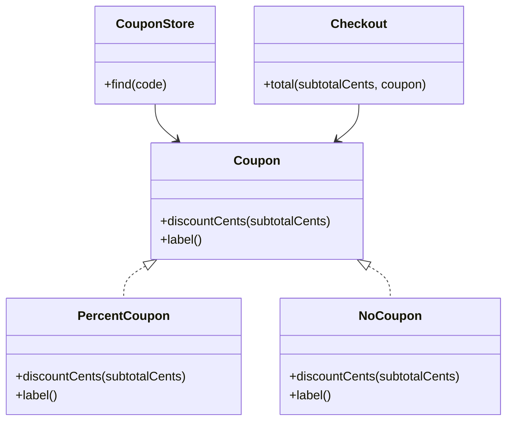

## Overview

Null object replaces a null reference with an object that has the same interface and does nothing or returns a neutral value. Callers then call methods without checking for null. It removes repeated null checks and the NullPointerException risk that comes with them. An interviewer wants to hear where the null object comes from and why it is not hidden inside an if statement.

## What to know

1. Intent and the problem it solves :: A lookup returns null when there is no coupon, no logger or no discount, and every caller must check for null before using it. Missing checks cause crashes in one place and forgotten behaviour in another. A null object gives the missing case a real object with safe behaviour.
2. Structure and participants :: The null object implements the same interface as the real objects. It has no state and returns neutral values, such as zero discount or an empty list. The code that finds or creates the object returns the null object instead of null.
3. A worked example in Java :: A checkout that applies a coupon from a store. Unknown codes return a NoCoupon object that gives no discount. The checkout code has no null check, and the same code path works for valid and unknown codes.
4. When to use it and when not to :: Use it when "nothing" has a clear, safe behaviour, such as no discount, no logging or no notification. Do not use it when the absence must stop the flow or be reported to the user, such as a missing user during login. In that case an Optional or an exception is clearer. Do not hide real errors behind a neutral value.
5. Related patterns and how it shows up in interviews :: Null object is a Strategy or State with a do-nothing behaviour. It is often created by a Factory or a Repository lookup. It is related to Proxy, since both implement the real interface, but a proxy forwards calls and a null object does not. It shows up in logging, discount, notification and cache problems.

## Recap

- Null object: a real object for "nothing", with the same interface and safe behaviour.
- The caller does not check for null, so the code path is the same.
- Use it when doing nothing is the correct behaviour, not when the absence is an error.

## Go deeper

### The problem it solves {point: 0}

A checkout asks a store for a coupon by code. The store returns null when the code is unknown. The checkout then needs an if statement to skip the discount. Another method also needs the same if. A developer forgets it in a third method, and the app throws a NullPointerException the first time a customer uses a code that expired. The rule "no coupon means no discount" is written in several places.

### Structure {point: 1}

Coupon is the interface with discountCents() and label(). PercentCoupon is a real coupon. NoCoupon implements the same interface and returns zero discount and a neutral label. CouponStore returns NoCoupon when a code is not found. Checkout only sees the Coupon interface and never checks for null.



### Example: Checkout with optional coupons {point: 2}

The store knows two codes. SAVE10 gives ten percent off. Any other code returns NoCoupon. The checkout calls the same two methods for every code and prints the label and the total. The output for an unknown code shows the total is the full price, with no special branch in the checkout.

```java
import java.util.Map;

public class Main {

    interface Coupon {
        int discountCents(int subtotalCents);
        String label();
    }

    static class PercentCoupon implements Coupon {
        private final String code;
        private final int percent;

        PercentCoupon(String code, int percent) {
            this.code = code;
            this.percent = percent;
        }

        public int discountCents(int subtotalCents) {
            return subtotalCents * percent / 100;
        }

        public String label() {
            return code + " (" + percent + "% off)";
        }
    }

    // The null object: same interface, no discount, no special cases for callers.
    static class NoCoupon implements Coupon {
        static final NoCoupon INSTANCE = new NoCoupon();

        private NoCoupon() { }

        public int discountCents(int subtotalCents) { return 0; }
        public String label() { return "no coupon"; }
    }

    static class CouponStore {
        private final Map<String, Coupon> coupons = Map.of(
            "SAVE10", new PercentCoupon("SAVE10", 10));

        Coupon find(String code) {
            return coupons.getOrDefault(code, NoCoupon.INSTANCE);
        }
    }

    static class Checkout {
        static int total(int subtotalCents, Coupon coupon) {
            int discount = coupon.discountCents(subtotalCents);
            return subtotalCents - discount;
        }
    }

    public static void main(String[] args) {
        CouponStore store = new CouponStore();
        int subtotal = 5000;

        for (String code : new String[] {"SAVE10", "EXPIRED"}) {
            Coupon coupon = store.find(code);
            System.out.println("Code " + code + ": " + coupon.label());
            System.out.printf("Total: %.2f%n", Checkout.total(subtotal, coupon) / 100.0);
        }
    }
}
```

### When to use it and when not to {point: 3}

Use a null object when the absence has a safe, obvious behaviour and the caller should not care whether it exists. Logging with a no-op logger is the classic case. The cost is one more class to keep in step with the interface. Do not use it when the absence is an error that the user must see, such as an unknown account at login, or when the neutral value would hide a bug. For a lookup that may legitimately find nothing, return Optional when the caller must decide what to do.

### In interviews {point: 4}

Name Null object when the question has optional parts with no-op behaviour: a discount that may be absent in a checkout, a logger that can be turned off in a parking lot system, or an empty seat in a vending machine slot. Say the trade-off out loud: fewer null checks, but a silent default that can hide a missing setup. Compare it with Optional. Optional makes the caller handle absence, while a null object makes absence look like a normal value. Also compare with Proxy: a proxy forwards to a real object, while a null object does not forward anything.

### Modern Java

Java has Optional for absence that the caller must handle. A null object is a better fit when the behaviour of absence is always the same. An enum with one constant can also serve as a null object when the interface is small. Use the enum form for a fixed set of options, such as a no-op rounding mode.

## Interview questions

- When is a null object better than returning null or Optional?
- How does a null object differ from a proxy?
- What can go wrong if a null object hides a real configuration error?
- Where would the code create the null object, and why there?

## Common mistakes

- Returning null from the store and adding checks everywhere, instead of returning the null object once.
- Using a null object for an error that the user must see.
- Giving the null object state, so it is no longer a neutral value.
- Returning a null object from a method whose caller also expects Optional, which mixes two styles.
