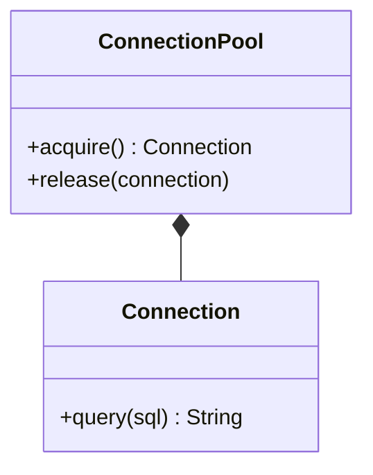

## Overview

Object pool keeps a set of costly objects alive and lends them out. A caller borrows one, uses it and returns it for the next caller. An interviewer wants to hear what happens when the pool is empty, and how a borrowed object is returned even when something fails.

## What to know

1. Intent and the problem it solves :: Object pool keeps a set of expensive objects and hands them out on request. A caller borrows one, uses it and returns it. The problem it solves is repeated creation of objects that are slow to build, such as database connections, worker threads or large buffers, when the number in use must also be capped.

2. Structure and participants :: The pool holds idle objects and counts how many it may create. `acquire()` returns an idle object, creates a new one if the cap allows it, or fails or waits when the pool is empty. `release()` puts the object back. The pooled object is the product. The client pairs every acquire with a release in a try and finally block.

3. A worked example in Java :: The example pools database connections with a cap of two. The demo shows that a third request fails while both are in use. Then three queries run in turn, and they reuse the connections that were already opened. A helper releases the connection in a finally block, even when a query fails.

4. When to use it and when not to :: Use it when creating an object costs much more than using it, and the number of objects must be capped. Do not use it for cheap objects. Pooling adds leaks, stale state and locking, and the JVM creates small objects quickly. A pooled object must be reset before reuse, or one caller's state reaches the next caller.

5. Related patterns and how it shows up in interviews :: Singleton keeps one instance. Object pool keeps several and lends them out. Flyweight shares immutable state between many objects at once, while a pool shares whole objects over time. In interviews it appears in connection pools, thread pools for a job system, and borrow-and-return resources such as hotel rooms or parking spots. Say what happens when the pool is empty: block, fail fast or grow.

## Recap

- Object pool: borrow, use, always return.
- It pays off only when creation is expensive and the count must be capped.
- Reset pooled objects before reuse, and decide what happens when the pool is empty.

## Go deeper

### The problem it solves {point: 0}

A reporting job opens a new database connection for each query. Opening a connection takes time and uses server resources. Under load, the job opens hundreds of connections, and the database refuses new ones. The code has no limit, so one busy job can take down the others.

After the change, the job asks a pool for a connection and returns it when the query ends. The pool opens only as many connections as it may, and reuses them. The before version creates without limit. The after version creates up to a cap and reuses what it has.

### Structure {point: 1}

`ConnectionPool` holds idle `Connection` objects in a deque and a cap on how many it may create. `acquire()` takes an idle connection, or creates one if the cap allows it. `release()` returns a connection to the idle deque. `Connection` is the pooled product, and its `query` method does the work.



### Example: database connection pool {point: 2}

`main` acquires both connections, then shows that a third acquire fails while the pool is busy. It releases them, and runs three queries through `run`. The output shows that only two connections are ever opened, and the later queries reuse them.

```java
import java.util.ArrayDeque;
import java.util.Deque;

public class Main {
    // The pooled object. Opening it is slow in real life, so the pool keeps it.
    static class Connection {
        private final int id;

        Connection(int id) {
            this.id = id;
            System.out.println("opened connection " + id);
        }

        String query(String sql) {
            return "result of [" + sql + "] on connection " + id;
        }
    }

    static class ConnectionPool {
        private final Deque<Connection> idle = new ArrayDeque<>();
        private final int maxSize;
        private int created = 0;

        ConnectionPool(int maxSize) {
            this.maxSize = maxSize;
        }

        synchronized Connection acquire() {
            if (!idle.isEmpty()) {
                return idle.pop();
            }
            if (created < maxSize) {
                return new Connection(++created);
            }
            throw new IllegalStateException("pool busy, max " + maxSize);
        }

        synchronized void release(Connection connection) {
            idle.push(connection);
        }
    }

    // Borrow, use, and always return, even when the query fails.
    static String run(ConnectionPool pool, String sql) {
        Connection connection = pool.acquire();
        try {
            return connection.query(sql);
        } finally {
            pool.release(connection);
        }
    }

    public static void main(String[] args) {
        ConnectionPool pool = new ConnectionPool(2);

        Connection a = pool.acquire();
        Connection b = pool.acquire();
        try {
            pool.acquire();
        } catch (IllegalStateException e) {
            System.out.println("third request: " + e.getMessage());
        }
        pool.release(a);
        pool.release(b);

        for (String sql : new String[] {"select 1", "select 2", "select 3"}) {
            System.out.println(run(pool, sql));
        }
    }
}
```

### When to use it and when not to {point: 3}

Use it when the object is costly to create and the system must limit how many exist at once, such as database connections or a fixed set of hardware devices. Do not use it for plain objects such as strings, points or small records. Pooling those adds bugs without a speed gain. Also decide the policy for an empty pool. Blocking with a wait is the usual choice for production. Failing fast is simpler, as in the example, and fine for an interview demo. Growing without a cap defeats the purpose.

### In interviews {point: 4}

Name the resource in the problem. In a parking lot, spots are borrowed and returned, but a spot is a domain object rather than an expensive one, so say that pooling is not the point there. In a job system or a rate-limited API client, a pool of workers or connections is a clear fit. Say the force first: "Opening a connection is slow and the database caps them, so I would pool connections with a fixed size."

Object pool is confused with singleton, which keeps one object for the whole program. It is also confused with flyweight. Flyweight shares immutable data among many objects at the same time. A pool gives one mutable object to one borrower at a time.

## Interview questions

- What happens when a caller asks for an object and the pool is empty?
- How do you make sure every acquired object is released, even after an exception?
- What must you reset before you reuse a pooled object?

## Common mistakes

- Forgetting to release on the error path, which slowly drains the pool.
- Reusing an object without resetting its state, so one caller sees another caller's data.
- Pooling cheap objects, where the pool costs more than creating new ones.
- Letting the pool grow without a cap, which defeats the reason for pooling.
