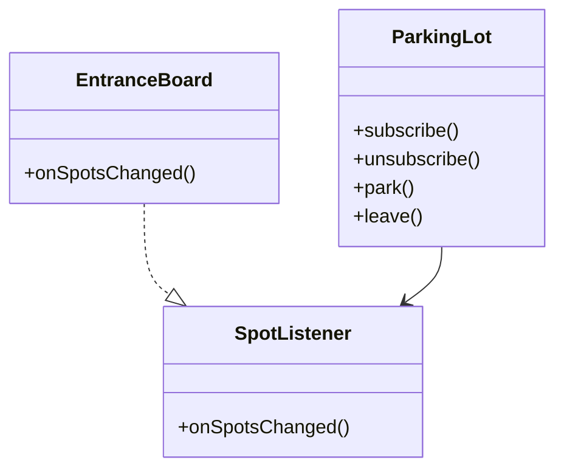

## Overview

Observer lets one object announce changes to a list of registered listeners, without knowing what each listener does. The intent is to keep the source of an event separate from the reactions to it. An interviewer wants to hear who subscribes and unsubscribes, how the subject avoids depending on concrete listeners, and what can go wrong, such as a listener that is never removed or one that throws during a notification.

## What to know

1. Intent and the problem it solves :: Let many parts of the system react to one event without the source calling each of them by name. Without it, a parking lot must call the display board, the logger and the billing code one by one, and adding a new reaction means editing the lot. With Observer, a new listener is registered and the lot stays the same.

2. Structure and participants :: A subject, such as the parking lot, keeps a list of listeners and offers subscribe and unsubscribe. A listener interface declares the method the subject calls when something changes. Concrete listeners, such as an entrance board, implement that method. The subject notifies each listener when its state changes.

3. A worked example in Java :: A parking lot tells its listeners when the free spots on a floor change. An entrance board and a lambda logger subscribe. The demo shows both listeners reacting, then a logger that unsubscribes, and a full floor that rejects a car without notifying anyone.

4. When to use it and when not to :: Use it when one event must reach several reactions, when the reactions change over time, or when the source should not know them. Do not use it when there is one fixed reaction, because a direct call is clearer. Watch for listeners that are never removed, which keeps objects alive and makes memory grow. Decide the order of notification, and what happens when a listener throws.

5. Related patterns and how it shows up in interviews :: Pub/sub is the same idea across services, with a broker between publisher and subscriber. Compare it with Mediator, where a central object routes messages between peers and decides the rules, while observers only react to events. Compare it with Chain of responsibility, where a request moves along handlers and can be stopped. In LLD rounds it fits parking lot displays, stock tickers, order status updates, and notifications on a ride-hailing app.

## Recap

- Observer: a subject notifies registered listeners when its state changes.
- The subject knows only the listener interface.
- Remove listeners when they are done, and decide what happens if one throws.

## Go deeper

### The problem it solves {point: 0}

A parking lot has to update several things when a spot is taken or freed: the entrance display, a log, and a billing counter. Written directly, the park method calls each of these by name. Adding a mobile app that shows free spots means editing park, and so does removing the logger. The lot must import and know about every screen and service in the system.

With Observer, the lot keeps a list of listeners and calls each one with the floor and the new count. The lot does not know what the listeners do. The display board and the logger are added at start-up, and a new screen is one more subscribe call.

### Structure {point: 1}

ParkingLot is the subject. It keeps the free counts per floor and a list of SpotListener objects. Its subscribe and unsubscribe methods change the list, and its change method updates the count and calls every listener. SpotListener is the observer interface with one method, onSpotsChanged. EntranceBoard implements it. A lambda can also implement it when the reaction is short.



### Example: parking lot display and logger {point: 2}

The example creates a lot with two spots on floor G and one on floor 1. A board and a logger subscribe. Parking and leaving notify both. The logger is then removed, so the next change reaches only the board. A car that tries to park on a full floor is refused before any listener is told. The loop copies the listener list before calling it, so a listener that unsubscribes during a call does not break the loop.

```java
import java.util.*;

public class Main {
    interface SpotListener {
        void onSpotsChanged(String floor, int freeSpots);
    }

    static class ParkingLot {
        private final Map<String, Integer> free;
        private final List<SpotListener> listeners = new ArrayList<>();

        ParkingLot(Map<String, Integer> capacityByFloor) {
            this.free = new HashMap<>(capacityByFloor);
        }

        void subscribe(SpotListener l) { listeners.add(l); }
        void unsubscribe(SpotListener l) { listeners.remove(l); }

        void park(String floor) {
            if (free.get(floor) == 0) throw new IllegalStateException("floor " + floor + " is full");
            change(floor, -1);
        }

        void leave(String floor) { change(floor, +1); }

        private void change(String floor, int delta) {
            int now = free.get(floor) + delta;
            free.put(floor, now);
            for (SpotListener l : List.copyOf(listeners)) {
                l.onSpotsChanged(floor, now);
            }
        }
    }

    static class EntranceBoard implements SpotListener {
        public void onSpotsChanged(String floor, int freeSpots) {
            System.out.println("[board] floor " + floor + ": " + freeSpots + " free");
        }
    }

    public static void main(String[] args) {
        ParkingLot lot = new ParkingLot(Map.of("G", 2, "1", 1));
        SpotListener board = new EntranceBoard();
        SpotListener logger = (floor, free) -> System.out.println("[log] " + floor + " -> " + free);

        lot.subscribe(board);
        lot.subscribe(logger);

        lot.park("G");
        lot.park("1");
        lot.leave("1");

        lot.unsubscribe(logger);
        lot.park("G");
        try {
            lot.park("G");
        } catch (IllegalStateException e) {
            System.out.println("rejected: " + e.getMessage());
        }
    }
}
```

### When to use it and when not to {point: 3}

Use the pattern when one change must reach several reactions, when reactions are added or removed at run time, and when the source should not depend on them. It keeps the subject small and lets new screens or services be added without editing it. The costs are harder reasoning about the flow, since one change can trigger many reactions, and the risk of leaks when listeners are never removed. A listener that throws can stop the others unless the subject catches the error. Decide whether notifications run on the caller's thread, and whether they are ordered.

When there is only one reaction, or the reaction is part of the subject's job, call it directly. Do not use Observer to hide a simple call, because the flow then becomes hard to follow.

### In interviews {point: 4}

In LLD rounds, say the event first: "when a spot frees up, several screens must update, so the lot publishes an event to listeners". This fits parking lot displays, stock prices, order status updates, and notifications on a ride-hailing app. Name the trade-offs: listeners need to unsubscribe, and the order and threading of calls must be decided. Compare it with Mediator. In Observer, the subject sends events to listeners and does not decide what they do. In Mediator, one object decides how messages are routed between peers. Compare it with Chain of responsibility, where a request moves along handlers until one stops it, while every observer hears each event. Mention pub/sub as the same idea between services, with a broker in the middle.

### Modern Java

Java has a functional interface for a listener with one method, so a lambda is enough for a short reaction, as the example shows. The java.beans PropertyChangeListener is a built-in observer with a property name. For concurrency, a CopyOnWriteArrayList is a common choice for listeners, because it lets a listener change the list during notification without an error.

## Interview questions

- How do you stop a listener from being kept in memory after it is no longer needed?
- What happens if one listener throws an exception during a notification?
- Should notifications run on the thread that made the change, or on another thread?
- How is Observer different from Mediator?

## Common mistakes

- Forgetting to unsubscribe, so listeners stay alive and receive events they no longer need.
- Letting one failing listener stop the others from being notified.
- Calling listeners while holding a lock, which can cause a deadlock if a listener calls back into the subject.
- Using Observer for a single fixed reaction that should be a direct call.
- Assuming the listeners run in a fixed order without saying so.
