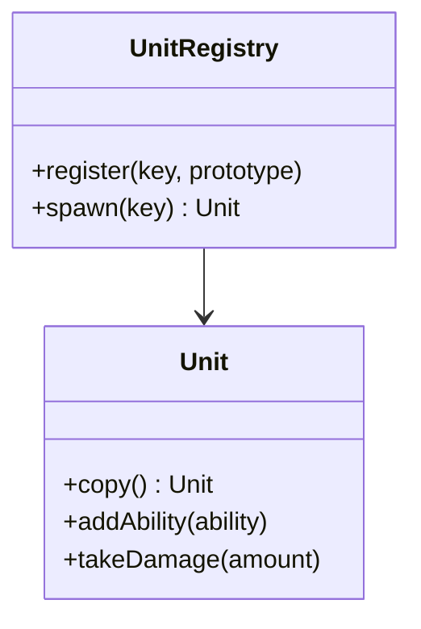

## Overview

Prototype creates new objects by copying a configured instance, instead of building each one from scratch. The caller asks a prototype for a copy, and the copy can change without touching the original. An interviewer wants to hear what gets copied, what stays shared, and why Java's `Cloneable` is avoided.

## What to know

1. Intent and the problem it solves :: Prototype creates objects by copying an existing, configured instance. The problem it solves is setup that is slow or long to repeat: many fields, loaded data, or a template that must be the same for each new object. The caller gets a working copy in one step.

2. Structure and participants :: The prototype declares a copy method. The concrete prototype implements the copy so that changing the copy does not change the original. A registry keeps named prototypes and returns copies on request. The client knows the registry and the copy method. It does not know how each template was configured.

3. A worked example in Java :: The example spawns game units. A goblin template is registered once, with its stats and abilities. Each spawn calls `copy()`, and the copies change on their own. The constructor copies the ability list, so one copy does not change another or the template.

4. When to use it and when not to :: Use it when creating from scratch is costly or when a set of templates is open and grows over time. Do not use it for simple objects, where a constructor is clearer. The main cost is the deep copy. Shared mutable parts, such as lists or references to a connection, must be copied on purpose. An explicit copy method is safer than `Cloneable`.

5. Related patterns and how it shows up in interviews :: Factory method creates an object by class. Prototype creates an object by copying an instance. Memento also stores state, but for undo, while prototype makes a new working object. In interviews it fits game entities, document or invoice templates, and cart or configuration templates. Say what is copied and what is shared.

## Recap

- Prototype: copy a configured object instead of rebuilding it.
- Copy deeply enough that the copy and the template do not share mutable state.
- Keep templates in a registry, and return copies from it.

## Go deeper

### The problem it solves {point: 0}

A game spawns many goblins. Each spawn would set the health, the attack, the sprite, the starting abilities and the loot table again, by hand. When a designer changes the goblin, every spawn site must change too. Copying the setup code into each site makes the goblin type hard to find and easy to set up wrong.

After the change, the goblin is configured once as a template and stored under a name. Each spawn asks for a copy. The designer changes the template in one place. The before version repeats the setup. The after version repeats only the copy.

### Structure {point: 1}

`Unit` is the prototype. It has a `copy()` method that returns a new `Unit` with the same values. The copy gets its own ability list. `UnitRegistry` keeps named templates and returns copies from `spawn(key)`. The client calls `spawn` and never sees how the template was built.



### Example: spawning game units from templates {point: 2}

`main` registers one goblin template. It spawns two goblins, gives one a new ability, and damages the other. The output shows that each copy changed on its own, and the template still has its original values.

```java
import java.util.ArrayList;
import java.util.HashMap;
import java.util.List;
import java.util.Map;

public class Main {
    // Prototype: a configured unit that knows how to copy itself.
    static class Unit {
        private final String type;
        private int hp;
        private final List<String> abilities;

        Unit(String type, int hp, List<String> abilities) {
            this.type = type;
            this.hp = hp;
            this.abilities = new ArrayList<>(abilities);
        }

        // The copy gets its own list, so changes do not leak back to the template.
        Unit copy() {
            return new Unit(type, hp, abilities);
        }

        void addAbility(String ability) {
            abilities.add(ability);
        }

        void takeDamage(int amount) {
            hp = Math.max(0, hp - amount);
        }

        @Override
        public String toString() {
            return type + " hp=" + hp + " abilities=" + abilities;
        }
    }

    // Registry: named templates, returns copies on request.
    static class UnitRegistry {
        private final Map<String, Unit> prototypes = new HashMap<>();

        void register(String key, Unit prototype) {
            prototypes.put(key, prototype);
        }

        Unit spawn(String key) {
            Unit prototype = prototypes.get(key);
            if (prototype == null) {
                throw new IllegalArgumentException("no prototype named " + key);
            }
            return prototype.copy();
        }
    }

    public static void main(String[] args) {
        UnitRegistry registry = new UnitRegistry();
        Unit goblin = new Unit("goblin", 30, List.of("claw"));
        registry.register("goblin", goblin);

        Unit first = registry.spawn("goblin");
        Unit second = registry.spawn("goblin");
        first.addAbility("poison");
        second.takeDamage(12);

        System.out.println(first);
        System.out.println(second);
        System.out.println("template: " + goblin);
    }
}
```

### When to use it and when not to {point: 3}

Use it when the template has a lot of setup, when designers or users create new templates at runtime, or when the object is expensive to build from its inputs. Do not use it for objects with three fields and no setup, where `new` is clearer. Be careful with the copy. A shallow copy shares lists, maps and references, so one copy changes all of them. Java's `Cloneable` and `Object.clone()` are easy to get wrong, because they skip the constructor and need a cast, so an explicit copy method is the usual choice in interviews.

### In interviews {point: 4}

Good places are the game entities in a tower defense or card game problem, and document templates in a document editor. In a vending machine or a parking lot, a template for a recurring setup, such as a monthly pass, can be copied for each customer. Say the force first: "Each spawn needs the same setup, so I would keep one template and copy it."

Prototype is confused with factory method. A factory decides the class and builds from input. A prototype builds from an existing object, so the template holds the configuration. It is also confused with memento. Memento saves a state so the object can go back to it. Prototype makes a new object that can then change in its own direction.

## Interview questions

- What exactly does your copy method copy, and what does it share?
- Why would you use an explicit copy method instead of `Cloneable`?
- When is prototype better than a factory, and when is it worse?

## Common mistakes

- Writing a shallow copy and sharing a mutable list between the template and every copy.
- Forgetting to register a template before spawning from it, which fails only at runtime.
- Using `Object.clone()` without thinking about the cast and the skipped constructor.
- Copying a field that should be fresh for each object, such as an id.
