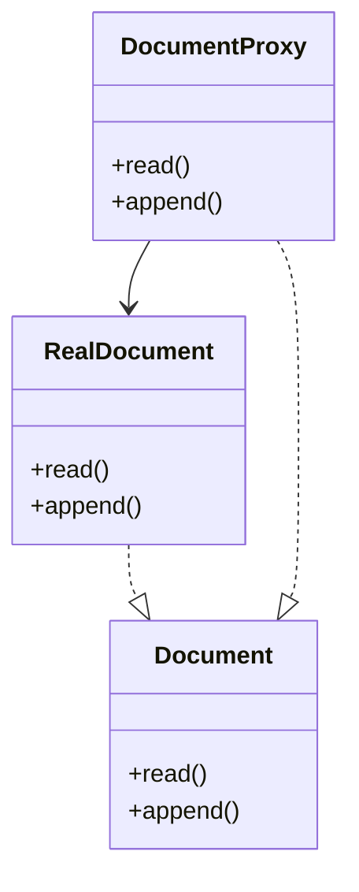

## Overview

Proxy stands in for another object and has the same interface. It can delay creating the real object, check access before a call, cache results, or handle a remote call. An interviewer wants to hear that the proxy and the real object share an interface, and to hear the purpose of the proxy named clearly.

## What to know

1. Intent and the problem it solves :: Proxy controls access to an object. The client uses the proxy as if it were the real object. Without one, access checks, lazy loading or caching spread into every caller. A proxy keeps these concerns in one place.

2. Structure and participants :: The Subject is the interface that both sides implement. The RealSubject does the actual work. The Proxy implements the Subject, holds a reference to the RealSubject, creates it when it is first needed, and checks the rules before it delegates.

3. A worked example in Java :: A document editor opens a document. The proxy checks the reader and editor lists, and it creates the expensive real document only on first use. A blocked call fails before anything is loaded.

4. When to use it and when not to :: Use it for lazy loading, access control, caching, or a stand-in for a remote service. Skip it when the real object is cheap and no rules apply, because the proxy only adds an indirection. Avoid proxies that change behaviour quietly, since callers expect the same results and timing.

5. Related patterns and how it shows up in interviews :: Decorator has the same shape but adds behaviour, while a proxy controls access or creation. Adapter changes the interface. In interviews, Proxy appears in document and file access, image galleries that load on demand, rate-limited API clients, and cache layers in front of a repository.

## Recap

- Proxy has the same interface as the object it stands in for.
- Typical jobs: lazy creation, access checks, caching, remote calls.
- Check access before the expensive work starts.

## Go deeper

### The problem it solves {point: 0}

Code that opens a document has to check permissions, load the file from disk and then read the text. Every caller repeats these steps. Some callers forget the check, and the expensive load happens even when the user is then blocked. Changing the rules means editing every caller. A proxy moves the check and the lazy load into one class that looks like the document itself.

### Structure {point: 1}

Document is the Subject interface with read and append. RealDocument is the RealSubject. Its constructor loads the content, which is the expensive step. DocumentProxy implements Document. It holds the reader and editor sets and a reference to a RealDocument that starts as null. It checks access, creates the real document when needed, and then delegates.



### Example: Lazy, access-checked documents in an editor {point: 2}

The demo creates a proxy and prints a line before any loading happens. A reader gets the content, which loads the real document. An editor appends text. A user who is only a reader is blocked from editing, and an unknown user is blocked from reading.

```java
import java.util.Set;

public class Main {

    // Subject: the real document and the proxy both implement this.
    interface Document {
        String read(String user);
        void append(String user, String text);
    }

    // Real subject: expensive to create, because it loads the file.
    static class RealDocument implements Document {
        private final StringBuilder body = new StringBuilder();

        RealDocument(String id) {
            System.out.println("Loading " + id + " from disk (expensive)");
            body.append("contents of ").append(id);
        }

        @Override
        public String read(String user) {
            return body.toString();
        }

        @Override
        public void append(String user, String text) {
            body.append(' ').append(text);
        }
    }

    // Proxy: same interface. Checks access first, then creates the real document on first use.
    static class DocumentProxy implements Document {
        private final String id;
        private final Set<String> readers;
        private final Set<String> editors;
        private RealDocument real; // created lazily; this demo is single-threaded

        DocumentProxy(String id, Set<String> readers, Set<String> editors) {
            this.id = id;
            this.readers = readers;
            this.editors = editors;
        }

        private RealDocument real() {
            if (real == null) {
                real = new RealDocument(id);
            }
            return real;
        }

        @Override
        public String read(String user) {
            if (!readers.contains(user)) {
                throw new SecurityException(user + " cannot read " + id);
            }
            return real().read(user);
        }

        @Override
        public void append(String user, String text) {
            if (!editors.contains(user)) {
                throw new SecurityException(user + " cannot edit " + id);
            }
            real().append(user, text);
        }
    }

    public static void main(String[] args) {
        Document doc = new DocumentProxy("design-doc", Set.of("ana", "ravi"), Set.of("ana"));
        System.out.println("Proxy created, nothing loaded yet");

        System.out.println(doc.read("ravi"));
        doc.append("ana", "Reviewed on Monday.");
        System.out.println(doc.read("ana"));

        try {
            doc.append("ravi", "Edit attempt");
        } catch (SecurityException e) {
            System.out.println("Blocked: " + e.getMessage());
        }
        try {
            doc.read("mallory");
        } catch (SecurityException e) {
            System.out.println("Blocked: " + e.getMessage());
        }
    }
}
```

### When to use it and when not to {point: 3}

Use a proxy when a call needs a rule that should not live in the caller, such as an access check, a cache, or a delay before an expensive load. Signals include a slow constructor, a remote service, or a permission model that every caller must follow. Costs are one more class, one more call per use, and surprises when a call that looked cheap is slow. If one caller needs one check, a plain check in a service method is simpler.

### In interviews {point: 4}

Documents and files are a common LLD topic, and a proxy is a natural way to show access control and lazy loading. An image gallery can show a light placeholder until the real image loads. A rate-limited API client can be a proxy that counts calls. A cache in front of a repository is a proxy too. Java has examples in the standard library: Collections.unmodifiableList returns a view that refuses changes, which is a proxy with a restricted interface. Proxy is often confused with Decorator, which has the same structure but adds behaviour. It is also confused with Facade. A proxy stands in for one object with the same interface, while a facade gives a new, simpler interface over several objects.

## Interview questions

- How is a proxy different from a decorator?
- If the document also has a cache, where should the access check go?
- What would you change so the proxy works across a network?

## Common mistakes

- Giving the proxy a different interface, so callers must know it is a proxy.
- Loading the expensive object before the access check runs.
- Forgetting that lazy creation is not thread-safe unless it is guarded.
- Using a proxy where a single method call would do.
