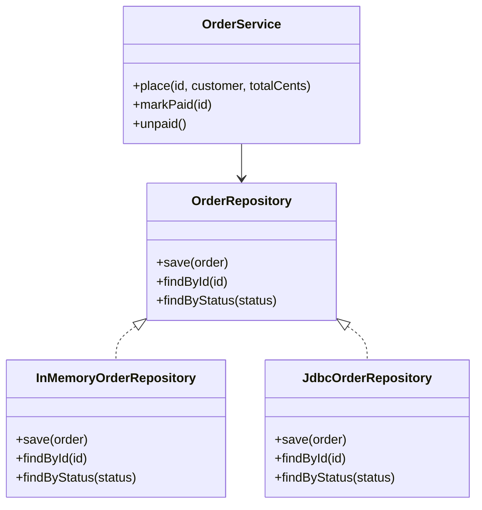

## Overview

Repository hides how objects are stored behind a collection-like interface. The service asks for orders by id or by status, and does not know whether the data is in memory, in SQL or in a remote API. It separates the business rules from the storage details. An interviewer wants to hear the interface the service needs, the in-memory version used for tests, and where the boundary sits.

## What to know

1. Intent and the problem it solves :: Business code that writes SQL or file access directly mixes rules with storage. Changing the database or testing the rules then means touching many classes. Repository gives the rules one interface for save and find, so storage can change without changing the rules.
2. Structure and participants :: The repository interface lists the queries the domain needs, such as save, findById and findByStatus. A concrete repository implements the interface for one storage choice. The service depends on the interface and receives the repository in its constructor.
3. A worked example in Java :: An order service with an in-memory order repository. The service places orders, marks them paid and lists unpaid ones. The example runs without a database, and the same service would work with a SQL repository.
4. When to use it and when not to :: Use it when the domain logic is more than a few lines and needs tests without a database, or when storage may change. Do not add it to a small script or a single table app where the ORM is already the abstraction. Keep the interface small, shaped by the queries the domain needs, not by every database feature.
5. Related patterns and how it shows up in interviews :: Repository often sits behind a Facade or a service, and it is created with Dependency injection. Compare it with DAO, which is close in purpose but usually lower level and table-shaped. It shows up in parking lot, library, order and inventory problems, where the rules must be tested without a real database.

## Recap

- Repository: one interface for save and find, hiding the storage choice.
- The service depends on the interface, so tests can use an in-memory version.
- Keep the interface shaped by the queries the domain needs.

## Go deeper

### The problem it solves {point: 0}

An order service writes SQL in the middle of its rules. "Mark an order paid" opens a connection, builds a query, reads a row and checks the status. To test the rule that a paid order cannot be paid again, the test needs a running database. Changing the table layout means changing the rules. Two services that need the same query copy the SQL, and the copies drift apart.

### Structure {point: 1}

OrderRepository declares save, findById and findByStatus. InMemoryOrderRepository keeps orders in a map and is used in tests and demos. JdbcOrderRepository would implement the same interface with SQL. OrderService holds an OrderRepository and calls only the interface. The composition root creates the chosen implementation and passes it in.



### Example: Order service with an in-memory repository {point: 2}

The service places two orders, marks one as paid, and lists the unpaid orders. It never touches a map or SQL. The in-memory repository keeps orders in insertion order. A missing order id causes the service to throw a clear error, and the repository reports absence with Optional.

```java
import java.util.ArrayList;
import java.util.LinkedHashMap;
import java.util.List;
import java.util.Map;
import java.util.Optional;

public class Main {

    record Order(String id, String customer, int totalCents, String status) { }

    interface OrderRepository {
        void save(Order order);
        Optional<Order> findById(String id);
        List<Order> findByStatus(String status);
    }

    static class InMemoryOrderRepository implements OrderRepository {
        private final Map<String, Order> rows = new LinkedHashMap<>();

        public void save(Order order) {
            rows.put(order.id(), order);
        }

        public Optional<Order> findById(String id) {
            return Optional.ofNullable(rows.get(id));
        }

        public List<Order> findByStatus(String status) {
            List<Order> found = new ArrayList<>();
            for (Order order : rows.values()) {
                if (order.status().equals(status)) {
                    found.add(order);
                }
            }
            return found;
        }
    }

    static class OrderService {
        private final OrderRepository orders;

        OrderService(OrderRepository orders) {
            this.orders = orders;
        }

        void place(String id, String customer, int totalCents) {
            orders.save(new Order(id, customer, totalCents, "PLACED"));
        }

        void markPaid(String id) {
            Order order = orders.findById(id)
                .orElseThrow(() -> new IllegalArgumentException("No order " + id));
            orders.save(new Order(order.id(), order.customer(), order.totalCents(), "PAID"));
        }

        List<Order> unpaid() {
            return orders.findByStatus("PLACED");
        }
    }

    public static void main(String[] args) {
        OrderService service = new OrderService(new InMemoryOrderRepository());

        service.place("o-1", "Asha", 4500);
        service.place("o-2", "Ben", 1200);
        service.markPaid("o-1");

        System.out.println("Unpaid: " + service.unpaid());

        try {
            service.markPaid("o-9");
        } catch (IllegalArgumentException e) {
            System.out.println("Error: " + e.getMessage());
        }
    }
}
```

### When to use it and when not to {point: 3}

Use Repository when the domain rules need unit tests without a database, when more than one storage option is plausible, or when several services share the same queries. The cost is an extra interface and a mapping layer between rows and domain objects. Do not wrap a database that already is a clean abstraction, such as a framework repository, in a second layer just for show. Also avoid one repository method per SQL statement. Shape the interface around what the domain asks for.

### In interviews {point: 4}

Name Repository when the question has entities that must be saved and found: orders in a shop, vehicles and tickets in a parking lot, books and members in a library. Show the interface first, then the in-memory version for the interview code, and say that a database version would implement the same interface. Compare it with DAO. DAO is usually one class per table with low-level methods, while Repository speaks in domain terms and returns domain objects. Mention that the repository is injected through the constructor, which connects it to Dependency injection.

### Modern Java

Records make the domain objects immutable and easy to compare. Optional marks absence in the repository return type. Use a record for an entity when its fields do not change, and create a new record for each change, as the example does with markPaid.

## Interview questions

- What does a Repository hide, and what should it never expose?
- Why is an in-memory repository useful in an interview or in tests?
- How is a Repository different from a DAO?
- Which queries should the interface contain, and how do you decide?

## Common mistakes

- Returning database rows or SQL types from the repository instead of domain objects.
- Adding one method for every table column, so the interface becomes the database.
- Putting business rules inside the repository, such as the check that a paid order cannot be paid again.
- Returning null for a missing entity instead of Optional or an exception.
