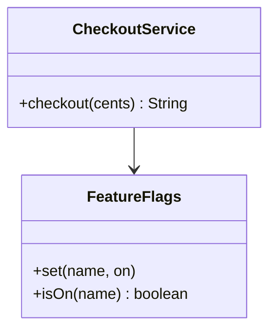

## Overview

Singleton makes sure a class has exactly one instance, and gives one place to reach it. It fits a shared resource that must not be duplicated, such as a feature flag store. An interviewer wants to hear the costs of the pattern, not only its shape, and how the instance would be injected instead.

## What to know

1. Intent and the problem it solves :: Singleton ensures one instance of a class exists and gives one access point to it. The problem it solves is a resource that must be shared, such as configuration, a metrics sink or a rate-limiter registry, and that breaks when two copies exist. Interviewers want to hear the costs as well as the shape.

2. Structure and participants :: A classic singleton has a private constructor, a static instance and a static accessor. In Java, an enum with one constant is the safest form. The JVM creates it once, creation is thread-safe, and it resists reflection and serialization tricks. Clients use the constant or the accessor directly.

3. A worked example in Java :: The example keeps feature flags in an enum singleton. The checkout service reads a flag from the singleton. The flag map is concurrent, so a flag can change while requests run. The example also checks that the constant is the same object each time.

4. When to use it and when not to :: Use it for one real shared resource that must be unique in the process, such as one configuration store. Avoid it for state that belongs to a test or a request, and avoid it as a shortcut to avoid passing a dependency. Singletons hide dependencies and are hard to replace in tests. Creating one instance at startup and passing it in is usually better.

5. Related patterns and how it shows up in interviews :: Object pool holds several instances and lends them out, while singleton holds exactly one. Factories often return a shared instance, so a singleton can be one factory. In interviews, mention singleton when a design has one config, one logger or one rate-limiter registry, and then explain how you would inject it. It is often the wrong answer when the interviewer asks about testability.

## Recap

- Singleton: one instance, one access point, and a cost in hidden global state.
- In Java, an enum with one constant is the safest form.
- Prefer creating one instance at startup and injecting it.

## Go deeper

### The problem it solves {point: 0}

A checkout service reads feature flags from a global variable that a settings page writes. Two copies of the flag store would give two answers, so a flag turned on in one place is off in another. A developer who needs the flags in a test has no way to replace them, because the code reads the global directly.

With a singleton, there is one store and one way to reach it. That fixes the two-copies problem. The test problem remains, and the next section shows how injecting the same store avoids it. The before version has many copies or hidden globals. The after version has one instance with a clear access point.

### Structure {point: 1}

`FeatureFlags` is the singleton. It is an enum with one constant, `INSTANCE`. It holds a concurrent map of flags. `CheckoutService` is a client. It reads the constant directly. A test could not replace the store without changing the class, which is the cost to mention in an interview.



### Example: feature flags for checkout {point: 2}

`main` turns on a coupon flag, runs checkout, turns the flag off, and runs checkout again. The last line checks that the enum constant is the same object when read by name. That is the guarantee the pattern gives.

```java
import java.util.Map;
import java.util.concurrent.ConcurrentHashMap;

public class Main {
    // An enum with one constant: created once by the JVM, safe to share between threads.
    enum FeatureFlags {
        INSTANCE;

        private final Map<String, Boolean> flags = new ConcurrentHashMap<>();

        void set(String name, boolean on) {
            flags.put(name, on);
        }

        boolean isOn(String name) {
            return flags.getOrDefault(name, false);
        }
    }

    static class CheckoutService {
        String checkout(int cents) {
            if (FeatureFlags.INSTANCE.isOn("coupons")) {
                return "checkout with coupons: " + cents + " cents";
            }
            return "checkout: " + cents + " cents";
        }
    }

    public static void main(String[] args) {
        FeatureFlags.INSTANCE.set("coupons", true);
        System.out.println(new CheckoutService().checkout(1_250));

        FeatureFlags.INSTANCE.set("coupons", false);
        System.out.println(new CheckoutService().checkout(1_250));

        System.out.println("same instance: " + (FeatureFlags.INSTANCE == FeatureFlags.valueOf("INSTANCE")));
    }
}
```

### When to use it and when not to {point: 3}

Use it when the process must have exactly one of a resource, such as one connection pool or one metrics registry, and creating two would be a bug. Do not use it when the object holds per-test or per-request state. Do not use it so that classes can reach a dependency without asking for it. That hides the dependency and makes the code harder to test. The better design creates the instance once in `main` or in a composition root, and passes it to the classes that need it.

### In interviews {point: 4}

Name the shared resource in the problem. In a parking lot, a single entry gate controller or a rate-limited ticket counter. In a vending machine, a single inventory store. Say the cost before the pattern: "I would keep one instance, but I would inject it so tests can replace it."

Singleton is confused with a static utility class. A utility class has no state and no instance. A singleton has one instance with state, and the state can be passed around. It is also confused with object pool. A pool holds many objects and lends them out, while a singleton holds one object and always gives the same one.

## Interview questions

- Why is an enum a good way to write a singleton in Java?
- What makes a singleton hard to test, and how would you fix that?
- When would you use a singleton, and when would you inject one instance instead?

## Common mistakes

- Using a singleton as a global variable, with no thought about who depends on it.
- Writing a lazy singleton with a plain null check, which is not thread-safe.
- Keeping per-request data in a singleton, so requests see each other's data.
- Calling the singleton from inside the class under test, where a fake cannot be placed.
