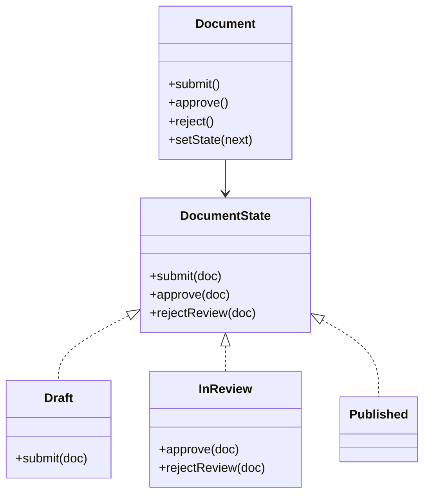

## Overview

State lets an object change its behaviour when its internal state changes. Each state is a class that handles the events allowed in that state and moves the object to the next state. It replaces large switch statements on a state enum. An interviewer wants you to name the states, draw the legal transitions, and say where illegal actions are rejected.

## What to know

1. Intent and the problem it solves :: An object acts differently depending on its state, such as a document that is a draft, in review, or published. Without State, every method holds a switch on the state, and the rules are spread across the class. State puts the rules for each state into its own class.
2. Structure and participants :: The context keeps a reference to the current state object and forwards each event to it. The state interface declares the events. Each concrete state implements the events it allows and tells the context when to move to the next state.
3. A worked example in Java :: A document workflow with the states Draft, In review and Published. A draft can be submitted, a document in review can be approved or sent back, and a published document accepts no changes. The example prints each transition and rejects illegal ones.
4. When to use it and when not to :: Use it when behaviour depends on the state, each state has its own rules, and transitions matter. Do not use it for two or three flags with trivial rules, because an enum and a small transition table are clearer. Many tiny state classes can also make the flow harder to follow.
5. Related patterns and how it shows up in interviews :: State and Strategy have the same shape, but in State the object changes its own state through transitions, while in Strategy the client picks the algorithm from outside. State shows up in the elevator, vending machine and order lifecycle problems. Say which transitions are legal before you write any classes.

## Recap

- State: behaviour follows the current state object, one class per state.
- Each transition is explicit, so illegal moves are easy to find.
- Prefer a plain enum with a transition table when the rules are short.

## Go deeper

### The problem it solves {point: 0}

Without State, a document class has one method per event, and each method switches on a status field. Adding a new status means editing every method. The rule "only a reviewed document can be published" lives in one switch, and the rule "only a draft can be submitted" lives in another. A missed case in one switch is a bug that only shows up at runtime.

### Structure {point: 1}

The context is the Document. It holds the current DocumentState and forwards submit, approve and reject to it. The DocumentState interface declares those events. Draft, InReview and Published implement the events they allow. A state that does not allow an event throws an IllegalStateException through a default method in the interface. A state changes the document by calling a method on the context, so the context controls the transition.



### Example: Document review workflow {point: 2}

The example models a document with three states. A Draft can be submitted for review. An InReview document can be approved, which publishes it, or rejected, which returns it to Draft. A Published document accepts no further events. The Document class only forwards calls, so all the rules sit in the state classes.

```java
public class Main {

    interface DocumentState {
        String name();

        default void submit(Document doc) { illegal("submit"); }
        default void approve(Document doc) { illegal("approve"); }
        default void rejectReview(Document doc) { illegal("reject"); }

        default void illegal(String action) {
            throw new IllegalStateException(action + " is not allowed in " + name());
        }
    }

    static class Draft implements DocumentState {
        public String name() { return "DRAFT"; }
        public void submit(Document doc) { doc.setState(new InReview()); }
    }

    static class InReview implements DocumentState {
        public String name() { return "IN_REVIEW"; }
        public void approve(Document doc) { doc.setState(new Published()); }
        public void rejectReview(Document doc) { doc.setState(new Draft()); }
    }

    static class Published implements DocumentState {
        public String name() { return "PUBLISHED"; }
    }

    static class Document {
        private final String title;
        private DocumentState state = new Draft();

        Document(String title) { this.title = title; }

        void setState(DocumentState next) {
            System.out.println(title + ": " + state.name() + " -> " + next.name());
            state = next;
        }

        void submit() { state.submit(this); }
        void approve() { state.approve(this); }
        void reject() { state.rejectReview(this); }
        String status() { return state.name(); }
    }

    public static void main(String[] args) {
        Document doc = new Document("Design notes");

        try {
            doc.approve();                       // not allowed in DRAFT
        } catch (IllegalStateException e) {
            System.out.println("Rejected: " + e.getMessage());
        }

        doc.submit();                            // DRAFT -> IN_REVIEW
        doc.reject();                            // IN_REVIEW -> DRAFT
        doc.submit();                            // DRAFT -> IN_REVIEW
        doc.approve();                           // IN_REVIEW -> PUBLISHED

        try {
            doc.submit();                        // not allowed after publishing
        } catch (IllegalStateException e) {
            System.out.println("Rejected: " + e.getMessage());
        }
        System.out.println("Final status: " + doc.status());
    }
}
```

### When to use it and when not to {point: 3}

Use State when an object has several states, each state has different rules for the same events, and the transitions need to be easy to read and test. The cost is one class per state and a few more files. The simpler alternative is an enum with a transition table, for example a Map from current status and event to the next status. That is enough when the only question is whether a move is allowed. Do not add State classes just to avoid one if statement.

### In interviews {point: 4}

Name State when the problem has a lifecycle. In a vending machine the states are Idle, HasCredit and Dispensing. In an elevator they are moving, idle, door open and maintenance. In a parking lot a ticket or spot can move through reserved, occupied and free. Interviewers often ask Strategy vs State: in Strategy the client chooses the algorithm and it does not change by itself, while in State the object moves between states as events happen. Mention that a state object may be shared when it holds no data.

### Modern Java

For a small, fixed set of states, an enum with a method per event works well. Each constant can have its own body that overrides the method, which gives the State shape without extra files. Use this form in an interview when the states are simple.

## Interview questions

- How is State different from a switch on an enum, and when is each better?
- Who decides the next state, the client or the state object itself?
- How would you test each state on its own?
- What should happen if two events arrive at the same time?

## Common mistakes

- Keeping the switch in the context, so the state classes only hold names.
- Letting a state set the context field directly instead of using one transition method.
- Storing shared data inside each state object instead of in the context.
- Creating a new state object on every call when the state holds no data. Use one shared instance.
