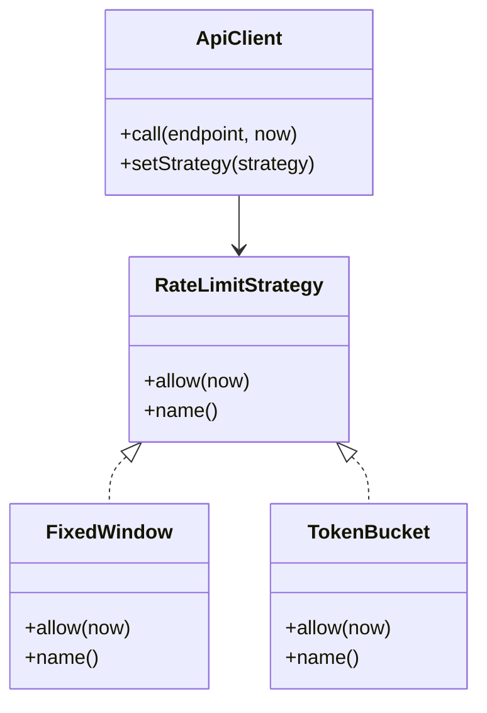

## Overview

Strategy puts a family of interchangeable algorithms behind one interface. The client picks one algorithm and the context calls it without knowing which one it is. It replaces conditionals on a type or mode flag. An interviewer wants to hear where the algorithm varies, how a new algorithm is added without touching the context, and how the choice is made.

## What to know

1. Intent and the problem it solves :: One class has an algorithm that varies by rule, such as a rate limiter that may use a fixed window or a token bucket. Without Strategy, the class grows an if or switch for each rule, and every new rule edits the same class. Strategy moves each rule into its own class behind one interface.
2. Structure and participants :: The strategy interface declares the operation. Concrete strategies implement it with one algorithm each. The context holds a strategy reference, calls it when it needs the result, and can have the strategy replaced at runtime.
3. A worked example in Java :: A rate limiter for an API client, with a fixed window strategy and a token bucket strategy. The client makes the same calls, and the example switches strategy in the middle of the run. The output shows which calls are allowed or throttled.
4. When to use it and when not to :: Use it when the algorithm varies independently of the code that calls it, and when you expect new variants. Do not use it when there is only one algorithm that is not likely to change, because an interface with one implementation adds noise. A plain method or a lambda is often enough.
5. Related patterns and how it shows up in interviews :: Strategy looks like State, but the client chooses the strategy from outside, while State changes itself through transitions. It is related to Template method, which varies steps inside a fixed flow by inheritance instead of composition. It shows up in pricing, matching, rate limiting and elevator scheduling problems.

## Recap

- Strategy: one interface, many interchangeable algorithms, chosen by the client.
- Adding a rule means adding a class, not editing the context.
- A lambda works when the algorithm is a single method and has no state.

## Go deeper

### The problem it solves {point: 0}

Suppose an API client needs a rate limit. The first version uses a fixed window with a counter. Then the team wants a token bucket that allows short bursts. Without Strategy, the client gets a field called mode, and every method checks it with an if. The window logic and the bucket logic end up in one class with shared fields that only make sense for one mode. Testing one algorithm means building the whole client.

### Structure {point: 1}

RateLimitStrategy declares allow(now). FixedWindow and TokenBucket each implement it and keep their own state. ApiClient is the context. It keeps one RateLimitStrategy, calls allow() for each request, and provides setStrategy() to swap the algorithm. The context never checks which concrete class it has.



### Example: Rate limiter for an API client {point: 2}

The client sends calls at given times in milliseconds. The first strategy allows two calls per one-second window. Then the client switches to a token bucket that holds two tokens and refills one token per second. Each strategy keeps its own fields, and the client only calls allow(). The output shows the strategy name each time it changes.

```java
public class Main {

    interface RateLimitStrategy {
        boolean allow(long nowMillis);
        String name();
    }

    static class FixedWindow implements RateLimitStrategy {
        private final int limit;
        private final long windowMillis;
        private long windowStart = -1;
        private int count;

        FixedWindow(int limit, long windowMillis) {
            this.limit = limit;
            this.windowMillis = windowMillis;
        }

        public boolean allow(long now) {
            if (windowStart < 0 || now - windowStart >= windowMillis) {
                windowStart = now;
                count = 0;
            }
            if (count < limit) {
                count++;
                return true;
            }
            return false;
        }

        public String name() { return "fixed window"; }
    }

    static class TokenBucket implements RateLimitStrategy {
        private final double capacity;
        private final double refillPerMilli;
        private double tokens;
        private long last = 0;

        TokenBucket(double capacity, double refillPerSecond) {
            this.capacity = capacity;
            this.refillPerMilli = refillPerSecond / 1000.0;
            this.tokens = capacity;
        }

        public boolean allow(long now) {
            tokens = Math.min(capacity, tokens + (now - last) * refillPerMilli);
            last = now;
            if (tokens >= 1) {
                tokens -= 1;
                return true;
            }
            return false;
        }

        public String name() { return "token bucket"; }
    }

    static class ApiClient {
        private RateLimitStrategy strategy;

        ApiClient(RateLimitStrategy strategy) {
            this.strategy = strategy;
        }

        void setStrategy(RateLimitStrategy next) {
            this.strategy = next;
            System.out.println("-- switched to " + next.name());
        }

        void call(String endpoint, long now) {
            boolean ok = strategy.allow(now);
            System.out.printf("t=%5d %-10s %s%n", now, endpoint, ok ? "allowed" : "throttled");
        }
    }

    public static void main(String[] args) {
        ApiClient client = new ApiClient(new FixedWindow(2, 1000));
        System.out.println("-- using " + "fixed window");
        client.call("/search", 0);
        client.call("/search", 100);
        client.call("/search", 200);      // third call in the same window
        client.call("/search", 1000);     // a new window starts

        client.setStrategy(new TokenBucket(2, 1));
        client.call("/search", 1100);
        client.call("/search", 1101);
        client.call("/search", 1102);
    }
}
```

### When to use it and when not to {point: 3}

Use Strategy when the same operation has more than one rule and the rules change often or are chosen by configuration. Each strategy can be tested alone with a plain input and output. The cost is one more interface and one class per variant. If the choice is a fixed flag with two branches that never change, a conditional is simpler. A lambda is enough when the variant is a single function with no state of its own, such as a comparator.

### In interviews {point: 4}

Name Strategy when the question says the rule will change: pricing by hour or flat rate in the parking lot, a matching rule in a ride-hailing app, a scheduling policy in the elevator, or a rate limit in an API. Say which part is the context and which part is the strategy. Interviewers often compare it with State, because both use an interface and a delegate. The difference is that the client picks a strategy, while a state object moves itself to the next state. Strategy is also the usual answer to "how do you add a new payment method without editing checkout".

### Modern Java

A functional interface with one method can be a strategy. Comparator is a standard example: Collections.sort(list, comparator) takes the algorithm as a parameter. Use a lambda when the strategy has no state, and a class when it keeps counters or windows as the example does.

## Interview questions

- How does Strategy remove a switch on a type or mode field?
- What is the difference between Strategy and State?
- Where does the client choose the strategy, and can it change at runtime?
- When would you pass a lambda instead of writing a class?

## Common mistakes

- Creating a strategy interface with only one implementation and no plan for another.
- Letting the strategy read or change fields of the context, which couples the two again.
- Making the strategy hold shared state that should belong to the context, such as the request count of a user.
- Choosing the strategy with a switch inside the context, which only moves the conditional.
